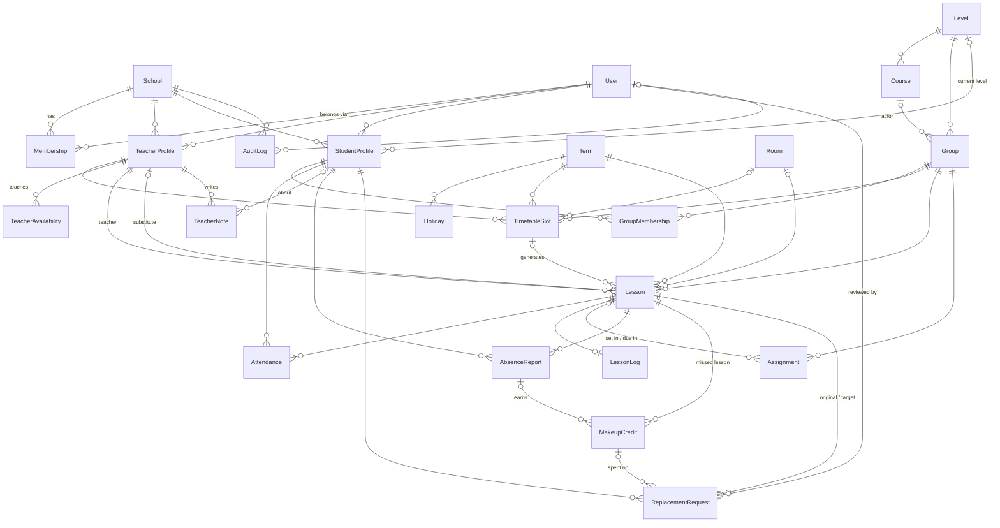

# Data model (Phases 1–3)

Source of truth: `prisma/schema.prisma`. This page explains the shape and the
rules that are not obvious from the schema alone.

## Tenancy

- `School` is the tenant. Every other table except `User` carries `school_id`
  (indexed via `@@unique([schoolId, id])` and further composite indexes).
- `User` is global so one person can belong to several schools. What a user
  may do in a school comes from `Membership` (`ADMIN` / `TEACHER` / `STUDENT`;
  one row per role, so an admin can also teach).
- **Cross-school references are impossible at the DB level.** Each
  tenant-owned table has a unique `(school_id, id)` and every relation between
  tenant-owned tables is a composite foreign key `(school_id, x_id) →
x(school_id, id)`. A `Lesson` of school A cannot point at a `Group` of
  school B — Postgres rejects it. `src/server/data-model.test.ts` fails if a
  new relation skips this.
- References to `User` (`recordedBy`, `reportedBy`, `reviewedBy`, audit
  `actor`) are plain FKs; membership in the school is checked server-side.
- Queries must still always filter by `schoolId` (the FK only guarantees
  consistency, not scoping).

## Time

- Weekdays are ISO 8601: 1 = Monday … 7 = Sunday.
- Recurring times (`TimetableSlot`, `TeacherAvailability`) are **minutes since
  midnight** in the school's timezone (`School.timezone`, IANA name). E.g.
  17:30 → `1050`.
- Concrete `Lesson.startsAt/endsAt` are absolute instants (`timestamptz`).
  `src/server/timetable/generate-lessons.ts` converts slots to lessons and
  keeps local wall-clock time across DST changes.
- Calendar days (`Term`, `Holiday`, `TeacherAvailability.date`,
  `Assignment.dueDate`) are `date` columns; ranges are inclusive.

## Timetable → lessons

`TimetableSlot` is a weekly template (group, teacher, room, weekday, start/end)
within a `Term`. Lessons are generated per term from the slots, skipping
`Holiday` days. `Lesson` is unique per `(timetable_slot_id, starts_at)`, so
regenerating is idempotent. Ad-hoc lessons have no slot. `Term.timetablePublishedAt`
null means the timetable is a draft (not shown to students).

A lesson keeps its regular `teacher`; `substituteTeacher` is set when someone
else teaches that instance (Phase 5 builds the workflow on top of this).

Attendance, lesson logs (one per lesson), homework (`Assignment`, set in one
lesson and due by a lesson and/or date), teacher notes, absence reports and
replacements all attach to `Lesson` instances.

## Absences & replacements

1. Student files an `AbsenceReport` for a lesson (unique per lesson+student).
2. That earns a `MakeupCredit` (`AVAILABLE` → `USED` / `EXPIRED`), unique per
   student + missed lesson.
3. The student books a `ReplacementRequest`: original lesson → target lesson
   of **the same level** (validated server-side against
   `StudentProfile.level` / `Group.level`). It is created `AUTO_APPROVED`; an
   admin can later set `APPROVED`, `REJECTED` or `OVERRIDDEN`, recording
   `reviewedBy`, `reviewedAt` and `reviewNote`.

## Teacher availability

`TeacherAvailability.kind`:

| Kind                 | Fields used                                | Meaning                                  |
| -------------------- | ------------------------------------------ | ---------------------------------------- |
| `WEEKLY_UNAVAILABLE` | `weekday`, `startMinute`, `endMinute`      | Every week in that window                |
| `DATE_UNAVAILABLE`   | `date`, optional `startMinute`/`endMinute` | One-off; whole day when minutes are null |
| `DATE_AVAILABLE`     | `date`, optional `startMinute`/`endMinute` | One-off exception to a weekly rule       |

## Privacy

`TeacherNote` is internal: readable by teachers and admins only, never by
students. The schema cannot enforce this — every read path in `src/server`
must, and must be covered by tests.

## Integrity rules in the migration

Prisma does not model CHECK constraints, so these live in
`prisma/migrations/*_phase1_3_data_model/migration.sql`:

- group capacity ≥ 1, and exactly 1 for `ONE_ON_ONE`; room capacity ≥ 1
- term / holiday `start_date ≤ end_date`
- slot weekday 1–7, `0 ≤ start_minute < end_minute ≤ 1440`
- availability shape matches its `kind` (see table above)
- lesson `starts_at < ends_at`; substitute ≠ regular teacher
- assignment has a due lesson or a due date
- teacher note is about a student, group or lesson
- replacement target ≠ original lesson

## Soft delete

Only `User.deletedAt` and `Group.deletedAt` — history (lessons, attendance)
must survive when a person leaves or a group is closed. Everything else is
hard-deleted; `onDelete` is `Restrict` wherever a delete would lose history.

## ER diagram

Every box except `User` also has `School ||--o{ X` — omitted for readability.

## Demo seed

`pnpm db:seed` (idempotent — deterministic UUIDs + upserts) creates
"Demo Language School" (Europe/Bratislava): 1 admin, 8 teachers (some with
weekly/one-off unavailability), 40 students, levels A1–C1, 6 courses, 10 groups
and 3 1-on-1s, 4 physical rooms + 1 online room, term "Autumn 2026" with
holidays, a published timetable and lessons generated 2026-09-14 → 2026-11-08.
Lessons before 2026-10-14 are `COMPLETED`; the last two weeks have attendance
and lesson logs. Also: homework, teacher notes, one substitution, one cancelled
lesson, absences with makeup credits and two replacements (auto-approved and
overridden). Fixtures live in `prisma/seed/data.ts`.
