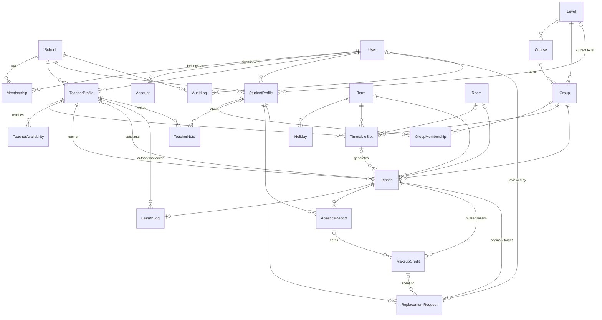

# Data model (Phases 1–3)

Source of truth: `prisma/schema.prisma`. This page explains the shape and the
rules that are not obvious from the schema alone.

## Tenancy

- `School` is the tenant. Every other table except `User` and the Auth.js
  tables (`Account`, `VerificationToken`) carries `school_id`
  (indexed via `@@unique([schoolId, id])` and further composite indexes).
- `User` has no `school_id` (sign-in finds the user by email before a school
  is known), but **every user belongs to exactly one school**: one
  `Membership` per user (unique `user_id`, decision 2026-10-14, see
  [multi-school-users.md](multi-school-users.md)). The membership holds the
  user's role (`ADMIN` / `TEACHER` / `STUDENT`, one role per user). Authorization reads this row, never the existence of a
  Teacher/StudentProfile.
- **Cross-school references are impossible at the DB level.** Each
  tenant-owned table has a unique `(school_id, id)` and every relation between
  tenant-owned tables is a composite foreign key `(school_id, x_id) →
x(school_id, id)`. A `Lesson` of school A cannot point at a `Group` of
  school B — Postgres rejects it. `src/server/data-model.test.ts` fails if a
  new relation skips this.
- References to `User` (`recordedBy`, `reportedBy`, `reviewedBy`, audit
  `actor`) are plain FKs; membership in the school is checked server-side.
- Queries must still always filter by `schoolId` (the FK only guarantees
  consistency, not scoping). Use `getSchoolScopedDb()`
  (`src/server/auth/session.ts`), which adds the signed-in school to every
  query and throws on attempts to touch another school.

## Authentication

- `User.email` is stored lower-cased (CHECK constraint); `User.passwordHash`
  is a bcrypt hash (null = no password sign-in). A soft-deleted user
  (`deletedAt`) cannot sign in.
- Sessions are stateless JWT cookies (Auth.js) holding user id, school id and
  role; every request re-reads the `Membership`, so role changes and removals
  apply immediately.
- `Account` and `VerificationToken` follow the `@auth/prisma-adapter` shape
  so OAuth / magic-link providers can be added later; unused for now.

## Time

- Weekdays are ISO 8601: 1 = Monday … 7 = Sunday.
- Recurring times (`TimetableSlot`, `TeacherAvailability`) are **minutes since
  midnight** in the school's timezone (`School.timezone`, IANA name). E.g.
  17:30 → `1050`.
- Concrete `Lesson.startsAt/endsAt` are absolute instants (`timestamptz`).
  `src/server/scheduling/generate-lessons.ts` converts slots to lessons and
  keeps local wall-clock time across DST changes.
- Calendar days (`Term`, `Holiday`, `TeacherAvailability.date`,
  `TimetableSlot.validFrom/validUntil`) are `date`
  columns; ranges are inclusive.
- `School.teachingWeekdays` (default Mon–Sat) and
  `School.dayStartMinute`/`dayEndMinute` (default 07:00–21:00) are the
  school's normal teaching week; the conflict checker warns outside them.

## Timetable → lessons

`TimetableSlot` is a weekly template (group, teacher, room, weekday, start/end)
within a `Term`, in effect from `validFrom` to `validUntil` (null = term
bounds). Lessons are generated per term from the slots, skipping `Holiday`
days (the term's own and the school-wide ones). Editing or ending a slot in a
published term, conflict checks and lesson regeneration are described in
[scheduling.md](scheduling.md). Generated lessons store the slot's local date in
`occurrence_date` and are unique per `(timetable_slot_id, occurrence_date)`,
so regenerating is idempotent even after a slot or a single lesson has been
moved to another time (CHECK: generated lessons must have an
`occurrence_date`). Ad-hoc lessons have neither. `Term.timetablePublishedAt`
null means the timetable is a draft (not shown to students).

A lesson keeps its regular `teacher`; `substituteTeacher` is set when someone
else teaches that instance (Phase 5 builds the workflow on top of this).

The lesson log (one per lesson: _what we covered_ plus the homework for the
next lesson, either of them optional but not both), teacher notes, absence
reports and replacements all attach to `Lesson` instances. There is no
attendance tracking and no separate homework model (owner decision
2026-10-14, `docs/design/lessons.md`). `LessonLog.updatedById` and
`updatedAt` record the last save; `updatedAt` is the edit-conflict check.
A `TeacherNote` written on a lesson page always has `lessonId` (where it was
written) plus `groupId` or `studentId` when it is about the group or a
student.

## Absences & replacements

1. Student files an `AbsenceReport` for a lesson (unique per lesson+student).
2. That earns a `MakeupCredit` (`AVAILABLE` → `USED` / `EXPIRED`), unique per
   student + missed lesson.
3. The student books a `ReplacementRequest`: original lesson → target lesson
   of **the same level** (validated server-side against
   `StudentProfile.level` / `Group.level`). It is created `AUTO_APPROVED`; an
   admin can later set `APPROVED`, `REJECTED` or `OVERRIDDEN`, recording
   `reviewedBy`, `reviewedAt` and `reviewNote`.

The Phase 3 rules (cutoff, credit expiry, room-size limit, 1-on-1
reschedule) and the schema changes they need are in
[replacements.md](replacements.md).

## Teacher availability

`TeacherAvailability.kind`:

| Kind                 | Fields used                                | Meaning                                  |
| -------------------- | ------------------------------------------ | ---------------------------------------- |
| `WEEKLY_UNAVAILABLE` | `weekday`, `startMinute`, `endMinute`      | Every week in that window                |
| `DATE_UNAVAILABLE`   | `date`, optional `startMinute`/`endMinute` | One-off; whole day when minutes are null |
| `DATE_AVAILABLE`     | `date`, optional `startMinute`/`endMinute` | One-off exception to a weekly rule       |

## Privacy

`TeacherNote` is internal: readable by teachers and admins only, never by
students. The schema cannot enforce this — every read path in `src/server`
must, and must be covered by tests.

## Integrity rules in the migration

Prisma does not model CHECK constraints, so these live in
`prisma/migrations/*_phase1_3_data_model/migration.sql`:

- school teaching weekdays within 1–7 (at least one), day start < day end
  (in `*_scheduling_slot_lifecycle`)
- group capacity ≥ 1, and exactly 1 for `ONE_ON_ONE`; room capacity ≥ 1
- term / holiday `start_date ≤ end_date`
- slot weekday 1–7, `0 ≤ start_minute < end_minute ≤ 1440`
- availability shape matches its `kind` (see table above)
- lesson `starts_at < ends_at`; substitute ≠ regular teacher; lessons with a
  slot have an `occurrence_date`
- lesson log has content or homework; covered ≤ 5,000, homework and note
  body ≤ 2,000 characters
- teacher note is about a student, group or lesson
- replacement target ≠ original lesson

## Soft delete and archiving

`User.deletedAt` and `Group.deletedAt` — history (lessons, logs)
must survive when a person leaves or a group is closed. `Room.archivedAt` and
`Level.archivedAt` hide a room or level that is no longer used from pickers
while everything that refers to it stays as it is (a room that was used last
term cannot be deleted, but it should not be offered any more); archiving can
be undone by clearing the column. Slots already in an archived room keep
running; new slots and lessons cannot be put there (`ROOM_ARCHIVED`, see
[scheduling.md](scheduling.md#types-and-severities)). Everything else is
hard-deleted; `onDelete` is `Restrict` wherever a delete would lose history.
A `Term` can only be deleted while it has no lessons (lessons → term is
`Restrict`); its slots and its own holidays go with it (`Cascade`). Timetable
slots are ended (`validUntil`), not deleted, once they have lessons. See
[scheduling.md](scheduling.md#deleting-terms-and-holidays).

## ER diagram

Every box except `User` and `Account` also has `School ||--o{ X` — omitted
for readability. (`VerificationToken` stands alone.)

## Demo seed

`pnpm db:seed` (idempotent — deterministic UUIDs + upserts) creates
"Demo Language School" (Europe/Bratislava): 1 admin, 8 teachers (some with
weekly/one-off unavailability), 40 students, levels A1–C1 (plus an archived
C2), 6 courses, 10 groups and 3 1-on-1s, 4 physical rooms + 1 online room
(plus an archived "Room 5 (Old annex)"), term "Autumn 2026" with
holidays (one school-wide), a published timetable (A2 Morning's Thursday slot
ends on 2026-10-25 and continues on Fridays) and lessons generated
2026-09-14 → 2026-11-08.
Lessons stay `SCHEDULED` (P2 doesn't use `COMPLETED`); most past lessons
have a lesson log with homework, every sixth has none yet
("No log yet"). Also: teacher notes, one substitution, one cancelled
lesson, absences with makeup credits and two replacements (auto-approved and
overridden). Fixtures live in `prisma/seed/data.ts`.
