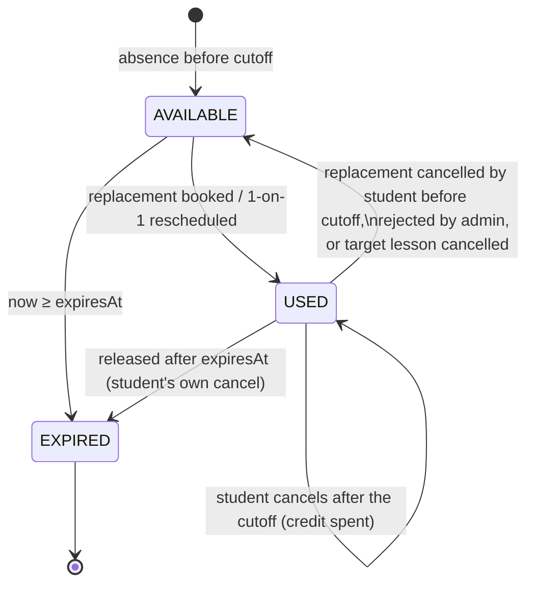

# Absences, makeup credits & replacements (rules, CARM-40)

**Status: Phase 3. Implemented: settings (§2), reporting and deleting
absences (§3) and credit creation and expiry (§4) in CARM-42; replacement
booking and review (§5–§6), 1-on-1 and admin reschedule (§7), credit
release (§4) and the rest of the schema (§9) in CARM-43. Still proposed:
the slot-split carry-over (§5 _Slot splits_) and counting replacements in
`checkLesson`'s room-capacity check (§9 _Changes outside the new module_);
until then a lesson cancelled by a timetable change releases its bookings
with grace.** This page
defines the rules the Phase 3 booking flow enforces and the schema changes
it needs. The screens are specified in `docs/design/absences.md` (CARM-39);
where the two disagree, raise it on the issue rather than picking one.

Owner decisions this builds on (2026-10-14, CARM-38, amended by the
owner's answers on CARM-39):

- The student reports their own absence, or an admin of the school reports
  it for them (e.g. the student phones the office). Teachers can't. The
  admin sets per school how long before a lesson a cancellation still earns
  a credit.
- Makeup credits expire; the admin sets the expiry per school.
- Group lessons: a replacement must be at the same level, is auto-approved,
  and an admin can review and override it.
- Replacements are limited by **room size**, not group size.
- A 1-on-1 lesson is simply rescheduled; it never becomes a replacement in
  another student's lesson.
- Every user belongs to exactly one school.

Terms used below: _now_ is the server time of the request; a lesson
_has started_ when `startsAt ≤ now`; two lessons _overlap_ when their
`[startsAt, endsAt)` intervals intersect (back-to-back lessons do not, as in
the conflict checker); a replacement is _active_ when its status is
`AUTO_APPROVED`, `APPROVED` or `OVERRIDDEN`.

## 1. Where things live

| Path                                    | What                                                                                                                              |
| --------------------------------------- | --------------------------------------------------------------------------------------------------------------------------------- |
| `src/server/scheduling/replacements.ts` | Pure rules: `earnsCredit`, `creditExpiry`, `creditState`, `seatsTaken`, `checkReplacement`, `reviewReplacement`, `studentClashes` |
| `src/server/scheduling/reschedule.ts`   | Pure rules: `checkReschedule`, `rescheduleOptions` (built on `checkLesson`)                                                       |
| `src/server/replacements/service.ts`    | Database service (Developer, CARM-42/43): loads plain data, calls the rules, writes in one transaction per action                 |
| `messages/en-GB/replacements.json`      | Reason messages (`replacements.reasons.<CODE>`), service errors                                                                   |

The rule files follow the scheduling module's contract: no Prisma, no
Next.js, plain-data inputs, deterministic output (reasons sorted by a fixed
order), unit- and property-tested. They return **every** failing reason, not
just the first, so the UI can explain why a lesson is not offered.

## 2. Settings (per school)

Two new columns on `School`, next to the existing teaching-day settings
(it already holds per-school configuration; a separate settings table is not
worth it for two integers):

| Column                  | Type | Default     | Range (CHECK)     | Meaning                                                                    |
| ----------------------- | ---- | ----------- | ----------------- | -------------------------------------------------------------------------- |
| `absenceCutoffMinutes`  | Int  | 1440 (24 h) | 0 – 20 160 (14 d) | A cancellation earns a credit only this long before the lesson starts      |
| `makeupCreditValidDays` | Int  | 30          | 1 – 365           | A credit can be used for lessons up to this many days after the missed one |

- The admin UI edits the cutoff in hours (0–336); the column stays in
  minutes so a 90-minute cutoff is possible later without a migration.
- Changes apply **from now on**: the cutoff is evaluated when the absence is
  reported; the expiry is stored on each credit when it is created.
  Existing credits keep their `expiresAt`.
- The same cutoff also limits when a student can cancel a replacement (§6)
  and how soon a rescheduled 1-on-1 can start (§7). One number, one rule to
  explain: "changes need at least _N_ hours' notice".
- Audit: `school.settings.updated` with the old and new values.

## 3. Reporting an absence

The student, or an admin of the student's school on their behalf, may
report an absence for lesson `L` when all hold:

- `L` is in the student's school, its term is published, `L.status` is
  `SCHEDULED` and `L` has not started;
- the student is a member of `L`'s group at `L.startsAt` (`isMemberAt`), or
  holds an active replacement into `L` — in that case they cancel the
  replacement instead (§6), they do not report an absence;
- the student has no absence report for `L` yet (`@@unique([lessonId, studentId])`).

`earnsCredit(L, reportedAt, cutoff)` = `reportedAt ≤ L.startsAt − cutoff`.

**Admin reports.** The rules are exactly the same as the student's: same
conditions, same cutoff, evaluated at the admin's `now`, same credit. The
service checks server-side that the actor is the student themselves or an
admin of the student's school; a teacher (or anyone else) gets
`FORBIDDEN`. `AbsenceReport.reportedById` stores the actor's user id
(§9), so the student's view can say "The school office cancelled this
lesson for you" and the teacher's roster "via office". On a lesson the
student attends as a replacement the admin uses Reject (§6) instead, as
the student would cancel the replacement. An admin report on a 1-on-1
before the cutoff gives the student a credit to reschedule later. To move
a 1-on-1 lesson directly, at any time including after the cutoff, the admin
uses the admin reschedule (§7). Audit: `absence.reported` with the actor.

| Lesson type | Before the cutoff                                                                                                                                     | After the cutoff (until the lesson starts)                                                  |
| ----------- | ----------------------------------------------------------------------------------------------------------------------------------------------------- | ------------------------------------------------------------------------------------------- |
| Group       | `AbsenceReport` + `MakeupCredit` (usable for a group replacement). The lesson runs for the others.                                                    | `AbsenceReport` only, no credit. Lesson runs.                                               |
| 1-on-1      | `AbsenceReport` + `MakeupCredit` (usable only to reschedule, §7). The lesson is **cancelled** (`STUDENT_CANCELLED`) so the teacher and room are free. | `AbsenceReport` only, no credit. The lesson stays `SCHEDULED` (the teacher keeps the time). |

- **A rescheduled 1-on-1 lesson never extends a credit.** If the lesson is
  the result of a reschedule (§7, `Lesson.rescheduledFromId` set) and a
  credit is spent on it (`MakeupCredit.rescheduledLessonId`), the
  student's options before the cutoff are:
  - _Reschedule_ again with the **same** credit, which is cancelled and
    moved as one step.
  - _Cancel_, which records the absence and releases the original credit
    with its original `expiresAt`, or `EXPIRED` if that date has passed.

  After the cutoff (until the lesson starts) they can still cancel, and
  get the same as any late 1-on-1 cancellation: an `AbsenceReport` on the
  rescheduled lesson, no credit, the lesson stays `SCHEDULED` and the
  original credit stays `USED`. The teacher's roster lists them as not
  coming (§9). That way repeated cancelling can never move the expiry back
  (§4).

- **An admin-moved lesson with no credit behind it** (admin reschedule,
  §7) is treated like the regular 1-on-1 it replaces, so moving a lesson
  never leaves the student worse off. Before the cutoff, cancelling earns a
  credit as in the table above, but `creditExpiry` is counted from the
  **chain root**. The chain root is the first lesson reached by following
  `rescheduledFromId` back, which is the regular lesson the admin moved
  originally. The credit's `sourceLessonId` is the cancelled lesson. Once
  that credit is spent on a reschedule, the rule above applies, so a
  chain mints at most one credit and its expiry can't be stretched by
  rescheduling. After the cutoff it is the same as any late 1-on-1
  cancellation.

- A report is **final** in v1: students cannot withdraw it, whoever
  reported it. Withdrawing
  would take back a seat a replacement student may already hold (§5), and
  for a 1-on-1 the cancelled lesson's time may already be taken.
- **Admins can delete a report** if it was a mistake. The deletion is
  audited as `absence.deleted`.
  - If its credit is `USED`, the delete is refused (`ABSENCE_CREDIT_USED`).
    The admin first rejects the replacement or cancels the rescheduled
    lesson, which releases the credit (§4), and then deletes. A delete
    never cascades into bookings.
  - Otherwise the report and its credit (`AVAILABLE` or `EXPIRED`) are
    deleted together.
  - For a 1-on-1 the lesson that was cancelled as `STUDENT_CANCELLED`
    returns to `SCHEDULED`, if it hasn't started. Before that,
    `checkLesson` is run on it, the same check the admin's lesson move
    uses. Blocking conflicts refuse the delete, because the teacher or
    room may have been taken in the meantime. Overridable conflicts need
    the admin to acknowledge them.
  - For a group lesson the student takes their seat back, and the lesson
    may then be over capacity (flagged, §5).
- No reports after a lesson has started — that is attendance, which v1
  does not track (owner decision, `data-model.md`).
- If the school cancels the missed lesson without a successor (a holiday,
  an ended slot, or a timetable change that moves it out of that week) the
  credit stays. The student already has it and nobody else is harmed.
  When a slot split has a **successor** lesson in the same week, the
  absence moves to it instead (§5, _Slot splits_).

## 4. Makeup credit lifecycle



**Expiry.** `creditExpiry(source, validDays, timeZone)` = the start of the
local day `sourceDate + validDays + 1` in the school's time zone, where
`sourceDate` is the missed lesson's local date. The UI shows "valid until
_sourceDate + validDays_". The anchor is the missed lesson, not the report
time, so reporting early does not stretch the window. A credit can only be
spent on a lesson that **starts before** `expiresAt`, and only while
`now < expiresAt`.

**Effective state.** `creditState(credit, now)` returns `EXPIRED` when
`status = AVAILABLE` and `now ≥ expiresAt`, otherwise `status`. Every read
and every booking uses the effective state, so correctness never depends on
a background job. The stored `status` is brought up to date lazily — any
write touching the credit, plus an idempotent, school-scoped
`UPDATE makeup_credits SET status = 'EXPIRED' WHERE school_id = $school AND status = 'AVAILABLE' AND expires_at <= $now`
run when a student or admin list loads (cheap, indexed by
`(school_id, status, expires_at)`). `$now` is the request's `now`, the
same instant the rules use, never the database's `now()` (§8). A real scheduler
can replace that later (P5 notifications will want one anyway).

**Releasing a used credit.** When an active replacement stops being active
(§6) or a rescheduled 1-on-1 lesson is cancelled by the school, its credit
goes back:

| Why it was released                                        | Credit becomes                                                                          |
| ---------------------------------------------------------- | --------------------------------------------------------------------------------------- |
| Student cancels their replacement before the cutoff        | `AVAILABLE` with the same `expiresAt` (or `EXPIRED` if that has passed)                 |
| Admin **rejects** the replacement                          | `AVAILABLE`, `expiresAt = max(expiresAt, now + 7 days)` — the student did nothing wrong |
| The target / rescheduled lesson is cancelled by the school | `AVAILABLE`, `expiresAt = max(expiresAt, now + 7 days)`                                 |
| Student cancels their rescheduled 1-on-1 before the cutoff | `AVAILABLE` with the same `expiresAt` (or `EXPIRED`), no new credit (§3)                |

Not a release: a student cancelling a replacement or a rescheduled 1-on-1
**after** its cutoff (§3, §6). The credit stays `USED`; it was spent on a
seat or a teacher's time the student gave up too late.

The 7-day grace is a fixed constant (`RELEASE_GRACE_DAYS`) in the rules
module, not a setting (owner decision on CARM-39). `usedAt` and
`rescheduledLessonId` are cleared on release. The rescheduled lesson keeps
its own link back (`Lesson.rescheduledFromId`), so "Rescheduled to …"
history never depends on the credit. A credit is only deleted with its absence, and never while `USED` (§3).

**Admin override and approve** do not change the credit (it stays `USED`).
An admin cannot mint credits in v1.

## 5. Room-size limit

For a target lesson `L`:

```
seatsTaken(L) = members(L) − absent(L) + replacements(L)
```

- `members(L)`: students with a `GroupMembership` in `L`'s group active at
  `L.startsAt` (`joinedAt ≤ startsAt < leftAt ?? ∞`, the same rule as
  `isMemberAt`). Using the lesson instant, not "currently enrolled", means a
  student joining next month does not use a seat today.
- `absent(L)`: those members with an `AbsenceReport` on `L`, before or after
  the cutoff — either way the seat is physically free, and reports are final
  (§3).
- `replacements(L)`: active replacements targeting `L`.

`capacity(L)` is the capacity of **the lesson's own room** (`Lesson.roomId`,
which may differ from the slot's after a move). A booking needs
`seatsTaken(L) + 1 ≤ capacity(L)`.

**No capacity.** When the lesson has no room, or the room's `capacity` is
null, there is no room limit and the replacement is accepted — the same
reading the conflict checker already uses (`ROOM_CAPACITY_EXCEEDED` never
fires without a capacity). Online rooms are the usual case; an admin who
wants to cap an online class sets a capacity on that room. We deliberately
do **not** fall back to `Group.capacity` (owner decision: room size, not
group size). Physical rooms without a capacity are a data gap the admin
data screens already allow; the admin review list shows "no room limit" on
those bookings so it is visible.

**Room changes after booking.** Booked replacements are never cancelled
automatically because the room changed:

- An admin moving a single lesson (`validateLesson`) gets the existing
  overridable `ROOM_CAPACITY_EXCEEDED` conflict, but counted with
  `seatsTaken(L)` instead of the enrolled count (see §9, checker change).
  The admin either picks another room or overrides; the override is audited
  as today.
- A timetable slot edit regenerates lessons. See _Slot splits_ below.
- A lesson over capacity takes no further bookings until seats free up, and
  the admin review queue flags it (`ROOM_FULL`, §6 _Admin review_).

Admins adding a member to a group do not re-check replacement seats in v1;
an upcoming lesson that ends up over capacity is flagged in the review
queue the same way.

### Slot splits

Editing a slot that already has lessons, from date D, **splits** it
(`planSlotEdit`). The old slot ends on D − 1, and a new slot with a new id
generates lessons from D. Without a rule, the new slot would bring back
occurrences the student already cancelled. The absence would stay on the
cancelled old lesson, so the student would count again in `seatsTaken` and
`studentClashes`, and would still hold the credit.

An absence belongs to the **weekly occurrence**, not to the row. So in a
split, every old-slot lesson `L` from D on that is being cancelled or is
already `STUDENT_CANCELLED` or `RESCHEDULED` (admin reschedule, §7) is matched with its **successor** `S`. `S` is
the new slot's occurrence in the same ISO week, in the school's time zone,
if there is one. A weekday change still matches, because a weekly slot
has one occurrence per week. `planSlotEdit` returns these pairs as
`carryOver: { fromLessonId, toSlotId, toDate }[]`. It is pure and
deterministic, and I'll add it to `lesson-sync.ts`. In the same
transaction the service then does the following:

| What `L` has                                  | What happens with successor `S`                                                                                                                                                                                                                                                                            |
| --------------------------------------------- | ---------------------------------------------------------------------------------------------------------------------------------------------------------------------------------------------------------------------------------------------------------------------------------------------------------- |
| Absence reports (group lesson)                | Moved to `S`, with their credits' `sourceLessonId` and the `originalLessonId` of their replacements. No new credit is earned, and `expiresAt` stays the same. The student is absent from `S`, so they don't count in its seats or their clashes.                                                           |
| `STUDENT_CANCELLED` or `RESCHEDULED` (1-on-1) | `S` is created already `CANCELLED` with the same reason as `L`. Any absence and credit on `L`, and the ad-hoc lesson's `rescheduledFromId`, are moved to `S`. That keeps lesson generation idempotent through the existing `(slot, occurrenceDate)` row, so the student never gets the week's lesson back. |
| Active replacements **into** `L`              | Moved to `S` if `reviewReplacement` on `S` (§6) has no failing reasons. Otherwise they are released (`CANCELLED`, `LESSON_CANCELLED`) and the credit is returned with grace (§4).                                                                                                                          |

Once everything is moved, `L` is judged by the existing rule: it is
deleted if it is untouched, and cancelled (`TIMETABLE_CHANGED`) otherwise,
for example when it still has a log or notes. Without a successor, because
the slot was ended, a holiday was added, or the new weekday falls before D
in that week, nothing moves. `L` is cancelled and its replacements are
released as above. Its absences and credits stay (§3). The editor's
existing confirmation copy still holds.

## 6. Group replacement eligibility

`checkReplacement(input, now)` returns a sorted list of reason codes; the
booking is allowed when it is empty. The service loads the target lesson,
its group, room and seat counts, the credit, the student's profile and the
student's lessons overlapping the target.

| Code                   | Fails when                                                                                                   | Admin can override |
| ---------------------- | ------------------------------------------------------------------------------------------------------------ | ------------------ |
| `NOT_FOUND`            | Target lesson not in the student's school (the service answers "not found", never "other school")            | no                 |
| `LESSON_NOT_PUBLISHED` | Target's term is not published                                                                               | no                 |
| `LESSON_CANCELLED`     | `target.status ≠ SCHEDULED`                                                                                  | no                 |
| `LESSON_STARTED`       | `target.startsAt ≤ now`                                                                                      | no                 |
| `NOT_A_GROUP_LESSON`   | Target's group is `ONE_ON_ONE`, or archived                                                                  | no                 |
| `SAME_LESSON`          | Target is the credit's source lesson (also a DB CHECK)                                                       | no                 |
| `ALREADY_ATTENDING`    | Student is a member of the target's group at `target.startsAt`, or already has an active replacement into it | no                 |
| `CREDIT_UNAVAILABLE`   | Credit is not the student's, or its effective state is not `AVAILABLE`, or it came from a 1-on-1 lesson      | no                 |
| `CREDIT_EXPIRES_FIRST` | `target.startsAt ≥ credit.expiresAt`                                                                         | yes                |
| `NO_LEVEL`             | Student has no level (`StudentProfile.levelId` null)                                                         | yes                |
| `LEVEL_MISMATCH`       | `group.levelId ≠ student.levelId`                                                                            | yes                |
| `ROOM_FULL`            | `seatsTaken(target) + 1 > capacity(target)`                                                                  | yes                |
| `STUDENT_CLASH`        | The target overlaps a lesson the student attends (below)                                                     | yes                |

Notes:

- **Level** is the target group's `levelId` and the student's **current**
  `StudentProfile.levelId`, compared by id at booking time. An archived
  level still matches (`admin-data.md`: archived levels keep working for
  replacements). Level rank is not used: "same level" means equal, not
  "within one rank".
- **Same school** is enforced twice: the service loads through the
  school-scoped client, and the composite FKs make a cross-school row
  impossible.
- **Lessons the student attends** at an instant are: lessons of groups they
  are a member of then (group and 1-on-1), that are not `CANCELLED` and that
  they have **not** reported absent from; plus the targets of their active
  replacements; plus their rescheduled 1-on-1 lessons. A lesson they
  reported absent from is not a clash — "I can't make Tuesday 18:00, I'll go
  Wednesday 18:00" is the normal case. `studentClashes` returns the
  clashing lessons so the message can name them.
- A student may hold several active replacements (one per credit), never
  two into the same lesson.
- There is no separate "booking closes N hours before" rule for the target
  in v1: it can be booked until it starts, as the issue asks. The teacher
  sees replacement students on the lesson page as soon as they book.

**Students** see only lessons with an empty reason list (the "Book a
replacement" list is `checkReplacement` over the candidate lessons: same
level, not started, before the credit's expiry, ordered by start). They
never override anything.

**Cancelling a replacement (student).** Allowed until the target starts
(owner decision on CARM-39); the cutoff only decides what happens to the
credit, the same rule as for their own lessons:

| When                                        | Replacement becomes                | Credit                         |
| ------------------------------------------- | ---------------------------------- | ------------------------------ |
| `now ≤ target.startsAt − cutoff`            | `CANCELLED`, reason `STUDENT`      | Released (§4)                  |
| After that, while the target hasn't started | `CANCELLED`, reason `STUDENT_LATE` | Stays `USED`, nothing released |

Either way the seat is free again (a `CANCELLED` replacement doesn't count
in `seatsTaken`) and the target is no longer one of the student's lessons.
The teacher's roster lists `STUDENT_LATE` replacements under _Not coming_
(§9). A student cannot report an absence on a lesson they attend as a
replacement; they cancel the replacement instead.

### Admin review

New replacements are `AUTO_APPROVED` and show in the admin review queue
until reviewed. The queue evaluates **`reviewReplacement(booking, target,
now)`** live, so an admin sees bookings that became problematic after the
fact: level changed, room changed, over capacity, new clash.
`reviewReplacement` is `checkReplacement` with **the booking under review
left out of every input**, so it never counts against itself:

- `ALREADY_ATTENDING` ignores this booking. It still fires when the student
  has since joined the target's group, or holds another active booking
  into it.
- `STUDENT_CLASH` ignores this booking's target as one of "the student's
  lessons".
- `ROOM_FULL` uses `seatsTaken(target) − 1` (without this booking) `+ 1 >
capacity`, i.e. `seatsTaken(target) > capacity`. A lesson that is exactly
  full passes.
- `CREDIT_UNAVAILABLE` accepts the credit being `USED` **by this
  booking**.
- `LESSON_STARTED` isn't evaluated, because the actions below are only
  offered before the start.

The same function checks an Override's new target, and the successor in a
slot split (§5). There the booking is left out the same way.

| Action       | Allowed on                          | Effect                                                                                                                                                                                                                                                      |
| ------------ | ----------------------------------- | ----------------------------------------------------------------------------------------------------------------------------------------------------------------------------------------------------------------------------------------------------------- |
| **Approve**  | `AUTO_APPROVED`, target not started | `APPROVED`; nothing else changes. Not allowed while an overridable reason is failing — that needs **Override**.                                                                                                                                             |
| **Reject**   | any active, target not started      | `REJECTED`; student no longer attends the target; credit released with grace (§4). Reason required.                                                                                                                                                         |
| **Override** | any active, target not started      | Keep the booking or **move it to another target lesson** despite failing overridable reasons. The admin acknowledges each failing reason (same pattern as `decideSave` in the timetable editor). Status `OVERRIDDEN`; credit stays `USED`. Reason required. |

- Blocking reasons (the "no" rows) cannot be overridden by anyone.
- Every review sets `reviewedById`, `reviewedAt`, `reviewNote`.
- Audit: `replacement.approved | rejected | overridden` with the actor, the
  previous status, the previous and new target, and every acknowledged
  reason (code + params). Bookings and cancellations are audited too
  (`replacement.booked | cancelled`), with the actor null for
  system-released ones.
- Reviews of started lessons are read-only; history is not rewritten.

## 7. 1-on-1 reschedule

A 1-on-1 lesson is moved to a new time with the same teacher; it never joins
another student's lesson.

**Representation.** The original lesson is **cancelled**
(`cancelReason STUDENT_CANCELLED`, §3) and the new time is a new **ad-hoc**
lesson (`timetableSlotId` and `occurrenceDate` null) in the same group.
It's linked two ways:

- `Lesson.rescheduledFromId` points to the lesson it replaces. This is
  permanent history and survives a release.
- `MakeupCredit.rescheduledLessonId` points to the lesson the credit is
  currently spent on. It is cleared when the credit is released.

Re-rescheduling chains these links: the new lesson points to the previous
ad-hoc lesson, and the credit moves to the new one. Why not move the
lesson in place:

- The original stays in history at its original time ("Rescheduled to Thu
  14 Nov 16:00"), and the generated `(slot, occurrenceDate)` row keeps lesson
  generation idempotent — it is never re-created.
- `planLessonSync` never touches ad-hoc lessons, so a later slot edit does
  not silently cancel a time the student and teacher agreed on. A moved
  generated lesson, by contrast, counts as touched and would be cancelled.
- Credits, expiry and cutoff work exactly as for group lessons; the only
  difference is what the credit is spent on.

**Flows.** "Reschedule" on an upcoming 1-on-1 before the cutoff does both
steps in one transaction (report absence → credit → spend it on the chosen
time). "Cancel" alone gives the student an `AVAILABLE` credit to reschedule
later from the Credits screen. After the cutoff neither is offered (§3).
On a lesson that is itself a reschedule, both reuse the original credit
and never mint a new one (§3).

**Where it can move** — `checkReschedule(calendar, request, now)`; every
condition is blocking for students:

| Code                   | Passes when (fails otherwise)                                                                               |
| ---------------------- | ----------------------------------------------------------------------------------------------------------- |
| `CREDIT_UNAVAILABLE`   | Credit is the student's, effectively `AVAILABLE`, from a lesson of **this** 1-on-1 group                    |
| `TOO_SOON`             | New start ≥ `now + cutoff` (the teacher gets the same notice the student needed)                            |
| `CREDIT_EXPIRES_FIRST` | New start < `credit.expiresAt`                                                                              |
| `OUTSIDE_TERM`         | New date inside a **published** term (any, not only the original's; the new lesson's `termId` is that term) |
| `DURATION_CHANGED`     | Same duration as the missed lesson                                                                          |
| conflict-checker codes | `checkLesson` on the candidate returns **no conflicts at all** — blocking or overridable                    |
| `STUDENT_CLASH`        | No overlap with the student's other lessons (§6 definition)                                                 |

The candidate passed to `checkLesson` is `{ termId, timetableSlotId: null,
occurrenceDate: null, groupId, teacherId: <group's regular teacher of the
missed lesson>, substituteTeacherId: null, roomId, startsAt, endsAt }`. So
yes, **it reuses the timetable conflict checker**, and inherits teacher
double-booking, room clashes and archived rooms, teacher weekly and dated
unavailability (with `DATE_AVAILABLE` exceptions), holidays, school days and
hours, DST. Students may not override anything the checker reports — those
overrides stay an admin tool. The extra `STUDENT_CLASH` check is needed
because the checker only knows group members, not replacements.

**Room.** Keep the missed lesson's room when it is free; otherwise any
non-archived room of the **same kind** (physical ↔ online) that yields no
conflict, preferring the slot's room, then by name. The student does not
pick a room.

**Offering times.** `rescheduleOptions(calendar, request, now, limit)`
enumerates candidate starts on a 15-minute grid inside the school's teaching
days and hours, from `now + cutoff` until the credit expires, runs
`checkReschedule` on each, and returns the first `limit` (default 20)
ordered by: the missed lesson's weekday and time first, then nearest date,
then earliest time. `buildCalendar` is built once per request, so this stays
cheap (≈ 30 days × 56 starts). Deterministic for the same input.

**Admin reschedule** (owner decision 2026-10-14). After the cutoff the
student gets no credit and cannot reschedule. An admin can still move the
lesson, for example after talking to the student offline.
`rescheduleByAdmin` uses the same representation as the student flow: the
source is cancelled and a new ad-hoc lesson is created with
`rescheduledFromId` set. The rules are:

- **Source:** any `SCHEDULED` 1-on-1 lesson that hasn't started. That
  includes one past the cutoff, one the student has already reported a
  late absence for, and one that is itself a reschedule. The source is
  cancelled with the new `cancelReason` `RESCHEDULED` ("Rescheduled"). A
  late absence report stays on the cancelled source as history, so the
  student attends the new lesson as normal.
- **No credit is created or spent.** If the source is itself a reschedule,
  the credit spent on it stays `USED` and its `rescheduledLessonId` moves
  to the new lesson. Separately, an admin can spend a student's
  `AVAILABLE` 1-on-1 credit on their behalf. That is the student flow run
  by the admin, with the admin rules below.
- **Checks:** the same checks as `checkReschedule`, without the
  student-only time limits (`TOO_SOON`, `CREDIT_EXPIRES_FIRST`).
  - Blocking `checkLesson` conflicts and `OUTSIDE_TERM` refuse the move.
  - Overridable conflicts (unavailability, holiday, school hours, shared
    online room, and `STUDENT_CLASH`) can be saved once the admin
    acknowledges each one. This is the `decideSave` pattern from the
    timetable editor.
  - `DURATION_CHANGED` doesn't apply: the admin may change the length.
- **What the admin picks:** the date, time and room. The teacher stays the
  group's regular teacher; substitutes are a P5 workflow.
  `rescheduleOptions` can still suggest conflict-free times.
- **Admin cancels:** an admin can cancel a rescheduled lesson, which
  releases its credit with grace (§4). Cancelling by the student follows §3, including
  the case of an admin-moved lesson with no credit.
- **Audit:** `lesson.rescheduled` records the actor, student, credit if
  any, source and new lesson, from and to, room, every acknowledged
  conflict and the admin's optional note (e.g. "agreed by phone").
- It takes the same lock as every other write here (§8).

## 8. Concurrency

Every write in this area — report absence, book / cancel / review a
replacement, reschedule — runs in one transaction that first takes the
school's **timetable advisory lock** (`timetableLockKey(schoolId)`, the lock
the timetable editor already takes), then re-loads and re-checks
everything, then writes.

- Two students booking the last seat: the second waits for the lock,
  recounts `seatsTaken`, gets `ROOM_FULL`.
- The same student spending one credit twice (two tabs): the credit update
  is conditional — `UPDATE makeup_credits SET status='USED' … WHERE
school_id = $school AND id = $id AND status = 'AVAILABLE' AND expires_at >
$now` — and must affect one row; plus the partial unique indexes below.
- **One clock.** The service takes `now` once per request and passes it to
  the rules and, as a parameter, to every SQL condition. No SQL in this
  area uses the database's `now()`, so the rules and the conditional
  update can't disagree about expiry at the boundary.
- A booking racing a timetable change (slot edit cancels the target, admin
  moves the lesson to a smaller room, admin publishes a holiday) or a
  reschedule racing another teacher booking: same lock, so one of them sees
  the other's result.
- Why one school-wide lock and not per lesson: a reschedule and a clash
  check read many lessons, and a per-lesson lock would not stop the races
  above. Bookings are low volume (a language school, not a ticket sale) and
  the transactions are short. If contention ever shows up, split into
  per-student + per-lesson locks taken in a fixed order.

The service returns the fresh reason list on a lost race (as `saveSlot`
returns fresh conflicts), so the UI can say "This lesson just filled up".

## 9. Schema review

Proposed changes for the Phase 3 migration (CARM-42 adds the settings,
absence and credit parts; CARM-43 the replacement and reschedule parts).

**`School`**

- Add `absenceCutoffMinutes Int @default(1440)` and
  `makeupCreditValidDays Int @default(30)`, with the CHECKs in §2.

**`AbsenceReport`**

- **Keep `reportedById`** (→ `User`, `onDelete: SetNull`) and
  `User.reportedAbsences`. The service always writes the actor: the
  student's user id, or the admin's when an admin reported it (§3). "Via
  office" is `reportedById ≠ student's userId`; null only after the
  reporting user was deleted. It is never a teacher (enforced by the
  service, covered by a permission test).
- Drop `reportedAt` (it duplicates `createdAt`) — or keep it and stop
  writing `createdAt` separately; one timestamp is enough. Proposal: drop.
- Whether it earned a credit is the credit's existence; no extra column.

**`MakeupCredit`**

- `absenceReportId` **required** (every credit comes from an absence in v1)
  and `@unique`; `expiresAt` **required** (credits always expire).
- Add `usedAt DateTime?` (set with `USED`, cleared on release).
- Add `rescheduledLessonId String? @unique` → `Lesson` (composite FK,
  `onDelete: Restrict`), the ad-hoc lesson a 1-on-1 credit is currently
  spent on. CHECK: `rescheduled_lesson_id IS NULL OR status = 'USED'`.
  History lives on `Lesson.rescheduledFromId`, not here.
- Keep `@@unique([studentId, sourceLessonId])` and the status index; add
  `@@index([schoolId, status, expiresAt])` for the lazy expiry update.

**`ReplacementRequest`**

- Add `CANCELLED` to `ReplacementStatus`, plus
  `cancelledAt DateTime?` and `cancelReason String?`
  (`STUDENT` | `STUDENT_LATE` | `LESSON_CANCELLED`; translated). `STUDENT_LATE`
  marks a cancel after the cutoff, so the credit stays `USED` (§6). Rows
  are kept for history.
  CHECK: `cancelled_at IS NOT NULL` iff `status = 'CANCELLED'`.
- `makeupCreditId` **required**. Partial unique indexes:
  - `(makeup_credit_id) WHERE status IN ('AUTO_APPROVED','APPROVED','OVERRIDDEN')`
    — a credit backs at most one active replacement;
  - `(student_id, target_lesson_id) WHERE status IN (…active…)`
    — no double booking of the same lesson.
- `originalLessonId` stays (it is what teachers and admins filter by) and
  must equal the credit's `sourceLessonId`; the service enforces it
  (cross-table, so no CHECK).
- Add `@@index([schoolId, originalLessonId])`.
- The name stays `ReplacementRequest`; renaming is churn for no gain, even
  though it is a booking rather than a request.

**`Lesson`**

- Add `rescheduledFromId String? @unique`, a composite self-FK
  `[schoolId, rescheduledFromId]` → `Lesson` (`onDelete: Restrict`). It is
  the lesson this one replaces after a 1-on-1 reschedule. CHECK:
  `rescheduled_from_id IS NULL OR timetable_slot_id IS NULL` (only ad-hoc
  lessons are reschedules).
- New `cancelReason` values `STUDENT_CANCELLED`
  (`scheduling.cancelReasons.STUDENT_CANCELLED` "Cancelled by student") and
  `RESCHEDULED` (`scheduling.cancelReasons.RESCHEDULED` "Rescheduled",
  used by the admin reschedule, §7).

**`AuditLog`** — new actions: `school.settings.updated`, `absence.reported`,
`absence.deleted`, `replacement.booked | cancelled | approved | rejected |
overridden`, `lesson.rescheduled`.

### Changes outside the new module

- `checkLesson` / `buildCalendar`: let the room-capacity and
  student-clash checks count replacement students (`seatsTaken`) and treat
  a student's replacement targets as their lessons. Proposed shape: an
  optional `replacements: { lessonId, studentId }[]` and `absences` in
  `SchedulingContext`; `checkSlot` keeps counting enrolled students (a
  weekly slot has no per-date replacements). I own this change.
- `planSlotEdit` / `planLessonSync`: return the `carryOver` pairs for a
  split (§5, _Slot splits_), and create successors of `STUDENT_CANCELLED`
  lessons as cancelled. When the plan cancels a lesson without a
  successor, the service releases its active replacements
  (`LESSON_CANCELLED`) and the credit of a cancelled rescheduled 1-on-1
  lesson in the same transaction. I own the lesson-sync part.
- Student lesson access (`canStudentSeeLesson`): an active replacement
  into a lesson gives the same access as membership (log and homework once
  it has started, never `TeacherNote`). Rejected or cancelled replacements
  give none. To be covered by the CARM-44 permission suite.
- Teacher roster for a lesson: _Coming_ = `members − absent + active
replacement students`, replacement students marked. _Not coming_ = the
  absent members (late when they have no credit, "via office" per
  `reportedById`) plus replacements cancelled as `STUDENT_LATE`. For a
  rescheduled 1-on-1, an `AbsenceReport` on it means not coming.

## 10. Tests

- Unit: every reason code in §6 and §7, boundaries (exactly at the cutoff
  earns a credit; a target starting exactly at `expiresAt` does not
  qualify; back-to-back is not a clash; DST weeks for expiry and the
  15-minute grid), each release path in §4.
- Unit, the cases from the CARM-40 review:
  - Cancelling or re-rescheduling a rescheduled 1-on-1 that has a credit
    spent on it, any number of times, never creates a credit and never
    changes `expiresAt`.
  - `reviewReplacement` passes on a booking into an exactly full lesson,
    and doesn't report its own target as a clash or its own credit as
    used.
  - Slot splits: same-day and weekday-change successors; a successor
    falling before D; a 1-on-1 `STUDENT_CANCELLED` successor and an
    admin-`RESCHEDULED` successor, each created cancelled with the same
    reason, the ad-hoc lesson's `rescheduledFromId` moved, and still
    cancelled after `planLessonSync` runs again (idempotent); a replacement
    moved versus released.
  - Cancelling an admin-moved lesson that has no credit: before the
    cutoff it earns one credit with the expiry counted from the chain
    root; rescheduling or cancelling again mints nothing more; after the
    cutoff it earns nothing.
  - Admin absence delete: refused while the credit is `USED`; a 1-on-1
    lesson is restored only without blocking conflicts.
- Unit, the CARM-39 answers:
  - An admin report follows the same cutoff and credit rules as the
    student's, and records the admin as `reportedById`; a teacher is
    refused.
  - A replacement cancelled after the cutoff is `STUDENT_LATE`, frees the
    seat and leaves the credit `USED`; cancelling once the target has
    started is refused. A late cancel of a rescheduled 1-on-1 keeps the
    lesson and the credit `USED`.
- Property (seeded realistic schools from `testing/`, 20 teachers, 60
  groups, 15 rooms, ~330 students): apply a random sequence of absences,
  bookings, cancellations, rejections and room moves through the rules, and
  assert that `seatsTaken ≤ capacity` holds for every lesson booked without
  an override, no credit backs two active replacements, no student is ever
  booked into overlapping lessons, every `rescheduleOptions` result passes
  `checkLesson` with no conflicts, and results don't depend on input order.
- Unit, admin reschedule: allowed after the cutoff and on a lesson with a
  late absence; no credit created or spent; credit link moved when the
  source is itself a reschedule; blocking conflicts refused; overridable
  conflicts and `STUDENT_CLASH` only with acknowledgement.
- DB (opt-in, like `service.db.test.ts`): two concurrent bookings for the
  last seat → exactly one succeeds; one credit spent from two transactions
  → exactly one succeeds.

## Owner decisions

Answered on CARM-39 (2026-10-14): admins may report absences for
students; credit validity counts from the missed lesson; a booking
cancelled after its cutoff spends the credit; the release grace is a fixed
7 days; 1-on-1 "cancel now, reschedule later" is allowed; no cap on
credits or bookings.

Answered on CARM-40 (2026-10-14):

1. **Late 1-on-1 cancellation** (§3): after the cutoff there is no credit
   and the student cannot reschedule. The lesson stays scheduled. An admin
   can still reschedule it, e.g. after an offline discussion with the
   student (§7, _Admin reschedule_).
2. **Rooms without a capacity** (§5): no limit on replacement students.
   Capacity stays optional in the admin form.
3. **Booking until the start** (§6): replacements can be booked until the
   target lesson begins, with no minimum notice for now.

No open questions remain.
