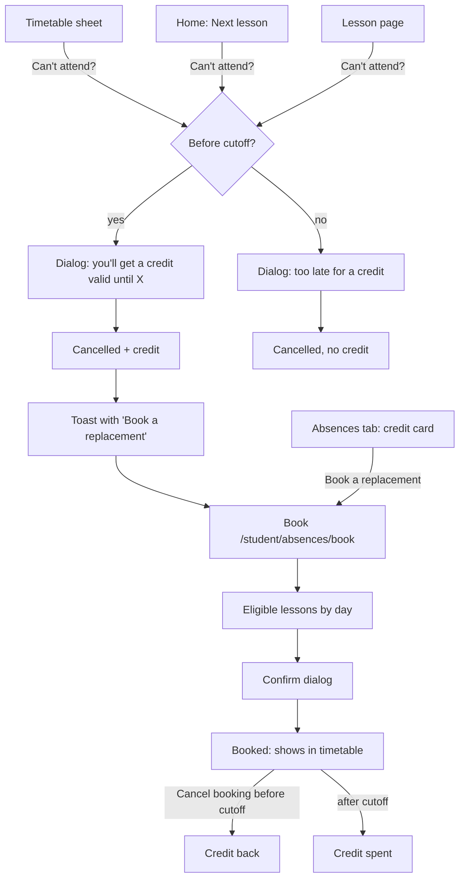
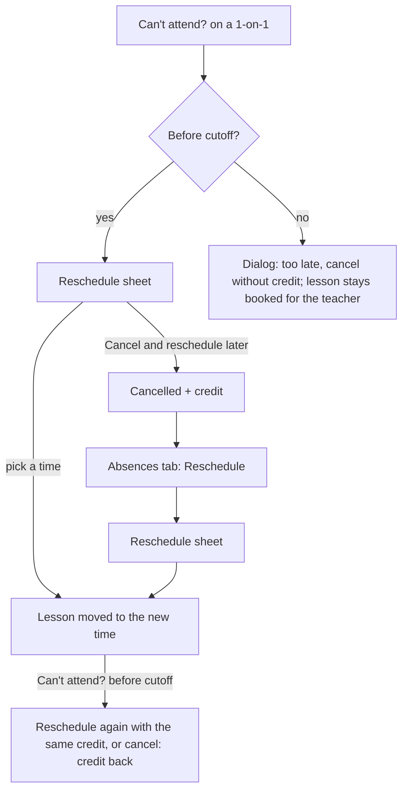
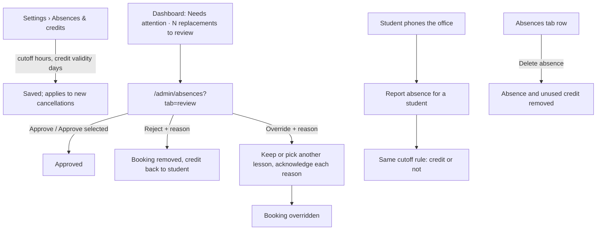

# Absences, makeup credits & replacements (Phase 3)

Spec for how a student **cancels** a lesson they can't attend, earns a
**makeup credit**, and spends it on a **replacement** group lesson or a
**rescheduled** 1-on-1. It also covers what teachers see on the lesson page
and how admins configure, monitor and review all of it. Builds on
`docs/design/tokens.md`, `docs/design/app-layout.md`,
`docs/design/timetable.md` (§6 weekly views, §6.3 details sheet) and
`docs/design/lessons.md` (lesson pages). Clickable wireframe:
`docs/design/wireframes/absences.html`.

The booking rules (eligibility, room capacity, reschedule times, credit
lifecycle, concurrency) are owned by the Scheduling Engineer in
`docs/architecture/replacements.md` (CARM-40, PR #23). This spec states what
the UI shows and links to the rule sections it relies on. §12 lists where the
owner's answers on this spec change that doc.

## Owner decisions this spec follows (2026-10-14, CARM-38)

1. **The student reports their own absence.** Teachers don't. The admin
   sets, per school, how long before the lesson a student can still cancel
   and earn a credit. _Amended on CARM-39:_ an admin can also cancel on a
   student's behalf (§7.5).
2. **Makeup credits expire.** The admin sets the expiry per school.
3. **Group lessons:** a replacement must be at the **same level**. It is
   auto-approved, and an admin can review and override it.
4. **Replacements are limited by room size**, not by group size.
5. **A 1-on-1 lesson is simply rescheduled.** It doesn't become a
   replacement in another student's lesson.
6. **Every user belongs to exactly one school.**

Owner answers on this spec (2026-10-14, CARM-39 review):

7. Credit validity counts from the **missed lesson's date**.
8. An **admin can cancel a lesson on a student's behalf**, e.g. when the
   student phones the office.
9. A booking cancelled **after its cutoff** spends the credit.
10. A credit released by an admin reject (or a school-cancelled target)
    gets **at least 7 more days**.
11. 1-on-1 **"cancel now, reschedule later"** with a credit is allowed.
12. **No cap** on credits or bookings for now.

Earlier decisions still apply: no attendance tracking (`lessons.md`
decision 1), TeacherNotes never reach students, all strings go through
next-intl.

## 1. Goal

- A student who can't come taps **Can't attend?** on their phone and knows,
  before confirming, whether they will get a makeup credit.
- A student with a credit finds a lesson that fits in a few taps. Only
  lessons they can really book are shown: no "sorry, that one is full"
  after the fact, except for a genuine race.
- A teacher opening a lesson sees at a glance who isn't coming and who is
  joining as a replacement.
- An admin sets two numbers once, and spends a minute a day on a review
  queue that is empty most of the time.

## 2. Roles and access

| Role    | Screens                                                                                                                                          | Can read                                                                                                                   | Can do                                                                                                                                               |
| ------- | ------------------------------------------------------------------------------------------------------------------------------------------------ | -------------------------------------------------------------------------------------------------------------------------- | ---------------------------------------------------------------------------------------------------------------------------------------------------- |
| Student | _Can't attend?_ (timetable sheet, lesson page, home) · Absences tab `/student/absences` · Book `/student/absences/book` · Reschedule sheet       | Their own cancellations, credits and bookings. For an eligible lesson: date, time, group, level, teacher, room, free seats | Cancel their own upcoming lesson (final, §5.6); book a replacement or reschedule a 1-on-1 with their own credit; cancel their own booking            |
| Teacher | Lesson page `/teacher/lessons/[id]` (new _Students_ card) · timetable details sheet                                                              | For their lessons (regular or substitute): who cancelled (name, when, reason) and who joins as a replacement               | Nothing in P3 (decision 1)                                                                                                                           |
| Admin   | Settings › Absences & credits `/admin/settings/absences` · Absences & replacements `/admin/absences` (tabs _Review_, _Replacements_, _Absences_) | Everything in the school                                                                                                   | Change the two settings; cancel a lesson on a student's behalf; delete a mistaken absence; approve, reject or override a replacement, with a reason. |

**Server-side rules** (the UI only mirrors them; QA covers them in CARM-44):

- Every query is scoped by `schoolId`. Student actions also check
  `studentId = me`. An id the user may not see returns **404**, as in
  `lessons.md` §2.
- Cancel, book, reschedule, cancel-booking and the admin actions are server actions that
  re-check every rule (cutoff, eligibility, seats, clash, credit state) at
  submit time. The lists in the UI are only a preview.
- A student booked onto a lesson as a replacement can open that lesson's
  student page (log and homework, never TeacherNotes, never other students'
  names) while the booking is active (`AUTO_APPROVED`, `APPROVED`,
  `OVERRIDDEN` to that lesson). Access ends when it's rejected, cancelled or
  moved.
- The eligible-lesson list for students is a **student-safe DTO**: no other
  students' names, only a free-seat count.

## 3. Concepts shown in the UI

| Concept                             | UI word (key)                                       | Meaning for the user                                                                                                                                                         |
| ----------------------------------- | --------------------------------------------------- | ---------------------------------------------------------------------------------------------------------------------------------------------------------------------------- |
| `AbsenceReport`                     | **Cancellation** (`absences.cancellation`)          | "I won't come to this lesson." Made by the student, or by an admin for them. The word "absence" is kept for the nav and the admin page, because that is what admins call it. |
| Cutoff                              | **Cancel by {dateTime}** (`absences.cutoff.by`)     | Lesson start minus the school's cutoff hours. Before it a cancellation earns a credit; after it, it doesn't. Always shown as an absolute date and time, never as "24 h".     |
| `MakeupCredit`                      | **Makeup credit** (`credits.title`), short _credit_ | One lesson to make up. Valid until a date. Spent on one replacement or one reschedule.                                                                                       |
| `ReplacementRequest` (group lesson) | **Replacement** (`replacements.title`)              | A seat in another group's lesson at the student's level, booked with a credit.                                                                                               |
| Reschedule (1-on-1)                 | **Rescheduled lesson** (`reschedule.title`)         | The same 1-on-1 (same teacher) at a new time, booked with a credit. Stored as a new ad-hoc `Lesson` with `rescheduledFromId` (`replacements.md` §7).                         |
| Booking                             | **Booking** (`bookings.*`)                          | Umbrella word on the student's Absences tab for "a replacement or a rescheduled lesson".                                                                                     |

### 3.1 One model for both lesson types

Group and 1-on-1 lessons follow the same three steps, so students learn it
once:

1. **Cancel** the lesson. Before the cutoff, a credit is created.
2. **Use the credit**: for a group lesson, book a replacement; for a 1-on-1,
   pick a new time with the same teacher.
3. The booking shows in the timetable. It can be **cancelled** with the same
   cutoff rule: before the cutoff the credit comes back, after it the credit
   is spent (decision 9).

For a 1-on-1 the dialog offers steps 1 and 2 together (_Reschedule now_),
plus _Cancel and reschedule later_ when the student doesn't know a time yet
(§5.3).

A credit remembers what it came from: a group-lesson credit can only book a
group replacement, a 1-on-1 credit can only reschedule in the same 1-on-1
group (`replacements.md` §6 `CREDIT_UNAVAILABLE`, §7).

A cancellation is **final** for the student (`replacements.md` §3): there's
no _Undo_. A mistaken one is deleted by an admin (§7.5).

### 3.2 Status badges

Student-facing:

| Thing               | State                          | Badge (token)                                            | Icon (lucide) |
| ------------------- | ------------------------------ | -------------------------------------------------------- | ------------- |
| Credit              | Available                      | **Valid until {date}** (`success`)                       | `ticket`      |
| Credit              | Available, expires in ≤ 7 days | **Expires in {days} days** (`warning`)                   | `ticket`      |
| Credit              | Used                           | **Used** (muted)                                         | `check`       |
| Credit              | Expired                        | **Expired** (muted)                                      | `clock-alert` |
| Lesson in timetable | Cancelled by me                | **Not attending** (`lesson-cancelled`)                   | `calendar-x`  |
| Lesson in timetable | Replacement / rescheduled      | **Replacement** / **Rescheduled** (`lesson-replacement`) | `repeat`      |
| Booking             | Rejected by the school         | **Removed by school** (`danger`)                         | `ban`         |
| Booking             | Moved by the school (override) | **Changed by school** (`info`)                           | `info`        |

`AUTO_APPROVED` and `APPROVED` both read **Booked** for the student. The
review is the school's business, not theirs.

Admin-facing (`ReplacementStatus`):

| Status          | Badge                                                            | Token     |
| --------------- | ---------------------------------------------------------------- | --------- |
| `AUTO_APPROVED` | **Needs review** (auto-approved)                                 | `info`    |
| `CANCELLED`     | **Cancelled by student** / **Lesson cancelled** (`cancelReason`) | muted     |
| `APPROVED`      | **Approved**                                                     | `success` |
| `REJECTED`      | **Rejected**                                                     | `danger`  |
| `OVERRIDDEN`    | **Overridden**                                                   | `warning` |

Absence (admin list): **Credit earned** (`success`) · **Late — no credit**
(`warning`), plus a muted **By {admin}** chip when an admin reported it.

## 4. User flows

### 4.1 Student — group lesson



### 4.2 Student — 1-on-1 lesson



### 4.3 Admin



## 5. Student (mobile-first)

### 5.1 _Can't attend?_ entry points

| Where                                                  | Control                                         | Shown when                                                                         |
| ------------------------------------------------------ | ----------------------------------------------- | ---------------------------------------------------------------------------------- |
| Timetable lesson details sheet (`timetable.md` §6.3)   | Outline button _Can't attend?_ + cutoff caption | Own scheduled lesson (regular or booking) that hasn't started                      |
| Home › Next lesson card (`app-layout.md` §7.4)         | Link button _Can't attend?_                     | Same                                                                               |
| Student lesson page `/student/lessons/[id]` (upcoming) | Outline button in the header                    | Same. Upcoming lesson pages show date, time, room, teacher only (`lessons.md` §2). |

The caption under the button always states the cutoff as an absolute time:

- Before the cutoff (`info` text): "Cancel by **Sun 19 Oct, 17:00** to get
  a makeup credit."
- After the cutoff (`warning` text): "It's after the cutoff (Sun 19 Oct,
  17:00). You can still cancel, but you won't get a credit."

For a lesson already cancelled, the sheet shows the **Not attending** badge,
"You cancelled this lesson on {date}." (or "The school office cancelled
this lesson for you on {date}." when an admin did it, §7.5) plus either
"You got a makeup credit." or "No credit — cancelled after the cutoff.",
and the hint "Changed your mind? Contact the school office." (§5.6).

For a booking (replacement / rescheduled lesson) the same button reads
_Cancel booking_ (§5.7).

### 5.2 Cancel dialog — group lesson

A bottom `Sheet` on mobile, a `Dialog` on desktop. One screen, no steps.

```
┌──────────────────────────────┐
│ Cancel B1 Evening?           │ title
│ Mon 20 Oct · 17:00–18:30     │
│ ┌──────────────────────────┐ │
│ │ 🎟 You'll get a makeup    │ │ success Alert (before cutoff)
│ │ credit, valid until      │ │
│ │ Wed 19 Nov. Use it to    │ │
│ │ join another B1 lesson.  │ │
│ └──────────────────────────┘ │
│ Reason (optional)            │
│ [e.g. Doctor's appointment ] │ textarea, 2 lines, ≤ 300
│ Your teacher sees the reason.│ hint
│                              │
│ [ Cancel my lesson ]         │ primary, full width
│ [ Keep my lesson   ]         │ outline, full width
└──────────────────────────────┘
```

- **Before the cutoff:** `success` Alert with `ticket` icon: "You'll get a
  makeup credit, valid until {date}. Use it to join another {level} lesson."
  The date is the missed lesson's date plus the validity days (decision 7,
  `replacements.md` §4).
- **After the cutoff:** `warning` Alert with `alert-triangle`: "It's less
  than {hours} hours before the lesson, so you won't get a makeup credit.
  Your teacher will still know you're not coming." The primary button reads
  _Cancel without credit_.
- **Reason** is optional, plain text, ≤ 300 characters, visible to the
  teacher and admins. Hint: "Your teacher sees the reason."
- A caption under the buttons: "You can't undo this yourself. If you
  change your mind, contact the school office." Cancellations are final
  for students (`replacements.md` §3).
- The primary button is not destructive-red: cancelling is a normal,
  expected action.
- **Success** closes the dialog and shows a toast:
  - with credit: "Lesson cancelled. You have a makeup credit until {date}."
    with action _Book a replacement_;
  - without: "Lesson cancelled. No credit, because it was after the cutoff."
- **Cutoff passed while the dialog was open:** the server refuses the
  "with credit" variant. The dialog switches to the after-cutoff state in
  place and shows a `warning` Alert "The cutoff passed while you were
  deciding. You can still cancel, but without a credit." The student must
  press the button again.
- **Lesson started meanwhile:** `danger` Alert "This lesson has already
  started, so it can't be cancelled." Only _Close_.
- **Error:** inline `danger` Alert above the buttons, reason text kept,
  _Try again_.

### 5.3 Can't attend — 1-on-1 lesson (Reschedule sheet)

Before the cutoff, _Can't attend?_ on a 1-on-1 opens the **Reschedule
sheet** directly (full-height bottom `Sheet` on mobile, right `Sheet` on
desktop):

```
┌──────────────────────────────┐
│ Reschedule your lesson       │
│ 1-on-1 with Tomas Horvat     │
│ Now: Tue 21 Oct · 18:00–18:45│ struck through after pick
│ Pick a new time (until 20 Nov)│
│ Tue 28 Oct                   │ h3
│ [18:00 · usual time]         │ same weekday & time first
│ Wed 22 Oct                   │ h3
│ [16:00] [16:30] [19:00]      │ ToggleGroup chips, 44 px
│ Thu 23 Oct                   │
│ [17:00] [17:15] [17:30]      │
│ ─────────────────────────────│
│ New time: Wed 22 Oct, 16:00– │ summary, aria-live
│ 16:45 · Room 2               │
│ [ Reschedule ]               │ primary
│ Can't pick a time now?       │
│ Cancel and reschedule later  │ link button
└──────────────────────────────┘
```

- **Times offered** come from `rescheduleOptions` (`replacements.md` §7):
  same teacher, same length, no conflict of any kind in the timetable
  checker, no clash with the student's other lessons, in a published term,
  at least the cutoff ahead of now, and before the credit's expiry. Starts
  are on a 15-minute grid. The server returns **up to 20** times: the
  missed lesson's weekday and time first, then the nearest dates.
- The sheet shows them grouped by day in date order (h3 per day). A time on
  the lesson's usual weekday and start gets the caption "usual time". There
  is no week navigation; the list is the full offer.
- Picking a chip fills the summary line, including the room (the server
  picks it). The _Reschedule_ button is enabled from the start; pressing it
  with nothing picked shows the field error "Pick a new time."
- **Success:** toast "Lesson moved to {dateTime}." The timetable shows the
  new lesson with the **Rescheduled** badge (§5.8); the old lesson shows
  **Not attending**.
- **On a rescheduled lesson**, _Can't attend?_ before the cutoff opens the
  same sheet: picking a time moves it again with the **same** credit, and
  _Cancel and reschedule later_ releases that credit with its original
  expiry. No new credit is ever created (`replacements.md` §3).
- **_Cancel and reschedule later_** opens the group-style cancel dialog
  (§5.2) with the copy "You'll get a credit to reschedule this lesson with
  {teacher}, valid until {date}." The credit then appears on the Absences
  tab with a _Reschedule_ button that opens this same sheet.
- **Time taken meanwhile:** inline `warning` Alert "That time was just
  taken. Pick another one." The chip list refreshes.
- **No times at all until expiry:** empty state "No free times with {teacher}
  before {date}. Cancel now to keep your credit and try again later, or
  contact the school office." with _Cancel and reschedule later_ as the
  primary button.
- **After the cutoff:** _Can't attend?_ opens the cancel dialog in its
  after-cutoff state (§5.2) — no reschedule, no credit. For a 1-on-1 the
  `warning` text adds "Your teacher keeps this time for you, so the lesson
  counts as taken." (the lesson stays scheduled, `replacements.md` §3).

### 5.4 Absences tab (`/student/absences`, bottom tab ★ "Absences")

h1 **Absences & credits**. Single column, `max-w-md`, newest relevant
things first.

```
┌──────────────────────────────┐
│ Absences & credits           │ h1
│ Cancel by 24 h before a      │ policy line (muted)
│ lesson to get a credit.      │
│ Makeup credits (2)           │ h2
│ ┌──────────────────────────┐ │
│ │ 🎟 From Mon 13 Oct        │ │ credit card
│ │ B1 Evening · Group lesson │ │
│ │ [Valid until 12 Nov]      │ │ success badge
│ │ [ Book a replacement ]    │ │ primary
│ └──────────────────────────┘ │
│ ┌──────────────────────────┐ │
│ │ 🎟 From Tue 14 Oct        │ │
│ │ 1-on-1 with Tomas Horvat  │ │
│ │ [Expires in 3 days]       │ │ warning badge
│ │ [ Reschedule ]            │ │
│ └──────────────────────────┘ │
│ Upcoming bookings (1)        │ h2
│ │ ⟳ Thu 23 Oct · 18:00      │ │ lesson-replacement card
│ │ B1 Morning · Replacement  │ │
│ │ For your lesson on 13 Oct │ │
│ │ [Cancel booking]          │ │
│ Upcoming cancellations (1)   │ h2
│ │ Mon 27 Oct · B1 Evening   │ │
│ │ Credit earned             │ │
│ History                      │ h2, collapsed list
│ ▸ Used and expired credits, │ │
│   past cancellations (6)     │
└──────────────────────────────┘
```

- **Policy line** (muted, under h1): "Cancel at least {hours} hours before a
  lesson to get a makeup credit. Credits are valid for {days} days." It
  reflects the school settings so the rule is never a surprise.
- **Makeup credits** — available credits only, soonest expiry first. Card:
  source lesson date, group (or "1-on-1 with {teacher}"), the validity
  badge, and one primary button: _Book a replacement_ (group) or
  _Reschedule_ (1-on-1). If several credits are available, every card has
  its button; the server always spends the **credit the student pressed**.
- **Upcoming bookings** — replacements and rescheduled lessons that haven't
  started, soonest first, with _Cancel booking_ (§5.7). A booking changed or
  removed by the school shows its badge and the school's reason
  ("Removed by school: Group B1 Morning moved to a smaller room.").
- **Upcoming cancellations** — the student's cancellations of lessons that
  haven't started, with **Credit earned** / **No credit**, and "By the
  school office" when an admin reported it. No _Undo_ (§5.6).
- **History** — a `Collapsible`, closed by default, with the count. Rows,
  newest first, 20 at a time with _Load more_:
  - "Credit from Mon 13 Oct — used for B1 Morning, Thu 23 Oct" (`Used`)
  - "Credit from Tue 14 Oct — rescheduled to Wed 22 Oct, 16:00" (`Used`)
  - "Credit from Mon 6 Oct — expired on Thu 6 Nov" (`Expired`)
  - "Mon 29 Sep · B1 Evening — cancelled, no credit"
  - "Booking for Wed 1 Oct — removed by school: {reason}"
- **Empty state** (nothing at all): icon `calendar-x`, "No absences" /
  "If you can't come to a lesson, tap Can't attend? on it in your
  timetable. Cancel in time and you'll get a credit to make it up."
- Sections with nothing in them are hidden, except _Makeup credits_, which
  shows "No credits right now." so the student knows where they'd appear.
- **Loading:** skeleton of two cards. **Error:** `common.error.*` Alert +
  _Try again_.

**Home (`app-layout.md` §7.4):** when the student has at least one
available credit, a card appears under _Next lesson_: "You have {count}
makeup credits" with the soonest expiry and _Use a credit_ (→ Absences
tab). Hidden at 0.

**Nav badge:** the _Absences_ tab shows a dot when a credit expires within
7 days, with the accessible name "Absences, a credit expires soon".

### 5.5 Book a replacement (`/student/absences/book?credit={id}`)

Full page (not a sheet), because the list is long and needs the back
button.

```
┌──────────────────────────────┐
│ ‹ Absences                   │
│ Book a replacement           │ h1
│ Using your credit from       │
│ Mon 13 Oct · valid until     │
│ 12 Nov                       │
│ B1 lessons with free seats   │ h2
│ ‹ 20 – 26 Oct ›              │ week nav
│ Wed 22 Oct                   │ h3 per day
│ ┌──────────────────────────┐ │
│ │ 10:00–11:30 👥 B1 Morning │ │ lesson-group card
│ │ Room 1 · Eva Kováčová     │ │
│ │ 3 seats left              │ │
│ │ [ Book ]                  │ │
│ └──────────────────────────┘ │
│ ┌──────────────────────────┐ │
│ │ 18:00–19:30 👥 B1 Evening2│ │
│ │ Online · Peter Novák      │ │
│ │ 1 seat left               │ │ warning text when 1
│ │ [ Book ]                  │ │
│ └──────────────────────────┘ │
│ Lessons that clash with your │ muted footnote
│ timetable aren't shown.      │
└──────────────────────────────┘
```

- **Header:** which credit is used and until when. A student with several
  group credits can switch with a `Select` "Use credit from {date}".
- **List:** lessons for which `checkReplacement` returns no reasons
  (`replacements.md` §6): the student's level, a free seat in the room, no
  clash, published, not started, not cancelled, starting before the
  credit's expiry, and not a lesson the student already attends. Grouped by day, one week at a time, opening on the current
  week. `‹ ›` move up to the expiry week; earlier weeks aren't reachable.
- **Card:** time, group name with the group icon, room (online rooms say
  "Online"), teacher, and the seat count: "{n} seats left" (`warning`
  text at 1: "1 seat left"). Rooms without a capacity have no limit and
  show no count (`replacements.md` §5). The card is not a link; _Book_ is the only action.
- **Book** opens a confirm `Dialog`:
  "Book B1 Morning on Wed 22 Oct, 10:00?" / "This uses your makeup credit
  from Mon 13 Oct. You can cancel the booking until {cutoff} and keep the
  credit." Buttons _Book_ (primary) and _Back_.
- **Success:** redirect to the Absences tab and toast "Replacement booked
  for {dateTime}." with action _View in timetable_.
- **Race — seat taken:** the server returns fresh reasons
  (`replacements.md` §8). On `ROOM_FULL` the dialog shows `warning`
  "Someone just took the last seat. Pick another lesson." and closes to the
  refreshed list. Any other reason shows its `replacements.reasons.<CODE>`
  message the same way.
- **Credit expired or already used meanwhile:** `danger` Alert at the top
  of the page: "This credit expired on {date}." / "This credit has already
  been used." with _Back to Absences_. The list is hidden.
- **Empty week:** "No {level} lessons with free seats this week." with
  _Next week_ when the expiry allows.
- **Nothing at all until expiry:** "No {level} lessons with free seats
  before {date}. New seats free up when other students cancel, so check
  again later, or ask the school office." No action button.
- **Student has no level:** `warning` Alert "Your level isn't set yet, so
  we can't find replacement lessons. Ask the school office." No list.
- **Loading:** skeleton cards. **Error:** Alert + _Try again_.

### 5.6 No undo for students

A cancellation is final for the student (`replacements.md` §3): a
replacement student may already hold the freed seat, and a cancelled 1-on-1
time may already be taken. Wherever a cancellation is shown to the student
there is the muted hint "Changed your mind? Contact the school office." An
admin can then delete the absence (§7.5).

### 5.7 Cancel a booking (replacement or rescheduled 1-on-1)

- Same entry points and the same dialog as §5.2, with the booking's own
  cutoff:
  - Before the cutoff: `success` "Your credit from {sourceDate} comes back,
    valid until {expiry}." Button _Cancel booking_.
  - After the cutoff: `warning` "It's after the cutoff, so your credit is
    used up." Button _Cancel booking anyway_ (decision 9). The teacher then
    sees the student under _Not coming_.
  - Before the cutoff, but the credit has passed its expiry date
    meanwhile: `warning` "Your credit expired on {date}, so it won't come
    back."
- Cancelling a booking never creates a **new** credit; it only returns or
  spends the original one. This stops credit chains.
- A rescheduled 1-on-1 uses the Reschedule sheet instead (§5.3): move it
  again with the same credit, or cancel it to get the credit back.
- Toast: "Booking cancelled. Your credit is back." / "Booking cancelled."

### 5.8 Timetable and lesson page changes

Weekly timetable blocks and mobile cards (`timetable.md` §6.2, §6.5) get
two student states:

| State                     | Look                                                                                  | Text                                                              |
| ------------------------- | ------------------------------------------------------------------------------------- | ----------------------------------------------------------------- |
| Cancelled by me           | `lesson-cancelled` look, **no** line-through (the lesson still happens), `calendar-x` | badge "Not attending"                                             |
| Replacement / rescheduled | `lesson-replacement` (amber, 3 px left border), `repeat` icon                         | badge "Replacement" or "Rescheduled"; "For your lesson on {date}" |

The details sheet for a booking adds a row **Booking**: "Replacement for
your lesson on Mon 13 Oct" and the _Cancel booking_ button.

**Student lesson page for a replacement** (`/student/lessons/[id]`, when
booked): same page as `lessons.md` §6.4, with an `info` banner under the
header: "You're joining this lesson as a replacement." Log and homework
appear once the lesson has started, as for the student's own lessons. Back
link: _Absences_ or _Timetable_.

## 6. Teacher

### 6.1 Lesson page — Students card (`/teacher/lessons/[id]`)

A new card in the left column, **above** the lesson log, on every lesson
that isn't cancelled by the school. Admin's read-only lesson page
(`lessons.md` §7) shows the same card.

```
┌ Students                          Room 3 · 13 of 14 seats ┐
│ Coming (13)                                               │
│ Anna Kováč                                                │
│ Ben Novák                                                 │
│ Jana Malá     [⟳ Replacement · from B1 Morning]           │
│ …                                                         │
│ Not coming (2)                                            │
│ Peter Horák   cancelled 18 Oct · "Doctor's appointment"   │
│ Lucia Bielik  cancelled 20 Oct, 15:10 · [Late]            │
└───────────────────────────────────────────────────────────┘
```

- **Header:** h2 "Students" and, for rooms with a capacity, "{room} ·
  {taken} of {capacity} seats" (`tabular-nums`), counted as `seatsTaken`
  (`replacements.md` §5). Over capacity
  turns this into `warning` text "{taken} of {capacity} seats — over
  capacity".
- **Coming** — group members active on the lesson date minus cancellations,
  plus replacement students, sorted by name. Replacement students get a
  `lesson-replacement` badge with the `repeat` icon and the text
  "Replacement · from {group}" so the teacher knows where they come from.
  Text and icon, never color alone.
- **Not coming** — students who cancelled: name, when they cancelled
  (relative date, full time in the `<time>` title), the reason in quotes
  if given, a `warning` badge **Late** when it was after the cutoff
  (useful when it's 10 minutes before the lesson), and "via office" when an
  admin reported it. Replacement students who cancelled their booking
  after its cutoff are listed here too, with "Replacement" on their row.
- Empty lists: "Everyone in the group is coming." (no cancellations) is
  shown as a muted line instead of the _Not coming_ list.
- Teachers can't edit anything here (decision 1).
- **1-on-1 lessons:** the card is replaced by a one-line banner when
  relevant:
  - on the new lesson: `info` "Rescheduled by {student} from {oldDateTime}."
  - on the original lesson: the lesson shows as cancelled by the student
    with "{student} cancelled this lesson" and the reason.

### 6.2 Timetable details sheet

The _Students_ row (`timetable.md` §6.3) becomes "{coming} coming · {n}
not coming · {r} replacements" with the names grouped the same way as §6.1.
The lesson block itself doesn't change, except that a 1-on-1 the student
cancelled shows the **Not attending** look with the student's name.

### 6.3 Teacher dashboard

The _Today_ list (`app-layout.md` §7.3) shows "−{n} · +{r}" next to a
lesson with cancellations or replacements, with the accessible label
"{n} not coming, {r} replacements".

## 7. Admin

### 7.1 Settings › Absences & credits (`/admin/settings/absences`)

A new item in the settings sub-nav, after _School_. Form, `max-w-2xl`,
one _Save_ button:

```
Absences & credits                                          h1
┌──────────────────────────────────────────────────────────┐
│ Cancellation cutoff                                       │
│ Students who cancel at least [ 24 ] hours before a lesson │
│ get a makeup credit.                                      │
│ Example: for a lesson on Mon 17:00, cancel by Sun 17:00.  │ live
│                                                           │
│ Credit validity                                           │
│ A makeup credit is valid for [ 30 ] days after the        │
│ missed lesson.                                            │
│ Example: a credit for Mon 20 Oct is valid until Wed 19 Nov│ live
│                                                           │
│ ⓘ Changes apply to new cancellations. Existing credits    │
│   keep their dates.                                       │
│                                                [ Save ]   │
└──────────────────────────────────────────────────────────┘
```

- **Cancellation cutoff** — whole hours, `Input type="number"` inline in
  the sentence, 0–336 (14 days). Default **24**. Stored as
  `School.absenceCutoffMinutes` (`replacements.md` §2). 0 means "until the lesson starts".
  Label for screen readers: "Cancellation cutoff, in hours before the
  lesson".
- **Credit validity** — whole days, 1–365. Default **30**. Counted from the
  **missed lesson's date** (decision 7), and the credit is valid until the
  end of that day in the school's timezone. Stored as
  `School.makeupCreditValidDays`.
- Both examples update live as the admin types, using real dates.
- `info` Alert: "Changes apply to new cancellations. Existing credits keep
  their dates."
- The cutoff also sets how much notice a booking cancel and a 1-on-1
  reschedule need. Hint under the field: "The same notice applies to
  cancelling a replacement and to rescheduling a 1-on-1."
- Validation: `validation.integerRange` "Enter a whole number from {min} to
  {max}." Toast "Settings saved." Audited as `school.settings.updated`.

### 7.2 Absences & replacements (`/admin/absences`, nav _Absences & replacements_)

Desktop-first list page (`app-layout.md` §4.4) with three `Tabs`; the tab
is in the URL (`?tab=review`).

| Tab              | Default filter                     | Columns                                                                                                                                                                                                          |
| ---------------- | ---------------------------------- | ---------------------------------------------------------------------------------------------------------------------------------------------------------------------------------------------------------------- |
| **Review ({n})** | Needs review, lesson not started   | ☐ · Booked (relative) · Student · From (original lesson) · To (target lesson) · Seats (room) · Issues (live reasons) · actions                                                                                   |
| **Replacements** | Lesson date: next 14 days          | Student · From · To · Status badge · Reviewed by · Booked at · actions                                                                                                                                           |
| **Absences**     | Lesson date: last 7 + next 14 days | Lesson (date, time, group, type) · Student · Cancelled at (+ "By {admin}") · Reason · Credit (Credit earned / Late — no credit) · Credit status (Available until … / Used → link / Rescheduled → link / Expired) |

- **Filters** (filter bar): lesson date range (`Calendar` range, presets
  _This week_, _Next 14 days_, _Last 30 days_), Student (`Combobox`), Group,
  Teacher, Level, and Status where it applies. Filters stay in the URL.
  _Clear filters_ resets to the tab's default.
- From / To cells show "Mon 13 Oct, 17:00 · B1 Evening" as links to the
  admin lesson page.
- Row menu (`more-horizontal`): _Approve_, _Reject…_, _Override…_,
  _Open student_. On the _Absences_ tab: _Open lesson_, _Open student_,
  _Delete absence…_ (§7.5).
- The _Absences_ tab has a primary button **Report absence** (§7.5).
- 1-on-1 reschedules aren't replacements (`replacements.md` §7), so they
  aren't reviewed. They show on the _Absences_ tab as "Rescheduled →
  {lesson}" in the credit status; an admin changes them with the normal
  lesson tools.
- Pagination 25 per page. Sorting by lesson date (default ascending on
  _Review_, so the most urgent is on top).
- **Empty states:**
  - Review: icon `check-circle`, "Nothing to review" / "Replacements are
    approved automatically. Ones you haven't checked yet appear here."
  - Replacements: "No replacements in this period."
  - Absences: "No cancellations in this period."
- **Dashboard** (`app-layout.md` §7.2): the stat card _Pending replacement
  reviews_ and a _Needs attention_ line "{n} replacements to review" link
  to this tab.

### 7.3 Review actions

Every replacement is auto-approved when it's booked. The _Review_ tab
lists the `AUTO_APPROVED` ones whose lesson hasn't started. Reviewing is
optional: an unreviewed booking stays valid.

The **Issues** column shows the reasons `reviewReplacement` returns **now**
(`replacements.md` §6, _Admin review_), as `warning` badges using
`replacements.reasons.<CODE>`: e.g. "Room full (15/14)", "Different level
(B2)", "Clashes with {lesson}". These are problems that appeared after the
booking (room changed, level changed, new lesson). Rows with issues sort to
the top. A booking into a room without a capacity shows the muted note "No
room limit".

- **Approve** — only for rows without issues. One click, no dialog, toast
  "Approved." Also a bulk action: select rows with checkboxes, then
  _Approve selected ({n})_ in a bar above the table; rows with issues
  can't be selected. A reason is optional and not asked for. On a row with
  issues the row action is _Override…_ instead.
- **Reject…** — `AlertDialog`:
  - Title "Reject Jana Malá's replacement on Wed 22 Oct?"
  - Body "The booking is removed and the credit goes back to the student,
    valid until {expiry}." The new expiry is the later of the old one and
    7 days from now (decision 10). When that extends it, the body adds: "The
    credit gets extra days, so it's valid until {expiry}."
  - `Textarea` **Reason (required)** with hint "The student sees this
    reason." ≤ 300 characters.
  - Buttons _Reject_ (destructive) / _Cancel_.
- **Override…** — `Dialog` (desktop, `max-w-2xl`): keep the booking
  despite its issues, or move it to another lesson.
  - The first option is **Keep {current lesson}**, with its current issues.
  - Then a lesson picker: the eligible list from §5.5 for this student, plus
    a switch **Show all lessons** that also lists lessons with
    **overridable** reasons (`CREDIT_EXPIRES_FIRST`, `NO_LEVEL`,
    `LEVEL_MISMATCH`, `ROOM_FULL`, `STUDENT_CLASH`). Those rows carry each
    reason as a `warning` badge. Lessons with a blocking reason (started,
    cancelled, unpublished, 1-on-1, already attending) are never offered.
  - When the chosen option has reasons, each one is listed with its own
    checkbox, "I've checked: {reason}" (the same per-conflict acknowledgement
    as the timetable editor, `timetable.md` §3.1). All must be ticked.
  - `Textarea` **Reason (required)**, "The student sees this reason."
  - Button _Save override_. Toast "Booking kept." / "Booking moved to
    {dateTime}." Status becomes `OVERRIDDEN`; the credit stays used.
- After any action the row leaves the _Review_ tab, and the status shows on
  the _Replacements_ tab with _Reviewed by {name}, {dateTime}_.
- Approve, reject and override write `reviewedBy*`, `reviewNote` and an
  `AuditLog` entry (CARM-43). Rejecting or overriding an already approved
  booking is allowed from the _Replacements_ tab while its lesson hasn't
  started.
- **Conflicts:** if the student cancelled the booking, another admin
  reviewed it, or its reasons changed while the dialog was open: `warning` Alert "This booking
  changed while you were reviewing it. Reload to see the current state."

### 7.4 Admin lesson page and timetable

The admin lesson page gets the _Students_ card from §6.1, with each
replacement row linking to its review actions, and a row menu on each
_Coming_ group member: _Report absence…_ (§7.5). The admin timetable sheet
gets the same counts as §6.2.

### 7.5 Report an absence for a student, delete an absence

Owner decision 8: an admin can cancel on a student's behalf, e.g. when the
student phones the office. Teachers still can't.

**Report absence** (`Dialog`), from the _Absences_ tab button or the
lesson page row menu (lesson and student pre-filled):

```
Report an absence                                           title
Student   [ Jana Malá                      ▾ ]   Combobox
Lesson    [ Mon 20 Oct, 17:00 · B1 Evening ▾ ]   her upcoming lessons
┌ 🎟 Jana Malá gets a makeup credit, valid until Wed 19 Nov. ┐
Reason (optional)  [ Phoned the office: ill            ]
The student and the teacher see the reason.
                                  [ Cancel ] [ Report absence ]
```

- **Lesson** lists the student's upcoming lessons (next 30 days) where they
  are a member and that haven't started. Lessons they attend as a
  replacement aren't listed: reject the replacement instead (§7.3).
- The **same rule as for students**: the cutoff is checked when the admin
  saves. Before it, `success` "{name} gets a makeup credit, valid until
  {date}."; after it, `warning` "It's after the cutoff, so {name} won't get
  a makeup credit." Admins can't grant a credit outside the rule
  (`replacements.md` §4, no minting in v1).
- For a 1-on-1 before the cutoff, the lesson is cancelled and the student
  gets a credit to reschedule later. The admin doesn't pick a new time here;
  admins move lessons with the normal lesson tools.
- Toast "Absence reported for {name}." The student sees it on their
  Absences tab and in the timetable as "The school office cancelled this
  lesson for you on {date}."
- Audited as `absence.reported` with the admin as the actor.

**Delete absence…** (`AlertDialog`, _Absences_ tab row menu) for a report
made by mistake (`replacements.md` §3):

- Title "Delete {name}'s absence on {date}?" Body: "{name} is back on the
  lesson list. Their unused makeup credit from this lesson is removed."
- If the credit is used, the menu item is replaced by the text "The credit
  from this absence is used for {booking}. Reject that replacement or
  cancel the rescheduled lesson first."
- For a 1-on-1 whose time has been taken meanwhile, the server refuses with
  the timetable checker's conflict message; overridable conflicts need an
  acknowledgement, as in the lesson move.
- If the group lesson is now over capacity, the toast adds "B1 Evening is
  now over capacity (15/14)."
- Toast "Absence deleted." Audited as `absence.deleted`.

## 8. Copy (i18n keys, English source)

ICU plural syntax as in `lessons.md`. Dates and times are formatted by
next-intl from values, never put together by hand.

### absences

| Key                                  | Copy                                                                                                                                                                    |
| ------------------------------------ | ----------------------------------------------------------------------------------------------------------------------------------------------------------------------- |
| `nav.absencesShort`                  | Absences                                                                                                                                                                |
| `nav.absences`                       | Absences & replacements                                                                                                                                                 |
| `absences.title`                     | Absences & credits                                                                                                                                                      |
| `absences.policy`                    | Cancel at least {hours, plural, one {# hour} other {# hours}} before a lesson to get a makeup credit. Credits are valid for {days, plural, one {# day} other {# days}}. |
| `absences.cantAttend`                | Can't attend?                                                                                                                                                           |
| `absences.cutoff.before`             | Cancel by {dateTime} to get a makeup credit.                                                                                                                            |
| `absences.cutoff.after`              | It's after the cutoff ({dateTime}). You can still cancel, but you won't get a credit.                                                                                   |
| `absences.cancel.title`              | Cancel {group}?                                                                                                                                                         |
| `absences.cancel.creditInfo`         | You'll get a makeup credit, valid until {date}. Use it to join another {level} lesson.                                                                                  |
| `absences.cancel.creditInfoOneOnOne` | You'll get a credit to reschedule this lesson with {teacher}, valid until {date}.                                                                                       |
| `absences.cancel.noCreditWarning`    | It's less than {hours, plural, one {# hour} other {# hours}} before the lesson, so you won't get a makeup credit. Your teacher will still know you're not coming.       |
| `absences.cancel.reason`             | Reason (optional)                                                                                                                                                       |
| `absences.cancel.reasonPlaceholder`  | e.g. Doctor's appointment                                                                                                                                               |
| `absences.cancel.reasonHint`         | Your teacher sees the reason.                                                                                                                                           |
| `absences.cancel.confirm`            | Cancel my lesson                                                                                                                                                        |
| `absences.cancel.confirmNoCredit`    | Cancel without credit                                                                                                                                                   |
| `absences.cancel.keep`               | Keep my lesson                                                                                                                                                          |
| `absences.cancel.doneWithCredit`     | Lesson cancelled. You have a makeup credit until {date}.                                                                                                                |
| `absences.cancel.doneNoCredit`       | Lesson cancelled. No credit, because it was after the cutoff.                                                                                                           |
| `absences.cancel.cutoffPassed`       | The cutoff passed while you were deciding. You can still cancel, but without a credit.                                                                                  |
| `absences.cancel.started`            | This lesson has already started, so it can't be cancelled.                                                                                                              |
| `absences.notAttending`              | Not attending                                                                                                                                                           |
| `absences.youCancelled`              | You cancelled this lesson on {date}.                                                                                                                                    |
| `absences.gotCredit`                 | You got a makeup credit.                                                                                                                                                |
| `absences.byOffice`                  | The school office cancelled this lesson for you on {date}.                                                                                                              |
| `absences.changedMind`               | Changed your mind? Contact the school office.                                                                                                                           |
| `absences.cancel.final`              | You can't undo this yourself. If you change your mind, contact the school office.                                                                                       |
| `absences.cancel.oneOnOneLate`       | Your teacher keeps this time for you, so the lesson counts as taken.                                                                                                    |
| `absences.status.byOffice`           | By the school office                                                                                                                                                    |
| `absences.noCreditLate`              | No credit — cancelled after the cutoff.                                                                                                                                 |
| `absences.section.credits`           | Makeup credits ({count})                                                                                                                                                |
| `absences.section.bookings`          | Upcoming bookings ({count})                                                                                                                                             |
| `absences.section.cancellations`     | Upcoming cancellations ({count})                                                                                                                                        |
| `absences.section.history`           | History ({count})                                                                                                                                                       |
| `absences.history.creditUsed`        | Credit from {sourceDate} — used for {group}, {date}                                                                                                                     |
| `absences.history.rescheduled`       | Credit from {sourceDate} — rescheduled to {dateTime}                                                                                                                    |
| `absences.history.creditExpired`     | Credit from {sourceDate} — expired on {date}                                                                                                                            |
| `absences.history.cancelledNoCredit` | {date} · {group} — cancelled, no credit                                                                                                                                 |
| `absences.history.bookingRemoved`    | Booking for {date} — removed by school: {reason}                                                                                                                        |
| `absences.empty.title`               | No absences                                                                                                                                                             |
| `absences.empty.description`         | If you can't come to a lesson, tap Can't attend? on it in your timetable. Cancel in time and you'll get a credit to make it up.                                         |
| `absences.status.creditEarned`       | Credit earned                                                                                                                                                           |
| `absences.status.noCredit`           | No credit                                                                                                                                                               |
| `absences.status.late`               | Late                                                                                                                                                                    |

### credits

| Key                       | Copy                                                                              |
| ------------------------- | --------------------------------------------------------------------------------- |
| `credits.title`           | Makeup credit                                                                     |
| `credits.from`            | From {date}                                                                       |
| `credits.oneOnOneWith`    | 1-on-1 with {teacher}                                                             |
| `credits.validUntil`      | Valid until {date}                                                                |
| `credits.expiresIn`       | {days, plural, one {Expires tomorrow} other {Expires in # days}}                  |
| `credits.used`            | Used                                                                              |
| `credits.expired`         | Expired                                                                           |
| `credits.none`            | No credits right now.                                                             |
| `credits.book`            | Book a replacement                                                                |
| `credits.reschedule`      | Reschedule                                                                        |
| `credits.home.title`      | {count, plural, one {You have # makeup credit} other {You have # makeup credits}} |
| `credits.home.soonest`    | The first one expires on {date}.                                                  |
| `credits.home.use`        | Use a credit                                                                      |
| `credits.navExpiringSoon` | Absences, a credit expires soon                                                   |
| `credits.error.expired`   | This credit expired on {date}.                                                    |
| `credits.error.used`      | This credit has already been used.                                                |
| `credits.backToAbsences`  | Back to Absences                                                                  |

### replacements (student booking)

| Key                               | Copy                                                                                                                                                                                                                                                                                                                                            |
| --------------------------------- | ----------------------------------------------------------------------------------------------------------------------------------------------------------------------------------------------------------------------------------------------------------------------------------------------------------------------------------------------- |
| `replacements.title`              | Replacement                                                                                                                                                                                                                                                                                                                                     |
| `replacements.book.title`         | Book a replacement                                                                                                                                                                                                                                                                                                                              |
| `replacements.book.usingCredit`   | Using your credit from {sourceDate} · valid until {expiry}                                                                                                                                                                                                                                                                                      |
| `replacements.book.switchCredit`  | Use credit from {date}                                                                                                                                                                                                                                                                                                                          |
| `replacements.book.listTitle`     | {level} lessons with free seats                                                                                                                                                                                                                                                                                                                 |
| `replacements.book.seatsLeft`     | {count, plural, one {# seat left} other {# seats left}}                                                                                                                                                                                                                                                                                         |
| `replacements.book.online`        | Online                                                                                                                                                                                                                                                                                                                                          |
| `replacements.book.action`        | Book                                                                                                                                                                                                                                                                                                                                            |
| `replacements.book.clashHint`     | Lessons that clash with your timetable aren't shown.                                                                                                                                                                                                                                                                                            |
| `replacements.book.confirmTitle`  | Book {group} on {dateTime}?                                                                                                                                                                                                                                                                                                                     |
| `replacements.book.confirmBody`   | This uses your makeup credit from {sourceDate}. You can cancel the booking until {cutoff} and keep the credit.                                                                                                                                                                                                                                  |
| `replacements.book.back`          | Back                                                                                                                                                                                                                                                                                                                                            |
| `replacements.book.done`          | Replacement booked for {dateTime}.                                                                                                                                                                                                                                                                                                              |
| `replacements.book.viewTimetable` | View in timetable                                                                                                                                                                                                                                                                                                                               |
| `replacements.book.seatTaken`     | Someone just took the last seat. Pick another lesson.                                                                                                                                                                                                                                                                                           |
| `replacements.book.emptyWeek`     | No {level} lessons with free seats this week.                                                                                                                                                                                                                                                                                                   |
| `replacements.book.nextWeek`      | Next week                                                                                                                                                                                                                                                                                                                                       |
| `replacements.book.emptyAll`      | No {level} lessons with free seats before {date}. New seats free up when other students cancel, so check again later, or ask the school office.                                                                                                                                                                                                 |
| `replacements.book.noLevel`       | Your level isn't set yet, so we can't find replacement lessons. Ask the school office.                                                                                                                                                                                                                                                          |
| `replacements.badge`              | Replacement                                                                                                                                                                                                                                                                                                                                     |
| `replacements.forYourLesson`      | For your lesson on {date}                                                                                                                                                                                                                                                                                                                       |
| `replacements.joiningBanner`      | You're joining this lesson as a replacement.                                                                                                                                                                                                                                                                                                    |
| `replacements.removedBySchool`    | Removed by school                                                                                                                                                                                                                                                                                                                               |
| `replacements.changedBySchool`    | Changed by school                                                                                                                                                                                                                                                                                                                               |
| `replacements.schoolReason`       | {status}: {reason}                                                                                                                                                                                                                                                                                                                              |
| `replacements.reasons.<CODE>`     | One message per reason code, owned by `replacements.md` §6–7 (`messages/en-GB/replacements.json`). The UI uses e.g. `ROOM_FULL` "Room full ({taken}/{capacity})", `LEVEL_MISMATCH` "Different level ({level})", `STUDENT_CLASH` "Clashes with {lesson}", `NO_LEVEL` "No level set", `CREDIT_EXPIRES_FIRST` "After the credit expires ({date})". |

### reschedule (1-on-1)

| Key                        | Copy                                                                                                                          |
| -------------------------- | ----------------------------------------------------------------------------------------------------------------------------- |
| `reschedule.title`         | Reschedule your lesson                                                                                                        |
| `reschedule.with`          | 1-on-1 with {teacher}                                                                                                         |
| `reschedule.now`           | Now: {dateTime}                                                                                                               |
| `reschedule.pick`          | Pick a new time (until {date})                                                                                                |
| `reschedule.usualTime`     | usual time                                                                                                                    |
| `reschedule.summary`       | New time: {dateTime} · {room}                                                                                                 |
| `reschedule.confirm`       | Reschedule                                                                                                                    |
| `reschedule.pickRequired`  | Pick a new time.                                                                                                              |
| `reschedule.later`         | Cancel and reschedule later                                                                                                   |
| `reschedule.laterPrompt`   | Can't pick a time now?                                                                                                        |
| `reschedule.done`          | Lesson moved to {dateTime}.                                                                                                   |
| `reschedule.taken`         | That time was just taken. Pick another one.                                                                                   |
| `reschedule.emptyAll`      | No free times with {teacher} before {date}. Cancel now to keep your credit and try again later, or contact the school office. |
| `reschedule.badge`         | Rescheduled                                                                                                                   |
| `reschedule.again`         | Pick a new time. Your credit from {sourceDate} moves with it.                                                                 |
| `reschedule.teacherBanner` | Rescheduled by {student} from {dateTime}.                                                                                     |

### bookings (cancel a booking)

| Key                             | Copy                                                            |
| ------------------------------- | --------------------------------------------------------------- |
| `bookings.cancel`               | Cancel booking                                                  |
| `bookings.cancelAnyway`         | Cancel booking anyway                                           |
| `bookings.cancel.title`         | Cancel your booking for {group} on {date}?                      |
| `bookings.cancel.creditBack`    | Your credit from {sourceDate} comes back, valid until {expiry}. |
| `bookings.cancel.creditLost`    | It's after the cutoff, so your credit is used up.               |
| `bookings.cancel.creditExpired` | Your credit expired on {date}, so it won't come back.           |
| `bookings.cancel.doneBack`      | Booking cancelled. Your credit is back.                         |
| `bookings.cancel.done`          | Booking cancelled.                                              |
| `bookings.row`                  | Booking                                                         |
| `bookings.rowText`              | Replacement for your lesson on {date}                           |

### lessonStudents (teacher / admin lesson page)

| Key                                | Copy                                                                   |
| ---------------------------------- | ---------------------------------------------------------------------- |
| `lessonStudents.title`             | Students                                                               |
| `lessonStudents.seats`             | {room} · {taken} of {capacity} seats                                   |
| `lessonStudents.overCapacity`      | {taken} of {capacity} seats — over capacity                            |
| `lessonStudents.coming`            | Coming ({count})                                                       |
| `lessonStudents.notComing`         | Not coming ({count})                                                   |
| `lessonStudents.replacementFrom`   | Replacement · from {group}                                             |
| `lessonStudents.cancelledAt`       | cancelled {when}                                                       |
| `lessonStudents.viaOffice`         | via office                                                             |
| `lessonStudents.late`              | Late                                                                   |
| `lessonStudents.everyoneComing`    | Everyone in the group is coming.                                       |
| `lessonStudents.sheetSummary`      | {coming} coming · {notComing} not coming · {replacements} replacements |
| `lessonStudents.oneOnOneCancelled` | {student} cancelled this lesson                                        |
| `lessonStudents.todayDelta`        | {notComing} not coming, {replacements} replacements                    |

### adminAbsences

| Key                                       | Copy                                                                                                                |
| ----------------------------------------- | ------------------------------------------------------------------------------------------------------------------- |
| `adminAbsences.title`                     | Absences & replacements                                                                                             |
| `adminAbsences.tab.review`                | Review ({count})                                                                                                    |
| `adminAbsences.tab.replacements`          | Replacements                                                                                                        |
| `adminAbsences.tab.absences`              | Absences                                                                                                            |
| `adminAbsences.col.booked`                | Booked                                                                                                              |
| `adminAbsences.col.student`               | Student                                                                                                             |
| `adminAbsences.col.from`                  | From                                                                                                                |
| `adminAbsences.col.to`                    | To                                                                                                                  |
| `adminAbsences.col.seats`                 | Seats                                                                                                               |
| `adminAbsences.col.status`                | Status                                                                                                              |
| `adminAbsences.col.reviewedBy`            | Reviewed by                                                                                                         |
| `adminAbsences.col.lesson`                | Lesson                                                                                                              |
| `adminAbsences.col.cancelledAt`           | Cancelled at                                                                                                        |
| `adminAbsences.col.reason`                | Reason                                                                                                              |
| `adminAbsences.col.credit`                | Credit                                                                                                              |
| `adminAbsences.col.creditStatus`          | Credit status                                                                                                       |
| `adminAbsences.status.needsReview`        | Needs review                                                                                                        |
| `adminAbsences.status.approved`           | Approved                                                                                                            |
| `adminAbsences.status.rejected`           | Rejected                                                                                                            |
| `adminAbsences.status.overridden`         | Overridden                                                                                                          |
| `adminAbsences.status.cancelledByStudent` | Cancelled by student                                                                                                |
| `adminAbsences.status.creditEarned`       | Credit earned                                                                                                       |
| `adminAbsences.status.lateNoCredit`       | Late — no credit                                                                                                    |
| `adminAbsences.creditAvailableUntil`      | Available until {date}                                                                                              |
| `adminAbsences.creditUsedFor`             | Used → {lesson}                                                                                                     |
| `adminAbsences.preset.thisWeek`           | This week                                                                                                           |
| `adminAbsences.preset.next14`             | Next 14 days                                                                                                        |
| `adminAbsences.preset.last30`             | Last 30 days                                                                                                        |
| `adminAbsences.reviewedBy`                | Reviewed by {name}, {dateTime}                                                                                      |
| `adminAbsences.empty.review.title`        | Nothing to review                                                                                                   |
| `adminAbsences.empty.review.description`  | Replacements are approved automatically. Ones you haven't checked yet appear here.                                  |
| `adminAbsences.empty.replacements`        | No replacements in this period.                                                                                     |
| `adminAbsences.empty.absences`            | No cancellations in this period.                                                                                    |
| `adminAbsences.approve`                   | Approve                                                                                                             |
| `adminAbsences.approveSelected`           | Approve selected ({count})                                                                                          |
| `adminAbsences.approved`                  | {count, plural, one {Approved.} other {# replacements approved.}}                                                   |
| `adminAbsences.reject`                    | Reject…                                                                                                             |
| `adminAbsences.reject.title`              | Reject {student}'s replacement on {date}?                                                                           |
| `adminAbsences.reject.body`               | The booking is removed and the credit goes back to the student, valid until {expiry}.                               |
| `adminAbsences.reject.bodyGrace`          | The credit gets extra days, so it's valid until {expiry}.                                                           |
| `adminAbsences.reject.confirm`            | Reject                                                                                                              |
| `adminAbsences.reject.done`               | Replacement rejected. The student has their credit back.                                                            |
| `adminAbsences.reason`                    | Reason (required)                                                                                                   |
| `adminAbsences.reasonHint`                | The student sees this reason.                                                                                       |
| `adminAbsences.override`                  | Override…                                                                                                           |
| `adminAbsences.override.title`            | Override {student}'s booking                                                                                        |
| `adminAbsences.override.keep`             | Keep {lesson}                                                                                                       |
| `adminAbsences.override.ack`              | I've checked: {reason}                                                                                              |
| `adminAbsences.override.confirm`          | Save override                                                                                                       |
| `adminAbsences.override.kept`             | Booking kept.                                                                                                       |
| `adminAbsences.override.moved`            | Booking moved to {dateTime}.                                                                                        |
| `adminAbsences.col.issues`                | Issues                                                                                                              |
| `adminAbsences.noRoomLimit`               | No room limit                                                                                                       |
| `adminAbsences.status.lessonCancelled`    | Lesson cancelled                                                                                                    |
| `adminAbsences.creditRescheduled`         | Rescheduled → {lesson}                                                                                              |
| `adminAbsences.byAdmin`                   | By {name}                                                                                                           |
| `adminAbsences.report`                    | Report absence                                                                                                      |
| `adminAbsences.report.title`              | Report an absence                                                                                                   |
| `adminAbsences.report.student`            | Student                                                                                                             |
| `adminAbsences.report.lesson`             | Lesson                                                                                                              |
| `adminAbsences.report.credit`             | {name} gets a makeup credit, valid until {date}.                                                                    |
| `adminAbsences.report.noCredit`           | It's after the cutoff, so {name} won't get a makeup credit.                                                         |
| `adminAbsences.report.reasonHint`         | The student and the teacher see the reason.                                                                         |
| `adminAbsences.report.noLessons`          | {name} has no upcoming lessons in the next 30 days.                                                                 |
| `adminAbsences.report.alreadyCancelled`   | {name} already cancelled this lesson.                                                                               |
| `adminAbsences.report.done`               | Absence reported for {name}.                                                                                        |
| `adminAbsences.delete`                    | Delete absence…                                                                                                     |
| `adminAbsences.delete.title`              | Delete {name}'s absence on {date}?                                                                                  |
| `adminAbsences.delete.body`               | {name} is back on the lesson list. Their unused makeup credit from this lesson is removed.                          |
| `adminAbsences.delete.creditUsed`         | The credit from this absence is used for {booking}. Reject that replacement or cancel the rescheduled lesson first. |
| `adminAbsences.delete.overCapacity`       | {group} is now over capacity ({taken}/{capacity}).                                                                  |
| `adminAbsences.delete.done`               | Absence deleted.                                                                                                    |
| `adminAbsences.override.current`          | Current booking: {lesson}                                                                                           |
| `adminAbsences.override.showAll`          | Show all lessons                                                                                                    |
| `adminAbsences.override.otherLevel`       | Different level ({level})                                                                                           |
| `adminAbsences.override.roomFull`         | Room full ({taken}/{capacity})                                                                                      |
| `adminAbsences.override.clash`            | Clashes with {lesson}                                                                                               |
| `adminAbsences.changedMeanwhile`          | This booking changed while you were reviewing it. Reload to see the current state.                                  |
| `adminAbsences.openStudent`               | Open student                                                                                                        |
| `adminAbsences.openLesson`                | Open lesson                                                                                                         |
| `dashboard.admin.toReview`                | {count, plural, one {# replacement to review} other {# replacements to review}}                                     |

### settings (absences)

| Key                                  | Copy                                                                              |
| ------------------------------------ | --------------------------------------------------------------------------------- |
| `settings.absences.nav`              | Absences & credits                                                                |
| `settings.absences.title`            | Absences & credits                                                                |
| `settings.absences.cutoff`           | Cancellation cutoff                                                               |
| `settings.absences.cutoffSentence`   | Students who cancel at least {input} hours before a lesson get a makeup credit.   |
| `settings.absences.cutoffLabel`      | Cancellation cutoff, in hours before the lesson                                   |
| `settings.absences.cutoffExample`    | Example: for a lesson on {lessonDateTime}, cancel by {cutoffDateTime}.            |
| `settings.absences.cutoffZero`       | Students get a credit until the lesson starts.                                    |
| `settings.absences.validity`         | Credit validity                                                                   |
| `settings.absences.validitySentence` | A makeup credit is valid for {input} days after the missed lesson.                |
| `settings.absences.validityLabel`    | Credit validity, in days after the missed lesson                                  |
| `settings.absences.validityExample`  | Example: a credit for {lessonDate} is valid until {expiryDate}.                   |
| `settings.absences.cutoffHint`       | The same notice applies to cancelling a replacement and to rescheduling a 1-on-1. |
| `settings.absences.appliesToNew`     | Changes apply to new cancellations. Existing credits keep their dates.            |
| `settings.absences.saved`            | Settings saved.                                                                   |
| `validation.integerRange`            | Enter a whole number from {min} to {max}.                                         |

## 9. Accessibility

- The cutoff is always text with an absolute date and time. The
  credit/no-credit difference uses an icon and a sentence, not color alone.
- Dialog result states (cutoff passed, seat taken) are announced: the Alert
  inside the dialog has `role="alert"` and focus moves to it.
- Reschedule time chips are a `ToggleGroup` (`role="radiogroup"` semantics):
  arrow keys move between times in a day, `Tab` moves between days.
- Override acknowledgements are one labelled checkbox per reason, as in the
  timetable editor. Each
  chip's accessible name is the full date and time ("Wednesday 22 October,
  16:00 to 16:45"). The summary line is `aria-live="polite"`.
- Seat counts read "3 seats left in Room 1", not just "3".
- Replacement badges on the teacher page include the text "Replacement",
  so they work without color and in screen readers.
- The settings inputs inside sentences have a full `aria-label`
  (`settings.absences.cutoffLabel`) and the live example is
  `aria-live="polite"`.
- Bulk approve: the select-all checkbox has a label and announces "{n}
  selected". The bar's button isn't the only way: every row without issues
  has _Approve_.
- Student screens: 16 px text, 44 px targets, bottom sheets with a visible
  _Close_ button, no swipe-only dismissal.

## 10. Loading, empty and error states (summary)

| Screen                 | Loading          | Empty                                              | Error / special                                                   |
| ---------------------- | ---------------- | -------------------------------------------------- | ----------------------------------------------------------------- |
| Cancel dialog          | Button spinner   | —                                                  | Cutoff passed · lesson started · network (`common.error.network`) |
| Absences tab           | 2 card skeletons | `absences.empty.*`; credits section `credits.none` | `common.error.*` + _Try again_                                    |
| Book a replacement     | Card skeletons   | Empty week · nothing until expiry · no level       | Credit expired · credit used · seat taken                         |
| Reschedule sheet       | Chip skeletons   | No times until expiry                              | Time taken · cutoff passed · credit expired                       |
| Report absence (admin) | Button spinner   | `adminAbsences.report.noLessons`                   | Cutoff passed (switches to no-credit) · lesson started            |
| Teacher Students card  | Row skeletons    | `lessonStudents.everyoneComing`                    | Over capacity (warning)                                           |
| Admin settings         | Form skeleton    | —                                                  | Field validation · save error Alert                               |
| Admin list             | Table skeleton   | Per tab (§7.2)                                     | `common.noResults` + _Clear filters_ · changed meanwhile (§7.3)   |

## 11. Edge cases

- **School cancels a lesson the student already cancelled:** the credit
  stays (`replacements.md` §3).
- **School cancels a lesson a replacement student booked:** the booking is
  released and the credit returns with at least 7 more days (decision 10).
  The student sees "Removed by school: Lesson cancelled" in History.
- **Timetable slot edited after cancellations or bookings:** absences and
  bookings move to the same week's new lesson when there is one
  (`replacements.md` §5, _Slot splits_); the student sees no change except
  the new time.
- **Lesson time or room changes after booking:** the booking follows the
  lesson. If the new room is smaller than the seats taken, nobody is
  removed; the teacher sees "over capacity" and the admin review queue
  flags the booking.
- **Student leaves the group:** future cancellations of that group's
  lessons disappear with the membership; credits already earned stay until
  they expire.
- **Student's level changes:** credits stay; eligibility uses the current
  level at booking time. Existing bookings stay.
- **Several credits, same week:** each is spent separately. A student can
  hold at most one booking per target lesson.
- **Booking in the student's own group:** not offered (they're already in
  it). If they cancelled a lesson and want it back, the office deletes the
  absence (§7.5).
- **Replacement lesson the student can't attend:** _Can't attend?_ on it is
  _Cancel booking_ (§5.7); they can't report an absence on it.
- **Admin reports an absence while the student is booking with the same
  lesson's credit:** impossible — the credit only exists after the report.
  Two admins reporting the same absence: the second gets "{name} already
  cancelled this lesson."
- **Cutoff 0:** captions read "Cancel any time before the lesson starts to
  get a makeup credit."
- **Timezone:** cutoff, "has started" and expiry use the school's timezone.
- **Archived student:** can't sign in; their credits stay visible to admins
  and expire normally.

## 12. Alignment with `docs/architecture/replacements.md` (CARM-40)

This spec follows PR #23 for eligibility, reason codes, seat counting,
credit expiry and release, reschedule times, slot splits and concurrency.
The owner's answers on CARM-39 (decisions 7–12) change three points in
that doc:

- **R1 — Admin reports an absence for a student** (decision 8). Keep
  `AbsenceReport.reportedById` instead of dropping it (`replacements.md`
  §9). It holds the admin's user id when an admin reported it, and the
  student's user id otherwise. §3's "only the student may report" becomes
  "the student, or an admin of the school"; the cutoff and credit rules are
  the same. Teachers still can't.
- **R2 — Late booking cancel** (decision 9). A student can cancel a
  replacement **after** its cutoff, until the lesson starts. The booking
  becomes `CANCELLED` (reason `STUDENT`) and the credit stays `USED`.
  `replacements.md` §6 currently says "after that the booking stands". The
  same applies to a rescheduled 1-on-1 after its cutoff: the lesson stays
  scheduled, the student is shown as not coming, and the credit stays used.
- **R3 — Grace on release** (decision 10): fixed at 7 days, as a constant
  (answers `replacements.md` open question 1).

Two small points to settle in PR #23:

- The review-queue reason for an over-full lesson is `ROOM_FULL` in the §6
  table, but §5 and the CARM-39 comment say `OVER_CAPACITY`. The UI uses
  `ROOM_FULL` for both until PR #23 picks one.
- The teacher's _Not coming_ list shows replacement students who cancelled
  late (§6.1), so the roster needs those `CANCELLED` replacements as well
  as the active ones.

## 13. Owner decisions on this spec (2026-10-14)

Recorded as decisions 7–12 at the top. There are no open questions left for
this spec. The rules doc's own open questions 2–4 (late 1-on-1 cancel,
physical rooms without capacity, booking until the lesson starts) stay on
PR #23.
