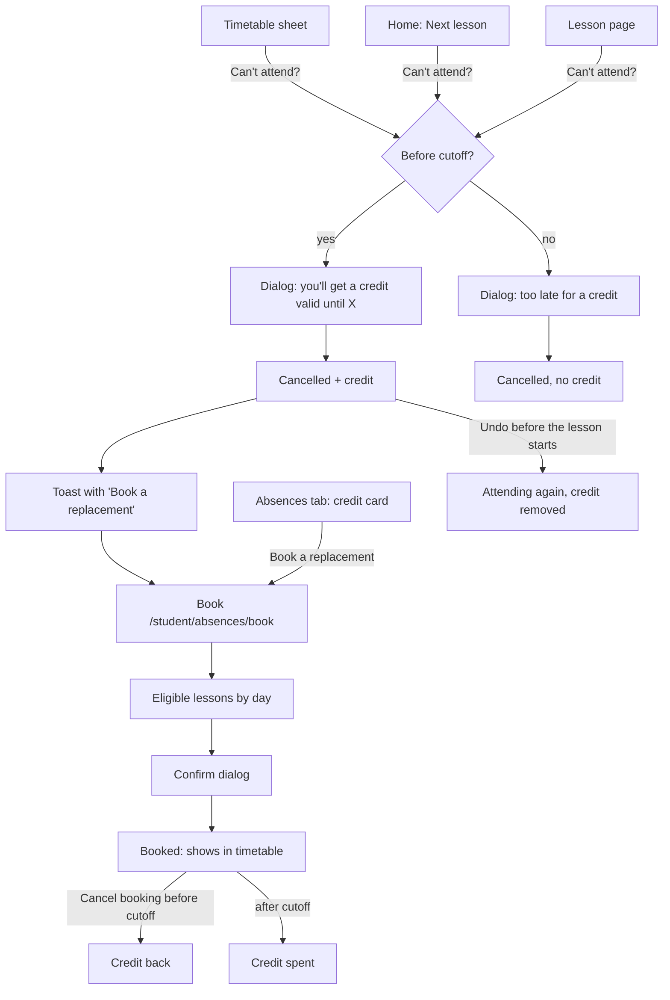
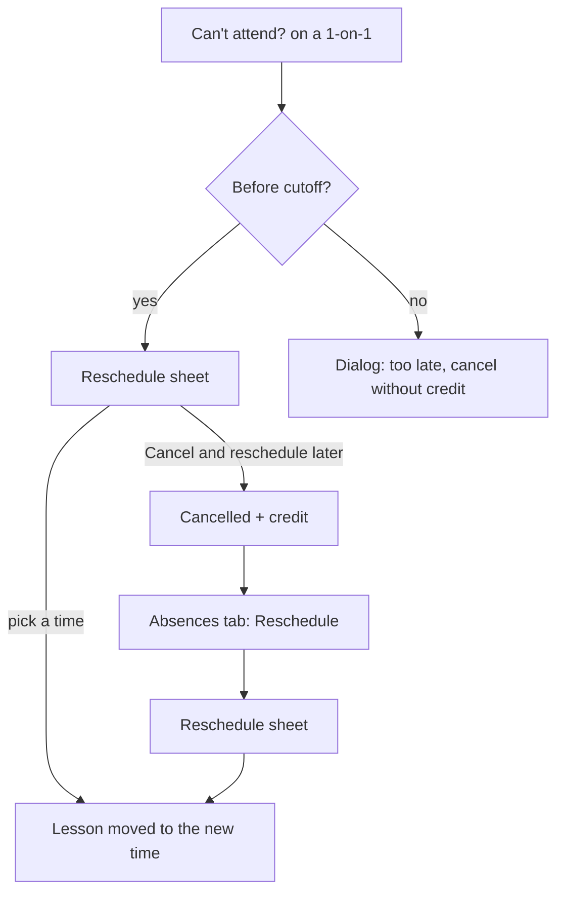
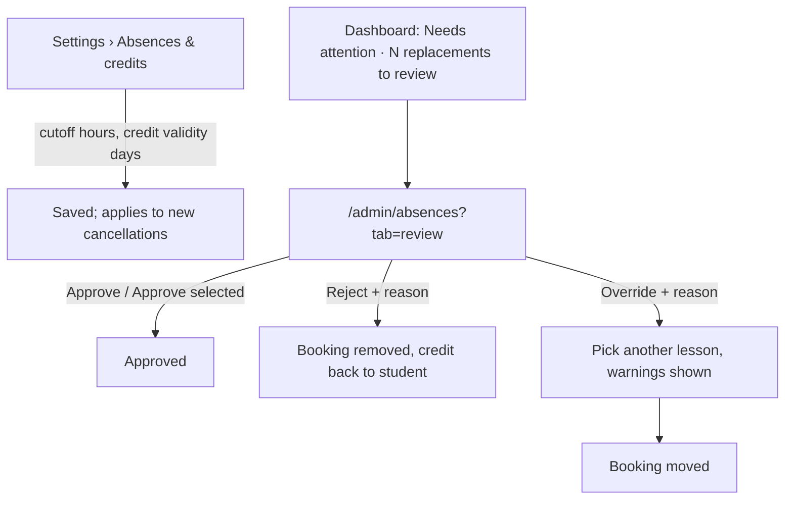

# Absences, makeup credits & replacements (Phase 3)

Spec for how a student **cancels** a lesson they can't attend, earns a
**makeup credit**, and spends it on a **replacement** group lesson or a
**rescheduled** 1-on-1. It also covers what teachers see on the lesson page
and how admins configure, monitor and review all of it. Builds on
`docs/design/tokens.md`, `docs/design/app-layout.md`,
`docs/design/timetable.md` (§6 weekly views, §6.3 details sheet) and
`docs/design/lessons.md` (lesson pages). Clickable wireframe:
`docs/design/wireframes/absences.html`.

The booking rules (eligibility, room capacity, reschedule slots, credit
lifecycle, concurrency) are owned by the Scheduling Engineer in
`docs/architecture/replacements.md` (CARM-40). This spec only states what the
UI shows and assumes; §12 lists every assumption CARM-40 must confirm or
correct. Where the two disagree, `replacements.md` wins and this spec is
updated.

## Owner decisions this spec follows (2026-10-14, CARM-38)

1. **Only the student reports their own absence.** Teachers and admins
   don't. The admin sets, per school, how long before the lesson a student
   can still cancel and earn a credit.
2. **Makeup credits expire.** The admin sets the expiry per school.
3. **Group lessons:** a replacement must be at the **same level**. It is
   auto-approved, and an admin can review and override it.
4. **Replacements are limited by room size**, not by group size.
5. **A 1-on-1 lesson is simply rescheduled.** It doesn't become a
   replacement in another student's lesson.
6. **Every user belongs to exactly one school.**

Earlier decisions still apply: no attendance tracking (`lessons.md`
decision 1), TeacherNotes never reach students, all strings go through
next-intl.

## 1. Goal

- A student who can't come taps **Can't attend?** on their phone and knows,
  before confirming, whether they will get a makeup credit.
- A student with a credit finds a lesson that fits in a few taps. Only
  lessons they can really book are shown: no "sorry, that one is full"
  after the fact, except for a genuine race.
- A teacher opening a lesson sees at a glance who isn't coming and who is
  joining as a replacement.
- An admin sets two numbers once, and spends a minute a day on a review
  queue that is empty most of the time.

## 2. Roles and access

| Role    | Screens                                                                                                                                          | Can read                                                                                                                   | Can do                                                                                                                                                            |
| ------- | ------------------------------------------------------------------------------------------------------------------------------------------------ | -------------------------------------------------------------------------------------------------------------------------- | ----------------------------------------------------------------------------------------------------------------------------------------------------------------- |
| Student | _Can't attend?_ (timetable sheet, lesson page, home) · Absences tab `/student/absences` · Book `/student/absences/book` · Reschedule sheet       | Their own cancellations, credits and bookings. For an eligible lesson: date, time, group, level, teacher, room, free seats | Cancel / undo their own upcoming lesson; book a replacement or reschedule a 1-on-1 with their own credit; cancel their own booking                                |
| Teacher | Lesson page `/teacher/lessons/[id]` (new _Students_ card) · timetable details sheet                                                              | For their lessons (regular or substitute): who cancelled (name, when, reason) and who joins as a replacement               | Nothing in P3 (decision 1)                                                                                                                                        |
| Admin   | Settings › Absences & credits `/admin/settings/absences` · Absences & replacements `/admin/absences` (tabs _Review_, _Replacements_, _Absences_) | Everything in the school                                                                                                   | Change the two settings; approve, reject or override a replacement or reschedule, with a reason. Admins can't cancel a lesson for a student (decision 1, §13 Q2). |

**Server-side rules** (the UI only mirrors them; QA covers them in CARM-44):

- Every query is scoped by `schoolId`. Student actions also check
  `studentId = me`. An id the user may not see returns **404**, as in
  `lessons.md` §2.
- Cancel, undo, book, reschedule and cancel-booking are server actions that
  re-check every rule (cutoff, eligibility, seats, clash, credit state) at
  submit time. The lists in the UI are only a preview.
- A student booked onto a lesson as a replacement can open that lesson's
  student page (log and homework, never TeacherNotes, never other students'
  names) while the booking is active (`AUTO_APPROVED`, `APPROVED`,
  `OVERRIDDEN` to that lesson). Access ends when it's rejected, cancelled or
  moved.
- The eligible-lesson list for students is a **student-safe DTO**: no other
  students' names, only a free-seat count.

## 3. Concepts shown in the UI

| Concept                                    | UI word (key)                                       | Meaning for the user                                                                                                                                                     |
| ------------------------------------------ | --------------------------------------------------- | ------------------------------------------------------------------------------------------------------------------------------------------------------------------------ |
| `AbsenceReport`                            | **Cancellation** (`absences.cancellation`)          | "I won't come to this lesson." Made by the student only. The word "absence" is kept for the nav and the admin page, because that is what admins call it.                 |
| Cutoff                                     | **Cancel by {dateTime}** (`absences.cutoff.by`)     | Lesson start minus the school's cutoff hours. Before it a cancellation earns a credit; after it, it doesn't. Always shown as an absolute date and time, never as "24 h". |
| `MakeupCredit`                             | **Makeup credit** (`credits.title`), short _credit_ | One lesson to make up. Valid until a date. Spent on one replacement or one reschedule.                                                                                   |
| `ReplacementRequest` (group lesson)        | **Replacement** (`replacements.title`)              | A seat in another group's lesson at the student's level, booked with a credit.                                                                                           |
| `ReplacementRequest` / reschedule (1-on-1) | **Rescheduled lesson** (`reschedule.title`)         | The same 1-on-1 (same teacher) at a new time, booked with a credit. Data shape is CARM-40's call (§12).                                                                  |
| Booking                                    | **Booking** (`bookings.*`)                          | Umbrella word on the student's Absences tab for "a replacement or a rescheduled lesson".                                                                                 |

### 3.1 One model for both lesson types

Group and 1-on-1 lessons follow the same three steps, so students learn it
once:

1. **Cancel** the lesson. Before the cutoff, a credit is created.
2. **Use the credit**: for a group lesson, book a replacement; for a 1-on-1,
   pick a new time with the same teacher.
3. The booking shows in the timetable. It can be **cancelled** with the same
   cutoff rule: before the cutoff the credit comes back, after it the credit
   is spent.

For a 1-on-1 the dialog offers steps 1 and 2 together (_Reschedule now_),
plus _Cancel and reschedule later_ when the student doesn't know a time yet
(§5.3).

A credit remembers what it came from: a group-lesson credit can only book a
group replacement, a 1-on-1 credit can only reschedule with the same
teacher (§12 A6).

### 3.2 Status badges

Student-facing:

| Thing               | State                          | Badge (token)                                            | Icon (lucide) |
| ------------------- | ------------------------------ | -------------------------------------------------------- | ------------- |
| Credit              | Available                      | **Valid until {date}** (`success`)                       | `ticket`      |
| Credit              | Available, expires in ≤ 7 days | **Expires in {days} days** (`warning`)                   | `ticket`      |
| Credit              | Used                           | **Used** (muted)                                         | `check`       |
| Credit              | Expired                        | **Expired** (muted)                                      | `clock-alert` |
| Lesson in timetable | Cancelled by me                | **Not attending** (`lesson-cancelled`)                   | `calendar-x`  |
| Lesson in timetable | Replacement / rescheduled      | **Replacement** / **Rescheduled** (`lesson-replacement`) | `repeat`      |
| Booking             | Rejected by the school         | **Removed by school** (`danger`)                         | `ban`         |
| Booking             | Moved by the school (override) | **Changed by school** (`info`)                           | `info`        |

`AUTO_APPROVED` and `APPROVED` both read **Booked** for the student. The
review is the school's business, not theirs.

Admin-facing (`ReplacementStatus`):

| Status              | Badge                            | Token     |
| ------------------- | -------------------------------- | --------- |
| `AUTO_APPROVED`     | **Needs review** (auto-approved) | `info`    |
| `APPROVED`          | **Approved**                     | `success` |
| `REJECTED`          | **Rejected**                     | `danger`  |
| `OVERRIDDEN`        | **Overridden**                   | `warning` |
| (student cancelled) | **Cancelled by student**         | muted     |

Absence (admin list): **Credit earned** (`success`) · **Late — no credit**
(`warning`).

## 4. User flows

### 4.1 Student — group lesson



### 4.2 Student — 1-on-1 lesson



### 4.3 Admin



## 5. Student (mobile-first)

### 5.1 _Can't attend?_ entry points

| Where                                                  | Control                                         | Shown when                                                                         |
| ------------------------------------------------------ | ----------------------------------------------- | ---------------------------------------------------------------------------------- |
| Timetable lesson details sheet (`timetable.md` §6.3)   | Outline button _Can't attend?_ + cutoff caption | Own scheduled lesson (regular or booking) that hasn't started                      |
| Home › Next lesson card (`app-layout.md` §7.4)         | Link button _Can't attend?_                     | Same                                                                               |
| Student lesson page `/student/lessons/[id]` (upcoming) | Outline button in the header                    | Same. Upcoming lesson pages show date, time, room, teacher only (`lessons.md` §2). |

The caption under the button always states the cutoff as an absolute time:

- Before the cutoff (`info` text): "Cancel by **Sun 19 Oct, 17:00** to get
  a makeup credit."
- After the cutoff (`warning` text): "It's after the cutoff (Sun 19 Oct,
  17:00). You can still cancel, but you won't get a credit."

For a lesson already cancelled by the student, the sheet shows the
**Not attending** badge, "You cancelled this lesson on {date}." plus either
"You got a makeup credit." or "No credit — cancelled after the cutoff.",
and an _Undo_ button (§5.6).

For a booking (replacement / rescheduled lesson) the same button reads
_Cancel booking_ (§5.7).

### 5.2 Cancel dialog — group lesson

A bottom `Sheet` on mobile, a `Dialog` on desktop. One screen, no steps.

```
┌──────────────────────────────┐
│ Cancel B1 Evening?           │ title
│ Mon 20 Oct · 17:00–18:30     │
│ ┌──────────────────────────┐ │
│ │ 🎟 You'll get a makeup    │ │ success Alert (before cutoff)
│ │ credit, valid until      │ │
│ │ Wed 19 Nov. Use it to    │ │
│ │ join another B1 lesson.  │ │
│ └──────────────────────────┘ │
│ Reason (optional)            │
│ [e.g. Doctor's appointment ] │ textarea, 2 lines, ≤ 300
│ Your teacher sees the reason.│ hint
│                              │
│ [ Cancel my lesson ]         │ primary, full width
│ [ Keep my lesson   ]         │ outline, full width
└──────────────────────────────┘
```

- **Before the cutoff:** `success` Alert with `ticket` icon: "You'll get a
  makeup credit, valid until {date}. Use it to join another {level} lesson."
- **After the cutoff:** `warning` Alert with `alert-triangle`: "It's less
  than {hours} hours before the lesson, so you won't get a makeup credit.
  Your teacher will still know you're not coming." The primary button reads
  _Cancel without credit_.
- **Reason** is optional, plain text, ≤ 300 characters, visible to the
  teacher and admins. Hint: "Your teacher sees the reason."
- The primary button is not destructive-red: cancelling is a normal,
  expected action, and it can be undone.
- **Success** closes the dialog and shows a toast:
  - with credit: "Lesson cancelled. You have a makeup credit until {date}."
    with action _Book a replacement_;
  - without: "Lesson cancelled. No credit, because it was after the cutoff."
- **Cutoff passed while the dialog was open:** the server refuses the
  "with credit" variant. The dialog switches to the after-cutoff state in
  place and shows a `warning` Alert "The cutoff passed while you were
  deciding. You can still cancel, but without a credit." The student must
  press the button again.
- **Lesson started meanwhile:** `danger` Alert "This lesson has already
  started, so it can't be cancelled." Only _Close_.
- **Error:** inline `danger` Alert above the buttons, reason text kept,
  _Try again_.

### 5.3 Can't attend — 1-on-1 lesson (Reschedule sheet)

Before the cutoff, _Can't attend?_ on a 1-on-1 opens the **Reschedule
sheet** directly (full-height bottom `Sheet` on mobile, right `Sheet` on
desktop):

```
┌──────────────────────────────┐
│ Reschedule your lesson       │
│ 1-on-1 with Tomas Horvat     │
│ Now: Tue 21 Oct · 18:00–18:45│ struck through after pick
│ Pick a new time (until 20 Nov)│
│ ‹ 20 – 26 Oct ›              │ week nav, 44 px
│ Wed 22 Oct                   │ h3
│ [16:00] [16:30] [19:00]      │ ToggleGroup chips, 44 px
│ Thu 23 Oct                   │
│ [17:00] [17:30]              │
│ Fri 24 Oct · no free times   │ muted
│ ─────────────────────────────│
│ New time: Wed 22 Oct, 16:00– │ summary, aria-live
│ 16:45 · Room 2               │
│ [ Reschedule ]               │ primary
│ Can't pick a time now?       │
│ Cancel and reschedule later  │ link button
└──────────────────────────────┘
```

- **Times offered** come from the server (CARM-40): same teacher, same
  length, teacher available, a free room, no clash with the student's other
  lessons, inside school days and hours, not on a holiday, at least the
  cutoff ahead of now, and before the credit's expiry. Start times on a
  30-minute grid (§12 A8).
- One week at a time, Monday first, opening on the week of the original
  lesson. `‹ ›` move between weeks up to the expiry. Days with no times show
  "No free times" so the student doesn't think the list is broken.
- Picking a chip fills the summary line, including the room (the server
  picks it). The _Reschedule_ button is enabled from the start; pressing it
  with nothing picked shows the field error "Pick a new time."
- **Success:** toast "Lesson moved to {dateTime}." The timetable shows the
  new lesson with the **Rescheduled** badge (§5.8); the old slot shows
  **Not attending**.
- **_Cancel and reschedule later_** opens the group-style cancel dialog
  (§5.2) with the copy "You'll get a credit to reschedule this lesson with
  {teacher}, valid until {date}." The credit then appears on the Absences
  tab with a _Reschedule_ button that opens this same sheet.
- **Time taken meanwhile:** inline `warning` Alert "That time was just
  taken. Pick another one." The chip list refreshes.
- **No times at all until expiry:** empty state "No free times with {teacher}
  before {date}. Cancel now to keep your credit and try again later, or
  contact the school office." with _Cancel and reschedule later_ as the
  primary button.
- **After the cutoff:** _Can't attend?_ opens the cancel dialog in its
  after-cutoff state (§5.2) — no reschedule, no credit.

### 5.4 Absences tab (`/student/absences`, bottom tab ★ "Absences")

h1 **Absences & credits**. Single column, `max-w-md`, newest relevant
things first.

```
┌──────────────────────────────┐
│ Absences & credits           │ h1
│ Cancel by 24 h before a      │ policy line (muted)
│ lesson to get a credit.      │
│ Makeup credits (2)           │ h2
│ ┌──────────────────────────┐ │
│ │ 🎟 From Mon 13 Oct        │ │ credit card
│ │ B1 Evening · Group lesson │ │
│ │ [Valid until 12 Nov]      │ │ success badge
│ │ [ Book a replacement ]    │ │ primary
│ └──────────────────────────┘ │
│ ┌──────────────────────────┐ │
│ │ 🎟 From Tue 14 Oct        │ │
│ │ 1-on-1 with Tomas Horvat  │ │
│ │ [Expires in 3 days]       │ │ warning badge
│ │ [ Reschedule ]            │ │
│ └──────────────────────────┘ │
│ Upcoming bookings (1)        │ h2
│ │ ⟳ Thu 23 Oct · 18:00      │ │ lesson-replacement card
│ │ B1 Morning · Replacement  │ │
│ │ For your lesson on 13 Oct │ │
│ │ [Cancel booking]          │ │
│ Upcoming cancellations (1)   │ h2
│ │ Mon 27 Oct · B1 Evening   │ │
│ │ Credit earned · [Undo]    │ │
│ History                      │ h2, collapsed list
│ ▸ Used and expired credits, │ │
│   past cancellations (6)     │
└──────────────────────────────┘
```

- **Policy line** (muted, under h1): "Cancel at least {hours} hours before a
  lesson to get a makeup credit. Credits are valid for {days} days." It
  reflects the school settings so the rule is never a surprise.
- **Makeup credits** — available credits only, soonest expiry first. Card:
  source lesson date, group (or "1-on-1 with {teacher}"), the validity
  badge, and one primary button: _Book a replacement_ (group) or
  _Reschedule_ (1-on-1). If several credits are available, every card has
  its button; the server always spends the **credit the student pressed**.
- **Upcoming bookings** — replacements and rescheduled lessons that haven't
  started, soonest first, with _Cancel booking_ (§5.7). A booking changed or
  removed by the school shows its badge and the school's reason
  ("Removed by school: Group B1 Morning moved to a smaller room.").
- **Upcoming cancellations** — the student's own cancellations of lessons
  that haven't started, with **Credit earned** / **No credit** and _Undo_
  (§5.6).
- **History** — a `Collapsible`, closed by default, with the count. Rows,
  newest first, 20 at a time with _Load more_:
  - "Credit from Mon 13 Oct — used for B1 Morning, Thu 23 Oct" (`Used`)
  - "Credit from Mon 6 Oct — expired on Thu 6 Nov" (`Expired`)
  - "Mon 29 Sep · B1 Evening — cancelled, no credit"
  - "Booking for Wed 1 Oct — removed by school: {reason}"
- **Empty state** (nothing at all): icon `calendar-x`, "No absences" /
  "If you can't come to a lesson, tap Can't attend? on it in your
  timetable. Cancel in time and you'll get a credit to make it up."
- Sections with nothing in them are hidden, except _Makeup credits_, which
  shows "No credits right now." so the student knows where they'd appear.
- **Loading:** skeleton of two cards. **Error:** `common.error.*` Alert +
  _Try again_.

**Home (`app-layout.md` §7.4):** when the student has at least one
available credit, a card appears under _Next lesson_: "You have {count}
makeup credits" with the soonest expiry and _Use a credit_ (→ Absences
tab). Hidden at 0.

**Nav badge:** the _Absences_ tab shows a dot when a credit expires within
7 days, with the accessible name "Absences, a credit expires soon".

### 5.5 Book a replacement (`/student/absences/book?credit={id}`)

Full page (not a sheet), because the list is long and needs the back
button.

```
┌──────────────────────────────┐
│ ‹ Absences                   │
│ Book a replacement           │ h1
│ Using your credit from       │
│ Mon 13 Oct · valid until     │
│ 12 Nov                       │
│ B1 lessons with free seats   │ h2
│ ‹ 20 – 26 Oct ›              │ week nav
│ Wed 22 Oct                   │ h3 per day
│ ┌──────────────────────────┐ │
│ │ 10:00–11:30 👥 B1 Morning │ │ lesson-group card
│ │ Room 1 · Eva Kováčová     │ │
│ │ 3 seats left              │ │
│ │ [ Book ]                  │ │
│ └──────────────────────────┘ │
│ ┌──────────────────────────┐ │
│ │ 18:00–19:30 👥 B1 Evening2│ │
│ │ Online · Peter Novák      │ │
│ │ 1 seat left               │ │ warning text when 1
│ │ [ Book ]                  │ │
│ └──────────────────────────┘ │
│ Lessons that clash with your │ muted footnote
│ timetable aren't shown.      │
└──────────────────────────────┘
```

- **Header:** which credit is used and until when. A student with several
  group credits can switch with a `Select` "Use credit from {date}".
- **List:** lessons the server says are eligible for this credit (CARM-40):
  the student's level, a free seat in the room, no clash, not started, not
  cancelled, before the credit's expiry, and not a lesson of the student's
  own group. Grouped by day, one week at a time, opening on the current
  week. `‹ ›` move up to the expiry week; earlier weeks aren't reachable.
- **Card:** time, group name with the group icon, room (online rooms say
  "Online"), teacher, and the seat count: "{n} seats left" (`warning`
  text at 1: "1 seat left"). Rooms without a capacity show no count (§12
  A3). The card is not a link; _Book_ is the only action.
- **Book** opens a confirm `Dialog`:
  "Book B1 Morning on Wed 22 Oct, 10:00?" / "This uses your makeup credit
  from Mon 13 Oct. You can cancel the booking until {cutoff} and keep the
  credit." Buttons _Book_ (primary) and _Back_.
- **Success:** redirect to the Absences tab and toast "Replacement booked
  for {dateTime}." with action _View in timetable_.
- **Race — seat taken:** the dialog shows `warning` "Someone just took the
  last seat. Pick another lesson." and closes to the refreshed list.
- **Credit expired or already used meanwhile:** `danger` Alert at the top
  of the page: "This credit expired on {date}." / "This credit has already
  been used." with _Back to Absences_. The list is hidden.
- **Empty week:** "No {level} lessons with free seats this week." with
  _Next week_ when the expiry allows.
- **Nothing at all until expiry:** "No {level} lessons with free seats
  before {date}. New seats free up when other students cancel, so check
  again later, or ask the school office." No action button.
- **Student has no level:** `warning` Alert "Your level isn't set yet, so
  we can't find replacement lessons. Ask the school office." No list.
- **Loading:** skeleton cards. **Error:** Alert + _Try again_.

### 5.6 Undo a cancellation

- Allowed while the lesson **hasn't started** (CARM-42).
- `AlertDialog` "Attend B1 Evening on Mon 20 Oct after all?" /
  - credit unused: "Your makeup credit from this lesson will be removed."
  - no credit: "You'll be back on the lesson list."
    Buttons _Yes, I'll attend_ / _Back_.
- **Credit already spent on a booking:** _Undo_ is replaced by the text
  "You used the credit from this lesson for {booking}. Cancel that booking
  first to undo." (§12 A5).
- Undo after the cutoff is allowed: the student loses nothing, because the
  credit, if any, is simply removed. Cancelling again later follows the
  cutoff at that moment.
- If the room has filled up with replacements meanwhile, undo is still
  allowed: the student's own group seat comes first (§12 A4).
- Toast: "You're attending {group} on {date} again."

### 5.7 Cancel a booking (replacement or rescheduled 1-on-1)

- Same entry points and the same dialog as §5.2, with the booking's own
  cutoff:
  - Before the cutoff: `success` "Your credit from {sourceDate} comes back,
    valid until {expiry}." Button _Cancel booking_.
  - After the cutoff: `warning` "It's after the cutoff, so your credit is
    used up." Button _Cancel booking anyway_.
  - Before the cutoff, but the credit has passed its expiry date
    meanwhile: `warning` "Your credit expired on {date}, so it won't come
    back."
- Cancelling a booking never creates a **new** credit; it only returns or
  spends the original one. This stops credit chains.
- A rescheduled 1-on-1 is cancelled the same way. It can't be rescheduled
  again directly: cancel it (credit back), then reschedule from the
  Absences tab.
- Toast: "Booking cancelled. Your credit is back." / "Booking cancelled."

### 5.8 Timetable and lesson page changes

Weekly timetable blocks and mobile cards (`timetable.md` §6.2, §6.5) get
two student states:

| State                     | Look                                                                                  | Text                                                              |
| ------------------------- | ------------------------------------------------------------------------------------- | ----------------------------------------------------------------- |
| Cancelled by me           | `lesson-cancelled` look, **no** line-through (the lesson still happens), `calendar-x` | badge "Not attending"                                             |
| Replacement / rescheduled | `lesson-replacement` (amber, 3 px left border), `repeat` icon                         | badge "Replacement" or "Rescheduled"; "For your lesson on {date}" |

The details sheet for a booking adds a row **Booking**: "Replacement for
your lesson on Mon 13 Oct" and the _Cancel booking_ button.

**Student lesson page for a replacement** (`/student/lessons/[id]`, when
booked): same page as `lessons.md` §6.4, with an `info` banner under the
header: "You're joining this lesson as a replacement." Log and homework
appear once the lesson has started, as for the student's own lessons. Back
link: _Absences_ or _Timetable_.

## 6. Teacher

### 6.1 Lesson page — Students card (`/teacher/lessons/[id]`)

A new card in the left column, **above** the lesson log, on every lesson
that isn't cancelled by the school. Admin's read-only lesson page
(`lessons.md` §7) shows the same card.

```
┌ Students                          Room 3 · 13 of 14 seats ┐
│ Coming (13)                                               │
│ Anna Kováč                                                │
│ Ben Novák                                                 │
│ Jana Malá     [⟳ Replacement · from B1 Morning]           │
│ …                                                         │
│ Not coming (2)                                            │
│ Peter Horák   cancelled 18 Oct · "Doctor's appointment"   │
│ Lucia Bielik  cancelled 20 Oct, 15:10 · [Late]            │
└───────────────────────────────────────────────────────────┘
```

- **Header:** h2 "Students" and, for rooms with a capacity, "{room} ·
  {taken} of {capacity} seats" (`tabular-nums`). Over capacity (§12 A4)
  turns this into `warning` text "{taken} of {capacity} seats — over
  capacity".
- **Coming** — group members active on the lesson date minus cancellations,
  plus replacement students, sorted by name. Replacement students get a
  `lesson-replacement` badge with the `repeat` icon and the text
  "Replacement · from {group}" so the teacher knows where they come from.
  Text and icon, never color alone.
- **Not coming** — students who cancelled: name, when they cancelled
  (relative date, full time in the `<time>` title), the reason in quotes
  if given, and a `warning` badge **Late** when it was after the cutoff
  (useful when it's 10 minutes before the lesson).
- Empty lists: "Everyone in the group is coming." (no cancellations) is
  shown as a muted line instead of the _Not coming_ list.
- Teachers can't edit anything here (decision 1).
- **1-on-1 lessons:** the card is replaced by a one-line banner when
  relevant:
  - on the new lesson: `info` "Rescheduled by {student} from {oldDateTime}."
  - on the original lesson: the lesson shows as cancelled by the student
    with "{student} cancelled this lesson" and the reason.

### 6.2 Timetable details sheet

The _Students_ row (`timetable.md` §6.3) becomes "{coming} coming · {n}
not coming · {r} replacements" with the names grouped the same way as §6.1.
The lesson block itself doesn't change, except that a 1-on-1 the student
cancelled shows the **Not attending** look with the student's name.

### 6.3 Teacher dashboard

The _Today_ list (`app-layout.md` §7.3) shows "−{n} · +{r}" next to a
lesson with cancellations or replacements, with the accessible label
"{n} not coming, {r} replacements".

## 7. Admin

### 7.1 Settings › Absences & credits (`/admin/settings/absences`)

A new item in the settings sub-nav, after _School_. Form, `max-w-2xl`,
one _Save_ button:

```
Absences & credits                                          h1
┌──────────────────────────────────────────────────────────┐
│ Cancellation cutoff                                       │
│ Students who cancel at least [ 24 ] hours before a lesson │
│ get a makeup credit.                                      │
│ Example: for a lesson on Mon 17:00, cancel by Sun 17:00.  │ live
│                                                           │
│ Credit validity                                           │
│ A makeup credit is valid for [ 30 ] days after the        │
│ missed lesson.                                            │
│ Example: a credit for Mon 20 Oct is valid until Wed 19 Nov│ live
│                                                           │
│ ⓘ Changes apply to new cancellations. Existing credits    │
│   keep their dates.                                       │
│                                                [ Save ]   │
└──────────────────────────────────────────────────────────┘
```

- **Cancellation cutoff** — whole hours, `Input type="number"` inline in
  the sentence, 0–168. Default **24**. 0 means "until the lesson starts".
  Label for screen readers: "Cancellation cutoff, in hours before the
  lesson".
- **Credit validity** — whole days, 1–365. Default **30**. Counted from the
  **missed lesson's date** (not the day the student cancelled), and the
  credit is valid until the end of that day in the school's timezone
  (§12 A2).
- Both examples update live as the admin types, using real dates.
- `info` Alert: "Changes apply to new cancellations. Existing credits keep
  their dates."
- Validation: `validation.integerRange` "Enter a whole number from {min} to
  {max}." Toast "Settings saved."
- Storage is CARM-40's call (§12 A1).

### 7.2 Absences & replacements (`/admin/absences`, nav _Absences & replacements_)

Desktop-first list page (`app-layout.md` §4.4) with three `Tabs`; the tab
is in the URL (`?tab=review`).

| Tab              | Default filter                     | Columns                                                                                                                                                              |
| ---------------- | ---------------------------------- | -------------------------------------------------------------------------------------------------------------------------------------------------------------------- |
| **Review ({n})** | Needs review, lesson not started   | ☐ · Booked (relative) · Student · From (original lesson) · To (target lesson) · Seats (room) · actions                                                               |
| **Replacements** | Lesson date: next 14 days          | Student · Type (Replacement / Rescheduled) · From · To · Status badge · Reviewed by · Booked at · actions                                                            |
| **Absences**     | Lesson date: last 7 + next 14 days | Lesson (date, time, group) · Student · Cancelled at · Reason · Credit (Credit earned / Late — no credit) · Credit status (Available until … / Used → link / Expired) |

- **Filters** (filter bar): lesson date range (`Calendar` range, presets
  _This week_, _Next 14 days_, _Last 30 days_), Student (`Combobox`), Group,
  Teacher, Level, and Status where it applies. Filters stay in the URL.
  _Clear filters_ resets to the tab's default.
- From / To cells show "Mon 13 Oct, 17:00 · B1 Evening" as links to the
  admin lesson page.
- Row menu (`more-horizontal`): _Approve_, _Reject…_, _Override…_,
  _Open student_. On the _Absences_ tab: _Open lesson_, _Open student_ only
  (admins don't cancel or undo for students, decision 1).
- Pagination 25 per page. Sorting by lesson date (default ascending on
  _Review_, so the most urgent is on top).
- **Empty states:**
  - Review: icon `check-circle`, "Nothing to review" / "Replacements are
    approved automatically. Ones you haven't checked yet appear here."
  - Replacements: "No replacements in this period."
  - Absences: "No cancellations in this period."
- **Dashboard** (`app-layout.md` §7.2): the stat card _Pending replacement
  reviews_ and a _Needs attention_ line "{n} replacements to review" link
  to this tab.

### 7.3 Review actions

Every replacement and reschedule is auto-approved when it's booked. The
_Review_ tab lists the `AUTO_APPROVED` ones whose lesson hasn't started.
Reviewing is optional: an unreviewed booking stays valid.

- **Approve** — one click, no dialog, toast "Approved." Also a bulk action:
  select rows with checkboxes, then _Approve selected ({n})_ in a bar above
  the table. A reason is optional and not asked for.
- **Reject…** — `AlertDialog`:
  - Title "Reject Jana Malá's replacement on Wed 22 Oct?"
  - Body "The booking is removed and the credit goes back to the student,
    valid until {expiry}." If the credit has expired since: "The credit
    expired on {date}. It will be returned with a new expiry of {date}."
    (§12 A7)
  - `Textarea` **Reason (required)** with hint "The student sees this
    reason." ≤ 300 characters.
  - Buttons _Reject_ (destructive) / _Cancel_.
- **Override…** — `Dialog` (desktop, `max-w-2xl`): move the booking to
  another lesson.
  - Shows the current booking at the top.
  - A lesson picker: the eligible list from §5.5 for this student, plus a
    switch **Show all lessons** that also lists lessons outside the rules
    (other level, full room, clash). Those rows carry the reason as a
    `warning` badge: "Different level (B2)", "Room full (14/14)",
    "Clashes with {lesson}". Choosing one requires ticking "I'm making an
    exception to the rules" (same pattern as the timetable editor's
    overridable conflicts, `timetable.md` §3.1). Lessons that have started
    or are cancelled are never offered.
  - `Textarea` **Reason (required)**, "The student sees this reason."
  - Button _Move booking_. Toast "Booking moved to {dateTime}."
- After any action the row leaves the _Review_ tab, and the status shows on
  the _Replacements_ tab with _Reviewed by {name}, {dateTime}_.
- Approve, reject and override write `reviewedBy*`, `reviewNote` and an
  `AuditLog` entry (CARM-43). Rejecting or overriding an already approved
  booking is allowed from the _Replacements_ tab while its lesson hasn't
  started.
- **Conflicts:** if the student cancelled the booking, or another admin
  reviewed it, while the dialog was open: `warning` Alert "This booking
  changed while you were reviewing it. Reload to see the current state."

### 7.4 Admin lesson page and timetable

The admin lesson page gets the _Students_ card from §6.1 (read-only), with
each replacement row linking to its review actions. The admin timetable
sheet gets the same counts as §6.2.

## 8. Copy (i18n keys, English source)

ICU plural syntax as in `lessons.md`. Dates and times are formatted by
next-intl from values, never put together by hand.

### absences

| Key                                  | Copy                                                                                                                                                                    |
| ------------------------------------ | ----------------------------------------------------------------------------------------------------------------------------------------------------------------------- |
| `nav.absencesShort`                  | Absences                                                                                                                                                                |
| `nav.absences`                       | Absences & replacements                                                                                                                                                 |
| `absences.title`                     | Absences & credits                                                                                                                                                      |
| `absences.policy`                    | Cancel at least {hours, plural, one {# hour} other {# hours}} before a lesson to get a makeup credit. Credits are valid for {days, plural, one {# day} other {# days}}. |
| `absences.cantAttend`                | Can't attend?                                                                                                                                                           |
| `absences.cutoff.before`             | Cancel by {dateTime} to get a makeup credit.                                                                                                                            |
| `absences.cutoff.after`              | It's after the cutoff ({dateTime}). You can still cancel, but you won't get a credit.                                                                                   |
| `absences.cancel.title`              | Cancel {group}?                                                                                                                                                         |
| `absences.cancel.creditInfo`         | You'll get a makeup credit, valid until {date}. Use it to join another {level} lesson.                                                                                  |
| `absences.cancel.creditInfoOneOnOne` | You'll get a credit to reschedule this lesson with {teacher}, valid until {date}.                                                                                       |
| `absences.cancel.noCreditWarning`    | It's less than {hours, plural, one {# hour} other {# hours}} before the lesson, so you won't get a makeup credit. Your teacher will still know you're not coming.       |
| `absences.cancel.reason`             | Reason (optional)                                                                                                                                                       |
| `absences.cancel.reasonPlaceholder`  | e.g. Doctor's appointment                                                                                                                                               |
| `absences.cancel.reasonHint`         | Your teacher sees the reason.                                                                                                                                           |
| `absences.cancel.confirm`            | Cancel my lesson                                                                                                                                                        |
| `absences.cancel.confirmNoCredit`    | Cancel without credit                                                                                                                                                   |
| `absences.cancel.keep`               | Keep my lesson                                                                                                                                                          |
| `absences.cancel.doneWithCredit`     | Lesson cancelled. You have a makeup credit until {date}.                                                                                                                |
| `absences.cancel.doneNoCredit`       | Lesson cancelled. No credit, because it was after the cutoff.                                                                                                           |
| `absences.cancel.cutoffPassed`       | The cutoff passed while you were deciding. You can still cancel, but without a credit.                                                                                  |
| `absences.cancel.started`            | This lesson has already started, so it can't be cancelled.                                                                                                              |
| `absences.notAttending`              | Not attending                                                                                                                                                           |
| `absences.youCancelled`              | You cancelled this lesson on {date}.                                                                                                                                    |
| `absences.gotCredit`                 | You got a makeup credit.                                                                                                                                                |
| `absences.noCreditLate`              | No credit — cancelled after the cutoff.                                                                                                                                 |
| `absences.undo`                      | Undo                                                                                                                                                                    |
| `absences.undo.title`                | Attend {group} on {date} after all?                                                                                                                                     |
| `absences.undo.removesCredit`        | Your makeup credit from this lesson will be removed.                                                                                                                    |
| `absences.undo.noCredit`             | You'll be back on the lesson list.                                                                                                                                      |
| `absences.undo.confirm`              | Yes, I'll attend                                                                                                                                                        |
| `absences.undo.creditUsed`           | You used the credit from this lesson for {booking}. Cancel that booking first to undo.                                                                                  |
| `absences.undo.done`                 | You're attending {group} on {date} again.                                                                                                                               |
| `absences.section.credits`           | Makeup credits ({count})                                                                                                                                                |
| `absences.section.bookings`          | Upcoming bookings ({count})                                                                                                                                             |
| `absences.section.cancellations`     | Upcoming cancellations ({count})                                                                                                                                        |
| `absences.section.history`           | History ({count})                                                                                                                                                       |
| `absences.history.creditUsed`        | Credit from {sourceDate} — used for {group}, {date}                                                                                                                     |
| `absences.history.creditExpired`     | Credit from {sourceDate} — expired on {date}                                                                                                                            |
| `absences.history.cancelledNoCredit` | {date} · {group} — cancelled, no credit                                                                                                                                 |
| `absences.history.bookingRemoved`    | Booking for {date} — removed by school: {reason}                                                                                                                        |
| `absences.empty.title`               | No absences                                                                                                                                                             |
| `absences.empty.description`         | If you can't come to a lesson, tap Can't attend? on it in your timetable. Cancel in time and you'll get a credit to make it up.                                         |
| `absences.status.creditEarned`       | Credit earned                                                                                                                                                           |
| `absences.status.noCredit`           | No credit                                                                                                                                                               |
| `absences.status.late`               | Late                                                                                                                                                                    |

### credits

| Key                       | Copy                                                                              |
| ------------------------- | --------------------------------------------------------------------------------- |
| `credits.title`           | Makeup credit                                                                     |
| `credits.from`            | From {date}                                                                       |
| `credits.oneOnOneWith`    | 1-on-1 with {teacher}                                                             |
| `credits.validUntil`      | Valid until {date}                                                                |
| `credits.expiresIn`       | {days, plural, one {Expires tomorrow} other {Expires in # days}}                  |
| `credits.used`            | Used                                                                              |
| `credits.expired`         | Expired                                                                           |
| `credits.none`            | No credits right now.                                                             |
| `credits.book`            | Book a replacement                                                                |
| `credits.reschedule`      | Reschedule                                                                        |
| `credits.home.title`      | {count, plural, one {You have # makeup credit} other {You have # makeup credits}} |
| `credits.home.soonest`    | The first one expires on {date}.                                                  |
| `credits.home.use`        | Use a credit                                                                      |
| `credits.navExpiringSoon` | Absences, a credit expires soon                                                   |
| `credits.error.expired`   | This credit expired on {date}.                                                    |
| `credits.error.used`      | This credit has already been used.                                                |
| `credits.backToAbsences`  | Back to Absences                                                                  |

### replacements (student booking)

| Key                               | Copy                                                                                                                                            |
| --------------------------------- | ----------------------------------------------------------------------------------------------------------------------------------------------- |
| `replacements.title`              | Replacement                                                                                                                                     |
| `replacements.book.title`         | Book a replacement                                                                                                                              |
| `replacements.book.usingCredit`   | Using your credit from {sourceDate} · valid until {expiry}                                                                                      |
| `replacements.book.switchCredit`  | Use credit from {date}                                                                                                                          |
| `replacements.book.listTitle`     | {level} lessons with free seats                                                                                                                 |
| `replacements.book.seatsLeft`     | {count, plural, one {# seat left} other {# seats left}}                                                                                         |
| `replacements.book.online`        | Online                                                                                                                                          |
| `replacements.book.action`        | Book                                                                                                                                            |
| `replacements.book.clashHint`     | Lessons that clash with your timetable aren't shown.                                                                                            |
| `replacements.book.confirmTitle`  | Book {group} on {dateTime}?                                                                                                                     |
| `replacements.book.confirmBody`   | This uses your makeup credit from {sourceDate}. You can cancel the booking until {cutoff} and keep the credit.                                  |
| `replacements.book.back`          | Back                                                                                                                                            |
| `replacements.book.done`          | Replacement booked for {dateTime}.                                                                                                              |
| `replacements.book.viewTimetable` | View in timetable                                                                                                                               |
| `replacements.book.seatTaken`     | Someone just took the last seat. Pick another lesson.                                                                                           |
| `replacements.book.emptyWeek`     | No {level} lessons with free seats this week.                                                                                                   |
| `replacements.book.nextWeek`      | Next week                                                                                                                                       |
| `replacements.book.emptyAll`      | No {level} lessons with free seats before {date}. New seats free up when other students cancel, so check again later, or ask the school office. |
| `replacements.book.noLevel`       | Your level isn't set yet, so we can't find replacement lessons. Ask the school office.                                                          |
| `replacements.badge`              | Replacement                                                                                                                                     |
| `replacements.forYourLesson`      | For your lesson on {date}                                                                                                                       |
| `replacements.joiningBanner`      | You're joining this lesson as a replacement.                                                                                                    |
| `replacements.removedBySchool`    | Removed by school                                                                                                                               |
| `replacements.changedBySchool`    | Changed by school                                                                                                                               |
| `replacements.schoolReason`       | {status}: {reason}                                                                                                                              |

### reschedule (1-on-1)

| Key                        | Copy                                                                                                                          |
| -------------------------- | ----------------------------------------------------------------------------------------------------------------------------- |
| `reschedule.title`         | Reschedule your lesson                                                                                                        |
| `reschedule.with`          | 1-on-1 with {teacher}                                                                                                         |
| `reschedule.now`           | Now: {dateTime}                                                                                                               |
| `reschedule.pick`          | Pick a new time (until {date})                                                                                                |
| `reschedule.noTimesDay`    | No free times                                                                                                                 |
| `reschedule.summary`       | New time: {dateTime} · {room}                                                                                                 |
| `reschedule.confirm`       | Reschedule                                                                                                                    |
| `reschedule.pickRequired`  | Pick a new time.                                                                                                              |
| `reschedule.later`         | Cancel and reschedule later                                                                                                   |
| `reschedule.laterPrompt`   | Can't pick a time now?                                                                                                        |
| `reschedule.done`          | Lesson moved to {dateTime}.                                                                                                   |
| `reschedule.taken`         | That time was just taken. Pick another one.                                                                                   |
| `reschedule.emptyAll`      | No free times with {teacher} before {date}. Cancel now to keep your credit and try again later, or contact the school office. |
| `reschedule.badge`         | Rescheduled                                                                                                                   |
| `reschedule.teacherBanner` | Rescheduled by {student} from {dateTime}.                                                                                     |

### bookings (cancel a booking)

| Key                             | Copy                                                            |
| ------------------------------- | --------------------------------------------------------------- |
| `bookings.cancel`               | Cancel booking                                                  |
| `bookings.cancelAnyway`         | Cancel booking anyway                                           |
| `bookings.cancel.title`         | Cancel your booking for {group} on {date}?                      |
| `bookings.cancel.creditBack`    | Your credit from {sourceDate} comes back, valid until {expiry}. |
| `bookings.cancel.creditLost`    | It's after the cutoff, so your credit is used up.               |
| `bookings.cancel.creditExpired` | Your credit expired on {date}, so it won't come back.           |
| `bookings.cancel.doneBack`      | Booking cancelled. Your credit is back.                         |
| `bookings.cancel.done`          | Booking cancelled.                                              |
| `bookings.row`                  | Booking                                                         |
| `bookings.rowText`              | Replacement for your lesson on {date}                           |

### lessonStudents (teacher / admin lesson page)

| Key                                | Copy                                                                   |
| ---------------------------------- | ---------------------------------------------------------------------- |
| `lessonStudents.title`             | Students                                                               |
| `lessonStudents.seats`             | {room} · {taken} of {capacity} seats                                   |
| `lessonStudents.overCapacity`      | {taken} of {capacity} seats — over capacity                            |
| `lessonStudents.coming`            | Coming ({count})                                                       |
| `lessonStudents.notComing`         | Not coming ({count})                                                   |
| `lessonStudents.replacementFrom`   | Replacement · from {group}                                             |
| `lessonStudents.cancelledAt`       | cancelled {when}                                                       |
| `lessonStudents.late`              | Late                                                                   |
| `lessonStudents.everyoneComing`    | Everyone in the group is coming.                                       |
| `lessonStudents.sheetSummary`      | {coming} coming · {notComing} not coming · {replacements} replacements |
| `lessonStudents.oneOnOneCancelled` | {student} cancelled this lesson                                        |
| `lessonStudents.todayDelta`        | {notComing} not coming, {replacements} replacements                    |

### adminAbsences

| Key                                       | Copy                                                                                  |
| ----------------------------------------- | ------------------------------------------------------------------------------------- |
| `adminAbsences.title`                     | Absences & replacements                                                               |
| `adminAbsences.tab.review`                | Review ({count})                                                                      |
| `adminAbsences.tab.replacements`          | Replacements                                                                          |
| `adminAbsences.tab.absences`              | Absences                                                                              |
| `adminAbsences.col.booked`                | Booked                                                                                |
| `adminAbsences.col.student`               | Student                                                                               |
| `adminAbsences.col.type`                  | Type                                                                                  |
| `adminAbsences.col.from`                  | From                                                                                  |
| `adminAbsences.col.to`                    | To                                                                                    |
| `adminAbsences.col.seats`                 | Seats                                                                                 |
| `adminAbsences.col.status`                | Status                                                                                |
| `adminAbsences.col.reviewedBy`            | Reviewed by                                                                           |
| `adminAbsences.col.lesson`                | Lesson                                                                                |
| `adminAbsences.col.cancelledAt`           | Cancelled at                                                                          |
| `adminAbsences.col.reason`                | Reason                                                                                |
| `adminAbsences.col.credit`                | Credit                                                                                |
| `adminAbsences.col.creditStatus`          | Credit status                                                                         |
| `adminAbsences.type.replacement`          | Replacement                                                                           |
| `adminAbsences.type.reschedule`           | Rescheduled                                                                           |
| `adminAbsences.status.needsReview`        | Needs review                                                                          |
| `adminAbsences.status.approved`           | Approved                                                                              |
| `adminAbsences.status.rejected`           | Rejected                                                                              |
| `adminAbsences.status.overridden`         | Overridden                                                                            |
| `adminAbsences.status.cancelledByStudent` | Cancelled by student                                                                  |
| `adminAbsences.status.creditEarned`       | Credit earned                                                                         |
| `adminAbsences.status.lateNoCredit`       | Late — no credit                                                                      |
| `adminAbsences.creditAvailableUntil`      | Available until {date}                                                                |
| `adminAbsences.creditUsedFor`             | Used → {lesson}                                                                       |
| `adminAbsences.preset.thisWeek`           | This week                                                                             |
| `adminAbsences.preset.next14`             | Next 14 days                                                                          |
| `adminAbsences.preset.last30`             | Last 30 days                                                                          |
| `adminAbsences.reviewedBy`                | Reviewed by {name}, {dateTime}                                                        |
| `adminAbsences.empty.review.title`        | Nothing to review                                                                     |
| `adminAbsences.empty.review.description`  | Replacements are approved automatically. Ones you haven't checked yet appear here.    |
| `adminAbsences.empty.replacements`        | No replacements in this period.                                                       |
| `adminAbsences.empty.absences`            | No cancellations in this period.                                                      |
| `adminAbsences.approve`                   | Approve                                                                               |
| `adminAbsences.approveSelected`           | Approve selected ({count})                                                            |
| `adminAbsences.approved`                  | {count, plural, one {Approved.} other {# replacements approved.}}                     |
| `adminAbsences.reject`                    | Reject…                                                                               |
| `adminAbsences.reject.title`              | Reject {student}'s replacement on {date}?                                             |
| `adminAbsences.reject.body`               | The booking is removed and the credit goes back to the student, valid until {expiry}. |
| `adminAbsences.reject.bodyExpired`        | The credit expired on {date}. It will be returned with a new expiry of {newDate}.     |
| `adminAbsences.reject.confirm`            | Reject                                                                                |
| `adminAbsences.reject.done`               | Replacement rejected. The student has their credit back.                              |
| `adminAbsences.reason`                    | Reason (required)                                                                     |
| `adminAbsences.reasonHint`                | The student sees this reason.                                                         |
| `adminAbsences.override`                  | Override…                                                                             |
| `adminAbsences.override.title`            | Move {student}'s booking                                                              |
| `adminAbsences.override.current`          | Current booking: {lesson}                                                             |
| `adminAbsences.override.showAll`          | Show all lessons                                                                      |
| `adminAbsences.override.otherLevel`       | Different level ({level})                                                             |
| `adminAbsences.override.roomFull`         | Room full ({taken}/{capacity})                                                        |
| `adminAbsences.override.clash`            | Clashes with {lesson}                                                                 |
| `adminAbsences.override.ack`              | I'm making an exception to the rules                                                  |
| `adminAbsences.override.confirm`          | Move booking                                                                          |
| `adminAbsences.override.done`             | Booking moved to {dateTime}.                                                          |
| `adminAbsences.changedMeanwhile`          | This booking changed while you were reviewing it. Reload to see the current state.    |
| `adminAbsences.openStudent`               | Open student                                                                          |
| `adminAbsences.openLesson`                | Open lesson                                                                           |
| `dashboard.admin.toReview`                | {count, plural, one {# replacement to review} other {# replacements to review}}       |

### settings (absences)

| Key                                  | Copy                                                                            |
| ------------------------------------ | ------------------------------------------------------------------------------- |
| `settings.absences.nav`              | Absences & credits                                                              |
| `settings.absences.title`            | Absences & credits                                                              |
| `settings.absences.cutoff`           | Cancellation cutoff                                                             |
| `settings.absences.cutoffSentence`   | Students who cancel at least {input} hours before a lesson get a makeup credit. |
| `settings.absences.cutoffLabel`      | Cancellation cutoff, in hours before the lesson                                 |
| `settings.absences.cutoffExample`    | Example: for a lesson on {lessonDateTime}, cancel by {cutoffDateTime}.          |
| `settings.absences.cutoffZero`       | Students get a credit until the lesson starts.                                  |
| `settings.absences.validity`         | Credit validity                                                                 |
| `settings.absences.validitySentence` | A makeup credit is valid for {input} days after the missed lesson.              |
| `settings.absences.validityLabel`    | Credit validity, in days after the missed lesson                                |
| `settings.absences.validityExample`  | Example: a credit for {lessonDate} is valid until {expiryDate}.                 |
| `settings.absences.appliesToNew`     | Changes apply to new cancellations. Existing credits keep their dates.          |
| `settings.absences.saved`            | Settings saved.                                                                 |
| `validation.integerRange`            | Enter a whole number from {min} to {max}.                                       |

## 9. Accessibility

- The cutoff is always text with an absolute date and time. The
  credit/no-credit difference uses an icon and a sentence, not color alone.
- Dialog result states (cutoff passed, seat taken) are announced: the Alert
  inside the dialog has `role="alert"` and focus moves to it.
- Reschedule time chips are a `ToggleGroup` (`role="radiogroup"` semantics):
  arrow keys move between times in a day, `Tab` moves between days. Each
  chip's accessible name is the full date and time ("Wednesday 22 October,
  16:00 to 16:45"). The summary line is `aria-live="polite"`.
- Seat counts read "3 seats left in Room 1", not just "3".
- Replacement badges on the teacher page include the text "Replacement",
  so they work without color and in screen readers.
- The settings inputs inside sentences have a full `aria-label`
  (`settings.absences.cutoffLabel`) and the live example is
  `aria-live="polite"`.
- Bulk approve: the select-all checkbox has a label and announces "{n}
  selected". The bar's button isn't the only way: every row has _Approve_.
- Student screens: 16 px text, 44 px targets, bottom sheets with a visible
  _Close_ button, no swipe-only dismissal.

## 10. Loading, empty and error states (summary)

| Screen                | Loading          | Empty                                              | Error / special                                                   |
| --------------------- | ---------------- | -------------------------------------------------- | ----------------------------------------------------------------- |
| Cancel dialog         | Button spinner   | —                                                  | Cutoff passed · lesson started · network (`common.error.network`) |
| Absences tab          | 2 card skeletons | `absences.empty.*`; credits section `credits.none` | `common.error.*` + _Try again_                                    |
| Book a replacement    | Card skeletons   | Empty week · nothing until expiry · no level       | Credit expired · credit used · seat taken                         |
| Reschedule sheet      | Chip skeletons   | Day "No free times" · nothing until expiry         | Time taken · cutoff passed · credit expired                       |
| Teacher Students card | Row skeletons    | `lessonStudents.everyoneComing`                    | Over capacity (warning)                                           |
| Admin settings        | Form skeleton    | —                                                  | Field validation · save error Alert                               |
| Admin list            | Table skeleton   | Per tab (§7.2)                                     | `common.noResults` + _Clear filters_ · changed meanwhile (§7.3)   |

## 11. Edge cases

- **School cancels a lesson the student already cancelled:** the student's
  credit stays (it was earned). (§12 A9)
- **School cancels a lesson a replacement student booked:** the booking is
  void and the credit returns automatically, with its expiry extended to at
  least 7 days from now if it would expire sooner. The student sees
  "Removed by school: Lesson cancelled" in History. (§12 A9)
- **Lesson time or room changes after booking:** the booking follows the
  lesson. If the new room is smaller than the seats taken, nobody is
  removed; the teacher and admin see "over capacity". (§12 A4)
- **Student leaves the group:** future cancellations of that group's
  lessons disappear with the membership; credits already earned stay until
  they expire.
- **Student's level changes:** credits stay; eligibility uses the current
  level at booking time. Existing bookings stay.
- **Several credits, same week:** each is spent separately. A student can
  hold at most one booking per target lesson.
- **Booking in the student's own group:** not offered (they're already in
  it). If they cancelled a lesson and want it back, that's _Undo_.
- **Cutoff 0:** captions read "Cancel any time before the lesson starts to
  get a makeup credit."
- **Timezone:** cutoff, "has started" and expiry use the school's timezone.
- **Archived student:** can't sign in; their credits stay visible to admins
  and expire normally.

## 12. Assumptions to align with CARM-40 (`docs/architecture/replacements.md`)

The rules doc is written in parallel. These are the UI's assumptions; each
needs a yes or a correction there.

- **A1 — Settings storage:** two integers on `School` (e.g.
  `cancellationCutoffHours`, default 24; `makeupCreditValidityDays`, default
  30).
- **A2 — Expiry:** `expiresAt` = end of (missed lesson's local date +
  validity days) in the school timezone, fixed when the credit is created.
  A booking's target lesson must **start** before `expiresAt`.
- **A3 — Rooms without capacity** (online): no seat limit, so no seat count
  is shown.
- **A4 — Over capacity:** undo of a cancellation and room changes are
  always allowed even if they push seats over capacity; the UI warns but
  never removes anyone.
- **A5 — Undo when the credit is spent:** blocked until the booking is
  cancelled.
- **A6 — Credit kind:** a credit from a group lesson books only group
  replacements; a credit from a 1-on-1 reschedules only with the same
  teacher (same 1-on-1 group). The UI decides which button to show from
  this.
- **A7 — Reject after expiry:** a rejected booking returns the credit; if it
  has expired, its expiry becomes at least 7 days from now. Same for a
  school-cancelled target lesson (A9).
- **A8 — Reschedule slots:** a server function returns free start times on
  a 30-minute grid for a week, using the timetable conflict checker; the
  new time must be at least the cutoff ahead of now. How a reschedule is
  stored (moved `Lesson` vs a new `Lesson` + `ReplacementRequest`) is up to
  CARM-40; the UI only needs "original lesson shows as Not attending, new
  one shows as Rescheduled" and the same cancel/return rules as a
  replacement.
- **A9 — School-cancelled lessons:** see §11.
- **A10 — Cancelled bookings:** a student-cancelled booking stays visible
  to admins as "Cancelled by student" (needs a status or a `cancelledAt`
  on `ReplacementRequest`).
- **A11 — Reason fields:** `AbsenceReport.reason` ≤ 300 characters;
  `reviewNote` required for reject and override, ≤ 300.

## 13. Open questions for the owner

1. **Q1 — Expiry start:** validity counted from the **missed lesson's
   date** (proposed) or from the day the student cancelled? Counting from
   the lesson means cancelling early doesn't shorten the credit.
2. **Q2 — Admin cancels for a student:** decision 1 says only students
   report absences. Should an admin still be able to cancel on a student's
   behalf when the student phones the office (e.g. young learners)? This
   spec offers no such action.
3. **Q3 — Credit back after a late booking cancel:** proposed: a booking
   cancelled after its cutoff spends the credit, the same rule as a normal
   lesson. Alternative: always return it.
4. **Q4 — Rejected after expiry:** proposed: give the student at least 7
   more days (A7). Alternative: the credit stays expired.
5. **Q5 — 1-on-1 "reschedule later":** proposed: allowed, using a credit
   with the normal expiry. Alternative: 1-on-1 lessons can only be moved
   in one step, no credit.
6. **Q6 — Limits:** should there be a cap on credits per term or bookings
   per week? This spec has none.
