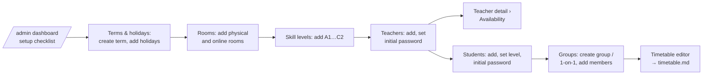
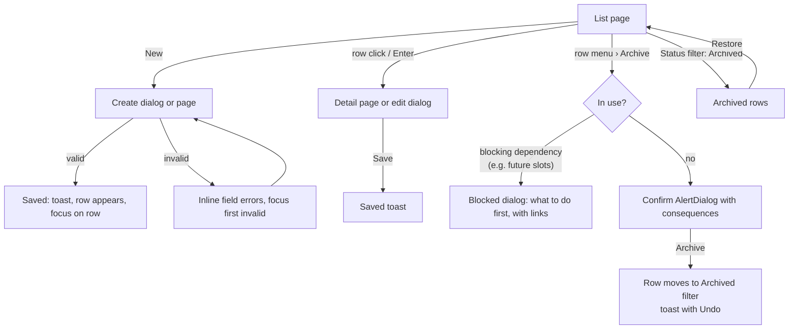
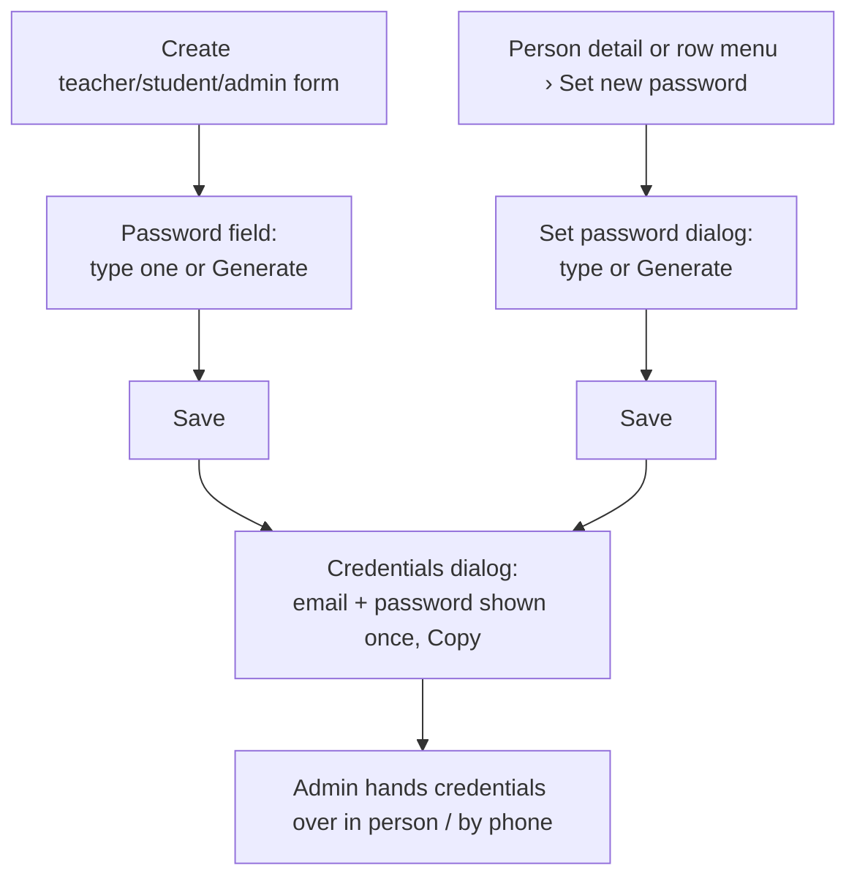

# Admin data screens (Phase 1)

Spec for the screens an admin uses to set up and maintain the school's core
data: teachers, students, skill levels, rooms, courses & groups (with members),
terms & holidays, teacher availability, and user passwords. Builds on
`docs/design/tokens.md` and `docs/design/app-layout.md` (shell, page patterns,
component rules, global states). Clickable wireframe:
`docs/design/wireframes/admin-data.html`.

The timetable editor and the weekly timetable views are in
`docs/design/timetable.md`.

## 1. Goal

- An admin can set up a new school from nothing in one sitting, in a natural
  order (term → rooms → levels → teachers → students → groups → timetable).
- Day-to-day changes (new student, student changes group, teacher away next
  Tuesday, new password) take a few clicks and never lose history.
- Every screen follows the same list → dialog/detail pattern, so there is one
  thing to learn.

## 2. Roles

| Role    | Access                                                                                                        |
| ------- | ------------------------------------------------------------------------------------------------------------- |
| Admin   | Full read/write on everything in this spec, own school only.                                                  |
| Teacher | None of these screens. Sees own groups read-only under _My groups & students_ (spec in the P1 teacher pages). |
| Student | None.                                                                                                         |

All reads and writes are enforced server-side (`requireRole("ADMIN")` +
`getSchoolScopedDb()`); hiding nav items is cosmetic only. Opening any URL in
this spec as teacher/student → 403 page (`errors.forbidden.*`). A guessed ID
of another school → 404 page (never reveal that it exists).

## 3. Information architecture

| Nav item (`app-layout.md` §4.3) | Route                    | Content                                                             |
| ------------------------------- | ------------------------ | ------------------------------------------------------------------- |
| People › Teachers               | `/admin/teachers`        | List                                                                |
|                                 | `/admin/teachers/[id]`   | Detail: tabs **Profile**, **Availability**, **Groups**              |
| People › Students               | `/admin/students`        | List                                                                |
|                                 | `/admin/students/[id]`   | Detail: tabs **Profile**, **Groups**                                |
| Academics › Courses & groups    | `/admin/groups`          | Tabs **Groups** (default), **Courses**                              |
|                                 | `/admin/groups/[id]`     | Detail: tabs **Members**, **Details**, **Timetable**                |
| Academics › Skill levels        | `/admin/levels`          | List (ordered by rank)                                              |
| Settings                        | `/admin/settings`        | Settings index with sub-nav (left `nav` on desktop, list on mobile) |
| Settings › School               | `/admin/settings/school` | Name, timezone, school week & hours                                 |
| Settings › Terms & holidays     | `/admin/settings/terms`  | Terms list; holidays per term + school-wide holidays                |
| Settings › Rooms                | `/admin/settings/rooms`  | List                                                                |
| Settings › Administrators       | `/admin/settings/admins` | List of admin accounts                                              |

Detail tabs are URL-addressable (`?tab=availability`) so links and the back
button work.

### 3.1 Setup checklist (admin dashboard, P1)

`app-layout.md` §7.2 announced it; spec here because it links into these
screens. Shown on `/admin` until every step is done, then replaced by the
normal dashboard. Card title `dashboard.admin.setup.title` "Set up your
school", progress "{done} of {total} done" (`dashboard.admin.setup.progress`).

| Step | Done when                       | Key                               | Link             |
| ---- | ------------------------------- | --------------------------------- | ---------------- |
| 1    | ≥ 1 term                        | `dashboard.admin.setup.term`      | Terms & holidays |
| 2    | ≥ 1 room                        | `dashboard.admin.setup.rooms`     | Rooms            |
| 3    | ≥ 1 level                       | `dashboard.admin.setup.levels`    | Skill levels     |
| 4    | ≥ 1 teacher                     | `dashboard.admin.setup.teachers`  | Teachers         |
| 5    | ≥ 1 student                     | `dashboard.admin.setup.students`  | Students         |
| 6    | ≥ 1 group with ≥ 1 member       | `dashboard.admin.setup.groups`    | Courses & groups |
| 7    | a term's timetable is published | `dashboard.admin.setup.timetable` | Timetable editor |

Each row: check icon (done, `text-success`, with hidden text "Done") or empty
circle, label, link. Steps are not locked — any order works.

## 4. User flows

### 4.1 First-time setup

### 4.2 Generic list → create / edit / archive

### 4.3 Set or reset a password (no email in v1)

## 5. Shared patterns for all screens in this spec

### 5.1 List page

- Page header: h1, one-line description (`muted-foreground`), primary button
  _New …_ on the right.
- **Filter bar** above the table (wraps on narrow screens): search `Input`
  (`type="search"`, placeholder per entity, matches name/email/code, debounced
  300 ms, reflected in `?q=`), entity-specific `Select` filters, and a
  **Status** `Select` _Active_ (default) / _Archived_ / _All_ for entities that
  can be archived. Filters live in the URL so a filtered list can be
  bookmarked and survives reload.
- **Table** in a card (TanStack "data table" recipe, `app-layout.md` §5):
  sticky header, sortable columns, first cell is a real link to the detail,
  last cell a row-action `DropdownMenu` (`aria-label` "Actions for {name}").
  25 rows per page with pagination (`Previous` / `Next` + "Showing 1–25 of 132").
- Counts in the page header description, e.g. "48 active students".
- Below 768 px the table becomes stacked cards (name + 2 key fields + menu).
  Admin screens are desktop-first, but must not break on a phone.

### 5.2 Create / edit

- ≤ 6 fields → `Dialog` (`max-w-lg`). Teachers and students use a dialog for
  **create** (the minimum to get started) and the **Profile tab** of the
  detail page for editing everything.
- Title "New {entity}" / "Edit {entity}". Footer: _Cancel_ (`outline`) +
  _Save_ / _Create {entity}_ (primary). Saving: button spinner + "Saving…",
  fields disabled.
- Validation: zod schema shared by client and server. Validate on blur and on
  submit; the **server is the source of truth** — server errors map to the
  same fields. Errors under the field, `text-destructive`, linked with
  `aria-describedby`; on submit focus the first invalid field. Form-level
  errors (network, conflict) in an `Alert` above the fields, data kept.
- After create: dialog closes, toast "{name} created" (`common.toast.created`),
  the new row is highlighted (`bg-accent` fading after 2 s) and focused.
- Unsaved changes on a detail page: leaving shows an `AlertDialog`
  "Discard changes?" (`common.unsaved.*`).
- Optimistic concurrency: if the record changed since the form opened
  (`updatedAt` mismatch), show `common.error.staleData` above the form with
  _Reload_; do not silently overwrite.

### 5.3 Archive, restore, delete

`User`, `Group`, `Room` and `Level` are soft-deleted, because history must
survive. Rooms and levels get `archivedAt` (owner decision 5, CARM-27). Everything
else is hard-deleted, and only while unused:

| Entity            | Action in UI          | Stored as                                         | Allowed when                                                                                            |
| ----------------- | --------------------- | ------------------------------------------------- | ------------------------------------------------------------------------------------------------------- |
| Teacher           | **Archive** / Restore | `User.deletedAt` (sign-in disabled)               | No slots in a current or future term (blocked dialog lists them, link to timetable).                    |
| Student           | **Archive** / Restore | `User.deletedAt`; active memberships get `leftAt` | Always; confirm lists groups they will leave.                                                           |
| Administrator     | **Archive** / Restore | `User.deletedAt`                                  | Not yourself; at least one active admin must remain.                                                    |
| Group             | **Archive** / Restore | `Group.deletedAt`                                 | No slots in a current or future term (end them first in the editor).                                    |
| Level             | **Archive** / Restore | `Level.archivedAt`                                | Always. Confirm lists the students and groups that keep it (§6.7). _Delete_ only while unused.          |
| Room              | **Archive** / Restore | `Room.archivedAt`                                 | Always. Confirm says how many slots still use it; they keep running (§6.9). _Delete_ only while unused. |
| Course            | **Delete**            | hard delete                                       | No groups use it.                                                                                       |
| Term              | **Delete**            | hard delete                                       | Timetable not published and no lessons. Otherwise disabled.                                             |
| Holiday           | **Delete**            | hard delete                                       | Always (published term: confirm shows impact, §6.8).                                                    |
| Availability rule | **Delete**            | hard delete                                       | Always.                                                                                                 |

- Archive confirm: `AlertDialog`, title "Archive {name}?", body lists the
  consequences (sign-in disabled; leaves groups; hidden from pickers), primary
  `destructive` "Archive". Toast with **Undo** (restores) for 10 s.
- Delete confirm: "Delete {name}?" + "This can't be undone." Only for
  unused records, so no consequences list. Rooms and levels offer both
  _Archive_ and _Delete_ in the row menu. _Delete_ is disabled with the
  tooltip "In use by {n} …" (`common.inUse`) once the record is used,
  so archiving is the normal way to retire one.
- **Blocked** state: `AlertDialog` with a single _OK_ / _Go to …_ action:
  "{name} can't be archived yet" + the reason + list (max 5, "+N more").
- Archived records: hidden from every picker (comboboxes in forms and the
  timetable editor) and from default lists; shown with an `Archived` badge
  (muted) when listed; existing lessons/history still show their names.
- **Exception: the current value.** When a form already points at an
  archived record, the picker keeps it as the selected value with an
  `Archived` badge. Examples: a student's level, a group's level, or a slot's
  room. Saving with that value unchanged is allowed. Once the admin picks
  something else, the archived record can't be picked again.
- Archived users who try to sign in get `auth.login.error.disabled`.

### 5.4 Password handling (all user types)

No email in v1, so the admin sets passwords and hands them over.

- **Create forms** (teacher, student, admin) have a _Password_ field with
  a _Generate_ button (`ghost`, icon `sparkles`) that fills a random 12-char
  password (no ambiguous characters `0O1lI`) and reveals it. Show/hide toggle
  as on login. Rule: min 10 characters (`validation.passwordMin`).
- **Set new password**: row menu and detail page header menu → `Dialog`
  "Set a new password for {name}", same field + _Generate_, Save.
- After either save: **Credentials dialog** "Share these sign-in details"
  with email and password in a read-only box, _Copy_ button (copies
  "Email: … / Password: …", toast "Copied"), and the note "This password won't
  be shown again. Ask {firstName} to keep it safe." Single _Done_ button.
  Passwords are never displayed anywhere else, never logged, never in the
  audit log `data`.
- Setting a new password does not sign out sessions that are already open in v1
  (stateless JWT). The owner accepted this on 2026-10-14 (decision 6). The UI
  doesn't mention sessions. To lock someone out at once, the admin archives
  them, because archiving takes effect on the next request.
- Admins change their own password via _My profile_ (user menu): current
  password + new password + confirm. Same rule.
- Every set/reset writes an `AuditLog` row (`user.password_set`, actor, target).

### 5.5 Pickers

- Person / group / room / level pickers use `Combobox` (> 10 options) showing
  name + secondary text (email, level code, room kind). Archived records are
  excluded. Type-ahead matches name, email, code.
- Weekday + time inputs: weekday `Select` (Mon–Sun, school week first; days
  outside the school week shown but marked "(no school)"), times `Select` in
  15-min steps within school hours plus `Input type="time"` fallback for
  keyboard users who prefer typing. Display via next-intl formats.
- Date inputs: `Calendar` in `Popover`, week starts Monday, plus a typed
  input in the locale format.

### 5.6 States (per screen, in addition to `app-layout.md` §6)

| State           | Pattern                                                                       |
| --------------- | ----------------------------------------------------------------------------- |
| Loading         | Table skeleton: header + 8 rows of grey bars, filter bar rendered (disabled). |
| Empty first use | Card with icon, title, description, primary action (`<entity>.empty.*`).      |
| No results      | "No {entities} match your filters." + _Clear filters_.                        |
| Archived empty  | "No archived {entities}."                                                     |
| Error           | Destructive `Alert` in place of the table with _Try again_.                   |
| Saving          | Button spinner, fields disabled.                                              |
| Validation      | Field errors (see §5.2), server errors mapped to fields.                      |

## 6. Screens

Column lists are in display order. "Sort" marks the default sort.

### 6.1 Teachers — list (`/admin/teachers`)

- h1 `teachers.title` "Teachers"; description `teachers.count` "{count, plural,
  one {# active teacher} other {# active teachers}}"; action `teachers.new`
  "New teacher".
- Filters: search (`teachers.search` "Search by name or email"), Status.
- Columns: **Name** (avatar initials in the teacher's color + name, sort) ·
  Email · Groups (count) · Lessons / week (from current term's slots) ·
  Status badge (only in _All_ view) · actions.
- Row actions: _Edit_ · _Availability_ · _Set new password_ · separator ·
  _Archive_ / _Restore_.
- Empty: `teachers.empty.title` "No teachers yet", `.description` "Add your
  teachers so you can assign them to groups and the timetable.", `.action`
  "Add teacher".

### 6.2 Teacher — create dialog

| Field           | Control                         | Rules                                                                  | Key                     |
| --------------- | ------------------------------- | ---------------------------------------------------------------------- | ----------------------- |
| Full name       | `Input`                         | required, 2–100 chars                                                  | `people.field.name`     |
| Email           | `Input type=email`              | required, valid, unique (case-insensitive) → `people.error.emailTaken` | `people.field.email`    |
| Password        | `Input` + Generate + show/hide  | required, ≥ 10 chars                                                   | `people.field.password` |
| Timetable color | swatch `RadioGroup` (8 options) | optional; default = next unused swatch                                 | `teachers.field.color`  |

Color swatches are a fixed palette chosen for ≥ 3:1 against white and used
only as the avatar/legend dot and the left border in teacher-filtered views —
lesson blocks keep the lesson-type tokens, so color never carries meaning
alone. Swatches have text names for screen readers ("Teal", "Orange", …).

Email already used by an **archived** user in this school → error with link
_Restore {name} instead_. Email used in another school (global `User`) → see
Q2; v1 shows `people.error.emailTaken`.

### 6.3 Teacher — detail (`/admin/teachers/[id]`)

Header: back link "Teachers", h1 name, `Archived` badge if archived, header
actions: _Set new password_ (`outline`) + overflow menu (_Archive_).

- **Profile** tab: form (name, email, color, bio `Textarea` optional ≤ 1000
  chars) + _Save changes_. Card "Sign-in": last password change date
  (from audit log) + _Set new password_.
- **Availability** tab: §6.4.
- **Groups** tab: read-only table of groups they teach in the selected term
  (term `Select`, default current): group, level, weekday/time, room. Link to
  each group. Empty: "{name} has no groups in {term}."

### 6.4 Teacher availability (tab on teacher detail)

Two cards. Explains itself: lead text `availability.lead` "The timetable
editor warns you when a lesson is planned while {firstName} is unavailable."

**Card A — Weekly unavailability** (`WEEKLY_UNAVAILABLE`)

- Visual: compact read-only week strip (school days as columns, school hours
  as rows, 24 px per hour) with hatched blocks for unavailable windows; the
  strip is `aria-hidden`, the **list below is the accessible source** and
  the place to edit.
- List rows: "Every Monday · 07:00–12:00 · Note" + _Edit_ / _Delete_ icon
  buttons (`aria-label` "Edit Monday 07:00–12:00").
- _Add unavailable time_ → dialog: weekday (`Select`), from, to, note
  (optional, ≤ 200 chars). Rule: from < to; overlapping rules on the same day
  are merged on save with a toast "Merged with an existing time on Monday."
- Bulk shortcut in the dialog: weekday is a multi-select checkbox group
  ("Mon … Sat") so "every morning" is one action (creates one row per day).
- Empty: `availability.weekly.empty` "{firstName} is available during all
  school hours."

**Card B — Exceptions (one-off dates)** (`DATE_UNAVAILABLE`, `DATE_AVAILABLE`)

- Table: Date (sort asc) · Type badge (_Unavailable_ = warning tone;
  _Available_ = success tone; always text) · Time ("Whole day" or range) ·
  Note · actions. Past dates hidden behind a _Show past exceptions_ toggle.
- _Add exception_ → dialog:
  - Type `RadioGroup`: _Unavailable on this date_ / _Available on this date
    (overrides the weekly rule)_.
  - Date (date picker; also a _To_ date for ranges → creates one row per
    day, max 31 days, `availability.error.rangeTooLong`).
  - _Whole day_ `Switch` (default on); when off, from/to selects.
  - Note.
- Impact preview in the dialog (published term only): "{count, plural, one
  {# scheduled lesson is} other {# scheduled lessons are}} affected on these
  dates." with list (date, time, group). Saving does **not** change lessons
  in P1 — substitutions are P5 — it only makes the conflict visible in the
  editor and lists them on save: toast "Saved. {n} lessons need a
  substitute or a change." with link to the timetable filtered to the teacher.
- Validation: `DATE_AVAILABLE` without a matching weekly rule on that
  weekday → warning text (not an error) "There's no weekly unavailability on
  this day, so this exception has no effect."
- Empty: `availability.exceptions.empty` "No exceptions planned."

### 6.5 Students — list (`/admin/students`)

- h1 "Students", count, action "New student".
- Filters: search (name, email, phone), **Level** (`Select`, incl. "No level"),
  **Group** (`Combobox`, incl. "Not in any group"), Status.
- Columns: **Name** (sort) · Email · Level (code badge) · Groups (names,
  comma separated, truncated + tooltip) · Phone · actions.
- Row actions: _Edit_ · _Add to group_ · _Set new password_ · _Archive_ / _Restore_.
- Empty: "No students yet" / "Add students, then enrol them in groups." /
  "Add student".

### 6.6 Student — create dialog and detail

Create dialog fields: Full name, Email, Password (+ Generate), Level
(`Select`, optional, `students.field.levelHint` "Used to match replacement
lessons to the right level."), Phone (optional, free text ≤ 30 chars),
_Add to group_ (optional `Combobox`; only groups with free capacity and,
by default, the selected level — see 6.10 rules).

Detail (`/admin/students/[id]`), header like teachers.

- **Profile**: name, email, level, phone; _Save changes_. Changing level
  when the student is in groups of another level → inline warning
  `students.levelMismatch` "{name} is in {group} ({level}). Changing the level
  doesn't move them to another group." (Saving allowed.)
- **Groups**: _Current_ table (group, type, level, teacher(s), joined date,
  _Remove from group_) and _Past_ table (group, joined, left). _Add to
  group_ button → dialog with group `Combobox` + start date (default today).
  Removing sets `leftAt` (date picker, default today) — never deletes.

### 6.7 Skill levels (`/admin/levels`)

- Ordered list (by `rank`), not paginated (typically ≤ 12). Columns: Order
  · Code (e.g. "B1") · Name ("Intermediate") · Students · Groups · actions.
- Reorder: _Move up_ / _Move down_ in the row menu (no drag-only; WCAG
  2.5.7). Optional drag handle as enhancement.
- Create/edit dialog: Code (required, ≤ 10 chars, unique →
  `levels.error.codeTaken`), Name (required, ≤ 60). New levels go last.
- Empty state offers a one-click preset: _Add CEFR levels (A1–C2)_
  (`levels.empty.preset`) next to _Add level_.
- Status filter _Active_ (default) / _Archived_ / _All_. Archived levels keep
  their `rank` and appear in that position with an `Archived` badge. _Move
  up / down_ only swaps active levels.
- **Archive** (row menu, always allowed): confirm `levels.archive.title`
  "Archive {code}?" with `levels.archive.consequence` "{students} students
  and {groups} groups keep this level. It's hidden when you pick a level for
  new students, groups and courses." _Restore_ brings it back to the pickers.
- Delete: only unused (§5.3).

### 6.8 Terms & holidays (`/admin/settings/terms`)

Terms table: Name · Dates ("1 Sep – 20 Dec 2026") · Status badge
(_Draft_ muted / _Published_ success / _Current_ info — current = today within
dates, shown in addition) · Slots · Holidays · actions (_Edit_, _Open
timetable_, _Delete_).

Term dialog: Name (required, unique), Start date, End date (required, end ≥
start → `terms.error.endBeforeStart`). Overlapping another term → warning,
not error (`terms.warning.overlap` "Overlaps with {term}. Lessons of both
terms will run in parallel."). Editing dates of a **published** term:
the dialog states `terms.impact.datesChanged` "Lessons outside the new dates
are removed (or cancelled if they have history); new dates get lessons." On
save the UI calls `regenerateLessons` and shows the result toast
(`timetable.md` §5.10). The date pickers don't allow moving the start or end
of a published term before today (`terms.error.cannotRemovePast`), because
the module never touches past lessons.

Delete term (only before publishing; the server refuses with
`scheduling.errors.TERM_HAS_LESSONS` otherwise): confirm lists what goes with
it — `terms.delete.cascade` "Its {slots} slots and {holidays} term holidays
are deleted too. School-wide holidays stay."

Holidays — a card under the table, **Holidays** with a `Select` scope
filter (_All_, _School-wide_, each term):

- Table: Name · Dates · Applies to (_All terms_ or term name) · actions.
- Dialog: Name (required, e.g. "Christmas break"), Start, End (inclusive;
  single-day = same date), Applies to `RadioGroup`: _All terms
  (school-wide)_ / _Only {term}_ `Select`.
- Adding/editing/deleting a holiday that touches a **published** term
  (`saveHoliday` / `deleteHoliday`, CARM-23): a confirm `AlertDialog` states
  the rule — add/edit: `holidays.confirm.add` "Lessons on these dates from
  today on are removed. Lessons with attendance, absences, homework or a
  substitute are kept as cancelled ('Holiday')."; delete:
  `holidays.confirm.delete` "Lessons on these dates come back from today
  on." After saving, the shared result toast (`timetable.md` §5.10). Past
  dates are never changed.
- Empty: "No holidays yet." + _Add holiday_.

### 6.9 Rooms (`/admin/settings/rooms`)

- Filters: search, Kind (_All / Physical / Online_).
- Columns: **Name** · Kind (icon `door-open` / `video` + text) · Capacity
  (physical; "—" for online without capacity) · Meeting link (online; host
  shown, full URL in tooltip, opens in new tab with external-link icon and
  hidden text "(opens in new tab)") · Used in slots (count) · actions.
- Dialog: Name (required, unique), Kind `RadioGroup` _Physical room_ /
  _Online room_; Physical → Capacity (required, integer 1–500); Online →
  Meeting link (optional, must be `https://`), Capacity (optional; empty =
  no limit). Switching kind keeps typed values but only the relevant ones are
  saved.
- Lowering capacity below a group that uses the room → warning in the
  dialog "{group} has {n} students; the timetable will show a capacity
  warning." (Saving allowed.)
- Status filter _Active_ (default) / _Archived_ / _All_. Archived rows have an
  `Archived` badge.
- **Archive** (row menu, always allowed): confirm `rooms.archive.title`
  "Archive {name}?". If slots in current or future terms use the room, the
  body adds `rooms.archive.slotsKeepRunning` "{count} slots still use this
  room. They keep running and are still checked. To move them, edit them in
  the timetable." with a link _Open timetable_ (filtered by this room).
  Otherwise the body just says `rooms.archive.consequence` "It's hidden from the
  timetable editor's room pickers. Past lessons keep it." _Restore_ brings
  it back.
- In the timetable editor, new slots can't use an archived room, and
  existing slots can't be moved into one. The scheduling module blocks
  this with `ROOM_ARCHIVED` (`timetable.md` §3.2).
- Empty: "No rooms yet" / "Add classrooms and online rooms to use them in the
  timetable." / "Add room".

### 6.10 Courses & groups (`/admin/groups`)

**Groups tab** (default)

- Filters: search, Type (_All / Group / 1-on-1_), Level, Course, Status.
- Columns: **Name** · Type (icon `users` / `user` + text, lesson-type
  tokens) · Level · Course · Members ("8 / 10"; "1 / 1" for 1-on-1; full =
  "10 / 10" with text "Full") · Teacher(s) (from current term's slots) ·
  actions (_Edit_, _Manage members_, _Archive_).
- Create/edit dialog:

  | Field    | Control                             | Rules                                                                                              |
  | -------- | ----------------------------------- | -------------------------------------------------------------------------------------------------- |
  | Type     | `RadioGroup`: Group lesson / 1-on-1 | required; **not editable** once the group has lessons (tooltip explains).                          |
  | Name     | `Input`                             | required, unique. For 1-on-1 prefilled "{student} 1-on-1" after picking the student.               |
  | Level    | `Select`                            | required.                                                                                          |
  | Course   | `Select`                            | optional; selecting a course pre-selects its level.                                                |
  | Capacity | `Input type=number`                 | Group: required 1–100. 1-on-1: fixed **1**, read-only with hint "1-on-1 lessons have one student." |
  | Student  | `Combobox` (1-on-1 only)            | optional at creation; the single member.                                                           |

  Capacity below current member count → error
  `groups.error.capacityBelowMembers` "This group already has {n} members.
  Remove members first or choose at least {n}."

**Group detail** (`/admin/groups/[id]`)

- Header: name, type badge, level badge, "Members 8 / 10", overflow
  (_Edit_, _Archive_).
- **Members** tab: table Name · Level · Joined · actions (_Remove from
  group_). _Add members_ → dialog with a multi-select student `Combobox`
  (checkbox list with search), start date (default today):
  - Default filter: students of the group's level; toggle _Show all levels_.
    Picking a student of another level shows inline warning tag "Level B2"
    (warning tone) — allowed (admin decides).
  - Capacity: the dialog shows "3 places left"; selecting more than the free
    places disables further checkboxes with the message
    `groups.members.full` "The group is full. Increase the capacity to add
    more." Never silently overfill.
  - Student already a member → hidden from the list.
  - Student whose existing groups have a slot at the same time as this
    group → warning tag "Time clash with {group}" (same data as the timetable
    student conflict).
- _Past members_ collapsible below (name, joined, left).
- **Details** tab: same fields as the dialog.
- **Timetable** tab: this group's slots per term (read-only list: weekday,
  time, teacher, room) with _Open in timetable editor_.

**Courses tab**: simple list Name · Level · Groups · actions; dialog Name
(required, unique), Level (required), Description (optional). Delete only
unused.

Empty (groups): "No groups yet" / "Create group classes and 1-on-1s, then add
students." / "New group".

### 6.11 Settings › School (`/admin/settings/school`)

Form (`max-w-2xl`): School name (required) · Timezone (`Combobox` of IANA
names, read-only once any lesson exists — changing it would shift every
lesson; tooltip explains) · **School week**: day checkboxes Mon–Sun (default
Mon–Sat) · **School hours**: from / to (default 07:00–21:00). These feed the
timetable grid range and the `OUTSIDE_SCHOOL_DAYS` / `OUTSIDE_SCHOOL_HOURS`
checks. Stored as `School.teachingWeekdays`, `dayStartMinute`,
`dayEndMinute` (CARM-23). Changing them doesn't move any slot; slots outside
the new range get the warning in the editor.

### 6.12 Settings › Administrators (`/admin/settings/admins`)

Same list pattern as teachers: Name · Email · Status · actions (_Set new
password_, _Archive_). Create dialog: name, email, password. Own row has
a "You" badge and no _Archive_. Archiving the last active admin is blocked
(`admins.error.lastAdmin`).

## 7. Copy (i18n keys, English source)

Namespaces map to files under `messages/en-GB/` (new: `people`, `teachers`,
`students`, `availability`, `levels`, `terms`, `holidays`, `rooms`, `groups`,
`courses`, `settings`, `admins`; additions to `common`, `validation`,
`dashboard`). Plurals use ICU.

### common (additions)

| Key                           | Copy                                                                |
| ----------------------------- | ------------------------------------------------------------------- |
| `common.save`                 | Save                                                                |
| `common.saveChanges`          | Save changes                                                        |
| `common.saving`               | Saving…                                                             |
| `common.cancel`               | Cancel                                                              |
| `common.edit`                 | Edit                                                                |
| `common.delete`               | Delete                                                              |
| `common.archive`              | Archive                                                             |
| `common.restore`              | Restore                                                             |
| `common.undo`                 | Undo                                                                |
| `common.actionsFor`           | Actions for {name}                                                  |
| `common.search`               | Search                                                              |
| `common.clearFilters`         | Clear filters                                                       |
| `common.noResultsFor`         | No {entities} match your filters.                                   |
| `common.status.label`         | Status                                                              |
| `common.status.active`        | Active                                                              |
| `common.status.archived`      | Archived                                                            |
| `common.status.all`           | All                                                                 |
| `common.pagination.summary`   | Showing {from}–{to} of {total}                                      |
| `common.pagination.previous`  | Previous                                                            |
| `common.pagination.next`      | Next                                                                |
| `common.toast.created`        | {name} created                                                      |
| `common.toast.saved`          | Changes saved                                                       |
| `common.toast.archived`       | {name} archived                                                     |
| `common.toast.restored`       | {name} restored                                                     |
| `common.toast.deleted`        | {name} deleted                                                      |
| `common.toast.copied`         | Copied                                                              |
| `common.confirm.archiveTitle` | Archive {name}?                                                     |
| `common.confirm.deleteTitle`  | Delete {name}?                                                      |
| `common.confirm.irreversible` | This can't be undone.                                               |
| `common.blocked.archiveTitle` | {name} can't be archived yet                                        |
| `common.inUse`                | In use by {count, plural, one {# record} other {# records}}         |
| `common.unsaved.title`        | Discard changes?                                                    |
| `common.unsaved.description`  | You have unsaved changes on this page.                              |
| `common.unsaved.discard`      | Discard                                                             |
| `common.unsaved.keepEditing`  | Keep editing                                                        |
| `common.error.title`          | Couldn't load this page                                             |
| `common.error.description`    | Check your connection and try again.                                |
| `common.error.network`        | Couldn't save. Check your connection — your changes are still here. |
| `common.error.staleData`      | Someone else changed this record. Reload to see the latest version. |
| `common.reload`               | Reload                                                              |
| `common.archivedBadge`        | Archived                                                            |
| `common.you`                  | You                                                                 |
| `common.opensInNewTab`        | (opens in new tab)                                                  |
| `common.optional`             | (optional)                                                          |
| `common.required`             | (required)                                                          |

### validation (additions)

| Key                       | Copy                                                                               |
| ------------------------- | ---------------------------------------------------------------------------------- |
| `validation.select`       | Choose {field}. (for selects; text fields keep the existing `validation.required`) |
| `validation.maxLength`    | Use {max} characters or fewer.                                                     |
| `validation.minLength`    | Use at least {min} characters.                                                     |
| `validation.passwordMin`  | Use at least 10 characters.                                                        |
| `validation.integerRange` | Enter a whole number from {min} to {max}.                                          |
| `validation.url`          | Enter a link starting with https://                                                |
| `validation.timeOrder`    | The end time must be after the start time.                                         |
| `validation.dateOrder`    | The end date must be on or after the start date.                                   |
| `validation.unique`       | {field} "{value}" is already used.                                                 |

### people (shared by teachers, students, admins)

| Key                                 | Copy                                                                         |
| ----------------------------------- | ---------------------------------------------------------------------------- |
| `people.field.name`                 | Full name                                                                    |
| `people.field.email`                | Email                                                                        |
| `people.field.password`             | Password                                                                     |
| `people.field.passwordHint`         | At least 10 characters. You'll see it once after saving so you can share it. |
| `people.password.generate`          | Generate                                                                     |
| `people.password.setNew`            | Set new password                                                             |
| `people.password.dialogTitle`       | Set a new password for {name}                                                |
| `people.credentials.title`          | Share these sign-in details                                                  |
| `people.credentials.description`    | This password won't be shown again. Ask {firstName} to keep it safe.         |
| `people.credentials.copy`           | Copy sign-in details                                                         |
| `people.credentials.copyText`       | Email: {email} Password: {password}                                          |
| `people.credentials.done`           | Done                                                                         |
| `people.lastPasswordChange`         | Password last set {date}                                                     |
| `people.error.emailTaken`           | This email is already used by another account.                               |
| `people.error.emailArchived`        | This email belongs to an archived account. Restore {name} instead.           |
| `people.archive.consequenceSignIn`  | {firstName} won't be able to sign in.                                        |
| `people.archive.consequenceHistory` | Past lessons and attendance are kept.                                        |

### teachers

| Key                                                               | Copy                                                                                                                                                              |
| ----------------------------------------------------------------- | ----------------------------------------------------------------------------------------------------------------------------------------------------------------- |
| `teachers.title`                                                  | Teachers                                                                                                                                                          |
| `teachers.count`                                                  | {count, plural, one {# active teacher} other {# active teachers}}                                                                                                 |
| `teachers.new`                                                    | New teacher                                                                                                                                                       |
| `teachers.newTitle`                                               | New teacher                                                                                                                                                       |
| `teachers.editTitle`                                              | Edit teacher                                                                                                                                                      |
| `teachers.search`                                                 | Search by name or email                                                                                                                                           |
| `teachers.col.name`                                               | Name                                                                                                                                                              |
| `teachers.col.email`                                              | Email                                                                                                                                                             |
| `teachers.col.groups`                                             | Groups                                                                                                                                                            |
| `teachers.col.lessonsPerWeek`                                     | Lessons / week                                                                                                                                                    |
| `teachers.field.color`                                            | Timetable colour                                                                                                                                                  |
| `teachers.field.bio`                                              | Bio                                                                                                                                                               |
| `teachers.tab.profile`                                            | Profile                                                                                                                                                           |
| `teachers.tab.availability`                                       | Availability                                                                                                                                                      |
| `teachers.tab.groups`                                             | Groups                                                                                                                                                            |
| `teachers.groups.empty`                                           | {name} has no groups in {term}.                                                                                                                                   |
| `teachers.empty.title`                                            | No teachers yet                                                                                                                                                   |
| `teachers.empty.description`                                      | Add your teachers so you can assign them to groups and the timetable.                                                                                             |
| `teachers.empty.action`                                           | Add teacher                                                                                                                                                       |
| `teachers.blocked.hasSlots`                                       | {name} still teaches {count, plural, one {# timetable slot} other {# timetable slots}} in current or upcoming terms. End or reassign them in the timetable first. |
| `teachers.blocked.openTimetable`                                  | Open timetable                                                                                                                                                    |
| `teachers.color.{blue,teal,green,orange,rose,purple,slate,amber}` | Blue, Teal, Green, Orange, Rose, Purple, Slate, Amber                                                                                                             |

### availability

| Key                                 | Copy                                                                                                  |
| ----------------------------------- | ----------------------------------------------------------------------------------------------------- |
| `availability.lead`                 | The timetable editor warns you when a lesson is planned while {firstName} is unavailable.             |
| `availability.weekly.title`         | Weekly unavailability                                                                                 |
| `availability.weekly.add`           | Add unavailable time                                                                                  |
| `availability.weekly.row`           | Every {weekday} · {from}–{to}                                                                         |
| `availability.weekly.empty`         | {firstName} is available during all school hours.                                                     |
| `availability.weekly.merged`        | Merged with an existing time on {weekday}.                                                            |
| `availability.exceptions.title`     | Exceptions                                                                                            |
| `availability.exceptions.add`       | Add exception                                                                                         |
| `availability.exceptions.showPast`  | Show past exceptions                                                                                  |
| `availability.exceptions.empty`     | No exceptions planned.                                                                                |
| `availability.field.weekdays`       | Days                                                                                                  |
| `availability.field.from`           | From                                                                                                  |
| `availability.field.to`             | To                                                                                                    |
| `availability.field.note`           | Note                                                                                                  |
| `availability.field.type`           | Type                                                                                                  |
| `availability.type.unavailable`     | Unavailable on this date                                                                              |
| `availability.type.available`       | Available on this date (overrides the weekly rule)                                                    |
| `availability.badge.unavailable`    | Unavailable                                                                                           |
| `availability.badge.available`      | Available                                                                                             |
| `availability.field.date`           | Date                                                                                                  |
| `availability.field.dateTo`         | To date                                                                                               |
| `availability.field.wholeDay`       | Whole day                                                                                             |
| `availability.wholeDay`             | Whole day                                                                                             |
| `availability.impact`               | {count, plural, one {# scheduled lesson is} other {# scheduled lessons are}} affected on these dates. |
| `availability.savedWithImpact`      | Saved. {count, plural, one {# lesson needs} other {# lessons need}} a substitute or a change.         |
| `availability.viewInTimetable`      | View in timetable                                                                                     |
| `availability.warning.noWeeklyRule` | There's no weekly unavailability on this day, so this exception has no effect.                        |
| `availability.error.rangeTooLong`   | Choose 31 days or fewer. Add longer absences in parts.                                                |

### students

| Key                             | Copy                                                                                   |
| ------------------------------- | -------------------------------------------------------------------------------------- |
| `students.title`                | Students                                                                               |
| `students.count`                | {count, plural, one {# active student} other {# active students}}                      |
| `students.new`                  | New student                                                                            |
| `students.search`               | Search by name, email or phone                                                         |
| `students.filter.level`         | Level                                                                                  |
| `students.filter.noLevel`       | No level                                                                               |
| `students.filter.group`         | Group                                                                                  |
| `students.filter.noGroup`       | Not in any group                                                                       |
| `students.field.level`          | Level                                                                                  |
| `students.field.levelHint`      | Used to match replacement lessons to the right level.                                  |
| `students.field.phone`          | Phone                                                                                  |
| `students.field.addToGroup`     | Add to group                                                                           |
| `students.tab.profile`          | Profile                                                                                |
| `students.tab.groups`           | Groups                                                                                 |
| `students.groups.current`       | Current groups                                                                         |
| `students.groups.past`          | Past groups                                                                            |
| `students.groups.joined`        | Joined                                                                                 |
| `students.groups.left`          | Left                                                                                   |
| `students.groups.remove`        | Remove from group                                                                      |
| `students.groups.removeTitle`   | Remove {name} from {group}?                                                            |
| `students.groups.removeDate`    | Last day in the group                                                                  |
| `students.levelMismatch`        | {name} is in {group} ({level}). Changing the level doesn't move them to another group. |
| `students.archive.leavesGroups` | {firstName} will leave: {groups}.                                                      |
| `students.empty.title`          | No students yet                                                                        |
| `students.empty.description`    | Add students, then enrol them in groups.                                               |
| `students.empty.action`         | Add student                                                                            |

### levels

| Key                          | Copy                                                                                                                                                                                                 |
| ---------------------------- | ---------------------------------------------------------------------------------------------------------------------------------------------------------------------------------------------------- |
| `levels.title`               | Skill levels                                                                                                                                                                                         |
| `levels.description`         | Levels order your groups and decide which replacement lessons a student can join.                                                                                                                    |
| `levels.new`                 | New level                                                                                                                                                                                            |
| `levels.col.order`           | Order                                                                                                                                                                                                |
| `levels.field.code`          | Code                                                                                                                                                                                                 |
| `levels.field.codeHint`      | Short label, e.g. B1                                                                                                                                                                                 |
| `levels.field.name`          | Name                                                                                                                                                                                                 |
| `levels.col.students`        | Students                                                                                                                                                                                             |
| `levels.col.groups`          | Groups                                                                                                                                                                                               |
| `levels.moveUp`              | Move up                                                                                                                                                                                              |
| `levels.moveDown`            | Move down                                                                                                                                                                                            |
| `levels.error.codeTaken`     | Code "{code}" is already used.                                                                                                                                                                       |
| `levels.empty.title`         | No levels yet                                                                                                                                                                                        |
| `levels.empty.description`   | Add the levels you teach, from easiest to hardest.                                                                                                                                                   |
| `levels.empty.action`        | Add level                                                                                                                                                                                            |
| `levels.empty.preset`        | Add CEFR levels (A1–C2)                                                                                                                                                                              |
| `levels.archive.title`       | Archive {code}?                                                                                                                                                                                      |
| `levels.archive.consequence` | {students, plural, one {# student} other {# students}} and {groups, plural, one {# group} other {# groups}} keep this level. It's hidden when you pick a level for new students, groups and courses. |

### terms / holidays

| Key                              | Copy                                                                                                                                                               |
| -------------------------------- | ------------------------------------------------------------------------------------------------------------------------------------------------------------------ |
| `terms.title`                    | Terms & holidays                                                                                                                                                   |
| `terms.new`                      | New term                                                                                                                                                           |
| `terms.field.name`               | Name                                                                                                                                                               |
| `terms.field.namePlaceholder`    | e.g. Autumn 2026                                                                                                                                                   |
| `terms.field.start`              | First day                                                                                                                                                          |
| `terms.field.end`                | Last day                                                                                                                                                           |
| `terms.col.dates`                | Dates                                                                                                                                                              |
| `terms.col.slots`                | Slots                                                                                                                                                              |
| `terms.col.holidays`             | Holidays                                                                                                                                                           |
| `terms.status.draft`             | Draft                                                                                                                                                              |
| `terms.status.published`         | Published                                                                                                                                                          |
| `terms.status.current`           | Current                                                                                                                                                            |
| `terms.openTimetable`            | Open timetable                                                                                                                                                     |
| `terms.error.endBeforeStart`     | The last day must be on or after the first day.                                                                                                                    |
| `terms.error.cannotRemovePast`   | A published term can't start or end before today.                                                                                                                  |
| `terms.warning.overlap`          | Overlaps with {term}. Lessons of both terms will run in parallel.                                                                                                  |
| `terms.impact.datesChanged`      | Lessons outside the new dates are removed (or cancelled if they have history); new dates get lessons.                                                              |
| `terms.delete.cascade`           | Its {slots, plural, one {# slot} other {# slots}} and {holidays, plural, one {# term holiday} other {# term holidays}} are deleted too. School-wide holidays stay. |
| `terms.empty.title`              | No terms yet                                                                                                                                                       |
| `terms.empty.description`        | A term sets the dates your timetable runs. Start with the current one.                                                                                             |
| `terms.empty.action`             | Add term                                                                                                                                                           |
| `holidays.title`                 | Holidays                                                                                                                                                           |
| `holidays.new`                   | Add holiday                                                                                                                                                        |
| `holidays.field.name`            | Name                                                                                                                                                               |
| `holidays.field.namePlaceholder` | e.g. Christmas break                                                                                                                                               |
| `holidays.field.start`           | First day                                                                                                                                                          |
| `holidays.field.end`             | Last day                                                                                                                                                           |
| `holidays.field.scope`           | Applies to                                                                                                                                                         |
| `holidays.scope.school`          | All terms (school-wide)                                                                                                                                            |
| `holidays.scope.term`            | Only {term}                                                                                                                                                        |
| `holidays.confirm.add`           | Lessons on these dates from today on are removed. Lessons with attendance, absences, homework or a substitute are kept as cancelled ("Holiday").                   |
| `holidays.confirm.delete`        | Lessons on these dates come back from today on.                                                                                                                    |
| `holidays.empty`                 | No holidays yet.                                                                                                                                                   |

### rooms

| Key                                | Copy                                                                                                                                                             |
| ---------------------------------- | ---------------------------------------------------------------------------------------------------------------------------------------------------------------- |
| `rooms.title`                      | Rooms                                                                                                                                                            |
| `rooms.new`                        | New room                                                                                                                                                         |
| `rooms.search`                     | Search rooms                                                                                                                                                     |
| `rooms.field.name`                 | Name                                                                                                                                                             |
| `rooms.field.kind`                 | Type                                                                                                                                                             |
| `rooms.kind.physical`              | Physical room                                                                                                                                                    |
| `rooms.kind.online`                | Online room                                                                                                                                                      |
| `rooms.field.capacity`             | Capacity                                                                                                                                                         |
| `rooms.field.capacityOnlineHint`   | Leave empty for no limit.                                                                                                                                        |
| `rooms.field.meetingUrl`           | Meeting link                                                                                                                                                     |
| `rooms.col.usedIn`                 | Used in slots                                                                                                                                                    |
| `rooms.noCapacity`                 | No limit                                                                                                                                                         |
| `rooms.warning.capacityBelowGroup` | {group} has {count} students; the timetable will show a capacity warning.                                                                                        |
| `rooms.empty.title`                | No rooms yet                                                                                                                                                     |
| `rooms.empty.description`          | Add classrooms and online rooms to use them in the timetable.                                                                                                    |
| `rooms.empty.action`               | Add room                                                                                                                                                         |
| `rooms.archive.title`              | Archive {name}?                                                                                                                                                  |
| `rooms.archive.consequence`        | It's hidden from the timetable editor's room pickers. Past lessons keep it.                                                                                      |
| `rooms.archive.slotsKeepRunning`   | {count, plural, one {# slot still uses} other {# slots still use}} this room. They keep running and are still checked. To move them, edit them in the timetable. |
| `rooms.archive.openTimetable`      | Open timetable                                                                                                                                                   |

### groups / courses

| Key                                 | Copy                                                                                      |
| ----------------------------------- | ----------------------------------------------------------------------------------------- |
| `groups.title`                      | Courses & groups                                                                          |
| `groups.tab.groups`                 | Groups                                                                                    |
| `groups.tab.courses`                | Courses                                                                                   |
| `groups.new`                        | New group                                                                                 |
| `groups.field.type`                 | Type                                                                                      |
| `groups.type.group`                 | Group lesson                                                                              |
| `groups.type.oneOnOne`              | 1-on-1                                                                                    |
| `groups.field.name`                 | Name                                                                                      |
| `groups.field.level`                | Level                                                                                     |
| `groups.field.course`               | Course                                                                                    |
| `groups.field.capacity`             | Capacity                                                                                  |
| `groups.field.capacityOneOnOne`     | 1-on-1 lessons have one student.                                                          |
| `groups.field.student`              | Student                                                                                   |
| `groups.field.typeLocked`           | The type can't change once the group has lessons.                                         |
| `groups.col.members`                | Members                                                                                   |
| `groups.col.teachers`               | Teachers                                                                                  |
| `groups.membersCount`               | {count} / {capacity}                                                                      |
| `groups.full`                       | Full                                                                                      |
| `groups.tab.members`                | Members                                                                                   |
| `groups.tab.details`                | Details                                                                                   |
| `groups.tab.timetable`              | Timetable                                                                                 |
| `groups.members.add`                | Add members                                                                               |
| `groups.members.placesLeft`         | {count, plural, =0 {No places left} one {# place left} other {# places left}}             |
| `groups.members.full`               | The group is full. Increase the capacity to add more.                                     |
| `groups.members.showAllLevels`      | Show all levels                                                                           |
| `groups.members.levelTag`           | Level {level}                                                                             |
| `groups.members.timeClash`          | Time clash with {group}                                                                   |
| `groups.members.startDate`          | First day in the group                                                                    |
| `groups.members.past`               | Past members                                                                              |
| `groups.members.empty`              | No members yet. Add students to this group.                                               |
| `groups.error.capacityBelowMembers` | This group already has {count} members. Remove members first or choose at least {count}.  |
| `groups.blocked.hasSlots`           | {name} has timetable slots in current or upcoming terms. End them in the timetable first. |
| `groups.openInEditor`               | Open in timetable editor                                                                  |
| `groups.empty.title`                | No groups yet                                                                             |
| `groups.empty.description`          | Create group classes and 1-on-1s, then add students.                                      |
| `groups.empty.action`               | New group                                                                                 |
| `courses.new`                       | New course                                                                                |
| `courses.field.name`                | Name                                                                                      |
| `courses.field.level`               | Level                                                                                     |
| `courses.field.description`         | Description                                                                               |
| `courses.empty`                     | No courses yet. Courses are optional — use them to name what a group teaches.             |

### settings / admins / dashboard

| Key                               | Copy                                                                  |
| --------------------------------- | --------------------------------------------------------------------- |
| `settings.title`                  | Settings                                                              |
| `settings.nav.school`             | School                                                                |
| `settings.nav.terms`              | Terms & holidays                                                      |
| `settings.nav.rooms`              | Rooms                                                                 |
| `settings.nav.admins`             | Administrators                                                        |
| `settings.school.name`            | School name                                                           |
| `settings.school.timezone`        | Time zone                                                             |
| `settings.school.timezoneLocked`  | The time zone can't change once lessons exist.                        |
| `settings.school.week`            | School days                                                           |
| `settings.school.hours`           | School hours                                                          |
| `settings.school.hoursHint`       | The timetable shows these hours and warns about lessons outside them. |
| `admins.title`                    | Administrators                                                        |
| `admins.new`                      | New administrator                                                     |
| `admins.error.lastAdmin`          | You can't archive the last administrator.                             |
| `admins.error.self`               | You can't archive your own account.                                   |
| `dashboard.admin.setup.title`     | Set up your school                                                    |
| `dashboard.admin.setup.progress`  | {done} of {total} done                                                |
| `dashboard.admin.setup.done`      | Done                                                                  |
| `dashboard.admin.setup.term`      | Add a term                                                            |
| `dashboard.admin.setup.rooms`     | Add rooms                                                             |
| `dashboard.admin.setup.levels`    | Add skill levels                                                      |
| `dashboard.admin.setup.teachers`  | Add teachers                                                          |
| `dashboard.admin.setup.students`  | Add students                                                          |
| `dashboard.admin.setup.groups`    | Create groups and add students                                        |
| `dashboard.admin.setup.timetable` | Build and publish the timetable                                       |

## 8. Accessibility notes

- Every dialog: title is the accessible name, focus on first field, `Esc`
  closes (with unsaved-changes check), focus returns to the trigger.
- Tables: `<caption class="sr-only">` with entity and filter summary
  ("Students, level B1, 12 results"); live region announces result counts
  after filtering (`role="status"`).
- Badges never rely on color: text is always present; icons are
  `aria-hidden`.
- Color swatch radio group: each swatch has a visible focus ring and a text
  name; selected swatch also shows a check icon.
- Availability week strip is decorative; the list is the source.
- Level reorder has buttons, not drag-only (WCAG 2.5.7).
- Generated passwords are announced via the field value; _Copy_ confirms via
  toast (`role="status"`).

## 9. Edge cases

- Email case: stored lower-case; "Anna@X.sk" and "anna@x.sk" are the same.
- Two students with the same name: lists show email as secondary text; pickers
  always show email.
- Teacher archived while being the regular teacher of past lessons: history
  shows "{name} (archived)".
- Student removed from a group mid-term: their future lessons for that group
  disappear from their timetable from the day after `leftAt`; past lessons
  and attendance stay.
- 1-on-1 group whose student is archived: group stays, member list empty,
  listed with warning "No student" in the groups list.
- Group capacity lowered by a race (two admins): server re-checks; second
  save gets `groups.error.capacityBelowMembers`.
- Room switched from physical to online while used: allowed; capacity checks
  change accordingly on next validation.
- Levels: deleting is impossible while in use, so ranks never point at
  nothing; reorder swaps ranks in one transaction (unique `(schoolId, rank)`).
  Archived levels keep their rank, so restoring one never collides.
- Room archived while slots use it: the slots keep running and lessons are
  still generated. The editor shows the room column/label with an `Archived`
  badge. Editing such a slot keeps the room as the current value (§5.3), and
  only moving it into a different archived room is blocked (`ROOM_ARCHIVED`).
- Level archived while students and groups have it: their detail pages show
  "B1 (archived)". Replacement-lesson matching (P3) still uses it.
- Holiday spanning two terms with scope "all terms": affects both.
- Term date edits that would orphan holidays outside the term: holidays stay
  (they're dates), shown with a muted "Outside term dates" note.
- Very long names: truncate in tables with tooltip, full in detail headers
  (wrap).

## 10. Open questions

Owner decisions (2026-10-14, CARM-22):

- **Archive rooms and levels:** yes. `archivedAt` on `Room` and `Level` (schema
  in CARM-27), plus a blocking `ROOM_ARCHIVED` conflict. See §5.3, §6.7, §6.9.
- **Password reset doesn't sign out open sessions:** accepted for v1. Archiving
  does sign the person out (§5.4).

Still open:

- **Q2 — Same person in two schools.** `User` is global and email unique.
  When an admin adds an email that exists in another school, v1 shows "already
  used". Fine while there is one school (P6 decides the multi-school flow).
