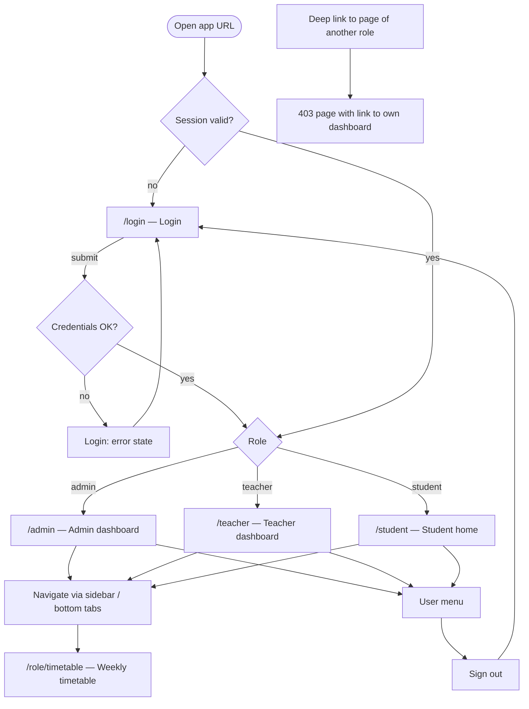

# App layout, components & first screens

Spec for the shell every feature lives in: navigation per role, header, responsive
behavior, the login screen, the three (empty) dashboards and a first look at the
weekly timetable grid. Tokens: `docs/design/tokens.md`. Clickable wireframe:
`docs/design/wireframes/app-layout.html` (open in a browser, no build step).

## 1. Goal

- One consistent, conventional shell for admin, teacher and student so each
  later feature only designs its page content.
- Navigation that already knows the full roadmap (P0–P6) so items slot in
  without re-layout.
- Student views work one-handed on a phone; admin views are optimised for a
  desktop screen.

## 2. Roles

| Role    | Primary device                           | Main jobs (roadmap)                                                                          |
| ------- | ---------------------------------------- | -------------------------------------------------------------------------------------------- |
| Admin   | Desktop (≥ 1280)                         | Set up school data, build timetable, review absences/replacements, people, payments, reports |
| Teacher | Desktop or tablet; phone between lessons | See own lessons, write lesson logs & homework, report absence                                |
| Student | Phone (≈ 390 × 844)                      | See next lesson & timetable, homework, report absence, book replacement                      |

**One role per user** (decided 2026-10-14): a person is admin, teacher or student — never several. No role switcher.

## 3. User flow



Routing (proposal for the Developer, enforced server-side in middleware + each
loader/action): role-prefixed segments `/admin/*`, `/teacher/*`, `/student/*`;
`/` redirects to the signed-in user's dashboard; `/login` is the only public page.
A deep link to a protected page while signed out goes to `/login?callbackUrl=…`
and returns there after sign-in (if the role allows it).

## 4. Layout shell

### 4.1 Desktop / tablet (≥ 768 px) — admin & teacher (student gets the same on desktop)

```
┌───────────────────────────────────────────────────────────────────────┐
│ [≡] [LL] Lingua Language School              [🔔 P5]  [AV Anna ▾]     │  header h-14, sticky
├──────────────┬────────────────────────────────────────────────────────┤
│ OVERVIEW     │  Breadcrumb (optional)                                  │
│ ▣ Dashboard  │  H1 Page title                       [Primary action]  │
│ SCHEDULE     │  ───────────────────────────────────────────────────    │
│ ▢ Timetable  │                                                         │
│ ▢ …          │  page content (bg-muted canvas, cards bg-card)          │
│              │                                                         │
│ ───────────  │                                                         │
│ ⚙ Settings   │                                                         │
└──────────────┴────────────────────────────────────────────────────────┘
```

- **Header** (`<header>`, sticky, `border-b`, `bg-background`):
  sidebar toggle (icon button, `aria-label` `nav.toggleSidebar`) · school
  **initials tile** (32 px, `bg-primary`, first letters of the school name — no
  uploaded logos, see §9) + **school name** (truncate with tooltip) ·
  right side: notifications bell (**P5**, not rendered before) · **user menu**.
- **User menu** (`DropdownMenu` on an `Avatar` + first name + chevron; on mobile avatar only):
  header shows full name, email and role badge · _My profile_ (P1) ·
  _Calendar subscription_ (iCal, **P5**) · _Language_ (only when > 1 locale) ·
  separator · _Sign out_.
- **Sidebar** (shadcn `Sidebar`, `collapsible="icon"`): grouped nav (section
  labels as `SidebarGroupLabel`), Settings pinned to the bottom. Expanded 256 px
  on ≥ 1024, icon rail on 768–1023 by default; user choice persisted in the
  `sidebar_state` cookie. Active item: `bg-accent text-accent-foreground
font-medium` + `aria-current="page"`. Collapsed rail shows tooltips.
- **Main** (`<main id="content">`): `bg-muted`, page padding `p-6`. Page header =
  h1 + optional description + right-aligned primary action. Content in cards.
- First focusable element: "Skip to content" link (`common.skipToContent`).

### 4.2 Mobile (< 768 px)

- Header: menu button (opens nav in a left `Sheet`) · school name · avatar (user menu).
- **Student only: bottom tab bar** (`<nav aria-label>`, fixed, 64 px + safe area)
  with up to 4 primary destinations + _More_ (opens the full nav sheet).
  Tabs: icon + label (always both), active = primary color + `aria-current`.
- Admin/teacher: no bottom bar; sheet navigation only. Admin pages that are
  desktop-only by nature (timetable editor) show a read-only view plus a
  notice `layout.desktopRecommended` instead of a broken editor.
- Page padding `p-4`, cards full-bleed allowed (`-mx-4` with no radius) for lists.

### 4.3 Navigation per role (full roadmap)

**Rule for later-phase items:** an item is rendered only once its feature ships
(nav config entry has a `phase` and `enabled` flag). No "coming soon" dead
links in the product. The wireframe shows them greyed with a phase badge _only
to validate the IA_.

Admin

| Section (`nav.section.*`) | Item                                              | i18n key            | Icon (lucide)      | Phase |
| ------------------------- | ------------------------------------------------- | ------------------- | ------------------ | ----- |
| —                         | Dashboard                                         | `nav.dashboard`     | `layout-dashboard` | P0    |
| Schedule                  | Timetable                                         | `nav.timetable`     | `calendar-days`    | P1    |
| Schedule                  | Lesson log (read-only, `lessons.md` §7)           | `nav.lessonLog`     | `notebook-pen`     | P2    |
| Schedule                  | Absences & replacements                           | `nav.absences`      | `calendar-x`       | P3    |
| Schedule                  | Substitutions                                     | `nav.substitutions` | `user-round-cog`   | P5    |
| Schedule                  | Auto-generate                                     | `nav.autoGenerate`  | `wand-sparkles`    | P4    |
| People                    | Students                                          | `nav.students`      | `graduation-cap`   | P1    |
| People                    | Teachers                                          | `nav.teachers`      | `presentation`     | P1    |
| Academics                 | Courses & groups                                  | `nav.courses`       | `book-open`        | P1    |
| Academics                 | Skill levels                                      | `nav.levels`        | `signal`           | P1    |
| Academics                 | Ratings                                           | `nav.ratings`       | `star`             | P5    |
| Finance                   | Payments                                          | `nav.payments`      | `wallet`           | P6    |
| Finance                   | Reports                                           | `nav.reports`       | `chart-column`     | P6    |
| (bottom)                  | Settings — school, terms & holidays, rooms, users | `nav.settings`      | `settings`         | P1    |

Teacher

| Section  | Item                 | i18n key            | Icon               | Phase |
| -------- | -------------------- | ------------------- | ------------------ | ----- |
| —        | Dashboard            | `nav.dashboard`     | `layout-dashboard` | P0    |
| Teaching | My timetable         | `nav.myTimetable`   | `calendar-days`    | P1    |
| Teaching | My groups & students | `nav.myGroups`      | `users`            | P1    |
| Teaching | Lesson log           | `nav.lessonLog`     | `notebook-pen`     | P2    |
| Me       | My absences          | `nav.myAbsences`    | `calendar-x`       | P3    |
| Me       | Substitutions        | `nav.substitutions` | `user-round-cog`   | P5    |

No _Parents_ item: parent accounts are out of scope (owner decision 2026-10-16, `payments-reports.md`). Payments and Reports are admin-only; teachers see no money anywhere.

Teachers have no _Ratings_ item: only admins see ratings (owner decision 2026-10-15, `notifications-substitutes.md` §2).

Student (bottom tabs marked ★)

| Item                      | i18n key                         | Icon             | Phase                           |
| ------------------------- | -------------------------------- | ---------------- | ------------------------------- |
| ★ Home                    | `nav.home`                       | `house`          | P0                              |
| ★ Timetable               | `nav.timetable`                  | `calendar-days`  | P1                              |
| ★ Homework                | `nav.homework`                   | `clipboard-list` | P2                              |
| ★ Absences & replacements | `nav.absencesShort` → "Absences" | `calendar-x`     | P3                              |
| Payments (in _More_)      | `nav.payments`                   | `wallet`         | P6                              |
| ★/More                    | `nav.more`                       | `menu`           | P0 (shown once > 4 items exist) |

Until P1 ships, the student bottom bar is hidden (only one destination).

### 4.4 Page-level patterns

| Pattern       | Use                                                                                                                         |
| ------------- | --------------------------------------------------------------------------------------------------------------------------- |
| List page     | Page header + filter bar (search `Input`, `Select` filters) + data table in a card + pagination                             |
| Detail page   | Page header with back link, `Tabs` for sub-areas, cards per section                                                         |
| Create / edit | Small forms (≤ 6 fields) in a `Dialog`; larger forms on their own page (`max-w-2xl`); destructive actions via `AlertDialog` |
| Quick view    | Right `Sheet` (desktop) / bottom `Sheet` (mobile) — e.g. lesson details from the timetable                                  |

## 5. Component guidelines (shadcn/ui)

| Need                                   | Component(s)                                                                                                       | Rules                                                                                                                                                                                                                                                                    |
| -------------------------------------- | ------------------------------------------------------------------------------------------------------------------ | ------------------------------------------------------------------------------------------------------------------------------------------------------------------------------------------------------------------------------------------------------------------------ |
| Actions                                | `Button`                                                                                                           | One primary per view. Variants: `default` (primary), `outline` (secondary), `ghost` (toolbar/icon), `destructive` (only inside confirm dialogs), `link`. Loading = disabled + `Loader2` spinner + verb-ing label.                                                        |
| Forms                                  | `Form` (react-hook-form + zod), `Input`, `Label`, `Textarea`, `Select`, `Checkbox`, `RadioGroup`, `Switch`         | Label above control; required fields marked "(required)" in label text, not just `*`. Validate on blur + submit. Error text under field, `text-destructive`, linked via `aria-describedby`, focus first invalid field on submit. Never disable submit to signal invalid. |
| Search-select (teacher, student, room) | `Combobox` = `Popover` + `Command`                                                                                 | Use when > 10 options.                                                                                                                                                                                                                                                   |
| Dates / times                          | `Calendar` in `Popover` (date picker); time = `Select` in 15-min steps or `Input type="time"`                      | Week starts Monday. Display format from next-intl (`dateTime` formats), never hand-built strings.                                                                                                                                                                        |
| Tables                                 | `Table` + TanStack Table ("data table" recipe)                                                                     | Sticky header, sortable columns via header buttons (`aria-sort`), row actions in a `DropdownMenu` (`more-horizontal`), clickable rows also have a real link in the first cell. Mobile: collapse to stacked cards for student-facing lists.                               |
| Dialogs                                | `Dialog`, `AlertDialog`, `Sheet`                                                                                   | `AlertDialog` for destructive/irreversible confirmation with the object name in the title. Focus trapped, `Esc` closes, focus returns to trigger.                                                                                                                        |
| Feedback                               | `Sonner` toasts, `Alert`                                                                                           | Toasts for success of user-initiated actions (bottom-right desktop, top-center mobile, 5 s, pause on hover, `role="status"`). Errors that need action → inline `Alert`, not a toast.                                                                                     |
| Status                                 | `Badge`                                                                                                            | Status tokens from `tokens.md`; always text, optional icon.                                                                                                                                                                                                              |
| Navigation                             | `Sidebar`, `Sheet`, `Breadcrumb`, `Tabs`, `DropdownMenu`, `Avatar`, `Tooltip`                                      | See §4.                                                                                                                                                                                                                                                                  |
| Loading                                | `Skeleton`                                                                                                         | Mirrors the final layout; no full-page spinners.                                                                                                                                                                                                                         |
| Timetable grid                         | Custom `TimetableGrid` (CSS grid) + `Button` lesson blocks + `Popover`/`Sheet` details + `ToggleGroup` view switch | No shadcn equivalent; see §8.                                                                                                                                                                                                                                            |
| Layout                                 | `Card`, `Separator`, `ScrollArea`                                                                                  |                                                                                                                                                                                                                                                                          |

## 6. States (apply to every screen)

| State                           | Pattern                                                                                                                                     | Copy keys                                                        |
| ------------------------------- | ------------------------------------------------------------------------------------------------------------------------------------------- | ---------------------------------------------------------------- |
| Loading                         | `Skeleton` blocks in the shape of the content (via `loading.tsx` / Suspense). Buttons: spinner + "Saving…".                                 | `common.loading`, `common.saving`                                |
| Empty — first use               | Centered in the card: 40 px muted icon, h2 title, one sentence what will appear here, primary action if the user can create it (else none). | `<feature>.empty.title`, `.description`, `.action`               |
| Empty — no results              | "No results for '{query}'" + _Clear filters_ link.                                                                                          | `common.noResults`, `common.clearFilters`                        |
| Error — load failed             | `Alert variant="destructive"` in place of content: title, one line, _Try again_ button (re-fetch). Route `error.tsx` uses the same.         | `common.error.title`, `common.error.description`, `common.retry` |
| Error — forbidden               | Full page 403: "You don't have access to this page" + _Go to my dashboard_.                                                                 | `errors.forbidden.*`                                             |
| Error — not found               | Full page 404 with link to dashboard.                                                                                                       | `errors.notFound.*`                                              |
| Offline / server down on submit | Inline `Alert` above form, form data kept.                                                                                                  | `common.error.network`                                           |

## 7. Screens

All copy below is English source for next-intl. `{name}` = ICU placeholder.

### 7.1 Login (`/login`, public)

Layout: `bg-muted` full screen, centered card `max-w-sm`, `rounded-xl`, `p-6`.
School initials tile + school name (display) above the card; v1 has one school, so the
name comes from the single seeded school (multi-school login is P6).

| Element                          | Key                                                   | Copy                                                                                       |
| -------------------------------- | ----------------------------------------------------- | ------------------------------------------------------------------------------------------ |
| Title (h1)                       | `auth.login.title`                                    | Sign in                                                                                    |
| Subtitle                         | `auth.login.subtitle`                                 | Sign in to {schoolName}                                                                    |
| Email label                      | `auth.login.email`                                    | Email                                                                                      |
| Password label                   | `auth.login.password`                                 | Password                                                                                   |
| Show/hide password (icon button) | `auth.login.showPassword` / `auth.login.hidePassword` | Show password / Hide password                                                              |
| Submit                           | `auth.login.submit` / `auth.login.submitting`         | Sign in / Signing in…                                                                      |
| Forgot password link             | `auth.login.forgot`                                   | Forgot password? — **not rendered in v1**; admins set passwords. Returns with email in P5. |
| Invalid credentials              | `auth.login.error.invalid`                            | Email or password is incorrect.                                                            |
| Account disabled                 | `auth.login.error.disabled`                           | Your account is disabled. Contact the school office.                                       |
| Rate limited                     | `auth.login.error.rateLimited`                        | Too many attempts. Try again in a few minutes.                                             |
| Server error                     | `auth.login.error.server`                             | Something went wrong. Please try again.                                                    |
| Required field                   | `validation.required`                                 | Enter your {field}.                                                                        |
| Invalid email                    | `validation.email`                                    | Enter a valid email address.                                                               |
| Session expired banner           | `auth.login.sessionExpired`                           | Your session expired. Sign in again to continue.                                           |
| Dev-only demo hint               | `auth.login.demoHint`                                 | Demo accounts: admin@…, teacher@…, student@… (rendered only when `NODE_ENV=development`)   |

States: default · field validation errors · submitting (inputs + button
disabled) · auth error (`Alert` above fields, `role="alert"`, password cleared,
focus to password) · session expired (info `Alert`).

Behavior: `autocomplete="email"` / `"current-password"`, `type="email"`,
Enter submits, no CAPTCHA in v1. Error message never reveals whether the email
exists. After success → role dashboard or `callbackUrl`.

### 7.2 Admin dashboard (`/admin`)

Zones (desktop, 12-col grid):

1. Page header: h1 `dashboard.greeting` "Good morning, {firstName}"
   (morning/afternoon/evening variants) + date (`dashboard.today` "Today is {date}").
2. **P1+ stat row** (4 cards): Lessons today · Teachers teaching today ·
   Pending replacement reviews (P3) · Teacher absences this week (P3).
3. Left 8 cols **Today's lessons** (compact list: time, group, teacher, room, status badge).
4. Right 4 cols **Needs attention** (P3: replacements to review, unassigned substitutions).

**P0 empty state** (what ships now): stat row and lists are not rendered; one card:

| Key                                 | Copy                                                                                                                                  |
| ----------------------------------- | ------------------------------------------------------------------------------------------------------------------------------------- |
| `dashboard.admin.empty.title`       | Your school is ready to set up                                                                                                        |
| `dashboard.admin.empty.description` | Once terms, rooms, teachers, students and groups are added, today's lessons and anything that needs your attention will show up here. |
| `dashboard.admin.empty.action`      | Go to settings (only when Settings exists — P1; in P0 no action)                                                                      |

From P1 the empty card turns into a **setup checklist** (term → rooms → teachers →
students → courses & groups → timetable), each step linking to its page with a
done check. Spec in the P1 dashboard issue.

### 7.3 Teacher dashboard (`/teacher`)

1. Greeting + date.
2. **Next lesson** card (P1): time until start, group/student, room, level, _Open lesson_ (P2 log).
3. **Today** list (P1) — same compact list as admin, own lessons only.
4. **To do** (P2): lessons without a log (`lessons.md` §5.1).

P0 empty state:

| Key                                   | Copy                                                                                           |
| ------------------------------------- | ---------------------------------------------------------------------------------------------- |
| `dashboard.teacher.empty.title`       | No lessons yet                                                                                 |
| `dashboard.teacher.empty.description` | When the school publishes the timetable, your lessons for today and the week will appear here. |

Also the "no lessons today" state (P1): `dashboard.teacher.noLessonsToday` "No lessons today. Your next lesson is {date} at {time}."

### 7.4 Student home (`/student`, mobile-first)

Single column at all widths (`max-w-md` centered on desktop).

1. Greeting "Hi, {firstName}".
2. **Next lesson** card (P1): weekday + time (large), course/group, teacher, room; _Can't attend?_ (P3).
3. **Latest homework** (P2): homework from the last lesson of each group, _See all_ (`lessons.md` §6.3).
4. **This week** (P1): mini agenda of remaining lessons.

P0 empty state:

| Key                                   | Copy                                                                         |
| ------------------------------------- | ---------------------------------------------------------------------------- |
| `dashboard.student.empty.title`       | You're all set                                                               |
| `dashboard.student.empty.description` | Your lessons and homework will appear here once you're enrolled in a course. |

### 7.5 Weekly timetable — first look (`/admin/timetable`, `/teacher/timetable`, `/student/timetable`)

Read-only view of dated **Lesson instances** for one week (P1). The editor for
recurring `TimetableSlot`s, drag & drop and the full weekly-view states are
specified in `docs/design/timetable.md`.

Toolbar (one row desktop, wraps on mobile):
`‹` `Today` `›` · week label "13 – 19 Oct 2026" (`timetable.weekRange`) ·
view `ToggleGroup` Week / Day (`timetable.view.week|day`) ·
admin only: filter `Combobox`es _Teacher_, _Room_, _Group_ (`timetable.filter.*`)
and _Edit timetable_ button (P1 editor).

Desktop week grid:

- Columns: time axis (56 px) + one column per **school day** (Mon–Sat default;
  school setting). Today's column header highlighted (`bg-accent`, `aria-current="date"`).
- Rows: school hours (default 07:00–21:00; school setting), 64 px
  per hour, 15-min snapping, hairline every 30 min.
- Lesson block (`button`, absolutely positioned by start/duration): time range,
  group/student name (bold), room · teacher (admin) or room · level (teacher),
  type icon + hidden text "Group lesson"/"1-on-1 lesson". Colors per
  `lesson-*` tokens. Short lessons (≤ 30 min) show name only, rest in tooltip.
- Overlaps in the same column split the width side-by-side (max 3, then "+N more").
- Current-time line in today's column.
- Click/Enter on a block → details `Sheet` (desktop right, mobile bottom).
- Keyboard: blocks are in time order in the tab sequence; arrow keys move
  between blocks (roving tabindex) — detailed in the timetable spec.
- Accessible alternative: the Day view is a plain list (`<ol>`), which screen
  readers get as the semantic equivalent.

Mobile (student default, < 768): **Day view as agenda list**: horizontal
week-day strip (Mon–Sun chips with date, dot if lessons), then cards per lesson in
time order. Swipe is optional; prev/next buttons always present.

States: loading (grid skeleton with 3–4 grey blocks) · empty week
(`timetable.empty.week` "No lessons this week.") · no timetable published
(`timetable.empty.none` "The timetable for this term hasn't been published yet.")
· error (Alert + retry) · filters with no result (`common.noResults`).

## 8. Edge cases

- Very long school names (truncate in header with tooltip; full in login).
- Users with no first name / long names → avatar initials fallback, truncate in menu.
- Session expires mid-session → next server action redirects to `/login?reason=expired` (banner) and back to `callbackUrl`.
- Signed-in user opens `/login` → redirect to their dashboard.
- Role changed by admin while user is signed in → enforced on next request server-side; UI shows 403 page for no-longer-allowed pages.
- Student on desktop → same shell as others (sidebar, no bottom bar); content stays `max-w-md`/`max-w-3xl`.
- Timetable: lessons outside default hours extend the grid; days with no school (holidays) show a striped column with label `timetable.holiday`.
- Timezone: all times shown in the school's timezone (school setting), not the browser's.
- 320 px width and 400 % zoom: header collapses to menu + avatar; tables become cards.

## 9. Decisions (project owner, 2026-10-14)

1. **Roles**: one role per user. No multi-role users, no role switcher.
2. **Later-phase nav items**: hidden until the feature ships (no "coming soon" items).
3. **Passwords**: admins set passwords in v1; _Forgot password?_ is not rendered until email exists (P5).
4. **School week**: Mon–Sat, 07:00–21:00 by default (stored as a school setting, so other schools can change it).
5. **Branding**: no school logos. The product is multi-school, so the UI stays neutral: the shared blue theme plus the school name and an initials tile. No per-school theming in v1.
6. **Dark mode**: not in v1. Light theme only; the dark values in `tokens.md` stay as reference for later.

No open questions remain for this spec.
