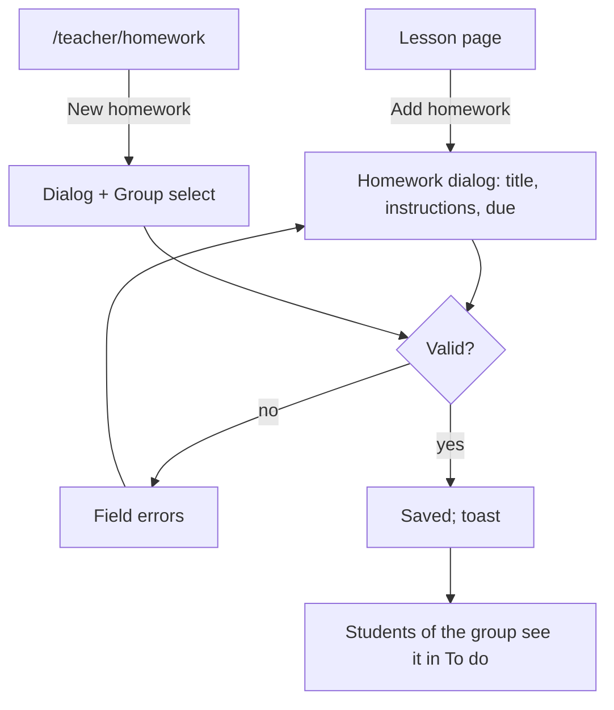
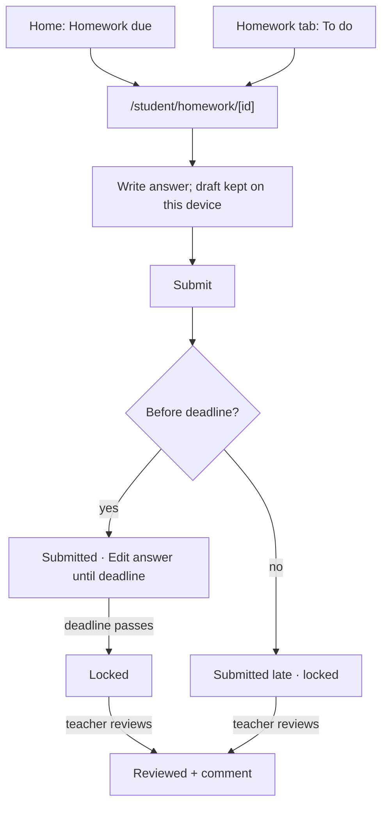
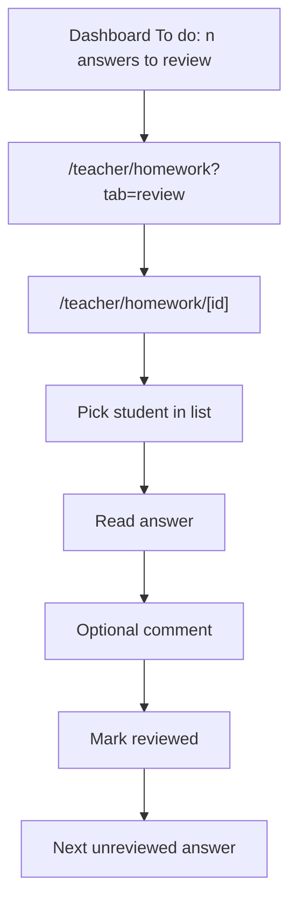

# Homework & text submissions (Phase 2)

Spec for setting homework for a group, students answering it with **text**
(no files in v1, owner decision 2026-10-14), and teachers reviewing the
answers. The lesson page that homework starts from is in
`docs/design/lessons.md`. Builds on `docs/design/tokens.md` and
`docs/design/app-layout.md`. Clickable wireframe:
`docs/design/wireframes/homework.html`.

## 1. Goal

- A teacher sets homework in the lesson in a few seconds: title, what to
  do, due next lesson (pre-filled).
- A student on a phone sees what's due and when, writes an answer, and can
  fix it until the deadline.
- A teacher sees who has answered, reads each answer and marks it reviewed,
  optionally with a short comment the student sees.

## 2. Roles and access

| Role    | Screens                                                                                                          | Can do                                                                                                                                                                                             |
| ------- | ---------------------------------------------------------------------------------------------------------------- | -------------------------------------------------------------------------------------------------------------------------------------------------------------------------------------------------- |
| Teacher | Lesson page _Homework_ card · `/teacher/homework` (nav _Homework_) · `/teacher/homework/[id]` (detail + review)  | **Teachers of the group** (regular teacher of any lesson of the group in the current term, or substitute of the lesson the homework is set in): create, edit, delete, read and review submissions. |
| Student | Home card _Homework due_ · `/student/homework` (bottom tab) · `/student/homework/[id]`                           | Read homework of groups they are a member of; write, edit (until the deadline) and read **their own** submission and its review.                                                                   |
| Admin   | Read-only `/admin/homework/[id]`, homework rows on the admin lesson page, _Homework_ tab on group/student detail | Read everything, no writes in P2.                                                                                                                                                                  |

Server-side: every homework/submission query is scoped by `schoolId`;
student queries return only their own submission (never others' text,
counts or names); teachers' access is derived from the group as above.
Unknown or inaccessible ids → 404.

## 3. Concepts and rules

| Concept          | UI word (key)                     | Rule                                                                                                                   |
| ---------------- | --------------------------------- | ---------------------------------------------------------------------------------------------------------------------- |
| `Assignment`     | **Homework** (`homework.title`)   | For one group. Optional "set in" lesson. Title ≤ 120 chars, instructions ≤ 5,000 chars (plain text, URLs auto-linked). |
| Due lesson       | **Due next lesson** / a lesson    | Deadline = that lesson's `startsAt` (follows the lesson if it moves).                                                  |
| Due date         | **Due on a date**                 | Deadline = **23:59 on that date**, school timezone.                                                                    |
| Submission (new) | **Answer** (`submissions.answer`) | One per student and homework. Text ≤ 10,000 chars.                                                                     |
| On time          | —                                 | Submitted before the deadline.                                                                                         |
| Late             | **Late** badge (`warning`)        | Submitted after the deadline.                                                                                          |
| Reviewed         | **Reviewed** badge (`success`)    | Teacher marked it reviewed; optional comment to the student.                                                           |

Exactly one of _due lesson_ / _due date_ is set (the schema allows both
null; the form requires one).

### 3.1 What happens after the due date (decision)

Conventional and forgiving, because the tool should not police deadlines:

1. **Before the deadline**: the student can submit and edit freely.
2. **After the deadline, already submitted**: the answer is **locked**
   (read-only). The student sees "Submitted on {dateTime}".
3. **After the deadline, not submitted**: the student can still submit
   **once**; it's marked **Late** for both sides. After sending it is
   locked.
4. **Once reviewed**: always locked, whatever the deadline.
5. A teacher who moves the deadline later re-opens editing for everyone
   whose answer isn't reviewed (rule 1 applies again).

There is no "close submissions" switch in P2 (see Q2).

### 3.2 Student list buckets

- **To do**: not submitted (including overdue, flagged), or submitted and
  still editable (before the deadline, not reviewed).
- **Done**: locked (deadline passed or reviewed). Overdue, never submitted
  homework moves to Done as **Missed** at the end of the term, so _To do_
  doesn't grow forever.

## 4. User flows

### 4.1 Teacher sets homework



### 4.2 Student answers



### 4.3 Teacher reviews



## 5. Teacher screens

### 5.1 Homework dialog (create / edit)

`Dialog`, ≤ 6 fields (app-layout §4.4):

| Field        | Control                                                            | Rules                                                                                                                                                                                                                                        |
| ------------ | ------------------------------------------------------------------ | -------------------------------------------------------------------------------------------------------------------------------------------------------------------------------------------------------------------------------------------- |
| Group        | `Select` (only from `/teacher/homework`; fixed text from a lesson) | required; groups the teacher teaches this term.                                                                                                                                                                                              |
| Title        | `Input`                                                            | required, ≤ 120. Placeholder "e.g. Workbook p. 34, exercises 1–3".                                                                                                                                                                           |
| Instructions | `Textarea` (optional)                                              | ≤ 5,000. Hint: "Students see this. Describe what to do and how to answer."                                                                                                                                                                   |
| Due          | `RadioGroup`: **Next lesson** · **Another lesson** · **On a date** | required. _Next lesson_ shows the computed lesson ("Wed 22 Oct, 17:00") and is the default; disabled with hint when the group has no upcoming lesson. _Another lesson_ → `Select` of the group's next 10 lessons. _On a date_ → date picker. |
| Set in       | caption only                                                       | "Set in lesson {date}" when opened from a lesson; not editable.                                                                                                                                                                              |

Buttons: _Cancel_ · _Set homework_ (create) / _Save changes_ (edit).
Toast: "Homework set for {group}." / "Homework updated."

Validation:

- Deadline in the past on **create** → "Choose a due lesson or date in the
  future." On edit, a past deadline may stay unchanged, but can't be newly
  set to the past.
- Due lesson cancelled (later) → shown on the homework as a `warning`
  Alert for teachers: "The due lesson was cancelled. The deadline stays
  {dateTime}. Change it if needed." with _Change due date_.

Editing with submissions: info Alert at the top of the dialog
"{count} students have already answered. They'll see the updated
instructions." Changing the deadline shows rule 5 (§3.1) as a caption when
it re-opens editing.

### 5.2 Delete

From the homework detail overflow menu (and lesson page row menu):
`AlertDialog` "Delete "{title}"?" Description:

- No submissions: "Students in {group} will no longer see it."
- With submissions: "{count} student answers will be deleted too. This
  can't be undone." Destructive button _Delete homework and answers_.

(Hard delete of answers is the simple v1 choice; see Q3.)

### 5.3 Homework list (`/teacher/homework`)

- Page header: h1 "Homework" + primary _New homework_.
- Tabs (`Tabs` with counts): **To review** (homework with unreviewed
  answers; default when count > 0) · **Open** (deadline in the future) ·
  **Past**. Group `Select` filter.
- Table columns: Title (link) · Group · Due ("Wed 22 Oct, 17:00 · next
  lesson" / date) · Answers "6 / 10" · To review "3" (badge `warning`) ·
  row menu (_Edit_, _Delete_). Mobile: stacked cards.
- Empty: To review → "No answers waiting for review." · Open → "No open
  homework. Set homework from a lesson or with New homework." · Past → "No
  past homework yet."

### 5.4 Homework detail & review (`/teacher/homework/[id]`)

Desktop (≥ 1024) master–detail:

```
┌ ‹ Homework                                                                ┐
│ Workbook p. 34, ex. 1–3                            [Edit] [⋯]             │
│ B1 Evening · Due Wed 22 Oct, 17:00 (next lesson) · Set in Mon 20 Oct      │
│ ▸ Instructions (collapsible, open by default)                             │
├──────────────────────────────┬────────────────────────────────────────────┤
│ Answers  6/10 · 3 to review  │ Eva Novak            [Submitted on time]   │
│ [All ▾]                      │ Submitted Tue 21 Oct, 20:14               │
│ ● Eva Novak     To review    │ ┌────────────────────────────────────────┐ │
│   Jan Kos       Late         │ │ answer text …                          │ │
│   Mia Lunt      Reviewed ✓   │ └────────────────────────────────────────┘ │
│   Petr Sova     Not submitted│ Comment to Eva (optional, she sees it)     │
│   …                          │ [textarea                              ]   │
│                              │ [Mark reviewed]   ‹ Prev   Next ›          │
└──────────────────────────────┴────────────────────────────────────────────┘
```

- Left list (4 cols): every student of the group who should do it
  (members on the deadline date, plus anyone who submitted), sorted: to
  review first, then not submitted, then reviewed. Status filter `Select`:
  All / To review / Not submitted / Reviewed. Each row: name + status badge.
- Right panel (8 cols): student name, status badge, submitted time (+
  "edited {dateTime}" when edited), answer text in a read-only bordered
  box (`whitespace-pre-wrap`, ≥ 16 px for readability).
  - Review form: `Textarea` label "Comment to {name} (optional, they see
    it)", ≤ 2,000; primary _Mark reviewed_; after saving, focus moves to the
    next answer to review (and says so in a live region).
  - Reviewed state: comment shown with "Reviewed by {name}, {dateTime}";
    _Edit comment_ link; _Mark as not reviewed_ in an overflow (re-opens the
    student's editing only if before the deadline).
  - Not submitted: "No answer yet." (+ "Overdue" badge after the deadline).
- Below 1024: the list is a page; tapping a student opens the answer as its
  own view with _‹ All answers_ and Prev/Next.
- Answers are private: the panel never shows other students' answers side
  by side to a student; teachers may see all.

States: loading skeleton · no members ("No students in {group}.") · error
Alert + retry · saving (button spinner).

## 6. Student screens (mobile-first)

### 6.1 Home card (app-layout §7.4 _Homework due_)

Up to 3 _To do_ items, soonest deadline first: title, group, due relative
("Due tomorrow, 17:00"; overdue in danger tone with icon `alert-circle`:
"Overdue since Mon 20 Oct"). _See all_ → `/student/homework`. Empty:
"No homework due. Nice!"

### 6.2 Homework list (`/student/homework`, bottom tab)

```
┌──────────────────────────────┐
│ Homework                     │ h1
│ [ To do (3) | Done ]         │ segmented, 44 px
│ ┌──────────────────────────┐ │
│ │ ⚠ Overdue                 │ │ danger badge
│ │ Essay: my last holiday    │ │ title
│ │ B1 Evening · was due      │ │
│ │ Mon 20 Oct, 17:00         │ │
│ └──────────────────────────┘ │
│ ┌──────────────────────────┐ │
│ │ Due tomorrow, 17:00       │ │ info tone when < 48 h
│ │ Workbook p. 34, ex. 1–3   │ │
│ │ B1 Evening · Not started  │ │
│ └──────────────────────────┘ │
│ ┌ Due Fri 24 Oct ─ Submitted ┐│ success badge "Submitted" + "You can edit until …"
└──────────────────────────────┘
```

- **To do**: overdue first, then by deadline. Card shows status: _Not
  started_ · _Draft on this device_ · _Submitted_ (editable) · _Overdue_.
- **Done**: newest deadline first, grouped by month. Badges: _Submitted_,
  _Late_, _Reviewed_ (+ "Comment from {teacher}" chip), _Missed_.
- Card is a full-width link ≥ 44 px; deadline uses `<time>`.
- Empty: To do → "No homework to do. Nice!" · Done → "Finished homework
  will show up here." · not in any group → `timetable.empty.noGroups`.

### 6.3 Homework page (`/student/homework/[id]`)

Single column `max-w-md`, 16 px text:

1. Back "Homework".
2. h1 title · status badge · meta: group, teacher, "Due {dateTime}" (+
   "next lesson" when due by lesson) and relative time.
3. **Instructions** (text, links open in a new tab).
4. **Your answer** — depends on state:

| State                           | UI                                                                                                                                                                            |
| ------------------------------- | ----------------------------------------------------------------------------------------------------------------------------------------------------------------------------- |
| Not started                     | `Textarea` label "Your answer", auto-grow from 6 lines, counter from 9,000. Primary _Submit answer_ (full width, 44 px). Caption "You can edit your answer until {dateTime}." |
| Draft                           | Same, with caption "Draft saved on this device {time}" (localStorage, per homework + user). The draft is never sent to the server and is cleared after submit.                |
| Submitted, before deadline      | Answer read-only + "Submitted {dateTime}" success badge + outline _Edit answer_ → textarea with _Save changes_ / _Cancel_.                                                    |
| Overdue, not submitted          | Warning Alert "This homework was due {dateTime}. You can still send an answer once; it will be marked late." + textarea + _Submit late answer_.                               |
| Locked (deadline passed / late) | Answer read-only + "Submitted {dateTime}" (+ _Late_ badge). Caption "The deadline has passed, so you can't change your answer."                                               |
| Reviewed                        | Answer read-only + **Teacher's comment** card (`info` surface): comment, "{teacher}, {dateTime}". Without a comment: "Reviewed by {teacher} on {date}."                       |

Submitting: button spinner "Sending…"; success toast "Answer sent." and the
view switches state. Empty answer → "Write an answer before sending."
Network error → inline Alert, text kept (plus local draft). If the
deadline passed while the student was typing, the server accepts the answer
as late and the page says so ("Sent after the deadline, marked late").

## 7. Admin (read-only)

- `/admin/homework/[id]`: same as the teacher detail without edit, delete
  or review controls; answers and comments readable.
- Group detail › **Homework** tab: table like §5.3 for that group (term
  `Select`).
- Student detail › **Homework** tab: that student's homework with status
  (Not submitted / Submitted / Late / Reviewed / Missed) and link to the
  answer.

## 8. Copy (i18n keys, English source)

### homework

| Key                                  | Copy                                                                                                                                                                         |
| ------------------------------------ | ---------------------------------------------------------------------------------------------------------------------------------------------------------------------------- |
| `homework.title`                     | Homework                                                                                                                                                                     |
| `homework.add`                       | Add homework                                                                                                                                                                 |
| `homework.new`                       | New homework                                                                                                                                                                 |
| `homework.dialog.createTitle`        | Set homework                                                                                                                                                                 |
| `homework.dialog.editTitle`          | Edit homework                                                                                                                                                                |
| `homework.field.group`               | Group                                                                                                                                                                        |
| `homework.field.title`               | Title                                                                                                                                                                        |
| `homework.field.titlePlaceholder`    | e.g. Workbook p. 34, exercises 1–3                                                                                                                                           |
| `homework.field.instructions`        | Instructions (optional)                                                                                                                                                      |
| `homework.field.instructionsHint`    | Students see this. Describe what to do and how to answer.                                                                                                                    |
| `homework.field.due`                 | Due                                                                                                                                                                          |
| `homework.due.nextLesson`            | Next lesson                                                                                                                                                                  |
| `homework.due.nextLessonValue`       | Next lesson ({dateTime})                                                                                                                                                     |
| `homework.due.noNextLesson`          | This group has no upcoming lesson. Choose a date.                                                                                                                            |
| `homework.due.anotherLesson`         | Another lesson                                                                                                                                                               |
| `homework.due.onDate`                | On a date                                                                                                                                                                    |
| `homework.due.onDateHint`            | Due at 23:59 on this day.                                                                                                                                                    |
| `homework.setIn`                     | Set in lesson {date}                                                                                                                                                         |
| `homework.submit.create`             | Set homework                                                                                                                                                                 |
| `homework.submit.edit`               | Save changes                                                                                                                                                                 |
| `homework.created`                   | Homework set for {group}.                                                                                                                                                    |
| `homework.updated`                   | Homework updated.                                                                                                                                                            |
| `homework.deleted`                   | Homework deleted.                                                                                                                                                            |
| `homework.error.dueInPast`           | Choose a due lesson or date in the future.                                                                                                                                   |
| `homework.error.dueRequired`         | Choose when the homework is due.                                                                                                                                             |
| `homework.error.titleTooLong`        | Keep the title under {max} characters.                                                                                                                                       |
| `homework.editWithAnswers`           | {count, plural, one {# student has already answered. They'll see the updated instructions.} other {# students have already answered. They'll see the updated instructions.}} |
| `homework.reopenHint`                | Moving the deadline later lets students edit answers that haven't been reviewed.                                                                                             |
| `homework.dueLessonCancelled`        | The due lesson was cancelled. The deadline stays {dateTime}. Change it if needed.                                                                                            |
| `homework.changeDue`                 | Change due date                                                                                                                                                              |
| `homework.delete.title`              | Delete "{title}"?                                                                                                                                                            |
| `homework.delete.noAnswers`          | Students in {group} will no longer see it.                                                                                                                                   |
| `homework.delete.withAnswers`        | {count, plural, one {# student answer will be deleted too.} other {# student answers will be deleted too.}} This can't be undone.                                            |
| `homework.delete.confirm`            | Delete homework                                                                                                                                                              |
| `homework.delete.confirmWithAnswers` | Delete homework and answers                                                                                                                                                  |
| `homework.dueValue`                  | Due {dateTime}                                                                                                                                                               |
| `homework.dueRelative.today`         | Due today, {time}                                                                                                                                                            |
| `homework.dueRelative.tomorrow`      | Due tomorrow, {time}                                                                                                                                                         |
| `homework.overdueSince`              | Overdue since {date}                                                                                                                                                         |
| `homework.instructions`              | Instructions                                                                                                                                                                 |
| `homework.lesson.setHere`            | Set in this lesson                                                                                                                                                           |
| `homework.lesson.dueHere`            | Due in this lesson                                                                                                                                                           |
| `homework.lesson.empty`              | No homework set in or due for this lesson.                                                                                                                                   |
| `homework.list.tab.review`           | To review ({count})                                                                                                                                                          |
| `homework.list.tab.open`             | Open                                                                                                                                                                         |
| `homework.list.tab.past`             | Past                                                                                                                                                                         |
| `homework.list.col.title`            | Title                                                                                                                                                                        |
| `homework.list.col.group`            | Group                                                                                                                                                                        |
| `homework.list.col.due`              | Due                                                                                                                                                                          |
| `homework.list.col.answers`          | Answers                                                                                                                                                                      |
| `homework.list.col.toReview`         | To review                                                                                                                                                                    |
| `homework.list.empty.review`         | No answers waiting for review.                                                                                                                                               |
| `homework.list.empty.open`           | No open homework. Set homework from a lesson or with New homework.                                                                                                           |
| `homework.list.empty.past`           | No past homework yet.                                                                                                                                                        |
| `homework.student.tab.todo`          | To do ({count})                                                                                                                                                              |
| `homework.student.tab.done`          | Done                                                                                                                                                                         |
| `homework.student.empty.todo`        | No homework to do. Nice!                                                                                                                                                     |
| `homework.student.empty.done`        | Finished homework will show up here.                                                                                                                                         |
| `homework.home.title`                | Homework due                                                                                                                                                                 |
| `homework.home.seeAll`               | See all                                                                                                                                                                      |
| `homework.home.empty`                | No homework due. Nice!                                                                                                                                                       |

### submissions

| Key                                 | Copy                                                                                         |
| ----------------------------------- | -------------------------------------------------------------------------------------------- |
| `submissions.answer`                | Your answer                                                                                  |
| `submissions.answers`               | Answers                                                                                      |
| `submissions.progress`              | {submitted} / {total} · {toReview} to review                                                 |
| `submissions.status.notStarted`     | Not started                                                                                  |
| `submissions.status.draft`          | Draft on this device                                                                         |
| `submissions.status.notSubmitted`   | Not submitted                                                                                |
| `submissions.status.submitted`      | Submitted                                                                                    |
| `submissions.status.onTime`         | Submitted on time                                                                            |
| `submissions.status.late`           | Late                                                                                         |
| `submissions.status.toReview`       | To review                                                                                    |
| `submissions.status.reviewed`       | Reviewed                                                                                     |
| `submissions.status.overdue`        | Overdue                                                                                      |
| `submissions.status.missed`         | Missed                                                                                       |
| `submissions.filter.all`            | All                                                                                          |
| `submissions.submit`                | Submit answer                                                                                |
| `submissions.submitLate`            | Submit late answer                                                                           |
| `submissions.sending`               | Sending…                                                                                     |
| `submissions.sent`                  | Answer sent.                                                                                 |
| `submissions.sentLate`              | Sent after the deadline, marked late.                                                        |
| `submissions.edit`                  | Edit answer                                                                                  |
| `submissions.saveChanges`           | Save changes                                                                                 |
| `submissions.editUntil`             | You can edit your answer until {dateTime}.                                                   |
| `submissions.draftSaved`            | Draft saved on this device {time}                                                            |
| `submissions.submittedAt`           | Submitted {dateTime}                                                                         |
| `submissions.editedAt`              | Edited {dateTime}                                                                            |
| `submissions.locked`                | The deadline has passed, so you can't change your answer.                                    |
| `submissions.overdueAlert`          | This homework was due {dateTime}. You can still send an answer once; it will be marked late. |
| `submissions.error.empty`           | Write an answer before sending.                                                              |
| `submissions.error.tooLong`         | Keep your answer under {max} characters.                                                     |
| `submissions.noAnswer`              | No answer yet.                                                                               |
| `submissions.review.comment`        | Comment to {name} (optional, they see it)                                                    |
| `submissions.review.mark`           | Mark reviewed                                                                                |
| `submissions.review.marked`         | Marked reviewed. Next: {name}.                                                               |
| `submissions.review.allDone`        | All answers reviewed.                                                                        |
| `submissions.review.by`             | Reviewed by {name}, {dateTime}                                                               |
| `submissions.review.editComment`    | Edit comment                                                                                 |
| `submissions.review.unmark`         | Mark as not reviewed                                                                         |
| `submissions.review.teacherComment` | Teacher's comment                                                                            |
| `submissions.review.noComment`      | Reviewed by {name} on {date}.                                                                |
| `submissions.review.commentChip`    | Comment from {name}                                                                          |
| `submissions.prev`                  | Previous answer                                                                              |
| `submissions.next`                  | Next answer                                                                                  |
| `submissions.backToAll`             | All answers                                                                                  |
| `submissions.noMembers`             | No students in {group}.                                                                      |

## 9. Accessibility

- Due `RadioGroup` options have visible text with the computed date; the
  date picker opens only for _On a date_ and returns focus to it.
- Student textarea: 16 px (no iOS zoom), visible label, counter linked via
  `aria-describedby`, `aria-live="polite"` near the limit only.
- Status is always text + icon; overdue uses danger tone **and** the word
  "Overdue".
- Review panel: after _Mark reviewed_, focus moves to the next answer's
  heading and a polite live region announces "Marked reviewed. Next: {name}."
- Master–detail list is a `<nav aria-label="Answers">` with links
  (`aria-current` on the selected one); Prev/Next buttons have labels.
- Toasts never contain answer text or comments.

## 10. Edge cases

- **Student joins the group after the homework was set**: sees it if the
  deadline is still in the future; older homework isn't shown.
- **Student leaves the group**: keeps their submitted homework under
  _Done_; unsubmitted homework of that group disappears from _To do_.
- **Due lesson moved**: deadline follows the new `startsAt`; students see
  the new time.
- **Due lesson cancelled**: deadline stays at the cancelled lesson's
  original start; teacher sees the warning (§5.1).
- **Group archived**: homework stays readable; no new homework.
- **Two teachers review the same answer**: last save wins; the panel shows
  the latest "Reviewed by".
- **Editing answer exactly at the deadline**: server time decides; if the
  save arrives after it, an on-time answer is **not** overwritten — the
  request is rejected with "The deadline has passed, so you can't change
  your answer." and the student's text stays in the field (and draft) so
  it isn't lost.
- **Very long answers**: answer box scrolls inside the panel on desktop;
  never truncated without a _Show all_.
- **Draft on a shared device**: drafts are keyed by user id and cleared on
  sign-out.

## 11. Data and server notes for the Developer (CARM-36)

- New tenant-owned model, e.g. `HomeworkSubmission`: `schoolId`,
  `assignmentId`, `studentId`, `body` (≤ 10,000), `submittedAt`,
  `updatedAt`, `isLate` (stored at first submit), `reviewedAt?`,
  `reviewedById?` (TeacherProfile), `reviewComment?` (≤ 2,000);
  `@@unique([assignmentId, studentId])`, composite tenant relations like
  the rest of the schema; cascade on assignment delete.
- Deadline is computed server-side (`dueLesson.startsAt` or end of
  `dueDate` in school timezone); the UI never decides lock state alone.
- Student DTO: own submission only; no counts of others.
- "Missed" is derived (term ended, no submission), not stored.

## 12. Open questions for the owner

- **Q1 — Late answers.** Decision above: after the deadline a student can
  still send one late answer (marked _Late_); on-time answers lock at the
  deadline. Alternative: block anything after the deadline. Confirm.
- **Q2 — Closing homework.** Should teachers be able to close a homework
  early or stop late answers? Recommendation: not in P2.
- **Q3 — Deleting homework with answers.** Allowed with a clear warning and
  hard delete. Alternative: block deletion once anyone answered. Confirm.
- **Q4 — Who may edit/review.** Any teacher of the group (and the
  substitute of the lesson it was set in), not only the author. OK?
- **Q5 — Grades.** Reviews are "reviewed + comment", no score. Ratings
  arrive in P5. OK to keep grades out of homework?
