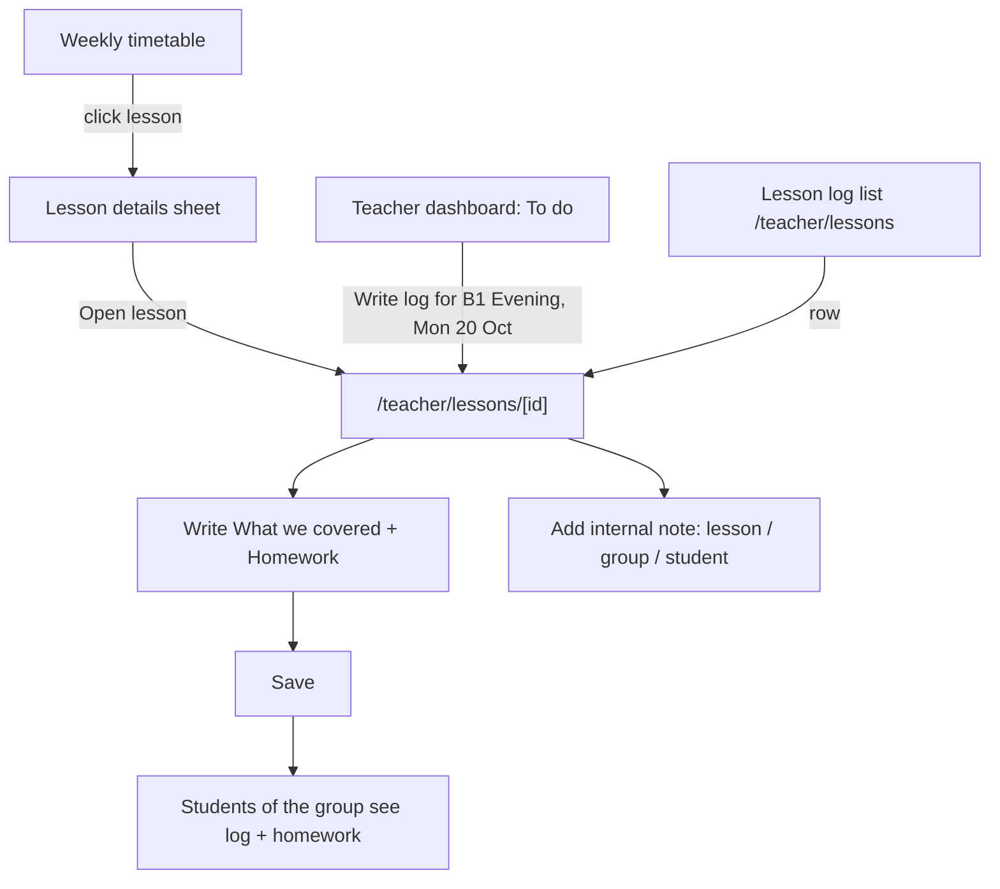
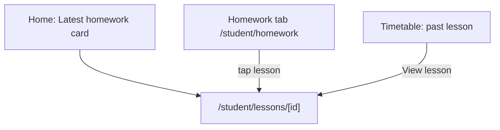

# Lessons: lesson log, homework & internal notes (Phase 2)

Spec for what a teacher writes down **inside a dated lesson** and what
students and admins can read: the lesson log ("what we covered"), the
homework for the next lesson, and internal TeacherNotes. Builds on
`docs/design/tokens.md`, `docs/design/app-layout.md` and
`docs/design/timetable.md` (§6.3 lesson details sheet). Clickable
wireframe: `docs/design/wireframes/lessons.html`.

## Owner decisions this spec follows (2026-10-14, CARM-34 review)

1. **No attendance tracking.** Teachers don't record present / absent /
   late. Whether a student is late or doesn't show up doesn't matter.
   A student **cancelling** a lesson matters only because it lets them
   book a replacement lesson in another group. That is Phase 3 (absences
   and replacements), not this spec.
2. **Homework is one text field per lesson.** The teacher writes e.g. "One
   page essay about your favourite movie". There are no due dates, no
   student answers, no review and no deadline rules. Its purpose is that a
   student who missed the lesson knows what to prepare for the next one.

Earlier owner decisions still apply: TeacherNotes are visible to teachers
and admins only, enforced server-side. All UI strings go through next-intl.

## 1. Goal

- Right after the lesson, a teacher writes two short texts in under a
  minute: **What we covered** and **Homework**. Optionally they add an
  internal note.
- A student, especially one who missed the lesson, sees on their phone
  what was covered and what to prepare.
- Nobody can confuse what students see with what they don't. Internal
  notes look internal everywhere.
- Admins can read all of it for any lesson in the school.

## 2. Roles and access

| Role               | Screens                                                                                 | Can read                                                                                     | Can write                                               |
| ------------------ | --------------------------------------------------------------------------------------- | -------------------------------------------------------------------------------------------- | ------------------------------------------------------- |
| Teacher            | Lesson page `/teacher/lessons/[id]` · lesson list `/teacher/lessons` (nav _Lesson log_) | Lessons where they are `teacherId` **or** `substituteTeacherId`, including all notes on them | Lesson log, homework and their own TeacherNotes on them |
| Substitute teacher | The same, for the substituted lesson                                                    | The same as the regular teacher **for that lesson**, including earlier notes about the group | The same as the regular teacher for that lesson         |
| Student            | Homework tab `/student/homework` · lesson page `/student/lessons/[id]` · home card      | Lessons of groups they were a member of on the lesson date: the log and the homework         | Nothing                                                 |
| Admin              | Lesson page `/admin/lessons/[id]` (read-only) · lesson list `/admin/lessons`            | Every lesson of the school, including all TeacherNotes                                       | Nothing (§12)                                           |

The regular teacher and the substitute both keep full rights on a
substituted lesson.

**Server-side rules.** The UI only mirrors these. QA covers them in
CARM-37.

- Every lesson query is scoped by `schoolId`.
  - Teachers: also by `teacherId = me OR substituteTeacherId = me`.
  - Students: also by a `GroupMembership` that is active on the lesson
    date. From P3, an approved replacement into the lesson counts too.
- A lesson the user may not see returns **404 Not found**, not 403, so
  lesson ids don't leak (as in CARM-32).
- Student responses come from a **separate, student-safe DTO** with no
  field for TeacherNotes. Never filter a teacher DTO down in the client.
- Students only see lessons that have **started**, except the "next
  lesson" link in the timetable, which shows only the lesson's date, time,
  room and teacher.

## 3. Concepts shown in the UI

| Concept       | UI word (key)                                 | Students see it? | Notes                                                                                      |
| ------------- | --------------------------------------------- | ---------------- | ------------------------------------------------------------------------------------------ |
| Lesson log    | **What we covered** (`lessonLog.covered`)     | yes              | Plain text, one per lesson.                                                                |
| Homework      | **Homework** (`lessonLog.homework`)           | yes              | Plain text, one per lesson, for the next lesson. Optional. No due date, answers or review. |
| `TeacherNote` | **Internal note** (`teacherNotes.title`)      | **never**        | About the lesson, the group or one student. Always shown in the internal style (§4).       |
| Missing log   | **No log yet** badge (`lessons.status.noLog`) | no               | A lesson that has ended, isn't cancelled and has no "What we covered". A reminder only.    |

## 4. Internal style (token `internal`)

TeacherNotes must look private at a glance, without relying on color.
They must not look like a status (warning, error) or a lesson type. The
token is in `tokens.md` §1.2:

| Token      | Surface            | Border                                | Header band                                     | Text                | Icon (lucide) |
| ---------- | ------------------ | ------------------------------------- | ----------------------------------------------- | ------------------- | ------------- |
| `internal` | `#f8fafc` slate-50 | `#475569` slate-600, 1 px, **dashed** | `#1e293b` slate-800 bg, `#ffffff` text (14.6:1) | `#0f172a` slate-900 | `lock`        |

Rules for every place an internal note appears (lesson page, admin views,
later a student's profile):

1. A dark header band with the lock icon and the visible text **"Internal —
   only teachers and admins see this"** (`teacherNotes.internalBanner`). It
   is always rendered, not only on hover.
2. The region is a `<section aria-labelledby>` with the heading "Internal
   notes".
3. The add/edit field's label repeats it: "Internal note (students can't
   see this)".
4. Internal notes never appear in a student-facing layout or in toasts.
   They are never shown next to student-visible content without the band.

## 5. Teacher

### 5.1 Flow



- In the **lesson details sheet** (`timetable.md` §6.3), teachers and
  admins get a primary button _Open lesson_. Students get _View lesson_ on
  past lessons. For students, the sheet also shows the homework text of
  that lesson when there is one.
- The **teacher dashboard _To do_ card** (app-layout §7.3) lists up to 5
  lessons from the last 14 days with no log yet, oldest first. When there
  are none: "You're all caught up."

### 5.2 Lesson page (`/teacher/lessons/[id]`)

On desktop (≥ 1024) the page has two columns. The left 8 columns hold the
lesson log. The right 4 columns hold internal notes (sticky). On tablet
and mobile it is one column: log, then internal notes.

```
┌ ‹ My timetable                                              ‹ ›            ┐
│ B1 Evening                                   [No log yet]                  │
│ Mon 20 Oct 2026 · 17:00–18:30 · Room 3 · 👥 Group lesson · B1              │
│ ⓘ You're substituting for Tomas Horvat in this lesson.     (substitute)   │
├──────────────────────────────────────────────┬─────────────────────────────┤
│ Lesson log   👁 Students in this group see it │ ▓ 🔒 Internal — only        │
│ What we covered                              │ ▓ teachers and admins …     │
│ [Unit 4: present perfect vs past simple… ]   │ Internal notes              │
│ Homework (optional)                          │ About [This lesson ▾]       │
│ [One page essay about your favourite movie]  │ [textarea              ]    │
│ Last saved by Tomas Horvat, 20 Oct 18:40     │ [Add note]                  │
│                                   [Save]     │ ─ notes on this lesson ─    │
│                                              │ ─ earlier notes (4) ▸ ─     │
├──────────────────────────────────────────────┤                             │
│ Previous lesson's homework (read-only)        │                             │
│ "Workbook p. 34, ex. 1–3" — Wed 15 Oct       │                             │
└──────────────────────────────────────────────┴─────────────────────────────┘
```

**Page header**

- Back link: _My timetable_, or _Lesson log_ when opened from the list.
- h1: the group name.
- Meta line (`tabular-nums`): date, time, room (online rooms get a _Join
  online_ link button), type icon + label, level.
- Badge: _No log yet_ (`warning`, icon `notebook-pen`) once the lesson has
  ended without a log, or _Cancelled_ (`danger`, + reason). No badge
  otherwise.
- Substitute banner (`info`, icon `user-round-cog`):
  - Shown to the substitute: "You're substituting for {teacher} in this
    lesson."
  - Shown to the regular teacher: "{substitute} is substituting in this
    lesson. You can both edit it."
- Previous / next lesson of the same group: icon buttons with
  `aria-label`s, for catching up on several lessons in a row.

**Lesson log card** (one form, one _Save_ button)

- h2 "Lesson log", plus a caption with the `eye` icon: "Students in this
  group can see this."
- `Textarea` **What we covered**. Placeholder: "e.g. Unit 4: present
  perfect vs past simple, speaking practice in pairs." It auto-grows from
  4 lines. Max 5,000 characters; a counter appears from 4,500.
- `Textarea` **Homework (optional)**. Hint: "What students should prepare
  for the next lesson." Placeholder: "e.g. One page essay about your
  favourite movie." It auto-grows from 2 lines. Max 2,000 characters.
- Both fields are plain text. Line breaks are kept and URLs are
  auto-linked when shown. No rich text in v1.
- Footer: a _Save_ button (primary when there are changes, outline
  otherwise) and the caption "Last saved by {name}, {dateTime}". Toast
  "Lesson log saved."
- Saving with both fields empty removes the record, after an `AlertDialog`
  "Remove the lesson log and homework?".
- **When it's editable:** from the lesson's start time onwards, with no end
  date. Before the start, the card says "You can fill this in once the
  lesson has started." (§12)
  The card is hidden for cancelled lessons. If a log was written before the
  lesson was cancelled, it is kept and shown read-only.
- **Unsaved changes:** leaving the page or moving to the previous/next
  lesson opens an `AlertDialog` "Discard unsaved changes?" with _Keep
  editing_ and _Discard_.
- **Two teachers editing** (regular teacher and substitute): the server
  rejects a save when the record changed after it was loaded. It shows a
  warning `Alert`: "{name} saved this lesson log while you were editing.
  Copy your text, reload, and save again." The typed text stays in the
  fields.

**Previous lesson's homework** (small read-only card under the log): the
homework text from the group's previous lesson and its date. It reminds
the teacher what students were asked to prepare. It is hidden when there
is none.

**States:** loading (skeleton) · saving (spinner on the button, fields
disabled) · save error (inline `Alert` above the footer, text kept, _Try
again_) · conflict (as above) · future lesson · cancelled.

### 5.3 Internal notes card

The whole card uses the internal style (§4).

- **Add form** at the top:
  - `Select` _About_: **This lesson** (default), **Group: {group}**, or
    **Student: {name}** for each current member of the group.
  - `Textarea` "Internal note (students can't see this)", max 2,000
    characters.
  - Button _Add note_.
  - Stored data: `lessonId` is always set (the context the note was written
    in), plus `groupId` or `studentId` for group or student notes.
- **Notes on this lesson**, newest first. Each shows the author, a relative
  date (full date in the `<time>` title), an _About_ chip and the body.
  - Own notes have a menu with _Edit_ (inline) and _Delete_ (`AlertDialog`
    "Delete this note?").
  - Other people's notes are read-only. "Edited" is shown when a note was
    changed.
- **Earlier notes about this group and its students**: collapsed by
  default, with the count in the trigger. It holds notes from other lessons
  about this group or one of its current members, 10 at a time, with _Show
  more_. This is how a substitute learns that "Jan needs extra time in
  written tasks".
- **Empty state:** "No internal notes yet. Use them for things only
  teachers and admins should know, like learning needs."
- Notes are allowed on future and cancelled lessons.

### 5.4 Lesson list (`/teacher/lessons`, nav _Lesson log_)

- Segmented filter: **No log yet** (default, with count) · **Upcoming** ·
  **Past**, plus a group `Select`. It defaults to the current term, with a
  term `Select` for looking back.
- Columns: Date & time (a link) · Group (type icon) · What we covered
  (excerpt, or "—") · Homework (excerpt, or "—"). Rows become stacked cards
  on mobile.
- Empty state per filter:
  - No log yet: "You're all caught up."
  - Upcoming: "No upcoming lessons."
  - Past: "No past lessons yet."

Teacher nav change: the P2 item _Homework_ from app-layout §4.3 is
**dropped**. Homework lives in the lesson log.

## 6. Student (mobile-first)

### 6.1 Flow



### 6.2 Homework tab (`/student/homework`, bottom tab ★)

This is the student's lesson history, built around "what do I need to
prepare". It lists past lessons, newest first, grouped by month, across all
the student's groups (including groups they left: the history is theirs).

```
┌──────────────────────────────┐
│ Homework                     │ h1
│ [All groups ▾]               │ only if in > 1 group
│ October                      │ h2
│ ┌──────────────────────────┐ │
│ │ Mon 20 Oct · B1 Evening   │ │
│ │ 📋 One page essay about   │ │ homework (full text, prominent)
│ │    your favourite movie   │ │
│ │ We covered: Unit 4:       │ │ log excerpt, 2 lines, muted
│ │ present perfect vs past…  │ │
│ └──────────────────────────┘ │
│ ┌──────────────────────────┐ │
│ │ Wed 15 Oct · B1 Evening   │ │
│ │ No homework               │ │ muted
│ │ We covered: Reading …     │ │
│ └──────────────────────────┘ │
│ ┌ Mon 13 Oct · Cancelled ──┐ │ muted, dashed
│ [Load more]                  │
└──────────────────────────────┘
```

- Each card is a full-width link (≥ 44 px) to the lesson page. It shows the
  date and group, the **homework text in full** (the main point), and a
  2-line excerpt of "We covered". If the teacher hasn't written anything
  yet, the card says "Your teacher hasn't added notes for this lesson yet."
- Cancelled lessons are shown muted with "Cancelled", so gaps make sense.
- A _Load more_ button loads 20 more. No infinite scroll.
- Empty state: "No lessons yet" / "After your first lesson, you'll see
  what was covered and the homework here."
- Not in any group: `timetable.empty.noGroups`.

Student nav change: the P2 item _Attendance_ from app-layout §4.3 is
**dropped**. _Homework_ stays a bottom tab.

### 6.3 Home card (app-layout §7.4)

The card is renamed from "Homework due" to **Latest homework**. It shows
the homework from the most recent past lesson of each of the student's
groups (up to 3), with the lesson date, then _See all_. When there is
none: "No homework from your last lessons."

### 6.4 Lesson page (`/student/lessons/[id]`)

Single column, `max-w-md`, 16 px text:

1. Back link: "Homework", or "Timetable" when opened from there.
2. h1 is the group name. Meta: date, time, teacher (or "{substitute}
   (substitute)"), room.
3. **Homework**: the text, or "No homework for this lesson."
4. **What we covered**: the text, or "Your teacher hasn't written the
   lesson log yet."

This page never shows TeacherNotes or other students' names.

**States:** loading skeleton · 404 (also for lessons of other groups) ·
error `Alert` + _Try again_.

## 7. Admin (Phase 2 scope)

Read-only access only. There is no attendance overview, because there is
no attendance.

- **`/admin/lessons/[id]`** has the same layout as the teacher page, read
  only:
  - The log and homework text, with the last editor.
  - The internal notes card without the add form.
  - Header actions _Open in timetable_ and _Open slot in editor_.
  - An `info` banner: "Admins can view this lesson. Teachers write the
    lesson log and homework."
- **`/admin/lessons`** is the same list as §5.4, with a Teacher filter. The
  default filter **No log yet** covers the whole school, so an admin can
  see which lessons are missing logs.
- **Student detail › Internal notes tab**: all TeacherNotes about the
  student, newest first, in the internal style, read-only.
- Entry points: _Open lesson_ in the admin weekly timetable sheet, and the
  list above.

## 8. Copy (i18n keys, English source)

### lessons

| Key                             | Copy                                                                     |
| ------------------------------- | ------------------------------------------------------------------------ |
| `lessons.open`                  | Open lesson                                                              |
| `lessons.view`                  | View lesson                                                              |
| `lessons.back.timetable`        | My timetable                                                             |
| `lessons.back.list`             | Lesson log                                                               |
| `lessons.prevOfGroup`           | Previous lesson of {group}                                               |
| `lessons.nextOfGroup`           | Next lesson of {group}                                                   |
| `lessons.status.noLog`          | No log yet                                                               |
| `lessons.status.cancelled`      | Cancelled                                                                |
| `lessons.substitute.you`        | You're substituting for {teacher} in this lesson.                        |
| `lessons.substitute.other`      | {substitute} is substituting in this lesson. You can both edit it.       |
| `lessons.cancelledBanner`       | This lesson was cancelled: {reason}                                      |
| `lessons.list.title`            | Lesson log                                                               |
| `lessons.list.filter.noLog`     | No log yet ({count})                                                     |
| `lessons.list.filter.upcoming`  | Upcoming                                                                 |
| `lessons.list.filter.past`      | Past                                                                     |
| `lessons.list.col.when`         | Date & time                                                              |
| `lessons.list.col.group`        | Group                                                                    |
| `lessons.list.col.covered`      | What we covered                                                          |
| `lessons.list.col.homework`     | Homework                                                                 |
| `lessons.list.col.teacher`      | Teacher                                                                  |
| `lessons.list.empty.noLog`      | You're all caught up.                                                    |
| `lessons.list.empty.upcoming`   | No upcoming lessons.                                                     |
| `lessons.list.empty.past`       | No past lessons yet.                                                     |
| `lessons.todo.title`            | To do                                                                    |
| `lessons.todo.writeLog`         | Write the log for {group}, {date}                                        |
| `lessons.todo.empty`            | You're all caught up.                                                    |
| `lessons.admin.readOnlyHint`    | Admins can view this lesson. Teachers write the lesson log and homework. |
| `lessons.admin.openInTimetable` | Open in timetable                                                        |
| `lessons.admin.openSlot`        | Open slot in editor                                                      |
| `lessons.unsaved.title`         | Discard unsaved changes?                                                 |
| `lessons.unsaved.description`   | Your changes to the lesson log haven't been saved.                       |
| `lessons.unsaved.keep`          | Keep editing                                                             |
| `lessons.unsaved.discard`       | Discard                                                                  |

### lessonLog

| Key                             | Copy                                                                                         |
| ------------------------------- | -------------------------------------------------------------------------------------------- |
| `lessonLog.title`               | Lesson log                                                                                   |
| `lessonLog.visibleToStudents`   | Students in this group can see this.                                                         |
| `lessonLog.covered`             | What we covered                                                                              |
| `lessonLog.coveredPlaceholder`  | e.g. Unit 4: present perfect vs past simple, speaking practice in pairs.                     |
| `lessonLog.homework`            | Homework (optional)                                                                          |
| `lessonLog.homeworkHint`        | What students should prepare for the next lesson.                                            |
| `lessonLog.homeworkPlaceholder` | e.g. One page essay about your favourite movie.                                              |
| `lessonLog.save`                | Save                                                                                         |
| `lessonLog.saved`               | Lesson log saved.                                                                            |
| `lessonLog.lastSaved`           | Last saved by {name}, {dateTime}                                                             |
| `lessonLog.notYet`              | You can fill this in once the lesson has started.                                            |
| `lessonLog.remove.title`        | Remove the lesson log and homework?                                                          |
| `lessonLog.remove.description`  | Students will no longer see what was covered or the homework for this lesson.                |
| `lessonLog.remove.confirm`      | Remove                                                                                       |
| `lessonLog.conflict`            | {name} saved this lesson log while you were editing. Copy your text, reload, and save again. |
| `lessonLog.tooLong`             | Keep this under {max} characters.                                                            |
| `lessonLog.previousHomework`    | Homework from the previous lesson ({date})                                                   |

### teacherNotes

| Key                               | Copy                                                                                                                              |
| --------------------------------- | --------------------------------------------------------------------------------------------------------------------------------- |
| `teacherNotes.title`              | Internal notes                                                                                                                    |
| `teacherNotes.internalBanner`     | Internal — only teachers and admins see this                                                                                      |
| `teacherNotes.field`              | Internal note (students can't see this)                                                                                           |
| `teacherNotes.about`              | About                                                                                                                             |
| `teacherNotes.about.lesson`       | This lesson                                                                                                                       |
| `teacherNotes.about.group`        | Group: {group}                                                                                                                    |
| `teacherNotes.about.student`      | Student: {name}                                                                                                                   |
| `teacherNotes.chip.lesson`        | Lesson                                                                                                                            |
| `teacherNotes.add`                | Add note                                                                                                                          |
| `teacherNotes.added`              | Note added.                                                                                                                       |
| `teacherNotes.edited`             | Edited                                                                                                                            |
| `teacherNotes.edit`               | Edit                                                                                                                              |
| `teacherNotes.delete`             | Delete                                                                                                                            |
| `teacherNotes.delete.title`       | Delete this note?                                                                                                                 |
| `teacherNotes.delete.description` | The note will be removed for all teachers and admins.                                                                             |
| `teacherNotes.onThisLesson`       | Notes on this lesson                                                                                                              |
| `teacherNotes.earlier`            | {count, plural, one {# earlier note about this group and its students} other {# earlier notes about this group and its students}} |
| `teacherNotes.showMore`           | Show more                                                                                                                         |
| `teacherNotes.empty`              | No internal notes yet. Use them for things only teachers and admins should know, like learning needs.                             |
| `teacherNotes.tooLong`            | Keep the note under {max} characters.                                                                                             |

### student homework & lesson page

| Key                          | Copy                                                                        |
| ---------------------------- | --------------------------------------------------------------------------- |
| `homework.title`             | Homework                                                                    |
| `homework.allGroups`         | All groups                                                                  |
| `homework.none`              | No homework                                                                 |
| `homework.noneForLesson`     | No homework for this lesson.                                                |
| `homework.weCovered`         | We covered: {text}                                                          |
| `homework.nothingYet`        | Your teacher hasn't added notes for this lesson yet.                        |
| `homework.loadMore`          | Load more                                                                   |
| `homework.empty.title`       | No lessons yet                                                              |
| `homework.empty.description` | After your first lesson, you'll see what was covered and the homework here. |
| `homework.home.title`        | Latest homework                                                             |
| `homework.home.seeAll`       | See all                                                                     |
| `homework.home.empty`        | No homework from your last lessons.                                         |
| `homework.lesson.covered`    | What we covered                                                             |
| `homework.lesson.logNotYet`  | Your teacher hasn't written the lesson log yet.                             |
| `homework.lesson.substitute` | {name} (substitute)                                                         |

## 9. Accessibility

- Both log fields have visible labels. The homework hint is linked with
  `aria-describedby`. Counters use `aria-live="polite"` only within 10 % of
  the limit.
- The internal band is real text (contrast 14.6:1). The lock icon is
  decorative (`aria-hidden`).
- Student pages use 16 px body text, 44 px targets and no hover-only
  content. Homework text on cards is never truncated.
- The _Save_ button is never hidden behind sticky bars
  (`scroll-padding-bottom`).

## 10. Edge cases

- **Student joins a group mid-term:** sees lessons from their `joinedAt`
  date onwards. The home card still shows the latest homework of the
  group, so they know what to prepare for their first lesson. (§12)
- **Student leaves a group:** keeps the lessons from their membership in
  the Homework tab. New lessons don't appear.
- **Lesson moved:** the log stays attached to the lesson. Pages show the
  current time.
- **Lesson cancelled after the log was written:** the text is kept and
  shown read-only with the cancelled banner.
- **Substitute removed later:** their log edits keep the author name, and
  they lose access to the lesson (404).
- **1-on-1 groups:** the same screens. The student is the only reader.
- **Timezone:** "has started" and all dates use the school's timezone.

## 11. Data and server notes for the Developer (CARM-35)

- **Homework:** add a nullable `homework` text column (≤ 2,000) to
  `LessonLog`, so one record per lesson holds both texts.
  `LessonLog.content` becomes nullable, because a lesson can have homework
  without a log, and vice versa. A record with both fields empty is
  deleted.
- **Remove what's no longer used:** drop the `Assignment` model, and drop
  the `Attendance` model with the `AttendanceStatus` enum. P3 absences use
  `AbsenceReport`, which is unaffected. Seed data and tests must change to
  match.
- `LessonLog` has `authorId` (TeacherProfile). Also store
  `updatedById` (the last editor) for the "Last saved by" caption, and use
  `updatedAt` for the conflict check.
- Validation (zod) mirrors the limits: covered ≤ 5,000, homework ≤ 2,000,
  `TeacherNote.body` ≤ 2,000.
- TeacherNote reads go through one server module. That module requires
  role TEACHER (with access to the lesson or group) or ADMIN. Student
  loaders must not import it. Cover this with unit tests and the CARM-37
  e2e suite.
- `LessonStatus.COMPLETED` is not used by P2. Lessons stay `SCHEDULED` or
  `CANCELLED`.

## 12. Decisions (owner, 2026-10-14)

1. **Admin edits:** admins can't edit a lesson log or its homework. They
   are read-only.
2. **Homework before the lesson:** not allowed. The log and homework can
   only be written once the lesson has started.
3. **New students:** they see lessons only from their join date, plus the
   group's latest homework on the home card.

No open questions remain for this spec.
