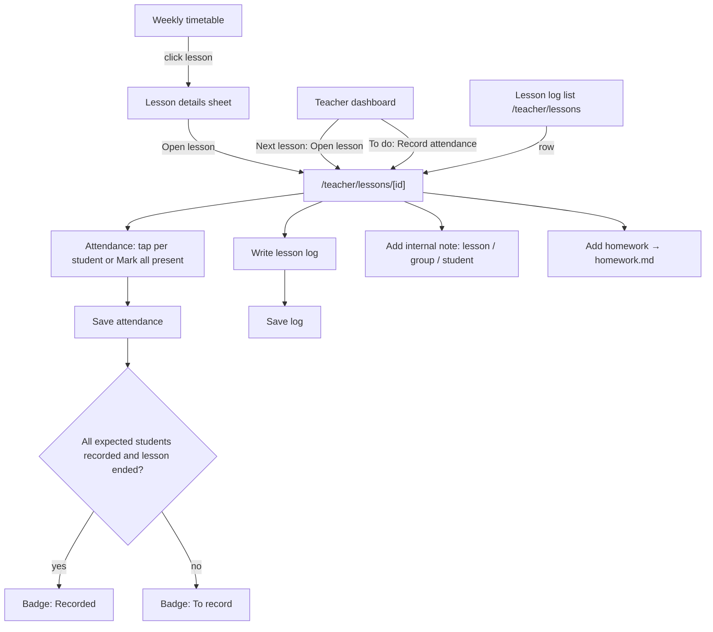
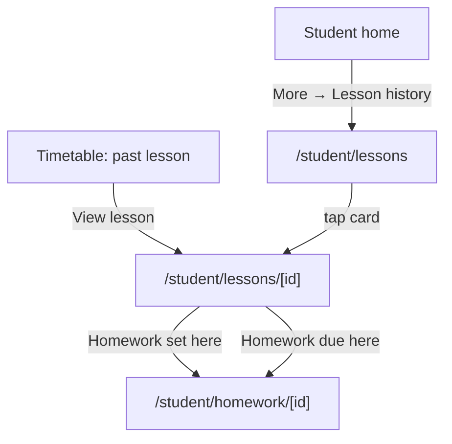

# Lessons: detail, attendance, lesson log, internal notes & history (Phase 2)

Spec for what happens **inside a dated lesson**: the teacher's lesson page
(attendance, lesson log, internal TeacherNotes, homework entry point), the
student's lesson history, and the admin's read access plus attendance
overview. Homework is specified in `docs/design/homework.md`. Builds on
`docs/design/tokens.md`, `docs/design/app-layout.md` and
`docs/design/timetable.md` (§6.3 lesson details sheet). Clickable wireframe:
`docs/design/wireframes/lessons.html`.

Owner decisions this spec follows (CARM-33, 2026-10-14): attendance is
**present / absent / excused** per student and lesson, with no "late"
(`LATE` is removed from `AttendanceStatus`). Homework answers are text only.

## 1. Goal

- A teacher records a lesson in **under a minute** right after teaching it:
  attendance with one tap per student (or _Mark all present_), a few lines
  of "what we covered", and an optional private note.
- Nobody can confuse what students can see with what they can't. Internal
  notes look internal everywhere they appear.
- A student sees on their phone what was covered in a lesson they missed,
  whether they were marked present, and which homework belongs to it.
- An admin can open any lesson in the school and see per group or per
  student who attended.

## 2. Roles and access

| Role               | Screens                                                                                                                                         | Can read                                                                                      | Can write                                                                                    |
| ------------------ | ----------------------------------------------------------------------------------------------------------------------------------------------- | --------------------------------------------------------------------------------------------- | -------------------------------------------------------------------------------------------- |
| Teacher            | Lesson page `/teacher/lessons/[id]` · lesson list `/teacher/lessons` (nav _Lesson log_) · dashboard _To do_                                     | Lessons where they are `teacherId` **or** `substituteTeacherId`; everything on those lessons  | Attendance, lesson log, own TeacherNotes, homework (homework.md) on those lessons            |
| Substitute teacher | Same as teacher, for the substituted lesson only                                                                                                | Same as the regular teacher **for that lesson**, including earlier notes about the group      | Same as the regular teacher for that lesson                                                  |
| Student            | Lesson history `/student/lessons` · lesson page `/student/lessons/[id]`                                                                         | Lessons of groups they were a member of on the lesson date: log, **own** attendance, homework | Nothing on the lesson (homework answers: homework.md)                                        |
| Admin              | Lesson page `/admin/lessons/[id]` (read-only) · _Attendance_ tab on group detail and student detail · lesson list `/admin/lessons` (P2 minimal) | Every lesson of the school, including all TeacherNotes                                        | Nothing in P2 (read-only; see Q1). Admins keep cancelling/moving lessons in the editor (P1). |

Both the regular teacher and the substitute keep full rights on a
substituted lesson: the regular teacher still owns the group and may fill in
what the substitute forgot.

**Server-side rules** (the UI only mirrors them; QA covers them in CARM-37):

- Every lesson query is scoped by `schoolId` and, for teachers, by
  `teacherId = me OR substituteTeacherId = me`; for students, by an active
  `GroupMembership` on the lesson's `occurrenceDate`/`startsAt` (and, from P3,
  by an approved replacement into the lesson).
- A lesson the signed-in user may not see returns **404 Not found**, not 403,
  so lesson ids don't leak (same as CARM-32).
- Student responses are built from a **separate, student-safe DTO** that has
  no field for TeacherNotes and contains only the student's own Attendance
  row. Never filter a teacher DTO down in the client.
- `Attendance.note` is visible to the student it belongs to (labelled so in
  the UI, §5.3). Anything private goes into a TeacherNote.

## 3. Concepts shown in the UI

| Concept            | UI word (key)                                          | Visible to students? | Notes                                                                                                                                                                                                |
| ------------------ | ------------------------------------------------------ | -------------------- | ---------------------------------------------------------------------------------------------------------------------------------------------------------------------------------------------------- |
| `Lesson`           | **Lesson** (`lessons.lesson`)                          | yes (own groups)     | One dated occurrence, as in the timetable.                                                                                                                                                           |
| `Attendance`       | **Attendance** (`attendance.title`)                    | own row only         | Present / Absent / Excused. "Not recorded" = no row yet.                                                                                                                                             |
| `Attendance.note`  | **Note for the student** (`attendance.note`)           | yes, own             | Optional, short (≤ 200 chars), e.g. "Arrived 20 minutes late". Replaces the removed "late" status.                                                                                                   |
| `LessonLog`        | **Lesson log** / "What we covered" (`lessonLog.title`) | yes                  | One per lesson, plain text.                                                                                                                                                                          |
| `TeacherNote`      | **Internal note** (`teacherNotes.title`)               | **never**            | About the lesson, the group or one student. Always shown in the internal style (§4).                                                                                                                 |
| Lesson "done"      | **Recorded** badge (`lessons.status.recorded`)         | no                   | Derived, not stored: lesson has ended and every expected student has an attendance row. The stored `LessonStatus.COMPLETED` is set by the server at that moment so timetable views can show it (Q2). |
| Lesson "to record" | **To record** badge (`lessons.status.toRecord`)        | no                   | Lesson has ended, is not cancelled, and attendance is incomplete.                                                                                                                                    |
| Log missing        | **No log** (`lessons.status.noLog`)                    | no                   | Shown next to _Recorded_ when the log is empty; a reminder, not a blocker.                                                                                                                           |

**Expected students** of a lesson = members of the lesson's group whose
membership covers the lesson date (`joinedAt ≤ lesson date` and
`leftAt` null or `> lesson date`), plus students who already have an
attendance row (e.g. they left the group later). From P3, replacement
students joining the lesson are added with a _Replacement_ tag.

## 4. Internal style (new token: `internal`)

TeacherNotes must be recognisable as private at a glance, without relying
on color, and must not look like a status (warning, error) or a lesson type.
Add to `tokens.md` §1.2:

| Token      | Surface            | Border                                | Header band                                     | Text                | Icon (lucide) |
| ---------- | ------------------ | ------------------------------------- | ----------------------------------------------- | ------------------- | ------------- |
| `internal` | `#f8fafc` slate-50 | `#475569` slate-600, 1 px, **dashed** | `#1e293b` slate-800 bg, `#ffffff` text (14.6:1) | `#0f172a` slate-900 | `lock`        |

Rules for every place an internal note appears (lesson page, admin views,
later a student's profile):

1. A dark header band with the lock icon and the visible text **"Internal —
   only teachers and admins see this"** (`teacherNotes.internalBanner`). The
   text is always rendered, not only on hover.
2. The region is a `<section aria-labelledby>` whose heading is "Internal
   notes" so screen readers announce it the same way.
3. The add/edit field's label repeats it: "Internal note (students can't see
   this)".
4. Internal notes are never shown in a student-facing layout, never
   included in a list or card that also contains student-visible content
   without the band, and never printed in toasts.

## 5. Teacher lesson page (`/teacher/lessons/[id]`)

### 5.1 Entry points



- **Lesson details sheet** (`timetable.md` §6.3) gets a primary button
  _Open lesson_ (`lessons.open`) for teacher and admin, and for students on
  past lessons _View lesson_ (`lessons.view`). P2 also adds to the sheet: an
  attendance summary line for teacher/admin ("8 present · 1 absent · 1
  excused") and, for students, their own attendance badge.
- **Teacher dashboard** `To do` card (app-layout §7.3) now ships: up to 5
  lessons _To record_ (oldest first, last 14 days) and the count of
  submissions to review (homework.md). Empty: `lessons.todo.empty` "You're
  all caught up."

### 5.2 Layout

Desktop (≥ 1024): page header + two columns, `lg:grid-cols-12`. Left 8 cols:
Attendance, Lesson log, Homework. Right 4 cols: Internal notes (sticky
`top-20`). Tablet and mobile: one column in the order Attendance → Lesson
log → Homework → Internal notes. No tabs: the page is short and teachers
should see everything at once.

```
┌ ‹ Back                                                                    ┐
│ B1 Evening                              [Recorded ✓] or [To record]       │ h1 + status
│ Mon 20 Oct 2026 · 17:00–18:30 · Room 3 · 👥 Group lesson · B1             │ meta line
│ ⓘ You're substituting for Tomas Horvat in this lesson.                    │ only for substitute
├───────────────────────────────────────────────┬───────────────────────────┤
│ Attendance                 8 of 10 recorded   │ ▓ 🔒 Internal — only      │
│ [Mark all present]                            │ ▓ teachers and admins …   │
│ Name            Present  Absent  Excused      │ Internal notes            │
│ Eva Novak       (●)      ( )     ( )   [note] │ [About: This lesson ▾]    │
│ Jan Kos         ( )      (●)     ( )   [note] │ [textarea            ]    │
│ …                                             │ [Add note]                │
│                       [Save attendance]       │ ─ notes on this lesson ─  │
├───────────────────────────────────────────────┤ Tomas · 20 Oct · Student: │
│ Lesson log · 👁 Students in this group can see │ Jan Kos  "…"  [⋯]         │
│ [What we covered…                         ]   │ ─ earlier notes ─         │
│ Last saved by Tomas Horvat, 20 Oct 18:35      │ …  [Show more]            │
│                              [Save log]       │                           │
├───────────────────────────────────────────────┤                           │
│ Homework                       [Add homework] │                           │
│ Set in this lesson: Unit 4 exercises · due …  │                           │
│ Due in this lesson: Essay · 6/10 submitted    │                           │
└───────────────────────────────────────────────┴───────────────────────────┘
```

Page header:

- Back link: to where the user came from when known (`?from=timetable` /
  `?from=lessons` / dashboard), default _My timetable_.
- h1 = group name (1-on-1: the group name, e.g. "Eva Novak 1-on-1").
- Meta line (`tabular-nums`): long date, time range, room (online room:
  _Join online_ link button), type icon + label, level code.
- Status badge, one of: _Scheduled_ (future, `muted`), _To record_
  (`warning`, icon `clipboard-pen`), _Recorded_ (`success`, icon
  `check`), _Cancelled_ (`danger`, icon `ban`, + reason). _No log_ (`muted`)
  can appear next to _Recorded_.
- Substitute banner (`info` Alert, icon `user-round-cog`) when the viewer is
  the substitute: "You're substituting for {teacher} in this lesson." When
  the viewer is the regular teacher and a substitute is set: "{substitute} is
  substituting in this lesson. You can both edit it."
- Prev / next lesson of the same group (icon buttons `chevron-left/right`,
  `aria-label` "Previous lesson of {group}" / "Next lesson of {group}") —
  quick for catching up on several lessons.

### 5.3 Attendance card

- Card header: h2 "Attendance" + progress "{recorded} of {total} recorded"
  - secondary button _Mark all present_ (`attendance.markAllPresent`).
    When some students are already marked, the button reads _Mark the rest
    present_ (`attendance.markRestPresent`) and only fills **unmarked** rows;
    it never overwrites a choice.
- One row per expected student, alphabetical by name:
  - Name (+ tags: _Left group_ if they left after the lesson, _Replacement_ P3).
  - Segmented control = `ToggleGroup type="single"` styled as three
    buttons, each with icon + text: **Present** (`check`, success tone when
    selected), **Absent** (`x`, danger tone), **Excused** (`circle-slash`,
    info tone). Unselected = outline. ≥ 44 px tall on touch layouts
    (< 1024), 36 px on desktop. Semantics: `role="radiogroup"`
    `aria-label="Attendance for {name}"`, arrow keys move, Space selects.
  - _Note_ icon button (`message-square`, `aria-label` "Add a note for
    {name}") toggles a one-line `Input` under the row, label "Note for the
    student (they can see it)", ≤ 200 chars. A row with a note shows the
    icon filled + the note text as a caption.
- Footer: primary _Save attendance_ (`attendance.save`) + caption "Last saved
  {time} by {name}". Saving writes all changed rows in one server action;
  toast "Attendance saved." Rows with no choice stay unrecorded (allowed —
  partial save, the badge stays _To record_).
- **Unsaved changes**: the Save button shows "Save attendance (3 changes)";
  leaving the page or switching lesson with unsaved changes opens an
  `AlertDialog` "Discard unsaved attendance?" (_Keep editing_ / _Discard_).
- **When editable**: from the lesson's local date (00:00, school timezone)
  onwards, with no end date in P2 (see Q3). Before that the controls are
  disabled with the hint "You can take attendance from the day of the
  lesson." Cancelled lesson: the card is replaced by a muted text "No
  attendance for cancelled lessons." and any existing rows are kept, shown
  read-only.
- An _Excused_ chosen here is a teacher's decision. From P3, a student's
  absence report pre-fills _Excused_ with a caption "Reported absent on
  {date}" — the teacher can still change it.

States: loading (skeleton rows) · empty group ("No students in this group
on {date}." + for admin a link to the group's members) · saving (button
spinner, controls disabled) · save error (inline `Alert` above the footer,
choices kept, _Try again_) · conflict (someone else saved meanwhile: `Alert`
warning "{name} changed attendance while you were editing. Your changes are
kept; review and save again." with the other person's values shown as
captions) · read-only (admin; future lesson; cancelled).

### 5.4 Lesson log card

- h2 "Lesson log" + visibility caption with `eye` icon: "Students in this
  group can see this." (`lessonLog.visibleToStudents`).
- `Textarea` label "What we covered", placeholder "e.g. Unit 4: present
  perfect vs past simple, speaking practice in pairs, vocabulary p. 52."
  Auto-grows from 4 lines, max 5,000 characters, counter appears from
  4,500. Plain text; line breaks kept; URLs auto-linked on display. No rich
  text in v1.
- Footer: _Save log_ (outline when unchanged, primary when dirty) + "Last
  saved by {name}, {dateTime}". Empty and saved → removes the log (confirm
  `AlertDialog` "Remove the lesson log?").
- Editable from the lesson's start time onwards (writing a plan beforehand
  is not this feature); before that: hint "You can write the log once the
  lesson has started." Cancelled lesson: card hidden.
- Same unsaved-changes guard as attendance (one dialog covers both).

### 5.5 Homework card

Summary only; the dialogs and review screens are in `homework.md`.

- h2 "Homework" + _Add homework_ (`homework.add`) button (opens the
  homework dialog pre-filled with this lesson as "set in" and the group's
  next lesson as "due").
- **Set in this lesson**: rows "Title · Due {date} · {n}/{total} submitted"
  → link to the homework detail.
- **Due in this lesson**: same rows, so the teacher can check what students
  should have prepared.
- Empty: "No homework set in or due for this lesson."

### 5.6 Internal notes card

Uses the `internal` style (§4) for the whole card.

- Add form (top): `Select` _About_ with options **This lesson** (default),
  **Group: {group}**, and **Student: {name}** for each expected student;
  `Textarea` label "Internal note (students can't see this)", max 2,000
  chars; button _Add note_. Data: always stores `lessonId` (the context it
  was written in) and sets `groupId` or `studentId` for group/student
  notes.
- **Notes on this lesson** (newest first): author name, relative date with
  full date in `<time>` title, _About_ chip (Lesson / Group / student
  name), body. Overflow menu on **own** notes: _Edit_ (inline), _Delete_
  (`AlertDialog` "Delete this note?"). Others' notes are read-only, and
  "Edited" is shown when `updatedAt > createdAt`.
- **Earlier notes about this group and its students** (collapsible,
  collapsed by default, count in the trigger): notes from other lessons
  whose `groupId` is this group or `studentId` is an expected student;
  10 at a time, _Show more_. This is how a substitute learns that "Jan
  needs extra time in written tasks".
- Empty: "No internal notes yet. Use them for things only teachers and
  admins should know, like learning needs or behaviour."
- Notes are allowed on cancelled and future lessons (planning notes are
  fine here, unlike the log).

### 5.7 Lesson list (`/teacher/lessons`, nav _Lesson log_)

Conventional list page (app-layout §4.4):

- Segmented filter: **To record** (default; ended, not cancelled,
  attendance incomplete) · **Upcoming** · **Past**. Plus group `Select`.
  Counts in the segment labels.
- Columns: Date & time · Group (type icon) · Attendance ("8/10", or badge)
  · Log (✓ / "No log") · Homework (n) · status badge. Row → lesson page.
  Mobile: stacked cards.
- Empty per filter: To record → "You're all caught up." · Upcoming → "No
  upcoming lessons." · Past → "No past lessons yet."
- Range: current term by default; term `Select` to look back.

## 6. Student lesson history (mobile-first)

### 6.1 Flow



Navigation: the student nav item `nav.attendance` from app-layout §4.3 is
replaced by **Lesson history** (`nav.lessonHistory`, icon `history`), under
_More_; the bottom bar stays Home · Timetable · Homework · More.

### 6.2 List (`/student/lessons`)

```
┌──────────────────────────────┐
│ Lesson history               │ h1
│ [Autumn 2026 ▾]              │ term select (only if > 1 term)
│ ┌──────────────────────────┐ │
│ │ This term                │ │ summary card
│ │ 18 present · 1 absent ·  │ │
│ │ 1 excused  (20 lessons)  │ │
│ └──────────────────────────┘ │
│ October                      │ h2 month
│ ┌──────────────────────────┐ │
│ │ Mon 20 Oct · 17:00  [✓ Present]
│ │ B1 Evening               │ │
│ │ Unit 4: present perfect… │ │ log excerpt, 2 lines
│ │ 📋 Homework set          │ │
│ └──────────────────────────┘ │
│ ┌ Wed 15 Oct · 17:00 [✗ Absent]┐
│ │ … "Arrived 20 min late"   │ │ attendance note when present
└──────────────────────────────┘
```

- Only lessons that have **started**, newest first, grouped by month,
  across all the student's groups (including groups they left — history
  is theirs). Cancelled lessons are shown muted with "Cancelled" so gaps
  make sense.
- Card (full-width link, ≥ 44 px): date + time · group name · attendance
  badge (Present `success` + `check` / Absent `danger` + `x` / Excused
  `info` + `circle-slash` / Not recorded `muted`) · log excerpt (2 lines,
  or "No lesson log yet." muted) · chips "Homework set" / "Homework due"
  when relevant.
- Summary card: counts of present / absent / excused for the selected term
  and the number of lessons; no percentage score (it reads as a grade; see
  Q4). Lessons not recorded are not counted.
- Infinite list with _Load more_ button (20 per page), not infinite scroll.

### 6.3 Lesson page (`/student/lessons/[id]`)

Single column, `max-w-md`:

1. Back link "Lesson history" (or "Timetable" when opened from there).
2. h1 group name; meta: date, time, teacher (or "{substitute} (substitute)"),
   room.
3. **Your attendance**: badge + attendance note if any. Not recorded yet:
   "Your teacher hasn't taken attendance yet." Future lesson: section hidden.
4. **What we covered**: the log text, or "Your teacher hasn't written the
   lesson log yet."
5. **Homework**: _Set in this lesson_ and _Due in this lesson_ cards with
   status (homework.md) linking to the homework page.

Never shown: other students' names or attendance, TeacherNotes, counts like
"8 present". A future lesson opens this page too (from the timetable sheet)
with only meta + homework due.

States: loading skeleton · not found (404, also for lessons of other
groups) · error Alert + _Try again_ · not in any group: "You're not in any
group yet. The school office will add you." (reuses `timetable.empty.noGroups`).

## 7. Admin (Phase 2 scope)

Decision: P2 gives admins **read access** plus a per-group and per-student
attendance overview. School-wide attendance reports, exports and
"missing attendance" alerts belong to P6 _Reports_ (Q5).

### 7.1 Lesson page (`/admin/lessons/[id]`)

Same layout as the teacher page, everything read-only:

- Attendance as a table (name, status badge, note, "recorded by {name},
  {dateTime}").
- Lesson log text + last editor.
- Homework rows link to `/admin/homework/[id]` (read-only, homework.md §7).
- Internal notes card (internal style) without the add form.
- Header actions: _Open in timetable_ (week view at that date) and, for
  generated lessons, _Open slot in editor_.
- Banner `info`: "Admins can view this lesson. The teacher records
  attendance and the lesson log." (`lessons.admin.readOnlyHint`).

Entry: admin weekly timetable sheet _Open lesson_; attendance overview
cells; admin `/admin/lessons` list (same as §5.7 with an extra Teacher
filter and default filter **To record** across the school — useful to
chase missing attendance without a report).

### 7.2 Group detail › Attendance tab (`/admin/groups/[id]?tab=attendance`)

Desktop-first matrix, term `Select` (default current):

```
              │ 6 Oct │ 8 Oct │ 13 Oct │ 15 Oct │ … │ Present │ Absent │ Excused
Eva Novak     │  P    │  P    │   A    │   P    │   │   14    │   1    │   0
Jan Kos       │  P    │  E    │   P    │   –    │   │   12    │   0    │   2
```

- Rows = students who were members during the term (left members after a
  separator, muted). Columns = the group's lessons in the term up to today,
  oldest → newest, horizontally scrollable with the name column and the
  totals sticky. Cancelled lessons are omitted.
- Cells show a **letter and a color** (P success, A danger, E info, "–" not
  recorded, blank = not a member then), with `title`/`aria-label` "Eva
  Novak, Mon 13 Oct: absent". Column headers link to the lesson page.
- Real `<table>` with `<th scope>` for row and column headers. Below 768 px:
  a list per student with the three totals instead of the matrix.
- Empty: "No lessons in {term} yet."

### 7.3 Student detail › Attendance tab (`/admin/students/[id]?tab=attendance`)

- Term `Select`; totals row (present / absent / excused / not recorded).
- Table: Date · Group · Teacher · Status badge · Note · link to lesson.
  Filter by status.
- Same data as the student's own history, plus the "recorded by" column.
- Also a **Internal notes** tab on student detail: all TeacherNotes with
  `studentId` = this student, newest first, internal style, read-only.

## 8. Copy (i18n keys, English source)

`{name}` = ICU placeholder; plurals use ICU `plural`.

### lessons

| Key                             | Copy                                                                            |
| ------------------------------- | ------------------------------------------------------------------------------- |
| `lessons.lesson`                | Lesson                                                                          |
| `lessons.open`                  | Open lesson                                                                     |
| `lessons.view`                  | View lesson                                                                     |
| `lessons.back.timetable`        | My timetable                                                                    |
| `lessons.back.list`             | Lesson log                                                                      |
| `lessons.prevOfGroup`           | Previous lesson of {group}                                                      |
| `lessons.nextOfGroup`           | Next lesson of {group}                                                          |
| `lessons.status.scheduled`      | Scheduled                                                                       |
| `lessons.status.toRecord`       | To record                                                                       |
| `lessons.status.recorded`       | Recorded                                                                        |
| `lessons.status.noLog`          | No log                                                                          |
| `lessons.status.cancelled`      | Cancelled                                                                       |
| `lessons.substitute.you`        | You're substituting for {teacher} in this lesson.                               |
| `lessons.substitute.other`      | {substitute} is substituting in this lesson. You can both edit it.              |
| `lessons.cancelledBanner`       | This lesson was cancelled: {reason}                                             |
| `lessons.summary`               | {present} present · {absent} absent · {excused} excused                         |
| `lessons.list.title`            | Lesson log                                                                      |
| `lessons.list.filter.toRecord`  | To record ({count})                                                             |
| `lessons.list.filter.upcoming`  | Upcoming                                                                        |
| `lessons.list.filter.past`      | Past                                                                            |
| `lessons.list.col.when`         | Date & time                                                                     |
| `lessons.list.col.group`        | Group                                                                           |
| `lessons.list.col.attendance`   | Attendance                                                                      |
| `lessons.list.col.log`          | Log                                                                             |
| `lessons.list.col.homework`     | Homework                                                                        |
| `lessons.list.col.teacher`      | Teacher                                                                         |
| `lessons.list.empty.toRecord`   | You're all caught up.                                                           |
| `lessons.list.empty.upcoming`   | No upcoming lessons.                                                            |
| `lessons.list.empty.past`       | No past lessons yet.                                                            |
| `lessons.todo.title`            | To do                                                                           |
| `lessons.todo.record`           | Record attendance for {group}, {date}                                           |
| `lessons.todo.empty`            | You're all caught up.                                                           |
| `lessons.admin.readOnlyHint`    | Admins can view this lesson. The teacher records attendance and the lesson log. |
| `lessons.admin.openInTimetable` | Open in timetable                                                               |
| `lessons.admin.openSlot`        | Open slot in editor                                                             |
| `lessons.unsaved.title`         | Discard unsaved changes?                                                        |
| `lessons.unsaved.description`   | Your changes to attendance or the lesson log haven't been saved.                |
| `lessons.unsaved.keep`          | Keep editing                                                                    |
| `lessons.unsaved.discard`       | Discard                                                                         |

### attendance

| Key                             | Copy                                                                                            |
| ------------------------------- | ----------------------------------------------------------------------------------------------- |
| `attendance.title`              | Attendance                                                                                      |
| `attendance.progress`           | {recorded} of {total} recorded                                                                  |
| `attendance.markAllPresent`     | Mark all present                                                                                |
| `attendance.markRestPresent`    | Mark the rest present                                                                           |
| `attendance.markedAnnouncement` | {count, plural, one {# student marked present} other {# students marked present}}               |
| `attendance.rowLabel`           | Attendance for {name}                                                                           |
| `attendance.status.PRESENT`     | Present                                                                                         |
| `attendance.status.ABSENT`      | Absent                                                                                          |
| `attendance.status.EXCUSED`     | Excused                                                                                         |
| `attendance.status.none`        | Not recorded                                                                                    |
| `attendance.note`               | Note for the student (they can see it)                                                          |
| `attendance.addNote`            | Add a note for {name}                                                                           |
| `attendance.save`               | Save attendance                                                                                 |
| `attendance.saveWithChanges`    | {count, plural, one {Save attendance (# change)} other {Save attendance (# changes)}}           |
| `attendance.saved`              | Attendance saved.                                                                               |
| `attendance.lastSaved`          | Last saved {dateTime} by {name}                                                                 |
| `attendance.notYet`             | You can take attendance from the day of the lesson.                                             |
| `attendance.cancelled`          | No attendance for cancelled lessons.                                                            |
| `attendance.emptyGroup`         | No students in this group on {date}.                                                            |
| `attendance.tag.leftGroup`      | Left group                                                                                      |
| `attendance.tag.replacement`    | Replacement                                                                                     |
| `attendance.conflict`           | {name} changed attendance while you were editing. Your changes are kept; review and save again. |
| `attendance.reportedAbsent`     | Reported absent on {date}                                                                       |
| `attendance.recordedBy`         | Recorded by {name}, {dateTime}                                                                  |
| `attendance.overview.title`     | Attendance                                                                                      |
| `attendance.overview.totals`    | Present · Absent · Excused                                                                      |
| `attendance.overview.cell`      | {name}, {date}: {status}                                                                        |
| `attendance.overview.empty`     | No lessons in {term} yet.                                                                       |
| `attendance.overview.notMember` | Not a member on this date                                                                       |
| `attendance.letter.PRESENT`     | P                                                                                               |
| `attendance.letter.ABSENT`      | A                                                                                               |
| `attendance.letter.EXCUSED`     | E                                                                                               |

### lessonLog

| Key                            | Copy                                                                                       |
| ------------------------------ | ------------------------------------------------------------------------------------------ |
| `lessonLog.title`              | Lesson log                                                                                 |
| `lessonLog.field`              | What we covered                                                                            |
| `lessonLog.placeholder`        | e.g. Unit 4: present perfect vs past simple, speaking practice in pairs, vocabulary p. 52. |
| `lessonLog.visibleToStudents`  | Students in this group can see this.                                                       |
| `lessonLog.save`               | Save log                                                                                   |
| `lessonLog.saved`              | Lesson log saved.                                                                          |
| `lessonLog.lastSaved`          | Last saved by {name}, {dateTime}                                                           |
| `lessonLog.notYet`             | You can write the log once the lesson has started.                                         |
| `lessonLog.remove.title`       | Remove the lesson log?                                                                     |
| `lessonLog.remove.description` | Students will no longer see what was covered in this lesson.                               |
| `lessonLog.remove.confirm`     | Remove                                                                                     |
| `lessonLog.tooLong`            | Keep the log under {max} characters.                                                       |

### teacherNotes

| Key                               | Copy                                                                                                                              |
| --------------------------------- | --------------------------------------------------------------------------------------------------------------------------------- |
| `teacherNotes.title`              | Internal notes                                                                                                                    |
| `teacherNotes.internalBanner`     | Internal — only teachers and admins see this                                                                                      |
| `teacherNotes.field`              | Internal note (students can't see this)                                                                                           |
| `teacherNotes.about`              | About                                                                                                                             |
| `teacherNotes.about.lesson`       | This lesson                                                                                                                       |
| `teacherNotes.about.group`        | Group: {group}                                                                                                                    |
| `teacherNotes.about.student`      | Student: {name}                                                                                                                   |
| `teacherNotes.chip.lesson`        | Lesson                                                                                                                            |
| `teacherNotes.add`                | Add note                                                                                                                          |
| `teacherNotes.added`              | Note added.                                                                                                                       |
| `teacherNotes.edited`             | Edited                                                                                                                            |
| `teacherNotes.edit`               | Edit                                                                                                                              |
| `teacherNotes.delete`             | Delete                                                                                                                            |
| `teacherNotes.delete.title`       | Delete this note?                                                                                                                 |
| `teacherNotes.delete.description` | The note will be removed for all teachers and admins.                                                                             |
| `teacherNotes.onThisLesson`       | Notes on this lesson                                                                                                              |
| `teacherNotes.earlier`            | {count, plural, one {# earlier note about this group and its students} other {# earlier notes about this group and its students}} |
| `teacherNotes.showMore`           | Show more                                                                                                                         |
| `teacherNotes.empty`              | No internal notes yet. Use them for things only teachers and admins should know, like learning needs or behaviour.                |
| `teacherNotes.tooLong`            | Keep the note under {max} characters.                                                                                             |

### history (student)

| Key                         | Copy                                                                           |
| --------------------------- | ------------------------------------------------------------------------------ |
| `nav.lessonHistory`         | Lesson history                                                                 |
| `history.title`             | Lesson history                                                                 |
| `history.summary.title`     | This term                                                                      |
| `history.summary.counts`    | {present} present · {absent} absent · {excused} excused                        |
| `history.summary.lessons`   | {count, plural, one {# lesson} other {# lessons}}                              |
| `history.yourAttendance`    | Your attendance                                                                |
| `history.attendanceNotYet`  | Your teacher hasn't taken attendance yet.                                      |
| `history.covered`           | What we covered                                                                |
| `history.logNotYet`         | Your teacher hasn't written the lesson log yet.                                |
| `history.noLogShort`        | No lesson log yet.                                                             |
| `history.chip.homeworkSet`  | Homework set                                                                   |
| `history.chip.homeworkDue`  | Homework due                                                                   |
| `history.loadMore`          | Load more                                                                      |
| `history.empty.title`       | No lessons yet                                                                 |
| `history.empty.description` | After your first lesson, you'll see what was covered and your attendance here. |
| `history.substitute`        | {name} (substitute)                                                            |

## 9. Accessibility

- Attendance rows: each is a labelled radiogroup; the selected option has
  icon **and** text and a visible checked state beyond color (filled
  background + check). Mark-all announces the result via a polite live
  region (`attendance.markedAnnouncement`).
- Tab order on the lesson page: header actions → attendance (row by row:
  group then note button) → Save attendance → log → homework → internal
  notes. Save buttons are not sticky-hidden behind the bottom bar
  (`scroll-padding-bottom`).
- The internal band is real text, contrast 14.6:1; the lock icon is
  decorative (`aria-hidden`).
- Matrix: `<table>` with `<caption>` "Attendance for {group}, {term}",
  row/column headers, cell letters plus `aria-label`; sticky columns don't
  trap focus; horizontal scroll container is focusable (`tabindex=0`) with
  a label.
- Character counters use `aria-live="polite"` only when within 10 % of the
  limit.
- Student pages: 16 px body, 44 px targets, no hover-only content.

## 10. Edge cases

- **Student joins a group mid-term**: appears in attendance only from
  their `joinedAt` date; earlier lessons are not in their history.
- **Student leaves**: stays in attendance of lessons before `leftAt`; their
  history keeps those lessons; new lessons don't list them. Attendance
  already recorded after `leftAt` (e.g. leftAt backdated) is kept and shown
  with _Left group_.
- **Group over capacity / 1-on-1**: 1-on-1 page shows one row; _Mark all
  present_ reads "Mark present".
- **Lesson moved** (time edited): the page always uses the current
  `startsAt`; attendance/log stay attached to the lesson.
- **Lesson cancelled after attendance was taken**: attendance and log
  stay, read-only, banner "This lesson was cancelled: {reason}"; they don't
  count in the student's summary.
- **Substitute removed after recording**: their attendance rows keep
  `recordedBy`; they lose access to the lesson (404).
- **Teacher archived**: notes and logs keep the author name.
- **Two teachers editing** (teacher + substitute): last write wins per row,
  with the conflict Alert in §5.3 when the server detects a newer
  `updatedAt` than the one loaded.
- **Very long lists** (group of 30): rows stay one line on desktop; on
  mobile the toggle wraps under the name.
- **Timezone**: dates and the "day of the lesson" rule use the school's
  timezone.
- **Deleted student user** (`User.deletedAt`): name shown with
  "(account disabled)"; history kept.

## 11. Data and server notes for the Developer (CARM-35)

- Remove `LATE` from `AttendanceStatus` (owner decision); migrate any
  existing `LATE` rows to `PRESENT` with the note "Late" (seed data only).
- Add `Attendance.note` length limit (200) and `LessonLog.content` (5,000),
  `TeacherNote.body` (2,000) in validation (zod), not only in the UI.
- Set `Lesson.status = COMPLETED` when the lesson has ended and all expected
  students are recorded; set it back to `SCHEDULED` if a student is
  added later without a row (Q2).
- Optimistic concurrency for attendance: send the loaded `updatedAt` per
  row; reject with a conflict error when it changed.
- TeacherNote reads must go through a single server module that requires
  role TEACHER (with access to the lesson/group) or ADMIN; student loaders
  must not import it. Covered by unit tests + the CARM-37 e2e suite.

## 12. Open questions for the owner

- **Q1 — Admin edits.** P2 makes admins read-only on lessons. Should an
  admin be able to correct attendance (e.g. a student brings a doctor's
  note to the office)? Recommendation: not in P2; P3's absence flow covers
  excusing, and a later "edit as admin" can be added with an audit entry.
- **Q2 — `COMPLETED` status.** Recommendation above: the server sets it when
  attendance is complete, and the log is a reminder only. Alternative: also
  require a log. Confirm.
- **Q3 — Editing window.** Attendance and logs stay editable forever in P2.
  Should they lock, e.g. at term end or after 14 days? Recommendation: lock
  at term end later, once reports (P6) depend on it.
- **Q4 — Attendance rate.** Students see counts, not a percentage. Do you
  want a percentage (and a minimum-attendance rule) shown to students or
  admins?
- **Q5 — Admin scope.** P2 ships the group matrix, the student tab and the
  _To record_ lesson list. School-wide reports, exports and alerts wait for
  P6. OK?
- **Q6 — Attendance note visibility.** The short attendance note is visible
  to the student (it replaces "late"). Private remarks go into internal
  notes. OK?
