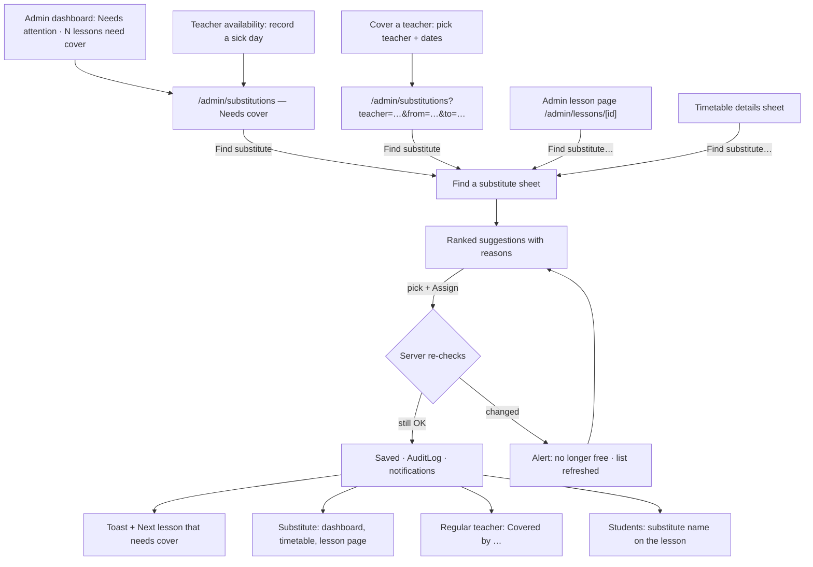
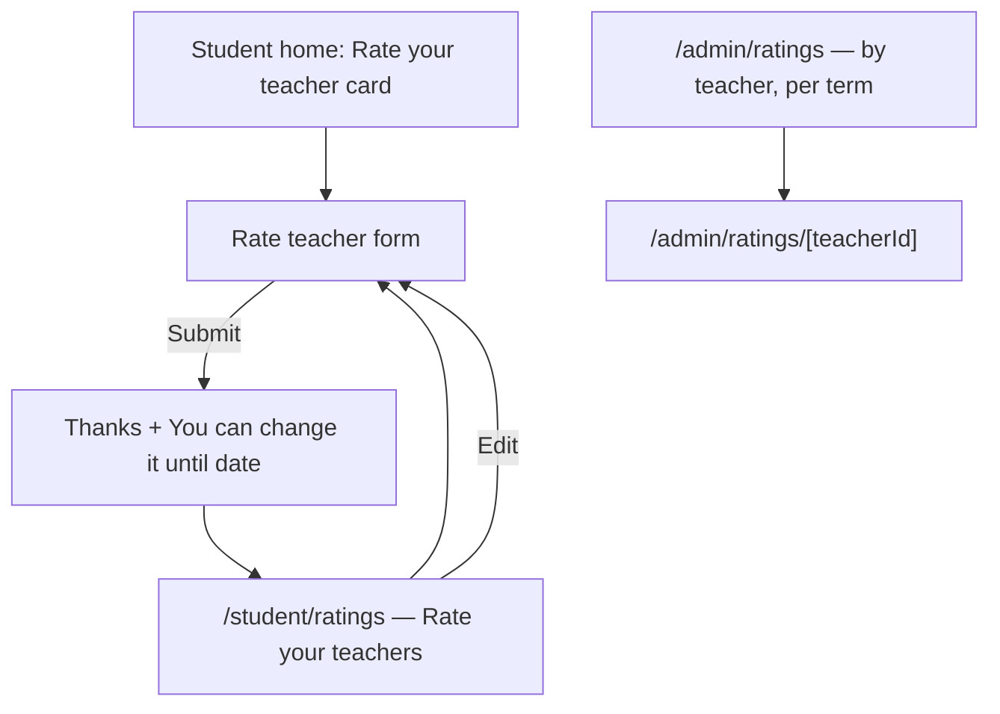
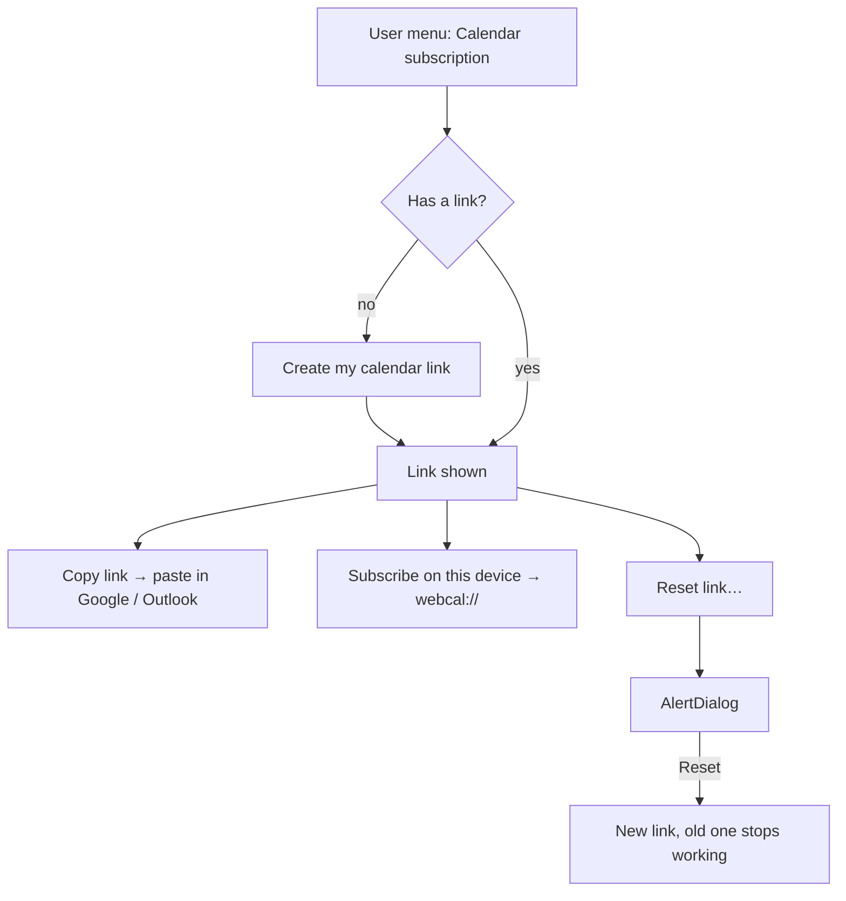

# Notifications, substitutes, ratings & iCal (Phase 5)

Spec for the Phase 5 screens: the in-app notification inbox, the admin
substitute flow and how a covered lesson looks to everyone, student ratings
of teachers with the admin-only ratings view, and the private calendar
(iCal) subscription link. Builds on `docs/design/tokens.md`,
`docs/design/app-layout.md`, `docs/design/timetable.md`,
`docs/design/lessons.md`, `docs/design/absences.md` and
`docs/design/timetable-generator.md`. Clickable wireframe:
`docs/design/wireframes/notifications-substitutes.html`.

The rules behind these screens (who is notified of what, eligibility and
ranking of substitutes, who may rate and when, feed contents) are owned by
the Scheduling Engineer's rules doc (CARM-64, `docs/architecture/`). Where
this spec needs a rule it states the **UI assumption** and lists it in §11,
so the two docs can be checked against each other. If they disagree, the
rules doc wins on behaviour and this spec is updated to match. This version
is aligned with `docs/architecture/phase5-rules.md` (CARM-64, PR #41, at
`8ffb4df`); its
§ numbers are cited as "rules §x".

## Owner decisions this spec follows (2026-10-15, CARM-45 / CARM-62)

1. **Notifications are in-app only in v1.** The design leaves room for
   email later, but nothing is designed for email now.
2. **Students rate their teacher. Only admins see the ratings.**
3. **Substitutes:** the system suggests eligible substitutes, and the admin
   confirms one.

Earlier decisions still apply: one role per user, later-phase nav items are
hidden until they ship, TeacherNotes never reach students, no attendance
tracking (`lessons.md` decision 1), every query is scoped by `schoolId`, all
UI strings go through next-intl.

## 1. Goal

- Everybody learns about changes that affect them (a cancelled or moved
  lesson, a substitute, a new timetable) without having to check the
  timetable every day. One bell, one inbox, nothing else to learn.
- When a teacher can't come, the admin finds a suitable substitute for a
  lesson in under a minute, sees **why** each teacher is or isn't suggested,
  and confirms with one click.
- The substitute and the regular teacher can't miss who teaches which
  lesson.
- Students can give honest feedback on their teacher, privately and in a
  few taps, and admins can see it per teacher and term. Teachers never see
  ratings, anywhere.
- Teachers and students get their lessons into the calendar app they
  already use, with one link they can reset if it leaks.

## 2. Roles and access

| Area                  | Admin                                                                                                                | Teacher                                                                                     | Student                                                                    |
| --------------------- | -------------------------------------------------------------------------------------------------------------------- | ------------------------------------------------------------------------------------------- | -------------------------------------------------------------------------- |
| Notifications         | Own inbox (one admin type: replacement bookings to review)                                                           | Own inbox                                                                                   | Own inbox                                                                  |
| Substitutes           | Find, assign, change, remove (`/admin/substitutions`, lesson page, sheet)                                            | Read: lessons they cover and lessons covered for them (`/teacher/substitutions`, timetable) | Read: the substitute's name on the lesson                                  |
| Ratings               | Read all ratings of the school (`/admin/ratings`)                                                                    | **Nothing** — no page, no count, no average                                                 | Write and edit their own ratings (`/student/ratings`); read only their own |
| Calendar subscription | No feed of their own in v1 (rules §5.1). Turn off a user's link from the user's page (only if the owner agrees, §11) | Own link: create, copy, reset                                                               | Own link: create, copy, reset                                              |

**Server-side rules** the UI only mirrors (QA covers them in CARM-67):

- A notification is read and marked read only by its recipient. Another
  user's notification id returns **404**, like lessons (`lessons.md` §2).
- Substitute actions are admin-only server actions, scoped by `schoolId`,
  re-checked on confirm and written to `AuditLog`.
- Rating reads exist only in an admin-only server module. Student loaders
  return the student's own rating through a student DTO; teacher loaders
  never import the ratings module.
- The feed route authenticates **only** by its token. An unknown, reset or
  other-school token returns 404 with an empty body; it never reveals
  whether a user exists.

**Navigation changes** (`app-layout.md` §4.3):

- Header bell (all roles): rendered from P5, §4.1.
- Admin: _Substitutions_ (Schedule) and _Ratings_ (Academics) ship.
- Teacher: _Substitutions_ (Me) ships. The P5 item **_Ratings_ is
  dropped** from the teacher nav (owner decision 2).
- Student: _Ratings_ goes into the _More_ sheet (not a bottom tab), as
  "Rate your teachers". Notifications are reached from the header bell, not
  a tab.
- User menu (teacher, student): _Calendar subscription_ ships.

## 3. Concepts shown in the UI

| Concept       | UI word (key)                              | Notes                                                                                                                                |
| ------------- | ------------------------------------------ | ------------------------------------------------------------------------------------------------------------------------------------ |
| Notification  | **Notification** (`notifications.*`)       | One message to one user about one event, with an optional link. Unread until opened or marked read.                                  |
| Substitute    | **Substitute** (`substitutes.*`)           | Another teacher teaching one dated lesson instead of the regular teacher (`Lesson.substituteTeacherId`). Token `lesson-substitute`.  |
| Needs cover   | **Needs cover** (`substitutes.needsCover`) | An upcoming lesson whose teacher (the substitute, if it has one) is away, unavailable, double-booked or archived (§5.2, rules §3.7). |
| Rating        | **Rating** (`ratings.*`)                   | 1–5 stars plus an optional comment, from one student about one teacher for one term.                                                 |
| Calendar link | **Calendar link** (`calendarFeed.*`)       | Private iCal URL with a secret token. Never called "iCal" or "token" in the UI; "calendar link" and "subscribe" only.                |

## 4. Notifications

### 4.1 Bell and unread badge (header, all roles)

Header right side, before the user menu (`app-layout.md` §4.1), all roles:

```
… Lingua Language School                    [🔔³]  [AV Anna ▾]
```

- Icon button `bell` (40 px, 44 px on mobile), `aria-label` from
  `notifications.bell.label`: "Notifications" or "Notifications, {count}
  unread". Tooltip with the same text.
- **Unread badge:** a red-600 pill on the top-right of the icon, white
  12 px `tabular-nums` text, the count up to 99, then "99+" (rules §2.7). No badge when
  there are no unread notifications. The badge is `aria-hidden`; the count
  is in the button label (never color only).
- **Desktop / tablet (≥ 768):** opens a `Popover` (380 px, `shadow-lg`).
  **Mobile (< 768):** navigates straight to the inbox page (a popover is
  too cramped on a phone).
- **Freshness:** the count comes with every page load and is refreshed
  every 60 s while the tab is visible, and when the window regains focus.
  No websockets in v1. The count never announces itself via a live region
  (too noisy); it is in the button label.

**Popover:**

```
┌ Notifications                     Mark all as read ┐
├────────────────────────────────────────────────────┤
│ ● ⟳ Ana Kral is substituting in B1 Evening         │ unread: dot + bold
│     Mon 20 Oct, 17:00 · 5 min ago                  │
│ ● ✕ C1 Business on Wed 22 Oct is cancelled          │
│     Reason: Teacher ill · 1 h ago                  │
│   🗓 Your timetable for Autumn 2026 changed         │ read: regular weight
│     12 lessons have a new teacher · Yesterday      │
│   …                                                │ up to 8 items
├────────────────────────────────────────────────────┤
│              See all notifications                 │
└────────────────────────────────────────────────────┘
```

- Header: h2 "Notifications" and a `link`-style button _Mark all as read_
  (only when something is unread). It marks read everything up to the
  newest item shown (`markAllRead({ upTo })`, rules §2.7), so a notification
  arriving meanwhile stays unread.
- Up to the 8 newest notifications (read and unread), newest first. Each
  item is one link (§4.3). Clicking it marks it read, closes the popover
  and navigates.
- Footer: _See all notifications_ → the inbox page.
- Keyboard: `Tab` from the bell enters the popover; items are a list of
  links, `Esc` closes and returns focus to the bell.
- States: loading (3 skeleton rows) · empty (`bell-off` icon, "You're all
  caught up." + "We'll let you know when something changes.") · error
  ("Couldn't load notifications." + _Try again_).

### 4.2 Inbox page (`/{role}/notifications`)

Same page for every role, inside the role's shell (`/admin/notifications`,
`/teacher/notifications`, `/student/notifications`). Single column,
`max-w-3xl` (desktop), full width cards on mobile, 16 px text for students.

```
┌ Notifications                                   [Mark all as read] ┐
│ [All | Unread (3)]                                                 │
│ Today                                                              │ h2
│ ┌──────────────────────────────────────────────────────────── ⋯ ┐ │
│ │ ● ⟳  Ana Kral is substituting in B1 Evening                    │ │
│ │      Mon 20 Oct 2026, 17:00–18:30 · Room 3                     │ │
│ │      5 min ago                                    Open lesson › │ │
│ └────────────────────────────────────────────────────────────────┘ │
│ ┌ ● ✕  C1 Business on Wed 22 Oct is cancelled ────────────── ⋯ ┐ │
│ Yesterday                                                          │
│ ┌   🗓  Your timetable for Autumn 2026 changed ─────────────── ⋯ ┐ │
│ Earlier                                                            │
│ …                                                                  │
│ [Load more]                                                        │
└────────────────────────────────────────────────────────────────────┘
```

- Page header: h1 "Notifications", _Mark all as read_ (`outline`, only when
  unread > 0; up to the newest item shown, as in the popover). Toast "All
  notifications marked as read."
- `ToggleGroup` filter **All** (default) · **Unread ({count})**, kept in the
  URL (`?filter=unread`).
- Grouped by day with h2 headings: **Today**, **Yesterday**, **Earlier**
  (school timezone).
- 20 per page (keyset cursor, rules §2.7), _Load more_ for the next 20. No
  infinite scroll.
- Row menu (`⋯`, `DropdownMenu`, `aria-label` "More actions for this
  notification"): _Mark as read_ (unread items only; no menu on read items).
  No _Mark as unread_ and no delete in v1: the server only marks read, and
  unread items about the same lesson are merged (rules §2.5). Retention
  removes old notifications.
- The list only shows what retention keeps (rules §2.5: every
  notification is deleted 90 days after it was created, read or not).
  Footer caption: "Notifications are removed after {days} days."

States:

| State           | Shows                                                                                                                      |
| --------------- | -------------------------------------------------------------------------------------------------------------------------- |
| Loading         | 5 skeleton rows in the shape of an item                                                                                    |
| Empty (all)     | `bell` icon · "No notifications yet" · "When a lesson is cancelled, moved or covered by a substitute, you'll see it here." |
| Empty (unread)  | "You're all caught up." + _Show all_ link                                                                                  |
| Error           | `Alert` "Couldn't load notifications." + _Try again_                                                                       |
| Mark-all failed | Inline `Alert` above the list, "Couldn't mark notifications as read. Try again."; nothing changes                          |

### 4.3 Notification item

| Part        | Rule                                                                                                                                                                                                                                                                                                          |
| ----------- | ------------------------------------------------------------------------------------------------------------------------------------------------------------------------------------------------------------------------------------------------------------------------------------------------------------- |
| Unread mark | 8 px primary dot **and** semibold title **and** visually hidden "Unread" before the title. Read items: no dot, regular weight.                                                                                                                                                                                |
| Icon        | 20 px lucide icon per category (table below), `aria-hidden`. Color reinforces the category but the title always says what happened.                                                                                                                                                                           |
| Title       | One sentence from i18n with ICU params, at most 2 lines on mobile then wraps (never truncated).                                                                                                                                                                                                               |
| Detail      | One optional muted line: lesson date and time (`tabular-nums`), room, reason.                                                                                                                                                                                                                                 |
| Time        | Relative ("5 min ago", "Yesterday") in a `<time datetime>` with the full date in `title`.                                                                                                                                                                                                                     |
| Link        | The whole card is one link to the target (lesson page, timetable week, absences tab, …). The trailing text ("Open lesson ›") says where it goes.                                                                                                                                                              |
| Gone target | Links are resolved per role when opened and re-run the page's access check (rules §2.4). If the target no longer exists or the user lost access (e.g. a substitute was removed), opening it shows the caption "No longer available." on the item instead of navigating (the mark-read action returns no URL). |

Opening an item marks it read **on the server before navigating** (the
same server action returns the URL), so the badge is right on the next
page.

**Text is rendered at read time** from the stored type and params, never
stored as English text. This keeps future languages possible and lets an
email channel reuse the same keys later.

### 4.4 Event catalogue (UI copy)

What each notification says, per **audience** (the message variant the
rules doc picks per recipient, rules §2.2): `teacher` (the effective
teacher), `regular` (the regular teacher of a covered lesson),
`substitute`, `student`, `admin`. Who receives which is the rules doc's
table; the column below repeats it for the reader. Keys are
`notifications.types.<TYPE>.<audience>` (+ `.detail`); copy in §8.

**1-on-1 lessons:** every lesson event carries `lessonType` (`GROUP` /
`ONE_ON_ONE`). For a 1-on-1 the group name is the student's own name, so
the student copy uses an ICU `select` and says "your lesson" instead of
`{group}` (e.g. "Ana Kral is teaching your lesson on Mon 20 Oct").

| Type                         | Icon (color)               | Title per audience                                                                                                                                                                       | Detail                                                                                                       | Link                          | Recipients (rules §2.2)                                                           |
| ---------------------------- | -------------------------- | ---------------------------------------------------------------------------------------------------------------------------------------------------------------------------------------- | ------------------------------------------------------------------------------------------------------------ | ----------------------------- | --------------------------------------------------------------------------------- |
| `LESSON_CANCELLED`           | `ban` (danger)             | All: "{group} on {date} is cancelled"                                                                                                                                                    | Reason: {reason}                                                                                             | Lesson                        | Teachers, attendees                                                               |
| `LESSON_MOVED`               | `calendar-clock` (info)    | Time changed: "{group} moved to {newDate}, {newTime}" · only the room changed: "{group} on {date} is now in {room}"                                                                      | Was {oldDate}, {oldTime} · Was {oldRoom}                                                                     | Lesson (the new one)          | Teachers, attendees                                                               |
| `SUBSTITUTE_ASSIGNED`        | `user-round-cog` (cyan)    | `student`: "{substitute} is teaching {group} on {date}" · `regular`: "{substitute} is covering your {group} lesson on {date}" · `substitute`: "You're substituting in {group} on {date}" | {time} · {room}                                                                                              | Lesson                        | New substitute, regular teacher, attendees                                        |
| `SUBSTITUTE_REMOVED`         | `user-round-x` (cyan)      | `student` / `regular`: "{teacher} is teaching {group} on {date} again" · `substitute`: "You're no longer substituting in {group} on {date}"                                              | {time}                                                                                                       | Lesson / timetable            | Previous substitute; on remove also regular teacher and attendees                 |
| `ABSENCE_REPORTED`           | `calendar-x` (warning)     | `teacher`: "{student} won't be at {group} on {date}" · `student` (an admin reported it): "The school reported you absent from {group} on {date}"                                         | Student: "You get a makeup credit." when `withCredit`                                                        | Lesson                        | Effective teacher; the student when an admin reported it                          |
| `REPLACEMENT_BOOKED`         | `repeat` (amber)           | `teacher`: "{student} joins {group} on {date} as a replacement" · `student` (an admin booked it): "You're booked into {group} on {date} as a replacement"                                | From {fromGroup} (teacher only)                                                                              | Target lesson                 | Effective teacher of the target; the student when an admin booked it              |
| `REPLACEMENT_ENDED`          | `repeat` (warning)         | `teacher`: "{student} no longer joins {group} on {date}" · `student`: "Your replacement in {group} on {date} was {outcome, select, rejected {rejected} other {cancelled}}"               | Student: `creditBack` "Your makeup credit is back."; the school's note when there is one                     | Target lesson                 | Effective teacher of the target; the student unless they did it (not for `moved`) |
| `REPLACEMENT_MOVED`          | `repeat` (warning)         | `student`: "The school moved your replacement to {group} on {date}"                                                                                                                      | Was {fromGroup}, {oldDate} · the school's note                                                               | New target lesson             | The student (the new target's teacher gets `REPLACEMENT_BOOKED`)                  |
| `REPLACEMENT_REVIEW_PENDING` | `repeat` (warning)         | `admin`: "{count, plural, one {# new replacement booking to review} other {# new replacement bookings to review}}"                                                                       | —                                                                                                            | Absences › Review             | Every admin; one unread item that counts up (rules §2.5)                          |
| `TIMETABLE_PUBLISHED`        | `calendar-check` (success) | All: "The timetable for {term} is ready"                                                                                                                                                 | "Your first lesson: {date}, {time}" (or "{termStart} – {termEnd}" without one)                               | Timetable at the first lesson | Teachers and students of the term                                                 |
| `TIMETABLE_CHANGED`          | `calendar-days` (info)     | All: "Your timetable for {term} changed"                                                                                                                                                 | The non-zero counts, joined: "2 new · 3 cancelled · 1 moved · 4 with a new teacher", then "from {firstDate}" | Timetable at {firstDate}      | Everyone with an affected lesson (one per person per action, rules §2.3)          |
| `CALENDAR_FEED_REVOKED`      | `link` (info)              | All: "The school turned off your calendar link"                                                                                                                                          | "Create a new one and add it to your calendar apps."                                                         | Calendar subscription         | The user (only if the owner agrees to admin revoke, §11)                          |

- **The actor never notifies themselves:** an admin who cancels a lesson
  doesn't get "lesson cancelled".
- **Bulk changes** (editor, holidays, publish, generator apply) produce one
  `TIMETABLE_CHANGED` per person, never one per lesson (rules §2.3).
- **Merged while unread** (rules §2.5): a lesson moved twice shows one item
  "moved to {newest}, was {oldest}"; a substitute assigned then changed shows
  the latest; assigned then removed again disappears; repeated timetable
  changes in a term add up in one item; new replacement bookings add to the
  admin's one review item. A merged item moves to the top. A cancellation
  replaces an unread "moved" or "substitute" item for the same lesson.
- **Past lessons:** changes to lessons that already ended notify nobody;
  lessons that started don't notify students (rules §2.1, §3.5).
- **Not notified in v1** (rules §2.2): "needs cover" (the admin dashboard's
  _Needs attention_ card and the _Needs cover_ tab count show it), rating
  open (the student home card is the prompt, §6.3), makeup credit expiry.

### 4.5 Room for email later (not designed now)

Only constraints, so nothing has to be redesigned:

- The catalogue above is the list of things an email could be sent for;
  each type's title/detail keys can be reused as subject/body.
- A later **Notification settings** page (per type: In app · Email) gets a
  _Settings_ link in the inbox page header and in the user menu. v1 renders
  neither.
- No "send me an email" checkbox anywhere in v1.

## 5. Substitutes

### 5.1 Flows



### 5.2 Substitutions page (`/admin/substitutions`, nav _Substitutions_)

Desktop-first (admin), `max-w-screen-2xl`. Tabs (`Tabs`, URL `?tab=`):

1. **Needs cover ({count})** (default): not-cancelled lessons in the next
   **8 weeks** (`NEEDS_COVER_DAYS` = 56) that haven't started and whose
   **effective** teacher (the substitute, if there is one) is away that day
   (one-off), double-booked or archived (`lessonsNeedingCover`, rules
   §3.7). So a covered lesson whose substitute falls ill comes back here
   too. Weekly unavailability is left out (it was acknowledged when the
   slot was planned). Sorted by
   start time, soonest first. Lessons starting within 48 h get a `danger`
   badge "Soon".
2. **Covered**: upcoming lessons with a substitute, soonest first.
3. **Past**: lessons that ended and had a substitute, newest first, with a
   term `Select` (for payroll questions).

Toolbar (all tabs): Teacher `Combobox` (regular teacher), date range
picker, Level `Select`. Primary page action **Cover a teacher…**.

```
┌ Substitutions                                           [Cover a teacher…] ┐
│ [Needs cover (3) | Covered (5) | Past]                                     │
│ Teacher [Any ▾]   Dates [20 Oct – 14 Dec ▾]   Level [Any ▾]                │
├────────────────────────────────────────────────────────────────────────────┤
│ When                     │ Lesson            │ Teacher         │ Why       │ │
│ Mon 20 Oct 17:00–18:30 ⚑ │ 👥 B1 Evening · B1 │ Tomas Horvat    │ Away (one-off) │ [Find substitute] │
│ Tue 21 Oct 09:00–10:30   │ 👤 Jan Novak · A2  │ Ana Kral (sub.) │ Double-booked  │ [Change substitute] │
│ Wed 22 Oct 18:00–19:30   │ 👥 C1 Business · C1│ Peter Varga     │ Archived       │ [Find substitute] │
└────────────────────────────────────────────────────────────────────────────┘
```

- Columns, _Needs cover_: When (link to the admin lesson page) · Lesson
  (type icon + label, group, level) · Teacher (the effective one; a
  substitute is marked "(substitute)") · Why, from the entry's `who` and
  `reasons`: _Away (one-off)_, _Double-booked_, _Archived_, or for a
  substitute _Substitute away_, _Substitute double-booked_, _Substitute
  archived_ · action _Find
  substitute_ (or _Change substitute_ when the problem is the substitute;
  `outline`, opens §5.3).
- _Covered_ / _Past_: When · Lesson · Teacher · **Substitute** (cyan
  `user-round-cog` + name) · Assigned by / at · row menu _Change
  substitute…_, _Remove substitute…_ (on _Past_ only within the 7-day
  record window, §5.6).
- **Cover a teacher…** (`Dialog`): Teacher (`Combobox`, required), From and
  To dates (default today → today), and a checkbox, on by default, "Also
  mark {teacher} as away on these dates" (owner to confirm, §11). This is
  the "Tomas called in sick" flow. With the box on, saving writes one
  `DATE_UNAVAILABLE` row per date through the existing availability service
  before the list loads (rules §3.7: that is how a sick day reaches _Needs
  cover_), so the editor and generator know too.
  Then the tab is filtered to that teacher and range and shows all their
  lessons in it. With the box off it only filters.
- Mobile: tables become stacked cards; the page shows the
  `layout.desktopRecommended` notice but stays usable (assigning a
  substitute from a phone is allowed).

States: loading (table skeleton) · empty _Needs cover_ ("No lessons need
cover in the next 8 weeks." / "When a teacher is away on a lesson's date,
the lesson shows up here.") · empty _Covered_ ("No upcoming lessons have a substitute.") ·
empty _Past_ ("No substitutions this term.") · no filter results
(`common.noResults`) · error (`Alert` + _Try again_).

### 5.3 Find a substitute (sheet)

Right `Sheet`, 520 px (full-screen bottom sheet on mobile). Opened from the
substitutions page, the admin lesson page (header action _Find substitute…_
/ _Change substitute…_), and the admin timetable details sheet
(`timetable.md` §6.3, new action row).

```
┌ Find a substitute                                                   ✕ ┐
│ B1 Evening · 👥 Group · B1                                            │
│ Mon 20 Oct 2026, 17:00–18:30 · Room 3                                 │
│ Regular teacher: Tomas Horvat (away, one-off)                         │
│ [Search teachers…]                                                    │
├───────────────────────────────────────────────────────────────────────┤
│ Suggested (3)                                                         │
│ (•) 1  Ana Kral                                                       │
│        ✓ Teaches B1  ✓ Free  ✓ 6 h → 7.5 h this week (max 10 h)       │
│        ★ Has taught B1 Evening · Already teaching that day           │
│ ( ) 2  Lucia Benova                                                   │
│        ✓ Teaches B1  ✓ Free  ✓ 4 h → 5.5 h this week (no max)         │
│ ( ) 3  Eva Simon                                                      │
│        ✓ Teaches B1  ✓ Free  ✓ 9 h → 10.5 h this week (max 12 h)      │
│ Possible with a warning (3)                                           │
│ ( ) Peter Varga     ⚠ Doesn't teach B1 (teaches A1–A2)                │
│ ( ) Marta Holub     ⚠ Unavailable Mon 16:00–20:00 (weekly)            │
│ ( ) Ivana Mraz      ⚠ Away on 20 Oct (one-off)                        │
│ ▸ Not possible (1)                                                    │
│     Jozef Kovac     ✗ Teaching C1 Business, 17:00–18:30               │
├───────────────────────────────────────────────────────────────────────┤
│ ⓘ Ana Kral, Tomas Horvat and the 8 students of B1 Evening will be     │
│   notified.                                                           │
│                                        [Cancel]  [Assign Ana Kral]    │
└───────────────────────────────────────────────────────────────────────┘
```

**Header:** group, type, level, date and time, room, regular teacher with
the reason the lesson needs cover. When the lesson already has a
substitute: "Current substitute: {name}" in the header. The current
substitute is the **first row**, badge _Current_, with their reasons (so
the admin sees whether they are still fine) and _Remove substitute…_
instead of a radio; they can't be assigned again (`IS_CURRENT`, rules
§3.7). Picking anyone else is a **change**.

**List:** one `RadioGroup` with three labelled sections, the same model as
the generator's teacher picker (`timetable-generator.md` §6.6), so admins
learn one pattern. The regular teacher and archived teachers are never
listed (rules §3.7). Order and bands come from
`suggestSubstitutes`; the UI never re-sorts.

| Section (key)                                  | Who (rules §3.3)                                                                                                          | Row shows                                                    | Selectable?                                             |
| ---------------------------------------------- | ------------------------------------------------------------------------------------------------------------------------- | ------------------------------------------------------------ | ------------------------------------------------------- |
| **Suggested** (`substitutes.picker.suggested`) | No reason at all: teaches the level, free, available, within max hours (rules §3.3)                                       | Rank number, name, green checks per rule, ranking hints      | Yes                                                     |
| **Possible with a warning** (`.withWarning`)   | Only overridable reasons: `LEVEL_NOT_TAUGHT`, `UNAVAILABLE_WEEKLY`, `UNAVAILABLE_ON_DATE`, `OVER_MAX_HOURS`; fewest first | Name + each warning (`warning` icon + text) + the same facts | Yes; one acknowledgement checkbox per warning (below)   |
| **Not possible** (`.notPossible`, collapsed)   | `BUSY`: teaching another lesson at that time                                                                              | Name + the reason, as text                                   | No. `aria-disabled`, reason read out; never only greyed |

- **Ranking** is the rules doc's (rules §3.7). Every row shows the hours
  fact ("6 h → 7.5 h this week (max 10 h)", from `weekMinutesAfter` /
  `maxMinutes`); _Suggested_ rows also show the `rank` number and up to
  two **hints** from the server, as small text with a `star` icon:
  `KNOWS_GROUP` → "Has taught {group}", `SAME_DAY` → "Already teaching that
  day", `FEWEST_HOURS` → "Fewest hours this week".
  Hints explain the order; they're not a score. No numeric score is shown.
- A teacher with **no levels at all** gets "Doesn't teach {level}" like
  anyone else (rules §3.3 rule 7), with "(no levels set)".
- Every reason is **text**: ✓/⚠/✗ icons are `aria-hidden` and the rule is
  spelled out ("Teaches B1", "Free at this time", "6 h → 7.5 h this week (max
  10 h)").
- **Search** filters across all sections by name; sections with no match
  hide; "No teachers match '{query}'."
- **Choosing a warning row** shows, above the footer, a `warning` `Alert`
  "{name} has warnings for this lesson:" with **one checkbox per warning**
  ("I've checked this", `timetable.override.acknowledge`) and an optional
  _Reason_ field (≤ 300 characters, audit log only). This is the editor's
  override pattern (`timetable.md` §5, one checkbox per warning). The
  primary stays enabled; pressing it with an unticked warning shows "Tick
  each warning to assign anyway." The acknowledged keys are sent with the
  action (rules §3.3).
- **Footer:** the notification preview "{substitute}, {teacher} and
  {count, plural, …} students of {group} will be notified.", built from the
  server's `notifyPreview` (rules §3.5) so it can't disagree with what is
  sent (no students once the lesson started, nobody once it ended, §5.6), _Cancel_ and the primary
  **Assign {name}** (label updates with the selection; disabled until one
  is chosen — the only place a disabled primary is allowed, because there is
  no invalid input to explain).
- **After saving:** the sheet closes, toast "{name} is substituting in
  {group} on {date}." and, when opened from _Needs cover_, the toast has
  **Next lesson** which opens the sheet for the next lesson in the list.
  The row moves to _Covered_.

States:

| State                             | Shows                                                                                                                                                                                               |
| --------------------------------- | --------------------------------------------------------------------------------------------------------------------------------------------------------------------------------------------------- |
| Loading                           | Header filled, 4 skeleton rows                                                                                                                                                                      |
| Nobody suggested                  | `Alert` (warning) "No teacher meets all the rules for this lesson." + "You can still pick someone below with a warning." Sections 2 and 3 open.                                                     |
| Nobody at all                     | "No other teacher can take this lesson: everyone is teaching at this time." + links _Move the lesson_ (admin lesson page) and _Cancel the lesson_                                                   |
| Saving                            | Spinner on the primary ("Assigning…"), list disabled                                                                                                                                                |
| Stale (re-check failed)           | `warning` `Alert` "{name} is no longer free at this time. Pick someone else." The list reloads with fresh reasons; the selection is cleared                                                         |
| Lesson changed (`LESSON_CHANGED`) | `warning` `Alert` "This lesson changed while you were choosing. Check it and pick again." The header and list reload from the fresh lesson the server returns                                       |
| Can't get a substitute            | Header `Alert` instead of the list: cancelled ("This lesson is cancelled.") or ended more than 7 days ago ("This lesson ended more than 7 days ago. Substitutes can no longer be recorded for it.") |
| Error                             | Inline `Alert` "Couldn't assign the substitute. Nothing was changed." + _Try again_                                                                                                                 |

### 5.4 Remove a substitute

`AlertDialog` from the lesson page, the _Covered_ row menu or the sheet:

- Title: "Remove {substitute} from {group} on {date}?"
- Description: "{teacher} teaches this lesson again. {substitute},
  {teacher} and the students are notified."
- The server checks the **regular** teacher (rules §3.5):
  - teaching another lesson then (`REGULAR_TEACHER_BUSY`): the dialog
    can't remove. It says "{teacher} is teaching {otherGroup} at this time,
    so the lesson can't go back to them. Pick another substitute instead."
    with _Close_ and **Change substitute…** (opens the sheet) instead of
    _Remove substitute_;
  - away, unavailable or over max hours: each warning is listed with its
    "I've checked this" checkbox, as in the sheet; the lesson will show up
    in _Needs cover_ again.
- Buttons: _Keep substitute_ · **Remove substitute** (`destructive`).
- Toast "{substitute} no longer substitutes in {group} on {date}."
- For a lesson that started, the description drops the students; for one
  that ended, it says "Nobody is notified; this corrects the record."

### 5.5 How a covered lesson looks

Timetable blocks and the details sheet already render substitutes
(`timetable.md` §6.2–6.3, keys `timetable.substitute.*`). The lesson-page
banners exist in `lessons.md` §5.2. P5 adds:

**Substitute teacher**

- Timetable: `lesson-substitute` block with badge "You're substituting" and
  "for {teacher}" (exists).
- **Dashboard** (`app-layout.md` §7.3): the _Next lesson_ and _Today_ cards
  show the same badge on covered lessons. New card **Substitutions** (only
  when there's something to show): "You're covering {count} lessons in the
  next 14 days" with the next two (date, group) and _See all_ →
  `/teacher/substitutions`.
- Lesson page: `info` banner "You're substituting for {teacher} in this
  lesson." (exists); full rights on the lesson as `lessons.md` §2.

**Regular teacher**

- Timetable: the "Covered by {substitute}" block (muted, `user-round-cog`,
  no line-through; exists). It stays visible so they know the slot is
  handled, and it doesn't count as teaching in their day.
- Dashboard _Today_: covered lessons stay in the list, muted, with "Covered
  by {substitute}".
- Lesson page: `info` banner "{substitute} is substituting in this lesson.
  You can both edit it." (exists).

**Teacher Substitutions page** (`/teacher/substitutions`, nav _Substitutions_)

Two sections, each a compact list (stacked cards on mobile), upcoming
first, with a _Show past_ toggle:

1. **You're covering**: date & time (link to lesson), group, level, room,
   "for {teacher}".
2. **Covered for you**: date & time, group, "by {substitute}".

Empty: "No substitutions." / "When you cover a lesson or someone covers
yours, it shows up here." Teachers can't request or change substitutes here
(admin-only, owner decision 3).

**Students** see the substitute on the timetable block, the details sheet
and the lesson page ("{substitute} (substitute)", existing keys) and get a
notification. Nothing else changes for them.

**Admin**: lesson page header shows the substitute banner "{substitute} is
substituting for {teacher}." with _Change substitute…_ / _Remove
substitute…_ actions; the admin dashboard _Needs attention_ card gets "{count}
lessons need cover" → _Needs cover_ tab.

### 5.6 Rules the UI assumes (details in §11)

- **Cancelled lessons** can't get a substitute; the actions are hidden.
- **Lessons that started or ended** (rules §3.2, §3.5): the admin can set,
  change or remove a substitute up to **7 days after the lesson ended**, to
  get the hours right. Started: banner "This lesson has started. Students
  aren't notified."; ended: "This lesson has ended. Nobody is notified;
  this corrects the record." Later than 7 days the actions are hidden. The
  _Past_ tab therefore shows _Change_ / _Remove_ only on rows within those 7
  days.
- **Moved lesson with a substitute** (rules §3.6): the substitute stays
  and the move is checked against them (busy blocks, warnings need a tick).
  The move dialog offers _Remove substitute and move_ as the alternative.
  A substitute who is unavailable at the new time shows up in _Needs
  cover_.
- **1-on-1 rescheduled**: the new lesson starts without a substitute; the
  old substitute gets "You're no longer substituting…".
- **Slot edited in the editor**: a covered lesson is replaced by a new one
  without a substitute; the admin re-arranges cover from _Needs cover_.
- **Regular teacher changed** (Phase 4 apply): a lesson keeps its
  substitute (`scheduling.md`); if the new regular teacher is the
  substitute, the substitute is cleared (CHECK constraint) and the lesson
  is shown as normal.

## 6. Ratings

### 6.1 Flow



### 6.2 When a student can rate (rules §4.1–4.2)

- A student can rate **each teacher they attended at least 3 lessons with
  in the term** (as regular teacher or substitute). "Attended" = the lesson
  ended, wasn't cancelled, and the student was in the group with no absence
  report, or held a replacement into it. A one-off cover can't be rated.
- **One rating per student, teacher and term.** The window opens at
  **half-term** and closes **14 days after the term ends** (rules §4.1).
  While it is open the student can **edit** their rating (no delete in v1,
  rules §4.2); afterwards it is read-only for them.
- Before half-term, a teacher the student already attended 3 lessons with
  is listed with "You can rate {teacher} from {date}." (the server's
  `opensAt`). Teachers below 3 lessons aren't listed. Archived teachers
  can't be rated. The UI never computes these dates; `opensAt` and
  `editableUntil` come from the server.
- No notification announces that rating is open (rules §2.2); the home
  card (§6.3) is the prompt.

### 6.3 Student: Rate your teachers (`/student/ratings`, mobile-first)

In the _More_ sheet as "Rate your teachers" with a count badge of teachers
not rated yet. Also a **home card** "Rate your teacher" when at least one
teacher is open and unrated: "How are your lessons with {teacher}?" +
_Rate now_ + _Not now_ (hides the card for 7 days; the list page still has
it).

```
┌──────────────────────────────┐
│ Rate your teachers           │ h1
│ Autumn 2026                  │
│ 🔒 Only the school office    │ privacy note (info)
│ sees ratings. Teachers never │
│ do.                          │
│ ┌──────────────────────────┐ │
│ │ Tomas Horvat             │ │
│ │ B1 Evening               │ │
│ │ Not rated yet  [Rate ›]  │ │
│ └──────────────────────────┘ │
│ ┌──────────────────────────┐ │
│ │ Ana Kral (substitute)    │ │
│ │ ★★★★☆ Rated 12 Nov       │ │
│ │ You can change it until  │ │
│ │ 3 Jan.         [Edit ›]  │ │
│ └──────────────────────────┘ │
└──────────────────────────────┘
```

- One card per teacher: name, the groups they taught the student in, and
  either "Not rated yet" with _Rate_, the stars and date with _Edit_, or
  "You can rate {teacher} from {date}." (no action).
- During the 14 days after a term ends, that term's cards stay on top with
  "Rating for {term} closes on {date}." Then they move to a collapsed
  "Earlier terms" section, read-only.
- Empty: "No teachers to rate yet" / "After a few lessons with a teacher,
  you can rate them here."

### 6.4 Rate a teacher (`/student/ratings/[teacherId]`)

A page, not a dialog (comfortable on a phone and survives a reload).

```
┌──────────────────────────────┐
│ ‹ Rate your teachers         │
│ How are your lessons with    │ h1
│ Tomas Horvat?                │
│ Autumn 2026 · B1 Evening     │
│ 🔒 Only the school office    │
│ sees your rating. Your       │
│ teacher never does.          │
│ Your rating (required)       │
│ [☆][☆][☆][☆][☆]              │ 5 × 44 px
│ Excellent                    │ label of the chosen value
│ Comment (optional)           │
│ [What's going well? What   ] │
│ [could be better?          ] │
│                        0/1000│
│ [        Submit rating      ]│ full width
└──────────────────────────────┘
```

- **Stars** are a `RadioGroup` of 5 radios styled as stars (44 × 44 px),
  each with a visible label on selection and an accessible name: 1 "Poor",
  2 "Fair", 3 "Good", 4 "Very good", 5 "Excellent". Arrow keys move,
  the chosen value is filled amber-500 with a 1 px amber-700 outline (≥ 3:1)
  and the label is printed under the stars — never color only.
- **Comment**: `Textarea`, max 1,000 characters, counter from 900.
- Privacy note always visible above the form (`info` style, `lock` icon).
- Submit → toast "Thanks! Your rating is saved." and back to the list.
  Editing shows "Last changed {date}" and _Save changes_. No delete in v1
  (rules §4.2).
- States: validation ("Choose a rating from 1 to 5 stars.") · saving ·
  error (inline `Alert`, input kept) · window closed (read-only, "Rating
  for {term} has closed. You can no longer change it.") · not eligible /
  other teacher → 404. A save after the window closed (page left open)
  shows the closed message and keeps nothing.

### 6.5 Admin: Ratings (`/admin/ratings`, nav _Ratings_)

Desktop-first. Page header h1 "Ratings", term `Select` (default current
term), caption "Only admins can see ratings."

```
┌ Ratings                                         Term [Autumn 2026 ▾]     ┐
│ 🔒 Only admins can see ratings. Teachers and students can't.            │
├─────────────────────────────────────────────────────────────────────────┤
│ Teacher        │ Average      │ Ratings │ Distribution      │ Last rated │
│ Ana Kral       │ ★ 4.6        │ 14      │ 5▇▇▇▇ 4▇▇ 3▏ 2 1  │ 2 days ago │
│ Tomas Horvat   │ ★ 3.9        │ 22      │ …                 │ Today      │
│ Eva Simon      │ —            │ 2 · too few to average │ — │ 10 Nov │
│ Peter Varga    │ No ratings   │ 0       │ —                 │ —          │
└─────────────────────────────────────────────────────────────────────────┘
```

- Columns: Teacher (link to detail) · Average (one decimal, `star` icon +
  number; text "out of 5" for screen readers) · Ratings (count) ·
  Distribution (5 small horizontal bars with counts as text, `aria-label`
  "5 stars: 9, 4 stars: 4, …") · Last rated. Sortable by teacher, average,
  count.
- **Too few:** with fewer than 3 visible ratings the average shows "—"
  and the count "{count} · too few to average", so a single angry rating
  doesn't look like a trend (rules §4.3). Hidden ratings don't count.
- All non-archived teachers of the school are listed, including those with
  no ratings.
- Empty term: "No ratings for {term} yet." / "Students can rate their
  teachers from {date}." (half-term).

**Teacher ratings** (`/admin/ratings/[teacherId]`): back link, h1 the
teacher's name, term `Select`, summary card (average, count, distribution),
then the list of ratings newest first: stars + label, comment (full text),
group, date, and the **student's name** (rules §4.3, owner to confirm in
rules §8.2). Filter by group. 20 per page with _Load more_. A comment that
was edited shows "Edited".

**Hide a rating** (abusive comment, rules §4.2): row menu _Hide rating…_ →
`AlertDialog` "Hide this rating?" / "It won't count in the average. You can
show it again." / _Cancel_ · **Hide**. A hidden rating stays in the list,
collapsed to "Hidden by {admin} on {date}" + _Show_ (expands the text) and
_Unhide_. Admins can't edit ratings.

Permission states: a teacher or student opening `/admin/ratings` gets the
403 page (`errors.forbidden.*`). There is no teacher-facing route at all.

## 7. Calendar subscription (iCal)

### 7.1 Where

User menu → **Calendar subscription** (teacher and student). Students also
get it in the _More_ sheet. Page `/teacher/calendar` or
`/student/calendar`, `max-w-2xl`, mobile-first for students.

### 7.2 Flow



### 7.3 Page

```
┌ Calendar subscription                                         ┐
│ See your lessons in Google Calendar, Apple Calendar or        │
│ Outlook. Your calendar updates by itself when lessons change. │
│ ┌ Your calendar link ──────────────────────────────────────┐  │
│ │ [https://app…/api/calendar/7Hk…Qz.ics      ] [Copy link] │  │
│ │ [Subscribe on this device]                               │  │
│ │ ⚠ Anyone with this link can see your lessons. Don't      │  │
│ │   share it. If it leaks, reset it.                       │  │
│ │ Created 14 Oct 2026                    [Reset link…]     │  │
│ └──────────────────────────────────────────────────────────┘  │
│ What's in it                                                  │
│ • Your lessons from 30 days ago to 180 days ahead             │
│ • Cancelled lessons stay, marked "Cancelled"                  │
│ • Who teaches each lesson, including substitutes              │
│ • No other students' names, notes or absence reasons          │
│ How to add it                                                 │
│ ▸ Google Calendar   ▸ Apple Calendar   ▸ Outlook              │
│ Calendar apps check for changes every few hours, so a change │
│ can take a while to show up.                                  │
└───────────────────────────────────────────────────────────────┘
```

- **No link yet** (first visit, or after an admin revoked it): the card
  shows the explanation and one primary button **Create my calendar link**.
  Links are created only on request, never by opening the page (rules
  §5.1). After a revoke the card also shows an `info` line "The school
  turned off your previous link. Create a new one and add it to your
  calendar apps." Once created, the page shows the same link on every
  visit; _Copy link_ works any time.
- **Link field:** read-only `Input` with the full URL (selectable,
  `font-variant-numeric` normal, scrolls horizontally, never truncated with
  an ellipsis) + **Copy link** (`outline`, `copy` icon). On copy: the button
  changes to "Copied" with `check` for 2 s and a `role="status"` message;
  if the clipboard API fails, the field text is selected and the hint
  "Press Ctrl+C (⌘C on Mac) to copy." appears.
- **Subscribe on this device:** `link` to the same URL with `webcal://`,
  which opens Apple Calendar / Outlook directly. On mobile it's the primary
  action (full width).
- **Warning** (`warning` style, not hidden in an accordion): the link is a
  secret.
- **How to add it:** `Accordion` with 3–4 short numbered steps per app
  (copy texts in §8). Google needs the copied link ("Other calendars › + ›
  From URL").
- **What's in it:** the summary of rules §5.3, in plain words.

### 7.4 Reset link

- _Reset link…_ (`outline`) → `AlertDialog`:
  - Title "Reset your calendar link?"
  - Description "Your current link stops working right away. Calendars
    that use it will stop updating, so you'll need to add the new link to
    them."
  - _Keep current link_ · **Reset link** (`destructive`).
- After reset: the new link is shown, the card gets a `success` line "New
  link created. Add it to your calendar apps." and focus moves to the link
  field. Toast "Calendar link reset."
- **Admin revoke** (only if the owner agrees, §11): on the user's admin
  page (`/admin/teachers/[id]`, `/admin/students/[id]`), a _Calendar link_
  row shows "Active since {date}" or "No calendar link" and _Turn off
  calendar link…_ (`outline`) → `AlertDialog` "Turn off {name}'s calendar
  link?" / "Their calendar apps stop updating. They can create a new link
  themselves. You won't see the link." / _Cancel_ · **Turn off**
  (`destructive`). Toast "Calendar link turned off." The user gets
  `CALENDAR_FEED_REVOKED`. The admin never sees the link itself (rules
  §5.1).

### 7.5 States

Loading (card skeleton) · no link · revoked by the school · link ·
creating/resetting (button spinner, "Creating…"/"Resetting…") · error
(inline `Alert` "Couldn't create your calendar link. Try again." /
"Couldn't reset your calendar link. Your current link still works.") ·
admins opening the page → 403 page. A bad or reset link opened anywhere
gets an empty 404 (rules §5.2); there is nothing to design for it.

### 7.6 What the feed shows (rules §5.3)

The feed is built by the rules doc's `buildFeed`; the UI owns only the
texts (`calendarFeed.*`). Times are sent in UTC, so calendar apps show them
in the user's own time zone. One event per lesson, kept up to date (same
event when a lesson moves or is cancelled).

| Case                                         | Event title (`SUMMARY`) | Shown as        | Description adds                                 |
| -------------------------------------------- | ----------------------- | --------------- | ------------------------------------------------ |
| Normal lesson                                | {group}                 | busy            | Level · Teacher: {teacher} · link                |
| Covered, seen by a student or the substitute | {group}                 | busy            | "Substitute for {regular}"                       |
| Covered, seen by the regular teacher         | Covered: {group}        | free            | "Substitute for {regular}" (teacher: substitute) |
| Cancelled                                    | Cancelled: {group}      | cancelled, free | —                                                |
| Student reported an absence                  | Not attending: {group}  | free            | —                                                |
| Online room                                  | as above                |                 | the join link as the event URL                   |

Calendar name: "{school} — {user}". Never in a feed: other students'
names, rosters, TeacherNotes, absence reasons, ratings, lesson logs or
homework.

## 8. Copy (i18n keys, English source)

### notifications

Audience keys follow rules §2.2 (`teacher`, `regular`, `substitute`,
`student`, `admin`); `.all` is used for every audience. In `student`
copy, `{group}` is rendered through `notifications.lessonName.student`, so
a 1-on-1 reads "your lesson" (`lessonType`, rules §2.2).

| Key                                                    | Copy                                                                                                    |
| ------------------------------------------------------ | ------------------------------------------------------------------------------------------------------- |
| `notifications.title`                                  | Notifications                                                                                           |
| `notifications.bell.label`                             | {count, plural, =0 {Notifications} one {Notifications, # unread} other {Notifications, # unread}}       |
| `notifications.markAllRead`                            | Mark all as read                                                                                        |
| `notifications.markedAllRead`                          | All notifications marked as read.                                                                       |
| `notifications.markRead`                               | Mark as read                                                                                            |
| `notifications.rowMenu`                                | More actions for this notification                                                                      |
| `notifications.unread`                                 | Unread                                                                                                  |
| `notifications.seeAll`                                 | See all notifications                                                                                   |
| `notifications.filter.all`                             | All                                                                                                     |
| `notifications.filter.unread`                          | Unread ({count})                                                                                        |
| `notifications.group.today`                            | Today                                                                                                   |
| `notifications.group.yesterday`                        | Yesterday                                                                                               |
| `notifications.group.earlier`                          | Earlier                                                                                                 |
| `notifications.loadMore`                               | Load more                                                                                               |
| `notifications.retention`                              | Notifications are removed after {days} days.                                                            |
| `notifications.gone`                                   | No longer available.                                                                                    |
| `notifications.open.lesson`                            | Open lesson                                                                                             |
| `notifications.open.timetable`                         | Open timetable                                                                                          |
| `notifications.open.review`                            | Review bookings                                                                                         |
| `notifications.open.calendar`                          | Open calendar subscription                                                                              |
| `notifications.empty.title`                            | No notifications yet                                                                                    |
| `notifications.empty.description`                      | When a lesson is cancelled, moved or covered by a substitute, you'll see it here.                       |
| `notifications.empty.unread`                           | You're all caught up.                                                                                   |
| `notifications.empty.popover`                          | We'll let you know when something changes.                                                              |
| `notifications.empty.showAll`                          | Show all                                                                                                |
| `notifications.error.load`                             | Couldn't load notifications.                                                                            |
| `notifications.error.markAll`                          | Couldn't mark notifications as read. Try again.                                                         |
| `notifications.lessonName.student`                     | {lessonType, select, ONE_ON_ONE {your lesson} other {{group}}}                                          |
| `notifications.types.LESSON_CANCELLED.all`             | {group} on {date} is cancelled                                                                          |
| `notifications.types.LESSON_CANCELLED.detail`          | Reason: {reason}                                                                                        |
| `notifications.types.LESSON_MOVED.all`                 | {group} moved to {newDate}, {newTime}                                                                   |
| `notifications.types.LESSON_MOVED.detail`              | Was {oldDate}, {oldTime}                                                                                |
| `notifications.types.LESSON_MOVED.roomOnly`            | {group} on {date} is now in {room}                                                                      |
| `notifications.types.LESSON_MOVED.roomOnlyDetail`      | Was {oldRoom}                                                                                           |
| `notifications.types.SUBSTITUTE_ASSIGNED.student`      | {substitute} is teaching {group} on {date}                                                              |
| `notifications.types.SUBSTITUTE_ASSIGNED.regular`      | {substitute} is covering your {group} lesson on {date}                                                  |
| `notifications.types.SUBSTITUTE_ASSIGNED.substitute`   | You're substituting in {group} on {date}                                                                |
| `notifications.types.SUBSTITUTE_ASSIGNED.detail`       | {time} · {room}                                                                                         |
| `notifications.types.SUBSTITUTE_REMOVED.student`       | {teacher} is teaching {group} on {date} again                                                           |
| `notifications.types.SUBSTITUTE_REMOVED.regular`       | You are teaching {group} on {date} again                                                                |
| `notifications.types.SUBSTITUTE_REMOVED.substitute`    | You're no longer substituting in {group} on {date}                                                      |
| `notifications.types.ABSENCE_REPORTED.teacher`         | {student} won't be at {group} on {date}                                                                 |
| `notifications.types.ABSENCE_REPORTED.student`         | The school reported you absent from {group} on {date}                                                   |
| `notifications.types.ABSENCE_REPORTED.detail`          | {withCredit, select, yes {You get a makeup credit.} other {}}                                           |
| `notifications.types.REPLACEMENT_BOOKED.teacher`       | {student} joins {group} on {date} as a replacement                                                      |
| `notifications.types.REPLACEMENT_BOOKED.student`       | You're booked into {group} on {date} as a replacement                                                   |
| `notifications.types.REPLACEMENT_BOOKED.detail`        | From {fromGroup}                                                                                        |
| `notifications.types.REPLACEMENT_ENDED.teacher`        | {student} no longer joins {group} on {date}                                                             |
| `notifications.types.REPLACEMENT_ENDED.student`        | Your replacement in {group} on {date} was {outcome, select, rejected {rejected} other {cancelled}}      |
| `notifications.types.REPLACEMENT_ENDED.detail`         | {creditBack, select, yes {Your makeup credit is back.} other {}} {note}                                 |
| `notifications.types.REPLACEMENT_MOVED.student`        | The school moved your replacement to {group} on {date}                                                  |
| `notifications.types.REPLACEMENT_MOVED.detail`         | Was {fromGroup}, {oldDate}. {note}                                                                      |
| `notifications.types.REPLACEMENT_REVIEW_PENDING.admin` | {count, plural, one {# new replacement booking to review} other {# new replacement bookings to review}} |
| `notifications.types.TIMETABLE_PUBLISHED.all`          | The timetable for {term} is ready                                                                       |
| `notifications.types.TIMETABLE_PUBLISHED.detail`       | {hasFirst, select, yes {Your first lesson: {date}, {time}} other {{termStart} – {termEnd}}}             |
| `notifications.types.TIMETABLE_CHANGED.all`            | Your timetable for {term} changed                                                                       |
| `notifications.types.TIMETABLE_CHANGED.added`          | {count} new                                                                                             |
| `notifications.types.TIMETABLE_CHANGED.cancelled`      | {count} cancelled                                                                                       |
| `notifications.types.TIMETABLE_CHANGED.moved`          | {count} moved                                                                                           |
| `notifications.types.TIMETABLE_CHANGED.teacherChanged` | {count} with a new teacher                                                                              |
| `notifications.types.TIMETABLE_CHANGED.from`           | from {firstDate}                                                                                        |
| `notifications.types.CALENDAR_FEED_REVOKED.all`        | The school turned off your calendar link                                                                |
| `notifications.types.CALENDAR_FEED_REVOKED.detail`     | Create a new one and add it to your calendar apps.                                                      |

### substitutes

| Key                                        | Copy                                                                                                                      |
| ------------------------------------------ | ------------------------------------------------------------------------------------------------------------------------- |
| `substitutes.title`                        | Substitutions                                                                                                             |
| `substitutes.tab.needsCover`               | Needs cover ({count})                                                                                                     |
| `substitutes.tab.covered`                  | Covered ({count})                                                                                                         |
| `substitutes.tab.past`                     | Past                                                                                                                      |
| `substitutes.coverTeacher`                 | Cover a teacher…                                                                                                          |
| `substitutes.coverTeacher.title`           | Cover a teacher                                                                                                           |
| `substitutes.coverTeacher.teacher`         | Teacher (required)                                                                                                        |
| `substitutes.coverTeacher.from`            | From                                                                                                                      |
| `substitutes.coverTeacher.to`              | To                                                                                                                        |
| `substitutes.coverTeacher.markAway`        | Also mark {teacher} as away on these dates                                                                                |
| `substitutes.coverTeacher.submit`          | Show lessons                                                                                                              |
| `substitutes.col.when`                     | When                                                                                                                      |
| `substitutes.col.lesson`                   | Lesson                                                                                                                    |
| `substitutes.col.teacher`                  | Teacher                                                                                                                   |
| `substitutes.col.why`                      | Why                                                                                                                       |
| `substitutes.col.substitute`               | Substitute                                                                                                                |
| `substitutes.col.assigned`                 | Assigned                                                                                                                  |
| `substitutes.why.awayOnDate`               | Away (one-off)                                                                                                            |
| `substitutes.why.doubleBooked`             | Double-booked                                                                                                             |
| `substitutes.why.isSubstitute`             | {name} (substitute)                                                                                                       |
| `substitutes.why.substituteAway`           | Substitute away                                                                                                           |
| `substitutes.why.substituteDoubleBooked`   | Substitute double-booked                                                                                                  |
| `substitutes.why.substituteArchived`       | Substitute archived                                                                                                       |
| `substitutes.why.archived`                 | Archived                                                                                                                  |
| `substitutes.soon`                         | Soon                                                                                                                      |
| `substitutes.find`                         | Find substitute                                                                                                           |
| `substitutes.findEllipsis`                 | Find substitute…                                                                                                          |
| `substitutes.change`                       | Change substitute…                                                                                                        |
| `substitutes.remove`                       | Remove substitute…                                                                                                        |
| `substitutes.picker.title`                 | Find a substitute                                                                                                         |
| `substitutes.picker.regular`               | Regular teacher: {teacher}                                                                                                |
| `substitutes.picker.current`               | Current substitute: {name}                                                                                                |
| `substitutes.picker.currentBadge`          | Current                                                                                                                   |
| `substitutes.picker.search`                | Search teachers…                                                                                                          |
| `substitutes.picker.suggested`             | Suggested ({count})                                                                                                       |
| `substitutes.picker.withWarning`           | Possible with a warning ({count})                                                                                         |
| `substitutes.picker.notPossible`           | Not possible ({count})                                                                                                    |
| `substitutes.picker.rank`                  | Suggestion {rank}                                                                                                         |
| `substitutes.reason.teachesLevel`          | Teaches {level}                                                                                                           |
| `substitutes.reason.free`                  | Free at this time                                                                                                         |
| `substitutes.reason.hours`                 | {current} → {with} this week ({max, select, none {no max} other {max {max}}})                                             |
| `substitutes.reason.notLevel`              | Doesn't teach {level} ({levels, select, none {no levels set} other {teaches {levels}}})                                   |
| `substitutes.reason.unavailableWeekly`     | Unavailable {weekday} {time} (weekly)                                                                                     |
| `substitutes.reason.unavailableDate`       | Away on {date} (one-off)                                                                                                  |
| `substitutes.reason.overMax`               | {current} → {with} this week (max {max})                                                                                  |
| `substitutes.reason.busy`                  | Teaching {otherGroup}, {otherTime}                                                                                        |
| `substitutes.hint.taughtGroup`             | Has taught {group}                                                                                                        |
| `substitutes.hint.atSchool`                | Already teaching that day                                                                                                 |
| `substitutes.hint.fewestHours`             | Fewest hours this week                                                                                                    |
| `substitutes.picker.noMatch`               | No teachers match '{query}'.                                                                                              |
| `substitutes.picker.noneSuggested`         | No teacher meets all the rules for this lesson.                                                                           |
| `substitutes.picker.noneSuggestedHint`     | You can still pick someone below with a warning.                                                                          |
| `substitutes.picker.nobody`                | No other teacher can take this lesson: everyone is teaching at this time.                                                 |
| `substitutes.picker.moveLesson`            | Move the lesson                                                                                                           |
| `substitutes.picker.cancelLesson`          | Cancel the lesson                                                                                                         |
| `substitutes.picker.warningsFor`           | {name} has warnings for this lesson:                                                                                      |
| `substitutes.picker.ackRequired`           | Tick each warning to assign anyway.                                                                                       |
| `substitutes.picker.reason`                | Reason (optional)                                                                                                         |
| `substitutes.picker.notifyPreview`         | {substitute}, {teacher} and the {count, plural, one {# student} other {# students}} of {group} will be notified.          |
| `substitutes.picker.notifyPreviewPast`     | {substitute} and {teacher} will be notified.                                                                              |
| `substitutes.picker.notifyNobody`          | Nobody is notified; this corrects the record.                                                                             |
| `substitutes.picker.assign`                | Assign {name}                                                                                                             |
| `substitutes.picker.assigning`             | Assigning…                                                                                                                |
| `substitutes.picker.started`               | This lesson has started. Students aren't notified.                                                                        |
| `substitutes.picker.ended`                 | This lesson has ended. Nobody is notified; this corrects the record.                                                      |
| `substitutes.picker.cancelled`             | This lesson is cancelled.                                                                                                 |
| `substitutes.picker.tooLate`               | This lesson ended more than 7 days ago. Substitutes can no longer be recorded for it.                                     |
| `substitutes.assigned`                     | {name} is substituting in {group} on {date}.                                                                              |
| `substitutes.nextLesson`                   | Next lesson                                                                                                               |
| `substitutes.stale`                        | {name} is no longer free at this time. Pick someone else.                                                                 |
| `substitutes.lessonChanged`                | This lesson changed while you were choosing. Check it and pick again.                                                     |
| `substitutes.error.assign`                 | Couldn't assign the substitute. Nothing was changed.                                                                      |
| `substitutes.remove.title`                 | Remove {substitute} from {group} on {date}?                                                                               |
| `substitutes.remove.description`           | {teacher} teaches this lesson again. {substitute}, {teacher} and the students are notified.                               |
| `substitutes.remove.stillAway`             | {teacher} has warnings for this lesson. The lesson will show up in Needs cover again.                                     |
| `substitutes.remove.regularBusy`           | {teacher} is teaching {otherGroup} at this time, so the lesson can't go back to them. Pick another substitute instead.    |
| `substitutes.remove.close`                 | Close                                                                                                                     |
| `substitutes.remove.keep`                  | Keep substitute                                                                                                           |
| `substitutes.remove.confirm`               | Remove substitute                                                                                                         |
| `substitutes.removed`                      | {substitute} no longer substitutes in {group} on {date}.                                                                  |
| `substitutes.admin.banner`                 | {substitute} is substituting for {teacher}.                                                                               |
| `substitutes.dashboard.needsCover`         | {count, plural, one {# lesson needs cover} other {# lessons need cover}}                                                  |
| `substitutes.empty.needsCover.title`       | No lessons need cover in the next 8 weeks.                                                                                |
| `substitutes.empty.needsCover.description` | When a teacher is away on a lesson's date, the lesson shows up here.                                                      |
| `substitutes.empty.covered`                | No upcoming lessons have a substitute.                                                                                    |
| `substitutes.empty.past`                   | No substitutions this term.                                                                                               |
| `substitutes.teacher.title`                | Substitutions                                                                                                             |
| `substitutes.teacher.covering`             | You're covering                                                                                                           |
| `substitutes.teacher.coveredForYou`        | Covered for you                                                                                                           |
| `substitutes.teacher.for`                  | for {teacher}                                                                                                             |
| `substitutes.teacher.by`                   | by {substitute}                                                                                                           |
| `substitutes.teacher.showPast`             | Show past                                                                                                                 |
| `substitutes.teacher.empty.title`          | No substitutions.                                                                                                         |
| `substitutes.teacher.empty.description`    | When you cover a lesson or someone covers yours, it shows up here.                                                        |
| `substitutes.teacher.card`                 | {count, plural, one {You're covering # lesson in the next 14 days} other {You're covering # lessons in the next 14 days}} |
| `substitutes.teacher.coveredToday`         | Covered by {substitute}                                                                                                   |

### ratings

| Key                                 | Copy                                                                              |
| ----------------------------------- | --------------------------------------------------------------------------------- |
| `ratings.student.title`             | Rate your teachers                                                                |
| `ratings.student.privacy`           | Only the school office sees ratings. Teachers never do.                           |
| `ratings.student.notRated`          | Not rated yet                                                                     |
| `ratings.student.rate`              | Rate                                                                              |
| `ratings.student.edit`              | Edit                                                                              |
| `ratings.student.ratedOn`           | Rated {date}                                                                      |
| `ratings.student.editableUntil`     | You can change it until {date}.                                                   |
| `ratings.student.closesOn`          | Rating for {term} closes on {date}.                                               |
| `ratings.student.opensOn`           | You can rate {teacher} from {date}.                                               |
| `ratings.student.earlierTerms`      | Earlier terms                                                                     |
| `ratings.student.substitute`        | {name} (substitute)                                                               |
| `ratings.student.empty.title`       | No teachers to rate yet                                                           |
| `ratings.student.empty.description` | After a few lessons with a teacher, you can rate them here.                       |
| `ratings.home.title`                | Rate your teacher                                                                 |
| `ratings.home.question`             | How are your lessons with {teacher}?                                              |
| `ratings.home.rateNow`              | Rate now                                                                          |
| `ratings.home.notNow`               | Not now                                                                           |
| `ratings.form.title`                | How are your lessons with {teacher}?                                              |
| `ratings.form.privacy`              | Only the school office sees your rating. Your teacher never does.                 |
| `ratings.form.stars`                | Your rating (required)                                                            |
| `ratings.form.star.1`               | Poor                                                                              |
| `ratings.form.star.2`               | Fair                                                                              |
| `ratings.form.star.3`               | Good                                                                              |
| `ratings.form.star.4`               | Very good                                                                         |
| `ratings.form.star.5`               | Excellent                                                                         |
| `ratings.form.comment`              | Comment (optional)                                                                |
| `ratings.form.commentPlaceholder`   | What's going well? What could be better?                                          |
| `ratings.form.submit`               | Submit rating                                                                     |
| `ratings.form.saveChanges`          | Save changes                                                                      |
| `ratings.form.saving`               | Saving…                                                                           |
| `ratings.form.saved`                | Thanks! Your rating is saved.                                                     |
| `ratings.form.lastChanged`          | Last changed {date}                                                               |
| `ratings.form.required`             | Choose a rating from 1 to 5 stars.                                                |
| `ratings.form.tooLong`              | Keep the comment under {max} characters.                                          |
| `ratings.form.closed`               | Rating for {term} has closed. You can no longer change it.                        |
| `ratings.form.error`                | Couldn't save your rating. Try again.                                             |
| `ratings.admin.title`               | Ratings                                                                           |
| `ratings.admin.adminsOnly`          | Only admins can see ratings. Teachers and students can't.                         |
| `ratings.admin.term`                | Term                                                                              |
| `ratings.admin.col.teacher`         | Teacher                                                                           |
| `ratings.admin.col.average`         | Average                                                                           |
| `ratings.admin.col.count`           | Ratings                                                                           |
| `ratings.admin.col.distribution`    | Distribution                                                                      |
| `ratings.admin.col.lastRated`       | Last rated                                                                        |
| `ratings.admin.average`             | {value} out of 5                                                                  |
| `ratings.admin.tooFew`              | {count} · too few to average                                                      |
| `ratings.admin.none`                | No ratings                                                                        |
| `ratings.admin.distribution`        | 5 stars: {five}, 4 stars: {four}, 3 stars: {three}, 2 stars: {two}, 1 star: {one} |
| `ratings.admin.empty.title`         | No ratings for {term} yet.                                                        |
| `ratings.admin.empty.description`   | Students can rate their teachers from {date}.                                     |
| `ratings.admin.detail.allGroups`    | All groups                                                                        |
| `ratings.admin.detail.edited`       | Edited                                                                            |
| `ratings.admin.detail.by`           | {student} · {group} · {date}                                                      |
| `ratings.admin.hide`                | Hide rating…                                                                      |
| `ratings.admin.hide.title`          | Hide this rating?                                                                 |
| `ratings.admin.hide.description`    | It won't count in the average. You can show it again.                             |
| `ratings.admin.hide.confirm`        | Hide                                                                              |
| `ratings.admin.hidden`              | Hidden by {admin} on {date}                                                       |
| `ratings.admin.show`                | Show                                                                              |
| `ratings.admin.unhide`              | Unhide                                                                            |

### calendarFeed

| Key                                     | Copy                                                                                                                                                                |
| --------------------------------------- | ------------------------------------------------------------------------------------------------------------------------------------------------------------------- |
| `calendarFeed.title`                    | Calendar subscription                                                                                                                                               |
| `calendarFeed.intro`                    | See your lessons in Google Calendar, Apple Calendar or Outlook. Your calendar updates by itself when lessons change.                                                |
| `calendarFeed.create`                   | Create my calendar link                                                                                                                                             |
| `calendarFeed.creating`                 | Creating…                                                                                                                                                           |
| `calendarFeed.revoked`                  | The school turned off your previous link. Create a new one and add it to your calendar apps.                                                                        |
| `calendarFeed.link`                     | Your calendar link                                                                                                                                                  |
| `calendarFeed.copy`                     | Copy link                                                                                                                                                           |
| `calendarFeed.copied`                   | Copied                                                                                                                                                              |
| `calendarFeed.copyFallback`             | Press Ctrl+C (⌘C on Mac) to copy.                                                                                                                                   |
| `calendarFeed.subscribe`                | Subscribe on this device                                                                                                                                            |
| `calendarFeed.secret`                   | Anyone with this link can see your lessons. Don't share it. If it leaks, reset it.                                                                                  |
| `calendarFeed.createdOn`                | Created {date}                                                                                                                                                      |
| `calendarFeed.contents.title`           | What's in it                                                                                                                                                        |
| `calendarFeed.contents.range`           | Your lessons from {pastDays} days ago to {futureDays} days ahead                                                                                                    |
| `calendarFeed.contents.cancelled`       | Cancelled lessons stay, marked "Cancelled"                                                                                                                          |
| `calendarFeed.contents.substitutes`     | Who teaches each lesson, including substitutes                                                                                                                      |
| `calendarFeed.contents.private`         | No other students' names, notes or absence reasons                                                                                                                  |
| `calendarFeed.howTo.title`              | How to add it                                                                                                                                                       |
| `calendarFeed.howTo.google`             | Google Calendar: copy the link. On a computer, open Google Calendar, next to "Other calendars" click +, choose "From URL", paste the link and click "Add calendar". |
| `calendarFeed.howTo.apple`              | Apple Calendar: on your iPhone or Mac, tap "Subscribe on this device" and confirm.                                                                                  |
| `calendarFeed.howTo.outlook`            | Outlook: copy the link. In Outlook on the web, go to "Add calendar", choose "Subscribe from web", paste the link and save.                                          |
| `calendarFeed.refreshNote`              | Calendar apps check for changes every few hours, so a change can take a while to show up.                                                                           |
| `calendarFeed.reset`                    | Reset link…                                                                                                                                                         |
| `calendarFeed.reset.title`              | Reset your calendar link?                                                                                                                                           |
| `calendarFeed.reset.description`        | Your current link stops working right away. Calendars that use it will stop updating, so you'll need to add the new link to them.                                   |
| `calendarFeed.reset.keep`               | Keep current link                                                                                                                                                   |
| `calendarFeed.reset.confirm`            | Reset link                                                                                                                                                          |
| `calendarFeed.resetting`                | Resetting…                                                                                                                                                          |
| `calendarFeed.reset.done`               | Calendar link reset.                                                                                                                                                |
| `calendarFeed.reset.addNew`             | New link created. Add it to your calendar apps.                                                                                                                     |
| `calendarFeed.error.create`             | Couldn't create your calendar link. Try again.                                                                                                                      |
| `calendarFeed.error.reset`              | Couldn't reset your calendar link. Your current link still works.                                                                                                   |
| `calendarFeed.admin.row`                | Calendar link                                                                                                                                                       |
| `calendarFeed.admin.active`             | Active since {date}                                                                                                                                                 |
| `calendarFeed.admin.none`               | No calendar link                                                                                                                                                    |
| `calendarFeed.admin.revoke`             | Turn off calendar link…                                                                                                                                             |
| `calendarFeed.admin.revoke.title`       | Turn off {name}'s calendar link?                                                                                                                                    |
| `calendarFeed.admin.revoke.description` | Their calendar apps stop updating. They can create a new link themselves. You won't see the link.                                                                   |
| `calendarFeed.admin.revoke.confirm`     | Turn off                                                                                                                                                            |
| `calendarFeed.admin.revoked`            | Calendar link turned off.                                                                                                                                           |
| `calendarFeed.calendarName`             | {school} — {user}                                                                                                                                                   |
| `calendarFeed.event.covered`            | Covered: {group}                                                                                                                                                    |
| `calendarFeed.event.cancelled`          | Cancelled: {group}                                                                                                                                                  |
| `calendarFeed.event.notAttending`       | Not attending: {group}                                                                                                                                              |
| `calendarFeed.event.teacher`            | Teacher: {teacher}                                                                                                                                                  |
| `calendarFeed.event.substituteFor`      | Substitute for {regular}                                                                                                                                            |
| `calendarFeed.event.level`              | Level: {level}                                                                                                                                                      |

### nav additions

| Key                 | Copy                  |
| ------------------- | --------------------- |
| `nav.substitutions` | Substitutions         |
| `nav.ratings`       | Ratings               |
| `nav.rateTeachers`  | Rate your teachers    |
| `nav.calendar`      | Calendar subscription |
| `nav.notifications` | Notifications         |

## 9. Accessibility

- Bell: the unread count is in the accessible name, not only in the red
  badge. Badge text is white on red-600 (4.8:1).
- Unread items: dot + weight + hidden "Unread" text (WCAG 1.4.1).
- Substitute picker: one `RadioGroup` with section headings as
  `role="group"` + `aria-labelledby`; disabled rows use `aria-disabled` and
  keep the reason in their accessible description; arrow keys move within
  the group, `Tab` reaches the footer.
- Stars are native radios (keyboard and screen reader for free), 44 px
  targets on mobile, value label printed as text.
- Copy button: a `role="status"` region announces "Copied"; the fallback
  selects the text so keyboard users can copy.
- All new tables follow the data table rules (`app-layout.md` §5): sticky
  header, `aria-sort`, a real link in the first cell, cards on mobile.
- No information appears on hover only (reasons, hints, distributions are
  all text).

## 10. Edge cases

- **Notification about a lesson the user can no longer see** (left the
  group, substitute removed): opening it shows "No longer available." on
  the item.
- **Hundreds of changes in one publish:** one `TIMETABLE_CHANGED` per person
  (§4.4).
- **User in two browser tabs:** marking read in one tab updates the other
  on its next 60 s refresh or focus.
- **Substitute on a 1-on-1 lesson:** same flow; the student sees "{substitute}
  (substitute)". In notifications the student audience renders `{group}`
  of a 1-on-1 as "your lesson" (`lessonType`, §4.4).
- **The substitute is later archived:** past lessons keep their name;
  upcoming covered lessons show up in _Needs cover_ with "{name}
  (substitute)" and reason _Substitute archived_.
- **A student rates, then leaves the group:** the rating stays, editable
  while the window is open (they still attended ≥ 3 lessons).
- **A teacher is archived:** stays in the admin ratings table for terms
  they had ratings in, marked "Archived".
- **Calendar link opened in a browser:** the file downloads; the page tells
  users to use _Copy link_ / _Subscribe_ instead.
- **Timezone / DST:** every date in notifications and the picker uses the
  school's timezone. The feed sends UTC, so calendar apps show the
  device's local time (the same as the school's for everyone on site).
- **320 px / 400 % zoom:** bell stays in the header; the picker is a
  full-screen sheet; tables become cards; the calendar link field scrolls
  instead of overflowing.

## 11. Alignment with the rules doc and open questions

The assumptions A1–A8 of the first draft are settled by
`docs/architecture/phase5-rules.md` §9 (CARM-64, at `8ffb4df`); this spec
follows it: 12 event types with the `admin` audience and `lessonType` for
1-on-1 copy, merging, and 90-day retention from creation (rules §2); needs
cover by effective teacher, 8 weeks ahead, without weekly unavailability;
picker bands, current substitute listed first, server hints and notify
preview; the 7-day record window (rules §3); ratings from half-term to 14
days after term end, edit only, admin hide (rules §4); links created on
request, admin revoke, UTC times and the event texts (rules §5).

**Choices this spec makes that the rules doc leaves to UX:**

- No _Mark as unread_ (the server only marks read; merging relies on it).
  The rules doc adopted this (`8ffb4df`).
- _Cover a teacher…_ records the sick day through the existing
  availability service (checkbox, on by default), the entry point rules
  §3.7 describes.

**Open questions for the owner** (the rules doc's §8 defaults are shown in
the screens as written; changing one changes only copy here):

1. **Bell on mobile** goes straight to the inbox page instead of opening a
   popover. OK? (Recommended: yes.)
2. **Several lessons at once:** assigning one substitute to several lessons
   in one go (e.g. a whole week) is not in v1; the _Next lesson_ shortcut
   covers it. OK?
3. **Cover a teacher** also marks the teacher as away on those dates
   (checkbox, on by default). OK? (Recommended: yes.)
4. **Admin turns off a user's calendar link** (lost phone, left the
   school): §7.4 and `CALENDAR_FEED_REVOKED`. OK? (Recommended: yes.)

## 12. Notes for the Developer (CARM-65, CARM-66)

- New routes: `/{role}/notifications`, `/admin/substitutions`,
  `/teacher/substitutions`, `/student/ratings`,
  `/student/ratings/[teacherId]`, `/admin/ratings`,
  `/admin/ratings/[teacherId]`, `/teacher/calendar`, `/student/calendar`,
  and the public feed route `GET /api/calendar/<token>.ics` (rules §5.2).
- The substitute picker reuses the generator picker's row component and
  reason formatting (`generator.picker.*` patterns) with new
  `substitutes.reason.*` keys.
- Message files: `messages/en-GB/notifications.json` (types under
  `notifications.types.<TYPE>.<audience>`), `substitutes.json`,
  `ratings.json`, `calendarFeed.json`; nav keys in `nav.json`.
- The bell's count is `unreadCount()` (rules §2.7), returned with the
  layout and by a small polling route.
- Picker rows render the generator's `TeacherReason` shape with the same
  component (rules §3.3).
- `lesson-substitute` CSS variables already exist from P1 (`timetable.md`
  §6.2).
