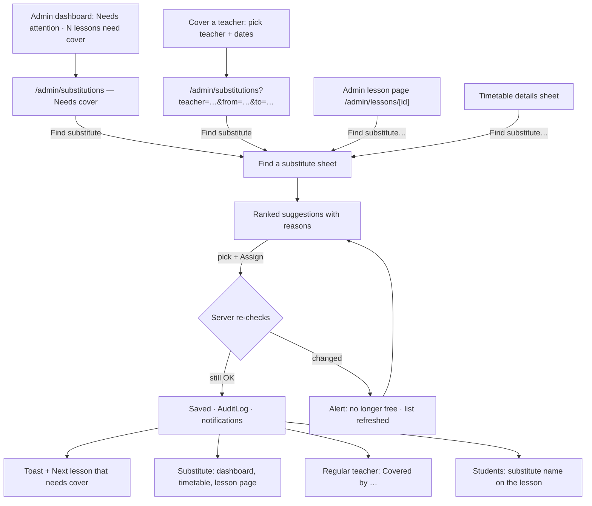
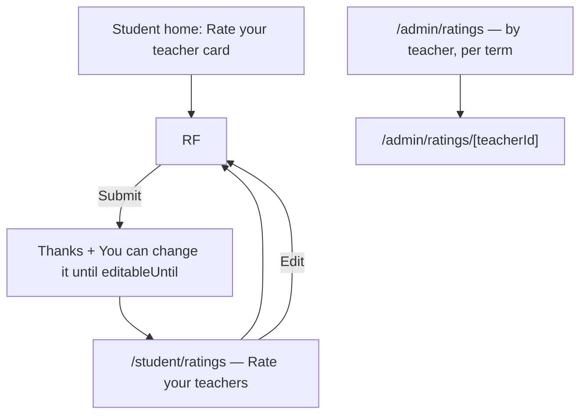
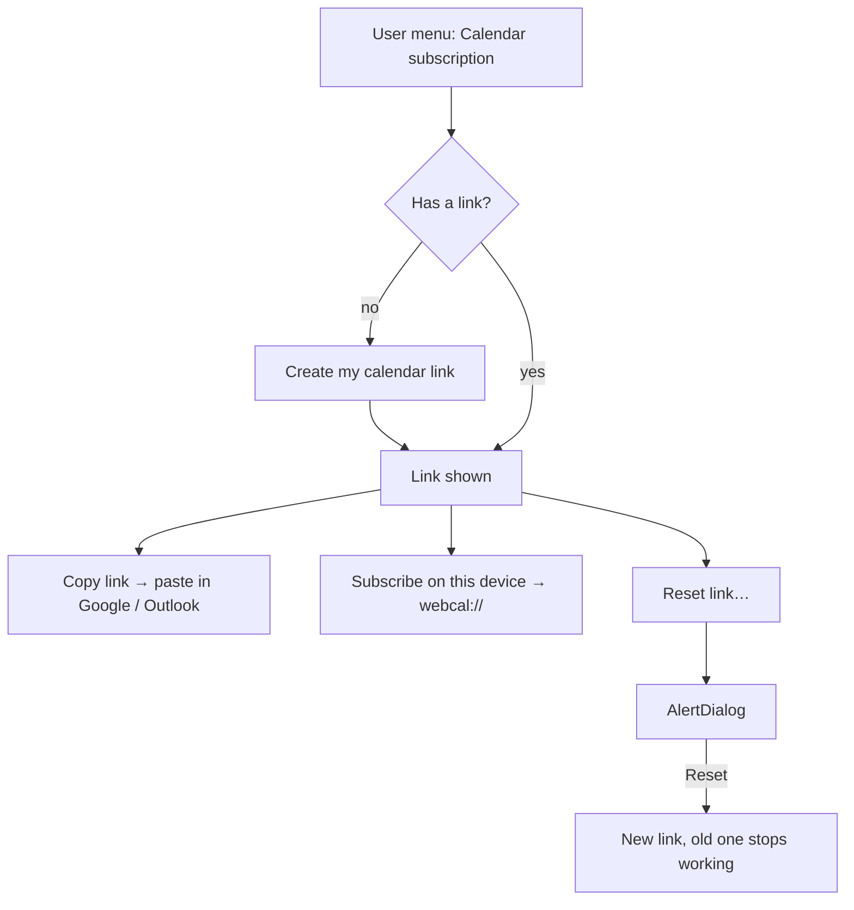

# Notifications, substitutes, ratings & iCal (Phase 5)

Spec for the Phase 5 screens: the in-app notification inbox, the admin
substitute flow and how a covered lesson looks to everyone, student ratings
of teachers with the admin-only ratings view, and the private calendar
(iCal) subscription link. Builds on `docs/design/tokens.md`,
`docs/design/app-layout.md`, `docs/design/timetable.md`,
`docs/design/lessons.md`, `docs/design/absences.md` and
`docs/design/timetable-generator.md`. Clickable wireframe:
`docs/design/wireframes/notifications-substitutes.html`.

The rules behind these screens (who is notified of what, eligibility and
ranking of substitutes, who may rate and when, feed contents) are owned by
the Scheduling Engineer's rules doc (CARM-64,
`docs/architecture/phase5-rules.md`, "rules doc" below). Both docs were
checked against each other: §11 lists what was agreed. If they disagree,
the rules doc wins on behaviour and this spec is updated to match.

## Owner decisions this spec follows (2026-10-15, CARM-45 / CARM-62)

1. **Notifications are in-app only in v1.** The design leaves room for
   email later, but nothing is designed for email now.
2. **Students rate their teacher. Only admins see the ratings.**
3. **Substitutes:** the system suggests eligible substitutes, and the admin
   confirms one.

Earlier decisions still apply: one role per user, later-phase nav items are
hidden until they ship, TeacherNotes never reach students, no attendance
tracking (`lessons.md` decision 1), every query is scoped by `schoolId`, all
UI strings go through next-intl.

## 1. Goal

- Everybody learns about changes that affect them (a cancelled or moved
  lesson, a substitute, a new timetable) without having to check the
  timetable every day. One bell, one inbox, nothing else to learn.
- When a teacher can't come, the admin finds a suitable substitute for a
  lesson in under a minute, sees **why** each teacher is or isn't suggested,
  and confirms with one click.
- The substitute and the regular teacher can't miss who teaches which
  lesson.
- Students can give honest feedback on their teacher, privately and in a
  few taps, and admins can see it per teacher and term. Teachers never see
  ratings, anywhere.
- Teachers and students get their lessons into the calendar app they
  already use, with one link they can reset if it leaks.

## 2. Roles and access

| Area                  | Admin                                                                     | Teacher                                                                                     | Student                                                                    |
| --------------------- | ------------------------------------------------------------------------- | ------------------------------------------------------------------------------------------- | -------------------------------------------------------------------------- |
| Notifications         | Own inbox                                                                 | Own inbox                                                                                   | Own inbox                                                                  |
| Substitutes           | Find, assign, change, remove (`/admin/substitutions`, lesson page, sheet) | Read: lessons they cover and lessons covered for them (`/teacher/substitutions`, timetable) | Read: the substitute's name on the lesson                                  |
| Ratings               | Read all ratings of the school (`/admin/ratings`)                         | **Nothing** — no page, no count, no average                                                 | Write and edit their own ratings (`/student/ratings`); read only their own |
| Calendar subscription | Not offered in v1 (admins have no lessons of their own; §11 Q6)           | Own link: create, copy, reset                                                               | Own link: create, copy, reset                                              |

**Server-side rules** the UI only mirrors (QA covers them in CARM-67):

- A notification is read and marked read only by its recipient. Another
  user's notification id returns **404**, like lessons (`lessons.md` §2).
- Substitute actions are admin-only server actions, scoped by `schoolId`,
  re-checked on confirm and written to `AuditLog`.
- Rating reads exist only in an admin-only server module. Student loaders
  return the student's own rating through a student DTO; teacher loaders
  never import the ratings module.
- The feed route authenticates **only** by its token. An unknown, reset or
  other-school token returns 404 with an empty body; it never reveals
  whether a user exists.

**Navigation changes** (`app-layout.md` §4.3):

- Header bell (all roles): rendered from P5, §4.1.
- Admin: _Substitutions_ (Schedule) and _Ratings_ (Academics) ship.
- Teacher: _Substitutions_ (Me) ships. The P5 item **_Ratings_ is
  dropped** from the teacher nav (owner decision 2).
- Student: _Ratings_ goes into the _More_ sheet (not a bottom tab), as
  "Rate your teachers". Notifications are reached from the header bell, not
  a tab.
- User menu (teacher, student): _Calendar subscription_ ships.

## 3. Concepts shown in the UI

| Concept       | UI word (key)                              | Notes                                                                                                                                                                                |
| ------------- | ------------------------------------------ | ------------------------------------------------------------------------------------------------------------------------------------------------------------------------------------ |
| Notification  | **Notification** (`notifications.*`)       | One message to one user about one event, with an optional link. Unread until opened or marked read.                                                                                  |
| Substitute    | **Substitute** (`substitutes.*`)           | Another teacher teaching one dated lesson instead of the regular teacher (`Lesson.substituteTeacherId`). Token `lesson-substitute`.                                                  |
| Needs cover   | **Needs cover** (`substitutes.needsCover`) | A lesson that hasn't started whose **effective** teacher (the regular teacher, or the substitute if there is one) is away that day, archived or teaching another lesson then (§5.2). |
| Rating        | **Rating** (`ratings.*`)                   | 1–5 stars plus an optional comment, from one student about one teacher for one term.                                                                                                 |
| Calendar link | **Calendar link** (`calendarFeed.*`)       | Private iCal URL with a secret token. Never called "iCal" or "token" in the UI; "calendar link" and "subscribe" only.                                                                |

## 4. Notifications

### 4.1 Bell and unread badge (header, all roles)

Header right side, before the user menu (`app-layout.md` §4.1):

```
… Lingua Language School                    [🔔³]  [AV Anna ▾]
```

- Icon button `bell` (40 px, 44 px on mobile), `aria-label` from
  `notifications.bell.label`: "Notifications" or "Notifications, {count}
  unread". Tooltip with the same text.
- **Unread badge:** a red-600 pill on the top-right of the icon, white
  12 px `tabular-nums` text, the count up to 9, then "9+". No badge when
  there are no unread notifications. The badge is `aria-hidden`; the count
  is in the button label (never color only).
- **Desktop / tablet (≥ 768):** opens a `Popover` (380 px, `shadow-lg`).
  **Mobile (< 768):** navigates straight to the inbox page (a popover is
  too cramped on a phone).
- **Freshness:** the count comes with every page load and is refreshed
  every 60 s while the tab is visible, and when the window regains focus.
  No websockets in v1. The count never announces itself via a live region
  (too noisy); it is in the button label.

**Popover:**

```
┌ Notifications                     Mark all as read ┐
├────────────────────────────────────────────────────┤
│ ● ⟳ Ana Kral is substituting in B1 Evening         │ unread: dot + bold
│     Mon 20 Oct, 17:00 · 5 min ago                  │
│ ● ✕ C1 Business on Wed 22 Oct is cancelled          │
│     Reason: Teacher ill · 1 h ago                  │
│   🗓 Your timetable for Autumn 2026 changed         │ read: regular weight
│     12 lessons have a new teacher · Yesterday      │
│   …                                                │ up to 8 items
├────────────────────────────────────────────────────┤
│              See all notifications                 │
└────────────────────────────────────────────────────┘
```

- Header: h2 "Notifications" and a `link`-style button _Mark all as read_
  (only when something is unread). It marks read everything up to the
  newest item shown (`markAllRead({ upTo })`, rules doc §2.7), so a
  notification that arrives meanwhile stays unread.
- Up to the 8 newest notifications (read and unread), newest first. Each
  item is one link (§4.3). Clicking it marks it read, closes the popover
  and navigates.
- Footer: _See all notifications_ → the inbox page.
- Keyboard: `Tab` from the bell enters the popover; items are a list of
  links, `Esc` closes and returns focus to the bell.
- States: loading (3 skeleton rows) · empty (`bell-off` icon, "You're all
  caught up." + "We'll let you know when something changes.") · error
  ("Couldn't load notifications." + _Try again_).

### 4.2 Inbox page (`/{role}/notifications`)

Same page for every role, inside the role's shell (`/admin/notifications`,
`/teacher/notifications`, `/student/notifications`). Single column,
`max-w-3xl` (desktop), full width cards on mobile, 16 px text for students.

```
┌ Notifications                                   [Mark all as read] ┐
│ [All | Unread (3)]                                                 │
│ Today                                                              │ h2
│ ┌──────────────────────────────────────────────────────────── ⋯ ┐ │
│ │ ● ⟳  Ana Kral is substituting in B1 Evening                    │ │
│ │      Mon 20 Oct 2026, 17:00–18:30 · Room 3                     │ │
│ │      5 min ago                                    Open lesson › │ │
│ └────────────────────────────────────────────────────────────────┘ │
│ ┌ ● ✕  C1 Business on Wed 22 Oct is cancelled ────────────── ⋯ ┐ │
│ Yesterday                                                          │
│ ┌   🗓  Your timetable for Autumn 2026 changed ─────────────── ⋯ ┐ │
│ Earlier                                                            │
│ …                                                                  │
│ [Load more]                                                        │
└────────────────────────────────────────────────────────────────────┘
```

- Page header: h1 "Notifications", _Mark all as read_ (`outline`, only when
  unread > 0). Toast "All notifications marked as read."
- `ToggleGroup` filter **All** (default) · **Unread ({count})**, kept in the
  URL (`?filter=unread`).
- Grouped by day with h2 headings: **Today**, **Yesterday**, **Earlier**
  (school timezone).
- 20 per page, _Load more_ for the next 20. No infinite scroll.
- Row menu (`⋯`, `DropdownMenu`, `aria-label` "More actions for this
  notification") on **unread** items only: _Mark as read_. Read items have
  no menu. There is no _Mark as unread_ and no delete in v1: unread items
  about the same lesson are merged (rules doc §2.5), and retention removes
  old notifications.
- Every notification, read or unread, is deleted 90 days after it was
  created (rules doc §2.5). Footer caption: "Notifications older than
  {days} days are removed." with the rules doc's constant.

States:

| State           | Shows                                                                                                                      |
| --------------- | -------------------------------------------------------------------------------------------------------------------------- |
| Loading         | 5 skeleton rows in the shape of an item                                                                                    |
| Empty (all)     | `bell` icon · "No notifications yet" · "When a lesson is cancelled, moved or covered by a substitute, you'll see it here." |
| Empty (unread)  | "You're all caught up." + _Show all_ link                                                                                  |
| Error           | `Alert` "Couldn't load notifications." + _Try again_                                                                       |
| Mark-all failed | Inline `Alert` above the list, "Couldn't mark notifications as read. Try again."; nothing changes                          |

### 4.3 Notification item

| Part        | Rule                                                                                                                                                                                                                               |
| ----------- | ---------------------------------------------------------------------------------------------------------------------------------------------------------------------------------------------------------------------------------- |
| Unread mark | 8 px primary dot **and** semibold title **and** visually hidden "Unread" before the title. Read items: no dot, regular weight.                                                                                                     |
| Icon        | 20 px lucide icon per category (table below), `aria-hidden`. Color reinforces the category but the title always says what happened.                                                                                                |
| Title       | One sentence from i18n with ICU params, at most 2 lines on mobile then wraps (never truncated).                                                                                                                                    |
| Detail      | One optional muted line: lesson date and time (`tabular-nums`), room, reason.                                                                                                                                                      |
| Time        | Relative ("5 min ago", "Yesterday") in a `<time datetime>` with the full date in `title`.                                                                                                                                          |
| Link        | The whole card is one link to the item's `href` from the server (lesson page, timetable week, review queue, …). The trailing text ("Open lesson ›") says where it goes.                                                            |
| Gone target | The server returns `href: null` when the target no longer exists or the user lost access (e.g. a substitute was removed). The item then has **no link** and the caption "No longer available." The UI never works this out itself. |

Opening an item marks it read **on the server before navigating** (the
same server action returns the URL), so the badge is right on the next
page.

**Text is rendered at read time** from the stored type and params, never
stored as English text. This keeps future languages possible and lets an
email channel reuse the same keys later.

### 4.4 Event catalogue (UI copy)

Types, recipients and params are the rules doc's (§2.2). This table is the
copy. Keys are `notifications.types.<TYPE>.<variant>` (§8). The variant is
the recipient's audience: `teacher` (effective teacher), `regular` (regular
teacher of a covered lesson), `substitute`, `student` or `admin`. Where a
row lists only `teacher`, every teacher audience uses it.

In student copy for a 1-on-1 lesson, "{group}" is written as "your lesson".
The text uses an ICU `select` on the `lessonType` param, shown below as
{group|your lesson}.

| Type                         | Icon (color)               | Variant                                                 | Title                                                              | Detail                                                                    | Link                    |
| ---------------------------- | -------------------------- | ------------------------------------------------------- | ------------------------------------------------------------------ | ------------------------------------------------------------------------- | ----------------------- |
| `LESSON_CANCELLED`           | `ban` (danger)             | teacher                                                 | {group} on {date} is cancelled                                     | Reason: {reason}                                                          | Lesson                  |
|                              |                            | student                                                 | {group\|your lesson} on {date} is cancelled                        | Reason: {reason}                                                          | Lesson                  |
| `LESSON_MOVED`               | `calendar-clock` (info)    | teacher                                                 | {group} moved to {date}, {time}                                    | Was {oldDate}, {oldTime}                                                  | Lesson (the new one)    |
|                              |                            | student                                                 | {group\|your lesson} moved to {date}, {time}                       | Was {oldDate}, {oldTime}                                                  | Lesson                  |
|                              | `door-open` (info)         | teacherRoom / studentRoom (only the room changed)       | {group\|your lesson} on {date} is now in {room}                    | Was {oldRoom}                                                             | Lesson                  |
| `SUBSTITUTE_ASSIGNED`        | `user-round-cog` (cyan)    | substitute                                              | You're substituting in {group} on {date}                           | For {teacher} · {time} · {room}                                           | Lesson                  |
|                              |                            | regular                                                 | {substitute} is covering your {group} lesson on {date}             | {time} · {room}                                                           | Lesson                  |
|                              |                            | student                                                 | {substitute} is teaching {group\|your lesson} on {date}            | {time} · {room}                                                           | Lesson                  |
| `SUBSTITUTE_REMOVED`         | `user-round-x` (cyan)      | substitute                                              | You're no longer substituting in {group} on {date}                 | —                                                                         | Timetable week          |
|                              |                            | regular                                                 | You're teaching {group} on {date} again                            | {substitute} no longer covers it                                          | Lesson                  |
|                              |                            | student                                                 | {teacher} is teaching {group\|your lesson} on {date} again         | —                                                                         | Lesson                  |
| `ABSENCE_REPORTED`           | `calendar-x` (warning)     | teacher                                                 | {student} won't be at {group} on {date}                            | —                                                                         | Lesson                  |
|                              |                            | student (an admin reported it)                          | The school reported you absent from {group\|your lesson} on {date} | You got a makeup credit. / No makeup credit for this one. (`withCredit`)  | Absences tab            |
| `REPLACEMENT_BOOKED`         | `repeat` (amber)           | teacher                                                 | {student} joins {group} on {date} as a replacement                 | From {fromGroup}                                                          | Lesson                  |
|                              |                            | student (an admin booked it)                            | The school booked you into {group} on {date} as a replacement      | For your missed {fromGroup} lesson                                        | Lesson                  |
| `REPLACEMENT_ENDED`          | `repeat` (amber)           | teacher                                                 | {student} no longer joins {group} on {date}                        | Booking cancelled / Rejected by the school / Moved to another lesson      | Lesson                  |
|                              |                            | studentCancelled                                        | Your replacement in {group} on {date} is cancelled                 | Your makeup credit is back. / The credit was used. (`creditBack`)         | Absences tab            |
|                              |                            | studentRejected                                         | The school rejected your replacement in {group} on {date}          | {note} · Your makeup credit is back.                                      | Absences tab            |
| `REPLACEMENT_MOVED`          | `repeat` (amber)           | student                                                 | The school moved your replacement to {group} on {date}             | Was {fromGroup}, {oldDate} · {note}                                       | Lesson (the new target) |
| `REPLACEMENT_REVIEW_PENDING` | `repeat` (warning)         | admin                                                   | {count} new replacement bookings to review                         | —                                                                         | Absences › Review       |
| `TIMETABLE_PUBLISHED`        | `calendar-check` (success) | teacher, student                                        | The timetable for {term} is ready                                  | Your first lesson: {date}, {time} / You have no lessons in this term yet. | Timetable week          |
| `TIMETABLE_CHANGED`          | `calendar-days` (info)     | teacher, student                                        | Your timetable for {term} changed                                  | 3 lessons moved · 1 cancelled · 12 with a new teacher, 3 Nov – 15 Dec     | Timetable week          |
| `CALENDAR_FEED_REVOKED`      | `link` (info)              | teacher, student (only if the owner says yes to §11 Q6) | The school turned off your calendar link                           | Create a new link to keep your calendar up to date.                       | Calendar subscription   |

- **The actor is never notified** of their own action, and nobody is told
  something they couldn't read anyway (rules doc §2.1, §2.4).
- **`TIMETABLE_CHANGED` detail** lists only the non-zero counts (`added`,
  `cancelled`, `moved`, `teacherChanged`), joined with " · ", then the date
  range.
- **Merging while unread:** a lesson moved twice, a substitute changed
  twice, timetable changes and new review bookings each stay **one** unread
  item that is updated and moved to the top (rules doc §2.5). Once read, the
  next event creates a new item.
- **Lessons that have ended** notify nobody (§5.6).
- **Not notified in v1:** lessons needing cover (the admin caused it; the
  dashboard card and the _Needs cover_ tab count show it) and rating
  opening (no scheduler; the student's home card is the prompt). Approving
  a replacement booking doesn't notify anybody either.

### 4.5 Room for email later (not designed now)

Only constraints, so nothing has to be redesigned:

- The catalogue above is the list of things an email could be sent for;
  each type's title/detail keys can be reused as subject/body.
- A later **Notification settings** page (per type: In app · Email) gets a
  _Settings_ link in the inbox page header and in the user menu. v1 renders
  neither.
- No "send me an email" checkbox anywhere in v1.

## 5. Substitutes

### 5.1 Flows



### 5.2 Substitutions page (`/admin/substitutions`, nav _Substitutions_)

Desktop-first (admin), `max-w-screen-2xl`. Tabs (`Tabs`, URL `?tab=`):

1. **Needs cover ({count})** (default): lessons in the next 8 weeks that
   haven't started, aren't cancelled, and whose **effective** teacher can't
   teach them (rules doc §3.7). The effective teacher is the regular teacher,
   or the substitute if there is one. Reasons: away that day (one-off
   unavailability), archived, or teaching another lesson at the same time.
   Weekly unavailability doesn't count: the admin already accepted it in the
   editor. So a covered lesson whose substitute is now away or archived
   comes back here, with "Substitute away" / "Substitute archived". Sorted
   soonest first. Lessons starting within 48 h get a `danger` badge "Soon".
2. **Covered**: upcoming lessons with a substitute, soonest first.
3. **Past**: lessons that ended and had a substitute, newest first, with a
   term `Select` (for payroll questions). Rows that ended up to 7 days ago
   keep _Change substitute…_ / _Remove substitute…_ for corrections (§5.6).

Toolbar (all tabs): Teacher `Combobox` (regular teacher), date range
picker, Level `Select`. Primary page action **Cover a teacher…**.

```
┌ Substitutions                                           [Cover a teacher…] ┐
│ [Needs cover (3) | Covered (5) | Past]                                     │
│ Teacher [Any ▾]   Dates [20 Oct – 14 Dec ▾]   Level [Any ▾]                │
├────────────────────────────────────────────────────────────────────────────┤
│ When                     │ Lesson            │ Teacher             │ Why               │ │
│ Mon 20 Oct 17:00–18:30 ⚑ │ 👥 B1 Evening · B1 │ Tomas Horvat        │ Away (one-off)    │ [Find substitute] │
│ Tue 21 Oct 09:00–10:30   │ 👤 Jan Novak · A2  │ Eva Simon           │ Teaching A2 Morning │ [Find substitute] │
│ Thu 23 Oct 17:00–18:30   │ 👥 B2 Evening · B2 │ Ana Kral (substitute) │ Substitute away │ [Find substitute] │
└────────────────────────────────────────────────────────────────────────────┘
```

- Columns, _Needs cover_: When (link to the admin lesson page) · Lesson
  (type icon + label, group, level) · Teacher (the effective one, with
  "(substitute)" when it's the substitute) · Why (short reason: "Away
  (one-off)", "Archived", "Teaching {otherGroup}", or with the "Substitute"
  prefix: "Substitute away", "Substitute archived", "Substitute teaching
  {otherGroup}") · action _Find substitute_ (`outline`, opens §5.3).
- _Covered_ / _Past_: When · Lesson · Teacher · **Substitute** (cyan
  `user-round-cog` + name) · Assigned by / at · row menu _Change
  substitute…_, _Remove substitute…_ (on _Past_ only for 7 days after the
  lesson ended, §5.6).
- **Cover a teacher…** (`Dialog`): Teacher (`Combobox`, required), From and
  To dates (default today → today). _Show lessons_ applies the filters on the
  _Needs cover_ tab **plus** all that teacher's lessons in the range (not
  only the ones that "need cover"). This is the "Tomas called in sick" flow:
  the admin sees all his lessons for the next days and covers them one by
  one. A checkbox, ticked by default, "Also mark {teacher} as away on these
  dates" writes one one-off unavailability per date through the existing
  availability service, so the lessons also appear in _Needs cover_ and the
  editor knows (§11 Q2, needs the owner's yes).
- Mobile: tables become stacked cards; the page shows the
  `layout.desktopRecommended` notice but stays usable (assigning a
  substitute from a phone is allowed).

States: loading (table skeleton) · empty _Needs cover_ ("No lessons need
cover." / "When a teacher is away on a lesson's date, the lesson shows up
here.") · empty _Covered_ ("No upcoming lessons have a substitute.") ·
empty _Past_ ("No substitutions this term.") · no filter results
(`common.noResults`) · error (`Alert` + _Try again_).

### 5.3 Find a substitute (sheet)

Right `Sheet`, 520 px (full-screen bottom sheet on mobile). Opened from the
substitutions page, the admin lesson page (header action _Find substitute…_
/ _Change substitute…_), and the admin timetable details sheet
(`timetable.md` §6.3, new action row). The admin lesson page is also how a
substitute is **recorded after the lesson** (up to 7 days after it ended):
_Needs cover_ only lists lessons that haven't started.

```
┌ Find a substitute                                                   ✕ ┐
│ B1 Evening · 👥 Group · B1                                            │
│ Mon 20 Oct 2026, 17:00–18:30 · Room 3                                 │
│ Regular teacher: Tomas Horvat (away, one-off)                         │
│ [Search teachers…]                                                    │
├───────────────────────────────────────────────────────────────────────┤
│ Suggested (3)                                                         │
│ (•) 1  Ana Kral                                                       │
│        ✓ Teaches B1  ✓ Free  ✓ 6 h → 7.5 h this week (max 10 h)       │
│        ★ Has taught B1 Evening before                                 │
│ ( ) 2  Lucia Benova                                                   │
│        ✓ Teaches B1  ✓ Free  ✓ 4 h → 5.5 h this week (no max)         │
│ ( ) 3  Eva Simon                                                      │
│        ✓ Teaches B1  ✓ Free  ✓ 9 h → 10.5 h this week (max 12 h)      │
│ Possible with a warning (3)                                           │
│ ( ) Peter Varga     ⚠ Doesn't teach B1 (teaches A1–A2)                │
│ ( ) Marta Holub     ⚠ Unavailable Mon 16:00–20:00 (weekly)            │
│ ( ) Ivana Mraz      ⚠ Away on 20 Oct (one-off)                        │
│ ▸ Not possible (1)                                                    │
│     Jozef Kovac     ✗ Teaching C1 Business, 17:00–18:30               │
├───────────────────────────────────────────────────────────────────────┤
│ ⓘ Ana Kral, Tomas Horvat and the 8 students of B1 Evening will be     │
│   notified.                                                           │
│                                        [Cancel]  [Assign Ana Kral]    │
└───────────────────────────────────────────────────────────────────────┘
```

**Header:** group, type, level, date and time, room, regular teacher with
the reason the lesson needs cover. When the lesson already has a
substitute: "Current substitute: {name}". The server lists that teacher
**first** (`current: true`), above the sections, with a _Current_ badge and
their current reasons, so the admin sees whether they're still fine. That
row can't be assigned again; it offers _Remove substitute…_ instead.

**List:** one `RadioGroup` with three labelled sections, the same model as
the generator's teacher picker (`timetable-generator.md` §6.6), so admins
learn one pattern. The server returns each teacher's section (`band`),
`rank`, reasons and hints (rules doc §3.7). The regular teacher and archived
teachers are never listed.

| Section (key)                                                     | Who (UI assumption, §11 A5)                                                                                            | Row shows                                               | Selectable?                                             |
| ----------------------------------------------------------------- | ---------------------------------------------------------------------------------------------------------------------- | ------------------------------------------------------- | ------------------------------------------------------- |
| **Suggested** (`substitutes.picker.suggested`, band `SUGGESTED`)  | Teaches the group's level, free at the lesson's time (no lesson, no unavailability), stays within max hours that week  | Rank number, name, green checks per rule, ranking hints | Yes                                                     |
| **Possible with a warning** (`.withWarning`, band `WITH_WARNING`) | Only overridable problems: doesn't teach the level, weekly unavailability, **away that day (one-off)**, over max hours | Name + each warning (`warning` icon + text)             | Yes; assigning needs a confirm checkbox (below)         |
| **Not possible** (`.notPossible`, band `NOT_POSSIBLE`, collapsed) | Teaching another lesson at that time (`BUSY`)                                                                          | Name + the reason, as text                              | No. `aria-disabled`, reason read out; never only greyed |

- **Ranking** of _Suggested_ is the rules doc's. The UI shows the rank
  number and up to two **ranking hints** as small text with a `star` icon:
  `KNOWS_GROUP` "Has taught {group} before", `SAME_DAY` "Already teaching
  that day", `FEWEST_HOURS` "Fewest hours this week". Hints explain the
  order; they're not a score. No numeric score is shown.
- Every reason is **text**: ✓/⚠/✗ icons are `aria-hidden` and the rule is
  spelled out ("Teaches B1", "Free at this time", "6 h → 7.5 h this week (max
  10 h)").
- **Search** filters across all sections by name; sections with no match
  hide; "No teachers match '{query}'."
- **Choosing a warning row** shows, above the footer, a `warning` `Alert`
  listing that teacher's warnings and a required `Checkbox` "Assign anyway".
  This mirrors the editor's override acknowledgement (`scheduling.md`
  "Saving with an override"); the acknowledged keys are sent with the
  action and stored in the audit log.
- **Footer:** the notification preview, built from the server's
  `notifyPreview` (the same recipient list the action uses, so it can't
  disagree with what is sent): "{names} and the {count} students of {group}
  will be notified."; without students once the lesson has started
  ("{names} will be notified."); and "Nobody is notified, because the lesson
  has ended." after the end. Then _Cancel_ and the primary
  **Assign {name}** (label updates with the selection; disabled until one
  is chosen — the only place a disabled primary is allowed, because there is
  no invalid input to explain). With the current substitute selected the
  primary is hidden and _Remove substitute…_ (`outline`) shows instead.
- **After saving:** the sheet closes, toast "{name} is substituting in
  {group} on {date}." and, when opened from _Needs cover_, the toast has
  **Next lesson** which opens the sheet for the next lesson in the list.
  The row moves to _Covered_.

States:

| State                    | Shows                                                                                                                                                                          |
| ------------------------ | ------------------------------------------------------------------------------------------------------------------------------------------------------------------------------ |
| Loading                  | Header filled, 4 skeleton rows                                                                                                                                                 |
| Nobody suggested         | `Alert` (warning) "No teacher meets all the rules for this lesson." + "You can still pick someone below with a warning." Sections 2 and 3 open.                                |
| Nobody at all            | "No other teacher can take this lesson: everyone is teaching at this time." + links _Move the lesson_ (admin lesson page) and _Cancel the lesson_                              |
| Saving                   | Spinner on the primary ("Assigning…"), list disabled                                                                                                                           |
| Stale (re-check failed)  | `warning` `Alert` "{name} is no longer free at this time. Pick someone else." The list reloads with fresh reasons; the selection is cleared                                    |
| Lesson changed/cancelled | `warning` `Alert` "This lesson changed while you were choosing. Reload to see it." + _Reload_ (`LESSON_CHANGED`)                                                               |
| Too late to record       | Lesson ended more than 7 days ago: the actions are hidden; if it happens on submit, `Alert` "This lesson ended more than 7 days ago. Its substitute can no longer be changed." |
| Error                    | Inline `Alert` "Couldn't assign the substitute. Nothing was changed." + _Try again_                                                                                            |

### 5.4 Remove a substitute

`AlertDialog` from the lesson page, the _Covered_ row menu or the sheet:

- Title: "Remove {substitute} from {group} on {date}?"
- Description: "{teacher} teaches this lesson again." plus the server's
  notify preview, as in §5.3.
- If the regular teacher is away or has another warning then: extra
  `warning` line "{teacher} is away at this time. The lesson will need cover
  again." and a required `Checkbox` "Remove anyway" (overridable, like the
  picker).
- **Regular teacher busy** (`REGULAR_TEACHER_BUSY`: they teach another
  lesson then): the dialog says "{teacher} is teaching {otherGroup} at this
  time, so the substitute can't be removed. Pick another substitute
  instead." Buttons: _Close_ · **Find another substitute** (opens §5.3). No
  destructive button.
- Buttons: _Keep substitute_ · **Remove substitute** (`destructive`).
- Toast "{substitute} no longer substitutes in {group} on {date}."

### 5.5 How a covered lesson looks

Timetable blocks and the details sheet already render substitutes
(`timetable.md` §6.2–6.3, keys `timetable.substitute.*`). The lesson-page
banners exist in `lessons.md` §5.2. P5 adds:

**Substitute teacher**

- Timetable: `lesson-substitute` block with badge "You're substituting" and
  "for {teacher}" (exists).
- **Dashboard** (`app-layout.md` §7.3): the _Next lesson_ and _Today_ cards
  show the same badge on covered lessons. New card **Substitutions** (only
  when there's something to show): "You're covering {count} lessons in the
  next 14 days" with the next two (date, group) and _See all_ →
  `/teacher/substitutions`.
- Lesson page: `info` banner "You're substituting for {teacher} in this
  lesson." (exists); full rights on the lesson as `lessons.md` §2.

**Regular teacher**

- Timetable: the "Covered by {substitute}" block (muted, `user-round-cog`,
  no line-through; exists). It stays visible so they know the slot is
  handled, and it doesn't count as teaching in their day.
- Dashboard _Today_: covered lessons stay in the list, muted, with "Covered
  by {substitute}".
- Lesson page: `info` banner "{substitute} is substituting in this lesson.
  You can both edit it." (exists).

**Teacher Substitutions page** (`/teacher/substitutions`, nav _Substitutions_)

Two sections, each a compact list (stacked cards on mobile), upcoming
first, with a _Show past_ toggle:

1. **You're covering**: date & time (link to lesson), group, level, room,
   "for {teacher}".
2. **Covered for you**: date & time, group, "by {substitute}".

Empty: "No substitutions." / "When you cover a lesson or someone covers
yours, it shows up here." Teachers can't request or change substitutes here
(admin-only, owner decision 3).

**Students** see the substitute on the timetable block, the details sheet
and the lesson page ("{substitute} (substitute)", existing keys) and get a
notification. Nothing else changes for them.

**Admin**: lesson page header shows the substitute banner "{substitute} is
substituting for {teacher}." with _Change substitute…_ / _Remove
substitute…_ actions; the admin dashboard _Needs attention_ card gets "{count}
lessons need cover" → _Needs cover_ tab.

### 5.6 Rules the UI assumes (details in §11)

- **Cancelled lessons** can't get a substitute; the actions are hidden.
- **Lessons that have started:** the admin can still set, change or remove
  a substitute, for the record (payroll-relevant hours). Students are no
  longer notified; the teachers are. The sheet shows a `warning` banner
  "This lesson has started. Students won't be notified."
- **Lessons that have ended:** the same actions for **7 days** after the
  end, to record who actually taught. **Nobody** is notified. Banner "This
  lesson has ended. Changing the substitute only corrects the record; nobody
  is notified." After 7 days the actions are hidden.
- **Moved lesson with a substitute**: the move dialog checks the
  substitute like any teacher conflict (busy blocks, unavailability needs
  acknowledging) and offers "remove the substitute" as the alternative. If
  the substitute is away at the new time, the lesson simply shows up in
  _Needs cover_ ("Substitute away"). There is no extra badge.
- **Regular teacher changed** (Phase 4 apply): a lesson keeps its
  substitute (`scheduling.md`); if the new regular teacher is the
  substitute, the substitute is cleared (CHECK constraint) and the lesson
  is shown as normal.

## 6. Ratings

### 6.1 Flow



### 6.2 When a student can rate (rules doc §4.1)

- A student can rate **each teacher who taught them in the term** (as
  regular teacher or substitute) once they've attended at least **3
  lessons** with that teacher. A lesson counts once it has **ended**, wasn't
  cancelled and the student didn't report an absence from it.
- **One rating per student, teacher and term.** It can be edited while the
  window is open, i.e. until `editableUntil` (14 days after the term ends),
  then it is read-only for the student. No delete.
- Rating opens at **half-term** (`opensAt`). Before that, teachers who
  qualify otherwise are listed with "You can rate {teacher} from {date}."
  There is no notification when rating opens; the home card is the prompt.
- The server sends `opensAt` and `editableUntil`; the UI never computes
  these dates.
- Substitutes who taught fewer lessons than the minimum don't appear.

### 6.3 Student: Rate your teachers (`/student/ratings`, mobile-first)

In the _More_ sheet as "Rate your teachers" with a count badge of teachers
not rated yet. Also a **home card** "Rate your teacher" when at least one
teacher is open and unrated: "How are your lessons with {teacher}?" +
_Rate now_ + _Not now_ (hides the card for 7 days; the list page still has
it).

```
┌──────────────────────────────┐
│ Rate your teachers           │ h1
│ Autumn 2026                  │
│ 🔒 Only the school's admins  │ privacy note (info)
│ see ratings. Teachers don't. │
│ ┌──────────────────────────┐ │
│ │ Tomas Horvat             │ │
│ │ B1 Evening               │ │
│ │ Not rated yet  [Rate ›]  │ │
│ └──────────────────────────┘ │
│ ┌──────────────────────────┐ │
│ │ Ana Kral (substitute)    │ │
│ │ ★★★★☆ Rated 12 Nov       │ │
│ │ You can change it until  │ │
│ │ 20 Dec.        [Edit ›]  │ │
│ └──────────────────────────┘ │
└──────────────────────────────┘
```

- One card per eligible teacher: name, the groups they taught the student
  in, and either "Not rated yet" + _Rate_, the stars + date + _Edit_, or
  "You can rate {teacher} from {date}." (no action).
- Earlier terms: a collapsed "Earlier terms" section, read-only.
- Empty: "No teachers to rate yet" / "After a few lessons with a teacher,
  you can rate them here."

### 6.4 Rate a teacher (`/student/ratings/[teacherId]`)

A page, not a dialog (comfortable on a phone and survives a reload).

```
┌──────────────────────────────┐
│ ‹ Rate your teachers         │
│ How are your lessons with    │ h1
│ Tomas Horvat?                │
│ Autumn 2026 · B1 Evening     │
│ 🔒 Only the school's admins  │
│ see this. Tomas won't see it.│
│ Your rating (required)       │
│ [☆][☆][☆][☆][☆]              │ 5 × 44 px
│ Excellent                    │ label of the chosen value
│ Comment (optional)           │
│ [What's going well? What   ] │
│ [could be better?          ] │
│                        0/1000│
│ [        Submit rating      ]│ full width
└──────────────────────────────┘
```

- **Stars** are a `RadioGroup` of 5 radios styled as stars (44 × 44 px),
  each with a visible label on selection and an accessible name: 1 "Poor",
  2 "Fair", 3 "Good", 4 "Very good", 5 "Excellent". Arrow keys move,
  the chosen value is filled amber-500 with a 1 px amber-700 outline (≥ 3:1)
  and the label is printed under the stars — never color only.
- **Comment**: `Textarea`, max 1,000 characters, counter from 900.
- Privacy note always visible above the form (`info` style, `lock` icon).
- Submit → toast "Thanks! Your rating is saved." and back to the list.
  Editing shows "Last changed {date}" and _Save changes_.
- No delete in v1 (§11 Q4).
- States: validation ("Choose a rating from 1 to 5 stars.") · saving ·
  error (inline `Alert`, input kept) · window closed (read-only, "Rating for
  {term} has closed. Your rating can no longer be changed.") · not eligible
  / other teacher → 404.

### 6.5 Admin: Ratings (`/admin/ratings`, nav _Ratings_)

Desktop-first. Page header h1 "Ratings", term `Select` (default current
term), caption "Only admins can see ratings."

```
┌ Ratings                                         Term [Autumn 2026 ▾]     ┐
│ 🔒 Only admins can see ratings. Teachers and students can't.            │
├─────────────────────────────────────────────────────────────────────────┤
│ Teacher        │ Average      │ Ratings │ Distribution      │ Last rated │
│ Ana Kral       │ ★ 4.6        │ 14      │ 5▇▇▇▇ 4▇▇ 3▏ 2 1  │ 2 days ago │
│ Tomas Horvat   │ ★ 3.9        │ 22      │ …                 │ Today      │
│ Eva Simon      │ Too few (2)  │ 2       │ —                 │ 10 Nov     │
│ Peter Varga    │ No ratings   │ 0       │ —                 │ —          │
└─────────────────────────────────────────────────────────────────────────┘
```

- Columns: Teacher (link to detail) · Average (one decimal, `star` icon +
  number; text "out of 5" for screen readers) · Ratings (count) ·
  Distribution (5 small horizontal bars with counts as text, `aria-label`
  "5 stars: 9, 4 stars: 4, …") · Last rated. Sortable by teacher, average,
  count.
- **Too few:** with fewer than 3 visible ratings the average shows "Too
  few to average" so a single angry rating doesn't look like a trend (§11
  Q5).
- Hidden ratings (below) are left out of the average, the count and the
  distribution.
- All non-archived teachers of the school are listed, including those with
  no ratings.
- Empty term: "No ratings for {term} yet." / "Students can rate their
  teachers from {date}."

**Teacher ratings** (`/admin/ratings/[teacherId]`): back link, h1 the
teacher's name, term `Select`, summary card (average, count, distribution),
then the list of ratings newest first: stars + label, comment (full text),
group, date, and the **student's name** (§11 Q3). Filter by group. 20 per
page with _Load more_. A comment that was edited shows "Edited".

- **Hide** (e.g. an abusive comment): each row has a menu with _Hide
  rating_. No confirm dialog, because it can be undone: toast "Rating hidden."
  with _Undo_. Hidden ratings move into a collapsed section "Hidden ratings
  ({count})" at the bottom, each with "Hidden by {name}, {date}" and
  _Unhide_. They don't count in the average. Admins can't edit a rating.
- The student isn't told that their rating was hidden.

Permission states: a teacher or student opening `/admin/ratings` gets the
403 page (`errors.forbidden.*`). There is no teacher-facing route at all.

## 7. Calendar subscription (iCal)

### 7.1 Where

User menu → **Calendar subscription** (teacher and student). Students also
get it in the _More_ sheet. Page `/teacher/calendar` or
`/student/calendar`, `max-w-2xl`, mobile-first for students.

### 7.2 Flow



### 7.3 Page

```
┌ Calendar subscription                                         ┐
│ See your lessons in Google Calendar, Apple Calendar or        │
│ Outlook. Your calendar updates by itself when lessons change. │
│ ┌ Your calendar link ──────────────────────────────────────┐  │
│ │ [https://app…/api/calendar/7Hk…Qz.ics      ] [Copy link] │  │
│ │ [Subscribe on this device]                               │  │
│ │ ⚠ Anyone with this link can see your lessons. Don't      │  │
│ │   share it. If it leaks, reset it.                       │  │
│ │ Created 14 Oct 2026                    [Reset link…]     │  │
│ └──────────────────────────────────────────────────────────┘  │
│ What's in it                                                  │
│ • Your lessons from 30 days ago to 6 months ahead             │
│ • Cancelled lessons, marked "Cancelled"                       │
│ • Lessons you reported you'll miss, marked "Not attending"    │
│ • Substitutes: who teaches each lesson                        │
│ How to add it                                                 │
│ ▸ Google Calendar   ▸ Apple Calendar   ▸ Outlook              │
│ Calendar apps check for changes every few hours, so a change │
│ can take a while to show up.                                  │
└───────────────────────────────────────────────────────────────┘
```

- **No link yet** (first visit): the card shows the explanation and one
  primary button **Create my calendar link**. Links are created only on
  request, so unused links don't exist.
- **Link field:** read-only `Input` with the full URL (selectable,
  `font-variant-numeric` normal, scrolls horizontally, never truncated with
  an ellipsis) + **Copy link** (`outline`, `copy` icon). On copy: the button
  changes to "Copied" with `check` for 2 s and a `role="status"` message;
  if the clipboard API fails, the field text is selected and the hint
  "Press Ctrl+C (⌘C on Mac) to copy." appears.
- **Subscribe on this device:** `link` to the same URL with `webcal://`,
  which opens Apple Calendar / Outlook directly. On mobile it's the primary
  action (full width).
- **Warning** (`warning` style, not hidden in an accordion): the link is a
  secret.
- **How to add it:** `Accordion` with 3–4 short numbered steps per app
  (copy texts in §8). Google needs the copied link ("Other calendars › + ›
  From URL").
- **What's in it:** the rules doc's window (30 days back, 180 days
  ahead), in plain words. "Not attending" is shown to students only.

### 7.4 Reset link

- _Reset link…_ (`outline`) → `AlertDialog`:
  - Title "Reset your calendar link?"
  - Description "Your current link stops working right away. Calendars
    that use it will stop updating, so you'll need to add the new link to
    them."
  - _Keep current link_ · **Reset link** (`destructive`).
- After reset: the new link is shown, the card gets a `success` line "New
  link created. Add it to your calendar apps." and focus moves to the link
  field. Toast "Calendar link reset."
- Optional (§11 Q6): an admin can **turn off** a user's link from the
  user's admin page (lost phone). The admin never sees the link and doesn't
  create a new one. The user gets `CALENDAR_FEED_REVOKED`, and their page
  shows the "no link yet" state with an `info` line "The school turned off
  your previous link. Create a new one to keep your calendar up to date."
  Admin side: on the teacher or student page, _Turn off calendar link…_
  (only when they have one) → `AlertDialog` "Turn off {name}'s calendar
  link?" / "Their calendar apps stop updating. They can create a new link
  themselves." / **Turn off link**.

### 7.5 States

Loading (card skeleton) · no link · link · creating/resetting (button
spinner, "Creating…"/"Resetting…") · error (inline `Alert` "Couldn't create
your calendar link. Try again." / "Couldn't reset your calendar link. Your
current link still works.") · admins opening the URL → 403 page.

### 7.6 What the feed shows (rules doc §5.3)

Event texts come from i18n (`calendarFeed.event.*`) in the school's
language. Times are UTC instants with no `TZID`, so DST is always right and
calendar apps show each user's local time. One event per lesson, with a
stable id, so a moved or cancelled lesson updates the same event.

| Lesson                    | Event title                        | Status / transparency                 | Description                                                                                                                |
| ------------------------- | ---------------------------------- | ------------------------------------- | -------------------------------------------------------------------------------------------------------------------------- |
| Normal lesson             | {group}                            | `CONFIRMED`, busy                     | {type} · {level} · Teacher: {teacher} · Room · link to lesson page                                                         |
| With substitute (student) | {group} (substitute: {substitute}) | `CONFIRMED`, busy                     | Teacher: {substitute}, instead of {teacher}                                                                                |
| Substitute's feed         | Substituting: {group}              | `CONFIRMED`, busy                     | For {teacher}                                                                                                              |
| Regular teacher, covered  | Covered by {substitute}: {group}   | `CONFIRMED`, **free** (`TRANSPARENT`) | So they see it's handled, but it doesn't block their day                                                                   |
| Cancelled                 | Cancelled: {group}                 | `CANCELLED`, free                     | Reason: {reason}                                                                                                           |
| Student reported absent   | Not attending: {group}             | `CONFIRMED`, **free**                 | The group lesson still runs                                                                                                |
| Online room               | as above                           |                                       | No meeting link: the event links to the lesson page, which shows it after sign-in (a leaked feed must not let anyone join) |

A removed substitute, a student who left the group or an ended replacement
makes the event disappear from that person's feed. No other students'
names, rosters, TeacherNotes, absence reasons, lesson logs, homework or
ratings ever appear in a feed.

## 8. Copy (i18n keys, English source)

### notifications

Variant fallback: a teacher audience (`regular`, `substitute`) without its own key uses `.teacher`; `TIMETABLE_PUBLISHED`, `TIMETABLE_CHANGED` and `CALENDAR_FEED_REVOKED` use `.teacher` for students too.

| Key                                                      | Copy                                                                                                                        |
| -------------------------------------------------------- | --------------------------------------------------------------------------------------------------------------------------- |
| `notifications.title`                                    | Notifications                                                                                                               |
| `notifications.bell.label`                               | {count, plural, =0 {Notifications} one {Notifications, # unread} other {Notifications, # unread}}                           |
| `notifications.markAllRead`                              | Mark all as read                                                                                                            |
| `notifications.markedAllRead`                            | All notifications marked as read.                                                                                           |
| `notifications.markRead`                                 | Mark as read                                                                                                                |
| `notifications.rowMenu`                                  | More actions for this notification                                                                                          |
| `notifications.unread`                                   | Unread                                                                                                                      |
| `notifications.seeAll`                                   | See all notifications                                                                                                       |
| `notifications.filter.all`                               | All                                                                                                                         |
| `notifications.filter.unread`                            | Unread ({count})                                                                                                            |
| `notifications.group.today`                              | Today                                                                                                                       |
| `notifications.group.yesterday`                          | Yesterday                                                                                                                   |
| `notifications.group.earlier`                            | Earlier                                                                                                                     |
| `notifications.loadMore`                                 | Load more                                                                                                                   |
| `notifications.retention`                                | Notifications older than {days} days are removed.                                                                           |
| `notifications.gone`                                     | No longer available.                                                                                                        |
| `notifications.open.lesson`                              | Open lesson                                                                                                                 |
| `notifications.open.timetable`                           | Open timetable                                                                                                              |
| `notifications.open.review`                              | Review                                                                                                                      |
| `notifications.open.absences`                            | Open absences                                                                                                               |
| `notifications.open.calendar`                            | Open calendar settings                                                                                                      |
| `notifications.empty.title`                              | No notifications yet                                                                                                        |
| `notifications.empty.description`                        | When a lesson is cancelled, moved or covered by a substitute, you'll see it here.                                           |
| `notifications.empty.unread`                             | You're all caught up.                                                                                                       |
| `notifications.empty.popover`                            | We'll let you know when something changes.                                                                                  |
| `notifications.empty.showAll`                            | Show all                                                                                                                    |
| `notifications.error.load`                               | Couldn't load notifications.                                                                                                |
| `notifications.error.markAll`                            | Couldn't mark notifications as read. Try again.                                                                             |
| `notifications.types.LESSON_CANCELLED.teacher`           | {group} on {date} is cancelled                                                                                              |
| `notifications.types.LESSON_CANCELLED.student`           | {lessonType, select, ONE_ON_ONE {Your lesson} other {{group}}} on {date} is cancelled                                       |
| `notifications.types.LESSON_MOVED.teacher`               | {group} moved to {date}, {time}                                                                                             |
| `notifications.types.LESSON_MOVED.student`               | {lessonType, select, ONE_ON_ONE {Your lesson} other {{group}}} moved to {date}, {time}                                      |
| `notifications.types.LESSON_MOVED.teacherRoom`           | {group} on {date} is now in {room}                                                                                          |
| `notifications.types.LESSON_MOVED.studentRoom`           | {lessonType, select, ONE_ON_ONE {Your lesson} other {{group}}} on {date} is now in {room}                                   |
| `notifications.types.SUBSTITUTE_ASSIGNED.substitute`     | You're substituting in {group} on {date}                                                                                    |
| `notifications.types.SUBSTITUTE_ASSIGNED.regular`        | {substitute} is covering your {group} lesson on {date}                                                                      |
| `notifications.types.SUBSTITUTE_ASSIGNED.student`        | {substitute} is teaching {lessonType, select, ONE_ON_ONE {your lesson} other {{group}}} on {date}                           |
| `notifications.types.SUBSTITUTE_REMOVED.substitute`      | You're no longer substituting in {group} on {date}                                                                          |
| `notifications.types.SUBSTITUTE_REMOVED.regular`         | You're teaching {group} on {date} again                                                                                     |
| `notifications.types.SUBSTITUTE_REMOVED.student`         | {teacher} is teaching {lessonType, select, ONE_ON_ONE {your lesson} other {{group}}} on {date} again                        |
| `notifications.types.ABSENCE_REPORTED.teacher`           | {student} won't be at {group} on {date}                                                                                     |
| `notifications.types.ABSENCE_REPORTED.student`           | The school reported you absent from {lessonType, select, ONE_ON_ONE {your lesson} other {{group}}} on {date}                |
| `notifications.types.REPLACEMENT_BOOKED.teacher`         | {student} joins {group} on {date} as a replacement                                                                          |
| `notifications.types.REPLACEMENT_BOOKED.student`         | The school booked you into {group} on {date} as a replacement                                                               |
| `notifications.types.REPLACEMENT_ENDED.teacher`          | {student} no longer joins {group} on {date}                                                                                 |
| `notifications.types.REPLACEMENT_ENDED.studentCancelled` | Your replacement in {group} on {date} is cancelled                                                                          |
| `notifications.types.REPLACEMENT_ENDED.studentRejected`  | The school rejected your replacement in {group} on {date}                                                                   |
| `notifications.types.REPLACEMENT_MOVED.student`          | The school moved your replacement to {group} on {date}                                                                      |
| `notifications.types.REPLACEMENT_REVIEW_PENDING.admin`   | {count, plural, one {# new replacement booking to review} other {# new replacement bookings to review}}                     |
| `notifications.types.TIMETABLE_PUBLISHED.teacher`        | The timetable for {term} is ready                                                                                           |
| `notifications.types.TIMETABLE_CHANGED.teacher`          | Your timetable for {term} changed                                                                                           |
| `notifications.types.CALENDAR_FEED_REVOKED.teacher`      | The school turned off your calendar link                                                                                    |
| `notifications.detail.reason`                            | Reason: {reason}                                                                                                            |
| `notifications.detail.was`                               | Was {oldDate}, {oldTime}                                                                                                    |
| `notifications.detail.wasRoom`                           | Was {oldRoom}                                                                                                               |
| `notifications.detail.timeRoom`                          | {time} · {room}                                                                                                             |
| `notifications.detail.forTeacher`                        | For {teacher} · {time} · {room}                                                                                             |
| `notifications.detail.noLongerCovers`                    | {substitute} no longer covers it                                                                                            |
| `notifications.detail.withCredit`                        | {withCredit, select, yes {You got a makeup credit.} other {No makeup credit for this one.}}                                 |
| `notifications.detail.fromGroup`                         | From {fromGroup}                                                                                                            |
| `notifications.detail.forMissed`                         | For your missed {fromGroup} lesson                                                                                          |
| `notifications.detail.outcome`                           | {outcome, select, cancelled {Booking cancelled} rejected {Rejected by the school} moved {Moved to another lesson} other {}} |
| `notifications.detail.creditBack`                        | {creditBack, select, yes {Your makeup credit is back.} other {The credit was used.}}                                        |
| `notifications.detail.note`                              | Note from the school: {note}                                                                                                |
| `notifications.detail.movedFrom`                         | Was {fromGroup}, {oldDate}                                                                                                  |
| `notifications.detail.firstLesson`                       | Your first lesson: {date}, {time}                                                                                           |
| `notifications.detail.noLessons`                         | You have no lessons in this term yet.                                                                                       |
| `notifications.detail.added`                             | {count, plural, one {# lesson added} other {# lessons added}}                                                               |
| `notifications.detail.cancelled`                         | {count, plural, one {# cancelled} other {# cancelled}}                                                                      |
| `notifications.detail.moved`                             | {count, plural, one {# moved} other {# moved}}                                                                              |
| `notifications.detail.teacherChanged`                    | {count, plural, one {# with a new teacher} other {# with a new teacher}}                                                    |
| `notifications.detail.range`                             | {from} – {to}                                                                                                               |
| `notifications.detail.feedRevoked`                       | Create a new link to keep your calendar up to date.                                                                         |

### substitutes

| Key                                          | Copy                                                                                                                      |
| -------------------------------------------- | ------------------------------------------------------------------------------------------------------------------------- |
| `substitutes.title`                          | Substitutions                                                                                                             |
| `substitutes.tab.needsCover`                 | Needs cover ({count})                                                                                                     |
| `substitutes.tab.covered`                    | Covered ({count})                                                                                                         |
| `substitutes.tab.past`                       | Past                                                                                                                      |
| `substitutes.coverTeacher`                   | Cover a teacher…                                                                                                          |
| `substitutes.coverTeacher.title`             | Cover a teacher                                                                                                           |
| `substitutes.coverTeacher.teacher`           | Teacher (required)                                                                                                        |
| `substitutes.coverTeacher.from`              | From                                                                                                                      |
| `substitutes.coverTeacher.to`                | To                                                                                                                        |
| `substitutes.coverTeacher.markAway`          | Also mark {teacher} as away on these dates                                                                                |
| `substitutes.coverTeacher.submit`            | Show lessons                                                                                                              |
| `substitutes.col.when`                       | When                                                                                                                      |
| `substitutes.col.lesson`                     | Lesson                                                                                                                    |
| `substitutes.col.teacher`                    | Teacher                                                                                                                   |
| `substitutes.col.why`                        | Why                                                                                                                       |
| `substitutes.col.substitute`                 | Substitute                                                                                                                |
| `substitutes.col.assigned`                   | Assigned                                                                                                                  |
| `substitutes.why.awayOnDate`                 | Away (one-off)                                                                                                            |
| `substitutes.why.archived`                   | Archived                                                                                                                  |
| `substitutes.why.busy`                       | Teaching {otherGroup}                                                                                                     |
| `substitutes.why.substituteAway`             | Substitute away                                                                                                           |
| `substitutes.why.substituteArchived`         | Substitute archived                                                                                                       |
| `substitutes.why.substituteBusy`             | Substitute teaching {otherGroup}                                                                                          |
| `substitutes.teacherIsSubstitute`            | {name} (substitute)                                                                                                       |
| `substitutes.soon`                           | Soon                                                                                                                      |
| `substitutes.find`                           | Find substitute                                                                                                           |
| `substitutes.findEllipsis`                   | Find substitute…                                                                                                          |
| `substitutes.change`                         | Change substitute…                                                                                                        |
| `substitutes.remove`                         | Remove substitute…                                                                                                        |
| `substitutes.picker.title`                   | Find a substitute                                                                                                         |
| `substitutes.picker.regular`                 | Regular teacher: {teacher}                                                                                                |
| `substitutes.picker.current`                 | Current substitute: {name}                                                                                                |
| `substitutes.picker.currentBadge`            | Current                                                                                                                   |
| `substitutes.picker.search`                  | Search teachers…                                                                                                          |
| `substitutes.picker.suggested`               | Suggested ({count})                                                                                                       |
| `substitutes.picker.withWarning`             | Possible with a warning ({count})                                                                                         |
| `substitutes.picker.notPossible`             | Not possible ({count})                                                                                                    |
| `substitutes.picker.rank`                    | Suggestion {rank}                                                                                                         |
| `substitutes.reason.teachesLevel`            | Teaches {level}                                                                                                           |
| `substitutes.reason.free`                    | Free at this time                                                                                                         |
| `substitutes.reason.hours`                   | {current} → {with} this week ({max, select, none {no max} other {max {max}}})                                             |
| `substitutes.reason.notLevel`                | Doesn't teach {level} (teaches {levels})                                                                                  |
| `substitutes.reason.unavailableWeekly`       | Unavailable {weekday} {time} (weekly)                                                                                     |
| `substitutes.reason.unavailableDate`         | Away on {date} (one-off)                                                                                                  |
| `substitutes.reason.overMax`                 | {current} → {with} this week (max {max})                                                                                  |
| `substitutes.reason.busy`                    | Teaching {otherGroup}, {otherTime}                                                                                        |
| `substitutes.hint.KNOWS_GROUP`               | Has taught {group} before                                                                                                 |
| `substitutes.hint.SAME_DAY`                  | Already teaching that day                                                                                                 |
| `substitutes.hint.FEWEST_HOURS`              | Fewest hours this week                                                                                                    |
| `substitutes.picker.noMatch`                 | No teachers match '{query}'.                                                                                              |
| `substitutes.picker.noneSuggested`           | No teacher meets all the rules for this lesson.                                                                           |
| `substitutes.picker.noneSuggestedHint`       | You can still pick someone below with a warning.                                                                          |
| `substitutes.picker.nobody`                  | No other teacher can take this lesson: everyone is teaching at this time.                                                 |
| `substitutes.picker.moveLesson`              | Move the lesson                                                                                                           |
| `substitutes.picker.cancelLesson`            | Cancel the lesson                                                                                                         |
| `substitutes.picker.assignAnyway`            | Assign anyway                                                                                                             |
| `substitutes.picker.warningsFor`             | {name} has warnings for this lesson:                                                                                      |
| `substitutes.picker.notifyPreview`           | {names} and the {count, plural, one {# student} other {# students}} of {group} will be notified.                          |
| `substitutes.picker.notifyPreviewNoStudents` | {names} will be notified.                                                                                                 |
| `substitutes.picker.notifyNobody`            | Nobody is notified, because the lesson has ended.                                                                         |
| `substitutes.picker.assign`                  | Assign {name}                                                                                                             |
| `substitutes.picker.assigning`               | Assigning…                                                                                                                |
| `substitutes.picker.started`                 | This lesson has started. Students won't be notified.                                                                      |
| `substitutes.picker.ended`                   | This lesson has ended. Changing the substitute only corrects the record; nobody is notified.                              |
| `substitutes.tooLate`                        | This lesson ended more than 7 days ago. Its substitute can no longer be changed.                                          |
| `substitutes.assigned`                       | {name} is substituting in {group} on {date}.                                                                              |
| `substitutes.nextLesson`                     | Next lesson                                                                                                               |
| `substitutes.stale`                          | {name} is no longer free at this time. Pick someone else.                                                                 |
| `substitutes.lessonChanged`                  | This lesson changed while you were choosing. Reload to see it.                                                            |
| `substitutes.error.assign`                   | Couldn't assign the substitute. Nothing was changed.                                                                      |
| `substitutes.remove.title`                   | Remove {substitute} from {group} on {date}?                                                                               |
| `substitutes.remove.description`             | {teacher} teaches this lesson again.                                                                                      |
| `substitutes.remove.anyway`                  | Remove anyway                                                                                                             |
| `substitutes.remove.regularBusy`             | {teacher} is teaching {otherGroup} at this time, so the substitute can't be removed. Pick another substitute instead.     |
| `substitutes.remove.findAnother`             | Find another substitute                                                                                                   |
| `substitutes.remove.close`                   | Close                                                                                                                     |
| `substitutes.remove.stillAway`               | {teacher} is away at this time. The lesson will need cover again.                                                         |
| `substitutes.remove.keep`                    | Keep substitute                                                                                                           |
| `substitutes.remove.confirm`                 | Remove substitute                                                                                                         |
| `substitutes.removed`                        | {substitute} no longer substitutes in {group} on {date}.                                                                  |
| `substitutes.admin.banner`                   | {substitute} is substituting for {teacher}.                                                                               |
| `substitutes.dashboard.needsCover`           | {count, plural, one {# lesson needs cover} other {# lessons need cover}}                                                  |
| `substitutes.empty.needsCover.title`         | No lessons need cover.                                                                                                    |
| `substitutes.empty.needsCover.description`   | When a teacher is away on a lesson's date, the lesson shows up here.                                                      |
| `substitutes.empty.covered`                  | No upcoming lessons have a substitute.                                                                                    |
| `substitutes.empty.past`                     | No substitutions this term.                                                                                               |
| `substitutes.teacher.title`                  | Substitutions                                                                                                             |
| `substitutes.teacher.covering`               | You're covering                                                                                                           |
| `substitutes.teacher.coveredForYou`          | Covered for you                                                                                                           |
| `substitutes.teacher.for`                    | for {teacher}                                                                                                             |
| `substitutes.teacher.by`                     | by {substitute}                                                                                                           |
| `substitutes.teacher.showPast`               | Show past                                                                                                                 |
| `substitutes.teacher.empty.title`            | No substitutions.                                                                                                         |
| `substitutes.teacher.empty.description`      | When you cover a lesson or someone covers yours, it shows up here.                                                        |
| `substitutes.teacher.card`                   | {count, plural, one {You're covering # lesson in the next 14 days} other {You're covering # lessons in the next 14 days}} |
| `substitutes.teacher.coveredToday`           | Covered by {substitute}                                                                                                   |

### ratings

| Key                                  | Copy                                                                              |
| ------------------------------------ | --------------------------------------------------------------------------------- |
| `ratings.student.title`              | Rate your teachers                                                                |
| `ratings.student.privacy`            | Only the school's admins see ratings. Teachers don't.                             |
| `ratings.student.notRated`           | Not rated yet                                                                     |
| `ratings.student.rate`               | Rate                                                                              |
| `ratings.student.edit`               | Edit                                                                              |
| `ratings.student.ratedOn`            | Rated {date}                                                                      |
| `ratings.student.editableUntil`      | You can change it until {date}.                                                   |
| `ratings.student.opensOn`            | You can rate {teacher} from {date}.                                               |
| `ratings.student.earlierTerms`       | Earlier terms                                                                     |
| `ratings.student.substitute`         | {name} (substitute)                                                               |
| `ratings.student.empty.title`        | No teachers to rate yet                                                           |
| `ratings.student.empty.description`  | After a few lessons with a teacher, you can rate them here.                       |
| `ratings.home.title`                 | Rate your teacher                                                                 |
| `ratings.home.question`              | How are your lessons with {teacher}?                                              |
| `ratings.home.rateNow`               | Rate now                                                                          |
| `ratings.home.notNow`                | Not now                                                                           |
| `ratings.form.title`                 | How are your lessons with {teacher}?                                              |
| `ratings.form.privacy`               | Only the school's admins see this. {teacher} won't see it.                        |
| `ratings.form.stars`                 | Your rating (required)                                                            |
| `ratings.form.star.1`                | Poor                                                                              |
| `ratings.form.star.2`                | Fair                                                                              |
| `ratings.form.star.3`                | Good                                                                              |
| `ratings.form.star.4`                | Very good                                                                         |
| `ratings.form.star.5`                | Excellent                                                                         |
| `ratings.form.comment`               | Comment (optional)                                                                |
| `ratings.form.commentPlaceholder`    | What's going well? What could be better?                                          |
| `ratings.form.submit`                | Submit rating                                                                     |
| `ratings.form.saveChanges`           | Save changes                                                                      |
| `ratings.form.saving`                | Saving…                                                                           |
| `ratings.form.saved`                 | Thanks! Your rating is saved.                                                     |
| `ratings.form.lastChanged`           | Last changed {date}                                                               |
| `ratings.form.required`              | Choose a rating from 1 to 5 stars.                                                |
| `ratings.form.tooLong`               | Keep the comment under {max} characters.                                          |
| `ratings.form.closed`                | Rating for {term} has closed. Your rating can no longer be changed.               |
| `ratings.form.error`                 | Couldn't save your rating. Try again.                                             |
| `ratings.admin.title`                | Ratings                                                                           |
| `ratings.admin.adminsOnly`           | Only admins can see ratings. Teachers and students can't.                         |
| `ratings.admin.term`                 | Term                                                                              |
| `ratings.admin.col.teacher`          | Teacher                                                                           |
| `ratings.admin.col.average`          | Average                                                                           |
| `ratings.admin.col.count`            | Ratings                                                                           |
| `ratings.admin.col.distribution`     | Distribution                                                                      |
| `ratings.admin.col.lastRated`        | Last rated                                                                        |
| `ratings.admin.average`              | {value} out of 5                                                                  |
| `ratings.admin.tooFew`               | Too few to average                                                                |
| `ratings.admin.none`                 | No ratings                                                                        |
| `ratings.admin.distribution`         | 5 stars: {five}, 4 stars: {four}, 3 stars: {three}, 2 stars: {two}, 1 star: {one} |
| `ratings.admin.empty.title`          | No ratings for {term} yet.                                                        |
| `ratings.admin.empty.description`    | Students can rate their teachers from {date}.                                     |
| `ratings.admin.detail.allGroups`     | All groups                                                                        |
| `ratings.admin.detail.edited`        | Edited                                                                            |
| `ratings.admin.detail.hide`          | Hide rating                                                                       |
| `ratings.admin.detail.hidden`        | Rating hidden.                                                                    |
| `ratings.admin.detail.undo`          | Undo                                                                              |
| `ratings.admin.detail.unhide`        | Unhide                                                                            |
| `ratings.admin.detail.unhidden`      | Rating shown again.                                                               |
| `ratings.admin.detail.hiddenSection` | Hidden ratings ({count})                                                          |
| `ratings.admin.detail.hiddenBy`      | Hidden by {name}, {date}                                                          |
| `ratings.admin.detail.by`            | {student} · {group} · {date}                                                      |

### calendarFeed

| Key                                     | Copy                                                                                                                                                                |
| --------------------------------------- | ------------------------------------------------------------------------------------------------------------------------------------------------------------------- |
| `calendarFeed.title`                    | Calendar subscription                                                                                                                                               |
| `calendarFeed.intro`                    | See your lessons in Google Calendar, Apple Calendar or Outlook. Your calendar updates by itself when lessons change.                                                |
| `calendarFeed.create`                   | Create my calendar link                                                                                                                                             |
| `calendarFeed.creating`                 | Creating…                                                                                                                                                           |
| `calendarFeed.link`                     | Your calendar link                                                                                                                                                  |
| `calendarFeed.copy`                     | Copy link                                                                                                                                                           |
| `calendarFeed.copied`                   | Copied                                                                                                                                                              |
| `calendarFeed.copyFallback`             | Press Ctrl+C (⌘C on Mac) to copy.                                                                                                                                   |
| `calendarFeed.subscribe`                | Subscribe on this device                                                                                                                                            |
| `calendarFeed.secret`                   | Anyone with this link can see your lessons. Don't share it. If it leaks, reset it.                                                                                  |
| `calendarFeed.createdOn`                | Created {date}                                                                                                                                                      |
| `calendarFeed.contents.title`           | What's in it                                                                                                                                                        |
| `calendarFeed.contents.range`           | Your lessons from 30 days ago to 6 months ahead                                                                                                                     |
| `calendarFeed.contents.notAttending`    | Lessons you reported you'll miss, marked "Not attending"                                                                                                            |
| `calendarFeed.contents.cancelled`       | Cancelled lessons, marked "Cancelled"                                                                                                                               |
| `calendarFeed.contents.substitutes`     | Substitutes: who teaches each lesson                                                                                                                                |
| `calendarFeed.howTo.title`              | How to add it                                                                                                                                                       |
| `calendarFeed.howTo.google`             | Google Calendar: copy the link. On a computer, open Google Calendar, next to "Other calendars" click +, choose "From URL", paste the link and click "Add calendar". |
| `calendarFeed.howTo.apple`              | Apple Calendar: on your iPhone or Mac, tap "Subscribe on this device" and confirm.                                                                                  |
| `calendarFeed.howTo.outlook`            | Outlook: copy the link. In Outlook on the web, go to "Add calendar", choose "Subscribe from web", paste the link and save.                                          |
| `calendarFeed.refreshNote`              | Calendar apps check for changes every few hours, so a change can take a while to show up.                                                                           |
| `calendarFeed.reset`                    | Reset link…                                                                                                                                                         |
| `calendarFeed.reset.title`              | Reset your calendar link?                                                                                                                                           |
| `calendarFeed.reset.description`        | Your current link stops working right away. Calendars that use it will stop updating, so you'll need to add the new link to them.                                   |
| `calendarFeed.reset.keep`               | Keep current link                                                                                                                                                   |
| `calendarFeed.reset.confirm`            | Reset link                                                                                                                                                          |
| `calendarFeed.resetting`                | Resetting…                                                                                                                                                          |
| `calendarFeed.reset.done`               | Calendar link reset.                                                                                                                                                |
| `calendarFeed.reset.addNew`             | New link created. Add it to your calendar apps.                                                                                                                     |
| `calendarFeed.error.create`             | Couldn't create your calendar link. Try again.                                                                                                                      |
| `calendarFeed.error.reset`              | Couldn't reset your calendar link. Your current link still works.                                                                                                   |
| `calendarFeed.revokedByAdmin`           | The school turned off your previous link. Create a new one to keep your calendar up to date.                                                                        |
| `calendarFeed.admin.revoke`             | Turn off calendar link…                                                                                                                                             |
| `calendarFeed.admin.revoke.title`       | Turn off {name}'s calendar link?                                                                                                                                    |
| `calendarFeed.admin.revoke.description` | Their calendar apps stop updating. They can create a new link themselves.                                                                                           |
| `calendarFeed.admin.revoke.confirm`     | Turn off link                                                                                                                                                       |
| `calendarFeed.admin.revoked`            | Calendar link turned off.                                                                                                                                           |
| `calendarFeed.calendarName`             | {school} — my lessons                                                                                                                                               |
| `calendarFeed.event.substituteFor`      | {group} (substitute: {substitute})                                                                                                                                  |
| `calendarFeed.event.substituting`       | Substituting: {group}                                                                                                                                               |
| `calendarFeed.event.coveredBy`          | Covered by {substitute}: {group}                                                                                                                                    |
| `calendarFeed.event.cancelled`          | Cancelled: {group}                                                                                                                                                  |
| `calendarFeed.event.notAttending`       | Not attending: {group}                                                                                                                                              |
| `calendarFeed.event.teacher`            | Teacher: {teacher}                                                                                                                                                  |
| `calendarFeed.event.insteadOf`          | Teacher: {substitute}, instead of {teacher}                                                                                                                         |
| `calendarFeed.event.for`                | For {teacher}                                                                                                                                                       |
| `calendarFeed.event.reason`             | Reason: {reason}                                                                                                                                                    |

### nav additions

| Key                 | Copy                  |
| ------------------- | --------------------- |
| `nav.substitutions` | Substitutions         |
| `nav.ratings`       | Ratings               |
| `nav.rateTeachers`  | Rate your teachers    |
| `nav.calendar`      | Calendar subscription |
| `nav.notifications` | Notifications         |

## 9. Accessibility

- Bell: the unread count is in the accessible name, not only in the red
  badge. Badge text is white on red-600 (4.8:1).
- Unread items: dot + weight + hidden "Unread" text (WCAG 1.4.1).
- Substitute picker: one `RadioGroup` with section headings as
  `role="group"` + `aria-labelledby`; disabled rows use `aria-disabled` and
  keep the reason in their accessible description; arrow keys move within
  the group, `Tab` reaches the footer.
- Stars are native radios (keyboard and screen reader for free), 44 px
  targets on mobile, value label printed as text.
- Copy button: a `role="status"` region announces "Copied"; the fallback
  selects the text so keyboard users can copy.
- All new tables follow the data table rules (`app-layout.md` §5): sticky
  header, `aria-sort`, a real link in the first cell, cards on mobile.
- No information appears on hover only (reasons, hints, distributions are
  all text).

## 10. Edge cases

- **Notification about a lesson the user can no longer see** (left the
  group, substitute removed): item shown without link, "No longer
  available."
- **Hundreds of changes in one publish:** one `TIMETABLE_CHANGED` per
  person (§4.4).
- **User in two browser tabs:** marking read in one tab updates the other
  on its next 60 s refresh or focus.
- **Substitute on a 1-on-1 lesson:** same flow; the student sees "{substitute}
  (substitute)" and the notification says "{substitute} is teaching your
  lesson on {date}" (the group name is the student's own name for 1-on-1,
  so student copy selects "your lesson" on `lessonType`).
- **The substitute is later archived:** past lessons keep their name;
  upcoming covered lessons move back to _Needs cover_ with reason "Substitute
  archived".
- **1-on-1 rescheduled:** the new lesson starts without a substitute (cover
  was for the old date). The old lesson's substitute gets
  `SUBSTITUTE_REMOVED`.
- **A student rates, then leaves the group:** the rating stays, editable
  until `editableUntil`.
- **A teacher is archived:** stays in the admin ratings table for terms
  they had ratings in, marked "Archived".
- **Calendar link opened in a browser:** the file downloads; the page tells
  users to use _Copy link_ / _Subscribe_ instead.
- **Timezone / DST:** every date in notifications and the picker uses the
  school's timezone. The feed uses UTC instants, and calendar apps show the
  user's local time.
- **320 px / 400 % zoom:** bell stays in the header; the picker is a
  full-screen sheet; tables become cards; the calendar link field scrolls
  instead of overflowing.

## 11. Agreed with the rules doc, and open questions

The spec's assumptions were checked against the rules doc (its §9, CARM-64,
PR #41). Summary of what was agreed and what changed here:

| #   | Topic                   | Agreed                                                                                                                                                                                                                                                                | Spec       |
| --- | ----------------------- | --------------------------------------------------------------------------------------------------------------------------------------------------------------------------------------------------------------------------------------------------------------------- | ---------- |
| A1  | Events and recipients   | Rules doc §2.2 types. Room-only moves are a `LESSON_MOVED` variant. Absence and replacement events go to the **effective** teacher only. No `needsCover` or `ratingOpen` notification. Student copy for admin-made absences and bookings, and for ended replacements. | §4.4       |
| A2  | Stored type + params    | Rendered at read time; the list returns `href` or `null` per item.                                                                                                                                                                                                    | §4.3       |
| A3  | Retention               | Deleted 90 days after creation, read or unread; no mark as unread; mark all read only up to the newest item shown; badge "9+" is the UI's.                                                                                                                            | §4.2       |
| A4  | Needs cover             | Effective teacher away (one-off), archived or double-booked; not started; 8 weeks ahead; no "check substitute" badge.                                                                                                                                                 | §5.2       |
| A5  | Picker                  | One-off away is a warning; archived teachers not listed; current substitute first; hints `KNOWS_GROUP`, `SAME_DAY`, `FEWEST_HOURS`; notify preview from the server.                                                                                                   | §5.3       |
| A6  | Started / ended lessons | Started: teachers notified, students not. Ended: nobody notified, changes allowed for 7 days. Remove refused with `REGULAR_TEACHER_BUSY`.                                                                                                                             | §5.4, §5.6 |
| A7  | Ratings                 | ≥ 3 ended, attended lessons; open at half-term until 14 days after term end (`opensAt`, `editableUntil` from the server); no delete; admins can hide.                                                                                                                 | §6         |
| A8  | Feed                    | 30 days back to 180 days ahead; UTC instants; no meeting links; §7.6 titles plus "Not attending"; links created on request; admin revoke never shows or creates a link.                                                                                               | §7         |

**Open questions for the owner:**

1. **Bell on mobile** goes straight to the inbox page instead of opening a
   popover. OK? (Recommended: yes.)
2. **Cover a teacher:** should the dialog also record the teacher as
   unavailable on those dates (so the editor and generator know)?
   Recommended: yes, as a checked-by-default checkbox "Also mark {teacher}
   as away on these dates". (The rules doc supports it.)
3. **Rating anonymity towards admins:** do admins see which student wrote a
   rating? Recommended: **yes** (admins can follow up on a complaint);
   teachers never see anything either way.
4. **Ratings:** can a student delete their rating? Recommended: no, only
   edit while rating is open (until 14 days after the term ends).
5. **"Too few" threshold:** hide the average below 3 ratings? Recommended:
   yes.
6. **Calendar link for admins**, and **admin turn-off of a user's link**
   (lost phone)? Recommended: no admin feed in v1; yes to admin turn-off
   from the user's page (the user then creates a new link; the admin never
   sees it).
7. **Several lessons at once:** assigning one substitute to several lessons
   in one go (e.g. a whole week) is not in v1; the _Next lesson_ shortcut
   covers it. OK?

## 12. Notes for the Developer (CARM-65, CARM-66)

- New routes: `/{role}/notifications`, `/admin/substitutions`,
  `/teacher/substitutions`, `/student/ratings`,
  `/student/ratings/[teacherId]`, `/admin/ratings`,
  `/admin/ratings/[teacherId]`, `/teacher/calendar`, `/student/calendar`,
  and the public feed route (rules doc names it).
- The substitute picker reuses the generator picker's row component and
  reason formatting (`generator.picker.*` patterns) with new
  `substitutes.reason.*` keys.
- Message files: `messages/en-GB/notifications.json`, `substitutes.json`,
  `ratings.json`, `calendarFeed.json`; nav keys in `nav.json`.
- The bell's count is one cheap query (`count where recipient = me and
readAt is null`), returned with the layout and by a small polling route.
- `lesson-substitute` CSS variables already exist from P1 (`timetable.md`
  §6.2).
