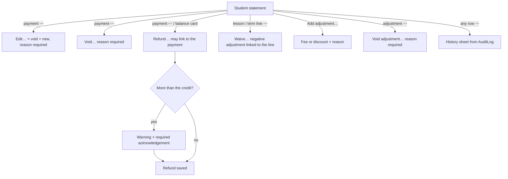
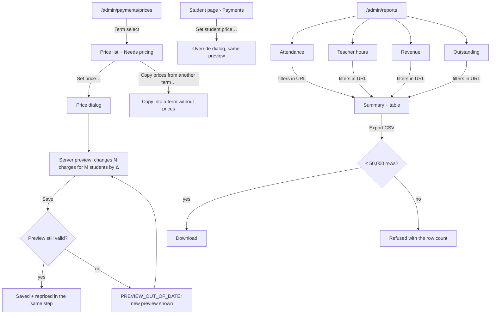
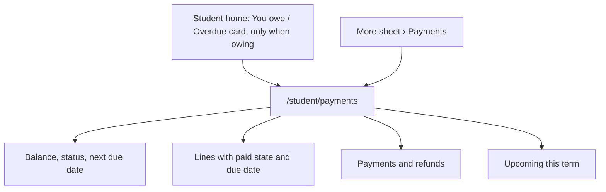

# Payments and reports (Phase 6)

Spec for the Phase 6 screens: price setup, student balances and statements,
recording payments (partial payments, refunds, adjustments, voids), the
student's own payments page, and the admin reports (attendance, teacher
hours, revenue, outstanding) with CSV export. Builds on
`docs/design/tokens.md`, `docs/design/app-layout.md`,
`docs/design/admin-data.md`, `docs/design/absences.md` and
`docs/design/notifications-substitutes.md`. Clickable wireframe:
`docs/design/wireframes/payments-reports.html`.

The rules behind these screens (billable lessons, pricing, when charges are
posted or recalculated, allocation and status, report definitions, CSV
format and limits, permissions) are owned by the Scheduling Engineer's rules
doc (CARM-71, `docs/architecture/phase6-rules.md`, "rules doc" below). This
spec is aligned with its §11 (B1–B9); §12 lists how. If they disagree, the
rules doc wins on behaviour and this spec is updated to match.

## Owner decisions this spec follows (2026-10-16, CARM-69)

1. **In scope:** payments and reports.
2. **No parent accounts, no parent logins.** The P6 nav item _Parents_
   (`app-layout.md` §4.3) is dropped.
3. **No multi-school UI.** A user belongs to exactly one school, so there is
   no school switcher. Every screen and every export is scoped to the
   signed-in admin's school.
4. **No payment provider.** Admins record payments by hand. The design
   leaves room for a provider later (rules doc §4.6), but no screen starts
   or receives an online payment.

Earlier decisions still apply: one role per user, later-phase nav items are
hidden until they ship, **no attendance tracking** (`lessons.md` decision 1
— the attendance report is based on reported absences, §8.2), TeacherNotes
never reach students, every query is scoped by `schoolId`, all UI strings go
through next-intl.

## 1. Goal

- An admin sets prices once per term and never does billing maths by hand:
  the app shows what each student owes, line by line, and why.
- At the front desk, recording a payment takes under 20 seconds: find the
  student, the amount is prefilled, confirm.
- Mistakes are fixed openly, never erased: a wrong payment is voided with a
  reason (or edited, which is void + new), a charge is waived with an
  adjustment, money given back is a refund, and every change is in the
  audit log.
- An admin sees at a glance who owes money, who is overdue, and how much
  the school has collected.
- A student sees on their phone how much they owe, when it's due, and what
  they have paid.
- Admins get reports they can trust and export to a spreadsheet:
  attendance, teacher hours (for payroll), revenue and outstanding.

## 2. Roles and access

| Area                                   | Admin                                                                                        | Teacher                                     | Student                                              |
| -------------------------------------- | -------------------------------------------------------------------------------------------- | ------------------------------------------- | ---------------------------------------------------- |
| Prices                                 | Set, change, delete, copy (`/admin/payments/prices`); per-student prices on the student page | **Nothing**                                 | Nothing (sees the resulting charges only)            |
| Balances and statements                | All students of the school (`/admin/payments`, student page tab _Payments_)                  | **Nothing** — no page, no column, no amount | Own balance and statement only (`/student/payments`) |
| Record / edit / refund / void / adjust | Yes, all audited                                                                             | No                                          | No                                                   |
| Reports and CSV                        | All reports (`/admin/reports/*`)                                                             | **Nothing** (not even their own hours)      | Nothing                                              |
| Settings › Payments                    | Currency, payment term                                                                       | No                                          | No                                                   |

**Server-side rules** the UI only mirrors (rules doc §6; QA covers them in
CARM-74):

- Every read or write of other people's money or report data lives in
  `src/server/billing/admin.ts` / `src/server/reports/admin.ts`, behind
  `requireRole("ADMIN")` and `getSchoolScopedDb()`, with an import
  allow-list. Teacher DTOs contain no money field at all.
- The student's page reads `src/server/billing/student.ts`, which returns a
  student DTO: no voided rows, no notes, no void or adjustment reasons, no
  admin names, nothing about another student. Another student's id gives
  **404**.
- A teacher or student opening `/admin/payments*` or `/admin/reports*`
  gets the **403** page (`errors.forbidden.*`); the CSV route answers 403
  (401 when signed out).
- Every action re-validates at submit time, holds the billing lock and
  writes `AuditLog` in the same transaction.

**Navigation changes** (`app-layout.md` §4.3):

- Admin, section _Finance_: **Payments** (`wallet`) and **Reports**
  (`chart-column`) ship. _People › Parents_ is removed from the nav config.
- Admin, _Settings_: new sub-page **Payments** (`/admin/settings/payments`).
- Student: **Payments** (`wallet`) goes into the _More_ sheet (not a bottom
  tab); the four bottom tabs stay as they are.
- Teacher: no change.

## 3. Concepts shown in the UI

| Concept        | UI word (key)                                 | Meaning for the user                                                                                                                                                             |
| -------------- | --------------------------------------------- | -------------------------------------------------------------------------------------------------------------------------------------------------------------------------------- |
| Price          | **Price** (`billing.prices.*`)                | What a course or group costs in a term: **per lesson** or **per term** (prorated by lessons for students who join or leave). A student price overrides it for one student.       |
| Charge line    | **Lesson**, **Term fee**, **Adjustment**      | One line on the student's account. Lesson and term lines are created by the system; adjustments by an admin. Each line has a **due date** and a paid state.                      |
| Adjustment     | **Adjustment** (`billing.adjustment.*`)       | An admin-made line: a **fee** (positive) or a **discount / waiver / write-off** (negative), with a required reason that only admins see.                                         |
| Waive          | **Waive…** (`billing.waive.*`)                | A negative adjustment linked to one lesson or term line. System lines can't be voided, because the next recalculation would bring them back.                                     |
| Payment        | **Payment** (`payments.*`)                    | Money the school received: amount, date received, method, optional reference and note.                                                                                           |
| Refund         | **Refund** (`payments.refund.*`)              | Money the school paid back. Its own entry, never a negative payment. Can be linked to the payment it returns ("Refund of 3 Oct payment").                                        |
| Void           | **Voided** (`payments.voided`)                | A payment, refund or adjustment recorded by mistake. It stays visible to admins, struck through, with its reason, and no longer counts. Students never see voided rows.          |
| Edit (payment) | **Edit…** (`payments.edit.*`)                 | Void + record the corrected payment in one step. Shown as one change in History.                                                                                                 |
| Balance        | **Balance** (`billing.balance.*`)             | **One running total per student** across all terms: lines − payments + refunds. Shown as words: **Owes €120.00**, **In credit €20.00**, **Settled**. Never a bare signed number. |
| Upcoming       | **Upcoming this term** (`billing.upcoming.*`) | Lines that will be posted later in the term if nothing changes. Not part of the balance.                                                                                         |

### 3.1 Student status (rules doc §3.3)

One status per student (not per term):

| Status        | When                                                 | Badge (token)           | Icon (lucide)  |
| ------------- | ---------------------------------------------------- | ----------------------- | -------------- |
| `NOTHING_DUE` | No active lines and no payments                      | **Nothing due** (muted) | `minus`        |
| `SETTLED`     | Balance = 0                                          | **Settled** (`success`) | `circle-check` |
| `IN_CREDIT`   | Balance < 0                                          | **In credit** (`info`)  | `wallet`       |
| `DUE`         | Balance > 0, nothing overdue                         | **Due** (`warning`)     | `clock`        |
| `OVERDUE`     | Balance > 0 and an unpaid share is past its due date | **Overdue** (`danger`)  | `circle-alert` |

`DUE` and `OVERDUE` together are called **Owing** in filters. A line's due
date is the day it was posted + the school's payment term (default 14 days,
Settings). Payments pay the **oldest lines first** (rules doc §3.3), so a
partial payment makes the oldest lines _Paid_ and the next one _Partly
paid_.

### 3.2 Line states (statement)

| State            | Badge                                            | Notes                                                                         |
| ---------------- | ------------------------------------------------ | ----------------------------------------------------------------------------- |
| `PAID`           | **Paid** (`success`)                             |                                                                               |
| `PARTIALLY_PAID` | **Partly paid · {paid} of {amount}** (`warning`) |                                                                               |
| `UNPAID`         | **Unpaid** (muted)                               | Due date not passed (due date = today is not overdue)                         |
| Overdue          | **Overdue** (`danger`)                           | Unpaid or partly paid, and the due date is before today                       |
| Negative line    | none                                             | Discounts and waivers have no paid state; they add funds                      |
| Voided           | **Voided** (muted, amount struck through)        | Admin only, with the reason (`billing.voidReason.<CODE>` or the admin's text) |

Every badge is text; color only reinforces it.

### 3.3 Money in the UI (rules doc §3.1)

- **Stored** as integer minor units plus the school's ISO 4217 currency.
  The UI never does arithmetic on money; sums come from the server.
- **One currency per school** (Settings › Payments, default `EUR`),
  read-only once any price, charge or payment exists (`CURRENCY_LOCKED`).
- **Displayed** through next-intl number formatting with
  `style: "currency"`, fed the **decimal string** from `toDecimalString`
  (e.g. `"1250.50"`), via the shared `formatMoneyParts` helper
  (`src/server/billing/money.ts`). en-GB: `€1,250.50`. Messages take the
  **pre-formatted** string as a param (`{amount}`), so no message hard-codes
  a currency. Signed amounts like `-€5.00` never appear for balances (see
  Balance above); a negative line shows as "− €5.00" in the Charge column
  with the word "discount" for screen readers.
- **Typed** in a `MoneyInput`: `Input inputmode="decimal"`, the currency
  symbol as an `aria-hidden` prefix. Parsed by `parseMoney` (string-based:
  digits, the locale's separators, at most the currency's decimals, no
  sign, no exponent, ≤ 12 digits). `INVALID_AMOUNT` →
  `payments.validation.invalid`. Limits: prices 0–€100,000, payments and
  adjustments up to €1,000,000 (`payments.validation.tooLarge`).
- Amounts are right-aligned with `tabular-nums` in tables.

## 4. Flows

### 4.1 Admin — front desk payment

```mermaid
flowchart TD
  P["/admin/payments — Balances"] -->|Record payment… (page action)| D[Record payment dialog]
  P -->|row: Record payment| D
  S["Student page › Payments tab"] -->|Record payment…| D
  D --> A{Amount vs balance}
  A -- equal --> OK[Saved · AuditLog]
  A -- less --> PP[Info: partial, oldest lines paid first] --> OK
  A -- more --> OV[Info: student will be in credit] --> OK
  OK --> T[Toast + statement, status and overview refresh]
```

Double submits are harmless: the form carries a `clientRequestId`; a second
submit returns the first payment (rules doc §4.2).

### 4.2 Admin — fixing mistakes



### 4.3 Admin — prices and reports



### 4.4 Student



## 5. Prices (`/admin/payments/prices`)

Tab **Prices** on the Payments page (`Tabs`: _Balances_ · _Payments_ ·
_Prices_, URL path segments). Desktop-first, `max-w-screen-2xl`.

```
┌ Payments                                                [Record payment…] ┐
│ [Balances | Payments | Prices]                                            │
│ Term [Autumn 2026 ▾]                    [Copy prices from another term…]  │
│ ┌ ⚠ Needs pricing (2) ───────────────────────────────────────────────────┐│
│ │ C1 Business · 6 students · 14 lessons not charged      [Set price…]    ││
│ │ Marek Bielik 1-on-1 · 1 student · 10 lessons not charged [Set price…]  ││
│ └────────────────────────────────────────────────────────────────────────┘│
├───────────────────────────────────────────────────────────────────────────┤
│ Course / group          │ Type     │ Level │ Billing    │ Price    │      │
│ ▾ General English B1    │          │ B1    │ Per term   │ €240.00  │ ⋯    │ course row
│     B1 Evening          │ 👥 Group │ B1    │ (course)   │ €240.00  │ ⋯    │ inherits, muted
│     B1 Morning          │ 👥 Group │ B1    │ Per lesson │  €15.00  │ ⋯    │ "Group price" badge
│ ▾ Business English C1   │          │ C1    │ —          │ No price │ ⋯    │
│     C1 Business         │ 👥 Group │ C1    │ —          │ No price │ ⋯    │
│ ▾ No course                                                               │
│     Marek Bielik 1-on-1 │ 👤 1-on-1│ A2    │ —          │ No price │ ⋯    │
│     A1 Scholarship      │ 👥 Group │ A1    │ Per term   │   €0.00  │ ⋯    │
│ Student prices (3)  ▸                                                     │ collapsed list
└───────────────────────────────────────────────────────────────────────────┘
```

- **Term `Select`** (default: current term, else next). Prices are per
  term; editing a past term's price is allowed and reprices it (with the
  preview below).
- **Needs pricing** (`warning` card, only when non-empty): one row per
  group with billable lessons but no price in the term (rules doc §2.3):
  group, "{students} students · {lessons} lessons not charged", _Set
  price…_. Once a price exists, those lessons are charged, backdated to
  when they would have been posted.
- **Price table**: each course with its groups indented under it; groups
  without a course under **No course** (most 1-on-1s — they need a group
  price). Archived groups are hidden unless they have lessons in the term.
  _Billing_: _Per lesson_ · _Per term_ · "(course)" when a group inherits.
  _Price_: amount or **No price** (`warning` text + icon). €0.00 is a valid
  price (e.g. a scholarship): lessons are priced but nothing is charged.
  A group with its own price shows a muted **Group price** badge.
- **Student prices** (collapsed section): student, group or course,
  billing, price, _Edit_ / _Remove_. Same data as the student page's Price
  card.
- Row menu: _Set price…_ · _Remove price…_ (opens the same preview as a
  change; course: groups that inherit become "No price").

### 5.1 Set price (`Dialog`)

| Field      | Control                               | Rules                                                                                                                                        |
| ---------- | ------------------------------------- | -------------------------------------------------------------------------------------------------------------------------------------------- |
| Applies to | Read-only: course or group name, term | —                                                                                                                                            |
| Billing    | `RadioGroup`: Per lesson · Per term   | Required. Hints: "Charged for each lesson after it ends." / "One amount for the term, shared out by lessons for students who join or leave." |
| Price      | `MoneyInput`                          | Required, €0–€100,000.                                                                                                                       |

**Change preview** (rules doc §2.6): while the dialog is open, the server
runs the planner without writing (`previewPriceChange`, debounced 400 ms
after the last edit) and the dialog shows above the footer:

- `info` "This changes {count} posted charges for {students} students by
  {delta}." (`delta` signed and formatted, e.g. "+€120.00" / "−€30.00"),
  or "No posted charges change. New lessons will use this price." when
  nothing changes.
- Loading: "Checking which charges change…" (spinner); _Save_ stays enabled
  only once a preview is shown.
- A change applies to **the whole term** (there is no "from today" option):
  prices never change in the middle of a term; to change what one student
  pays, use a student price or an adjustment.

Save sends the preview's `expectedPreviewHash`. If charges changed in
between, the server answers `PREVIEW_OUT_OF_DATE`: the dialog keeps the
input, shows `warning` "Charges changed while you were editing. Check the
new preview and save again." and the fresh preview. Toast on success
"Price saved." (+ " {count} charges were updated." when the preview was
non-zero).

### 5.2 Copy prices from another term (`Dialog`)

- From term `Select` (terms with prices); target = the selected term.
- `Checkbox` "Also copy student prices" (off by default).
- Copy works only **into a term without prices**. When the target already
  has prices, the action is shown disabled-looking with the reason as
  text: "{term} already has prices. Copy works only into a term without
  prices." (`PRICES_EXIST`); the button opens nothing.
- Description: "Copies {count} prices from {from} to {term}." Toast
  "Prices copied to {term}."

### 5.3 Student price (override)

On the student page, Payments tab, card **Price** (§6.3): per group in the
term, which price applies — "{group}: group price", "course price" or
"student price" — with _Set student price…_ → `Dialog`: Term, Applies to
(`Select`: the student's group, or its course), Billing (pre-set to the
group's unit), Price (`MoneyInput`). Same change preview as §5.1. There
are no percentage discounts (rules doc §12.5): use a student price or an
adjustment. _Remove student price…_ falls back to the group price, with
the preview.

States (prices page): loading (table skeleton) · no term
(`billing.prices.noTerm` + link to Terms) · no groups
(`billing.prices.noGroups` + link to Courses & groups) · error (`Alert` +
_Try again_) · save error inline in the dialog, input kept.

## 6. Payments — admin

### 6.1 Balances (`/admin/payments`, default tab)

The answer to "who owes us money?". Balances are **as of now**, one per
student across all terms.

```
┌ Payments                                                          [Record payment…] ┐
│ [Balances | Payments | Prices]                                                      │
│ ┌ Owed ──────────┐ ┌ Overdue ───────┐ ┌ Students owing ┐ ┌ In credit ─────┐         │
│ │ €3,420.00      │ │ €1,260.00      │ │ 23 (9 overdue) │ │ €140.00 (4)    │         │
│ └────────────────┘ └────────────────┘ └────────────────┘ └────────────────┘         │
│ Status [Owing ▾]  Group [Any ▾]  [Search students…]  ☐ Include archived students    │
├─────────────────────────────────────────────────────────────────────────────────────┤
│ Student      │ Groups       │ Balance          │ Overdue │ Oldest due │ Status    │ Last payment │   │
│ Jana Kovac   │ B1 Evening   │ Owes €240.00     │ €120.00 │ 14 Sep     │ ⚠ Overdue │ —            │ [Record payment] ⋯ │
│ Petr Hruby   │ A2 Morning   │ Owes €80.00      │   —     │ —          │ ◷ Due     │ 3 Oct        │ [Record payment] ⋯ │
│ Marek Bielik │ 1-on-1       │ In credit €20.00 │   —     │ —          │ In credit │ 12 Oct       │ ⋯ │
└─────────────────────────────────────────────────────────────────────────────────────┘
```

- **Stat cards** (server values, as of now): _Owed_ (sum of positive
  balances), _Overdue_ (sum of `overdueMinor`), _Students owing_ ("{count}
  ({overdue} overdue)"), _In credit_ (sum and count). Each card is a link
  that applies the matching filter. Mobile: 2 × 2.
- **Filters** (URL params): Status (`Select`: _Owing_ = Due + Overdue
  (default), _Overdue_, _Due_, _In credit_, _Settled_, _Nothing due_, _Any_),
  Group (`Combobox`; students who are or were members), search by name or
  email, _Include archived students_ `Checkbox`.
- **Columns**: Student (link to the student page, Payments tab) · Groups
  (current) · Balance (words) · Overdue (amount) · Oldest due (date of the
  oldest overdue line) · Status badge · Last payment · actions. Default sort:
  overdue descending, then balance descending (same as the Outstanding
  report).
- Row actions: **Record payment** (`outline`, only when owing) · `⋯` _Open
  statement_, _Add adjustment…_.
- 50 rows per page, numbered pagination. Mobile: rows become cards (name,
  balance in words, status, _Record payment_); usable on a front-desk
  tablet, no `desktopRecommended` notice.
- The overview's _Needs pricing_ count shows as an `info` line above the
  table when non-zero: "{count} groups have lessons without a price." →
  Prices.

States:

| State                      | Shows                                                                                                                  |
| -------------------------- | ---------------------------------------------------------------------------------------------------------------------- |
| Loading                    | 4 stat skeletons + table skeleton                                                                                      |
| No prices at all           | `wallet` icon · "No prices yet" · "Set prices for your courses and groups. Then balances show up here." · _Set prices_ |
| Nobody owes (filter Owing) | `circle-check` icon · "Nobody owes anything right now." · _Show all students_                                          |
| No results                 | `common.noResults` + _Clear filters_                                                                                   |
| Error                      | `Alert` "Couldn't load balances." + _Try again_                                                                        |

### 6.2 Payments journal (`/admin/payments/journal`, tab _Payments_)

Every money movement in a date range, for checking the till or bank
statement. Filters: date range (default this month), Method (`Select`),
Type (_All_ / _Payments_ / _Refunds_), _Show voided_ `Checkbox`. Columns:
Received on · Student (link) · Type badge · Method · Reference · Amount ·
Recorded by · `⋯` (_Open statement_, _History_). Footer: "Received
{received} · Refunded {refunded} · Net {net}" for the filtered range.
Exports live in the Revenue report (§8.4), so there's one place for money
exports. Empty: "No payments in this period." States as §6.1.

### 6.3 Student page › Payments tab (`/admin/students/[id]?tab=payments`)

New tab after _Groups_ on the student detail (`admin-data.md` §6.6).

```
┌ Petr Hruby                                         [Profile | Groups | Payments] ┐
│ ┌ Balance ─────────────────────────────────┐ ┌ Price ─────────────────────────┐ │
│ │ Owes €80.00                     ◷ Due    │ │ Autumn 2026                    │ │
│ │ Next due: €45.00 on 29 Oct               │ │ B1 Evening: group price        │ │
│ │ [Record payment…] [Add adjustment…]      │ │ €15.00 per lesson              │ │
│ └──────────────────────────────────────────┘ │ [Set student price…]           │ │
│                                              └────────────────────────────────┘ │
│ Statement   Term [All terms ▾]   ☐ Show voided                                  │
├─────────────────────────────────────────────────────────────────────────────────┤
│ Date   │ Line                                  │ Due    │ State          │ Charge  │ Paid    │ Balance │   │
│ 2 Sep  │ B1 Evening · lesson Tue 2 Sep 17:00   │ 16 Sep │ ✓ Paid         │ €15.00  │         │  €15.00 │ ⋯ │
│ …      │ (7 more lessons, September)           │        │                │         │         │         │   │
│ 3 Oct  │ Payment · Cash · Receipt 0142         │        │                │         │ €100.00 │  €20.00 │ ⋯ │
│ 5 Oct  │ Payment · Bank transfer  [Voided]     │        │ Recorded twice │         │ ~~€50~~ │  €20.00 │ ⋯ │
│ 10 Oct │ Adjustment: fee (Course book)         │ 24 Oct │ ◌ Partly paid  │ €15.00  │         │  €35.00 │ ⋯ │
│ 15 Oct │ B1 Evening · lesson Wed 15 Oct 17:00  │ 29 Oct │ Unpaid         │ €15.00  │         │  €50.00 │ ⋯ │
│ 16 Oct │ Waived: B1 Evening · lesson 15 Oct    │        │                │ − €15.00│         │  €35.00 │ ⋯ │
├─────────────────────────────────────────────────────────────────────────────────┤
│ Owes €80.00 at 16 Oct 2026                                                      │
│ ▸ Upcoming this term (9 lessons · €135.00) — not part of the balance           │
└─────────────────────────────────────────────────────────────────────────────────┘
```

- **Balance card**: balance in words (`text-2xl`), status badge, "Next
  due: {amount} on {date}" (the next unpaid due date; "Overdue since
  {date}: {amount}" in `danger` text when overdue), then _Record payment…_
  (primary) and _Add adjustment…_ (`outline`).
- **Price card**: per group in the selected term, which price applies
  (§5.3), with _Set student price…_.
- **Statement** (oldest first, so the running balance reads top-down):
  - Term `Select`: _All terms_ (default) or one term. With a term, the
    first row is **Balance before {term}**.
  - **Lesson lines**: one per billable lesson — "{group} · lesson {date
    time}". Month sub-headings ("September 2026 · 8 lessons · €120.00")
    group them; each month is collapsible so long terms stay readable.
  - **Term lines**: "{group} · {term} fee", plus "({memberLessons} of
    {termLessons} lessons)" when prorated.
  - **Adjustment lines**: "Adjustment: fee" / "Adjustment: discount" +
    the reason in muted text (admin only); a waiver reads "Waived:
    {line}" and links to that line.
  - **Payments / refunds**: "Payment · {method}" + reference; "Refund ·
    {method}" + "of {date} payment" when linked; an edited payment shows
    "Edited — replaces the {date} entry".
  - Each **positive line** shows its **due date** and **state** (§3.2).
  - **Voided rows** are hidden by default; _Show voided_ shows them struck
    through with the **Voided** badge and the reason in the State column
    (system reasons from `billing.voidReason.<CODE>`, e.g. "Recalculated",
    "No longer billable"). They never affect the running balance.
  - Row menu `⋯`:
    - lesson / term line → _Waive…_, _History_ (no void: the line would come
      back; fix the cause or waive it)
    - adjustment → _Void adjustment…_, _History_
    - payment → _Edit…_, _Refund…_, _Void payment…_, _History_
    - refund → _Void refund…_, _History_
- **Upcoming this term** (collapsed disclosure under the footer, muted):
  the lines that will be posted later this term if nothing changes —
  "{count} lessons · {amount}" and, expanded, the list with dates. Caption
  "Not part of the balance. Lessons are charged after they end."
- Footer: "{balance} at {date}".

### 6.4 Record payment (`Dialog`)

```
┌ Record payment                                        ✕ ┐
│ Student (required)  [Petr Hruby ▾]                      │
│ Owes €80.00 · Overdue: none                             │
│ Amount (required)   [€ 80.00      ]                     │
│ ⓘ Partial payment: pays the oldest lines first.         │  only when amount < balance
│   €30.00 will still be owed.                            │
│ Received on (required) [16 Oct 2026 ▾]                  │
│ Method (required)   [Cash ▾]                            │
│ Reference           [Receipt no. or bank reference]     │
│ Note (admins only)  [                              ]    │
│                               [Cancel] [Record €80.00]  │
└─────────────────────────────────────────────────────────┘
```

| Field       | Control                  | Rules                                                                                                                       |
| ----------- | ------------------------ | --------------------------------------------------------------------------------------------------------------------------- |
| Student     | `Combobox` (name, email) | Required. Prefilled and read-only from a row or the student page. Archived students can be picked (old debts).              |
| Amount      | `MoneyInput`             | Required, > 0, ≤ €1,000,000. Prefilled with the balance when owing; empty otherwise (paying ahead is allowed).              |
| Received on | Date picker              | Required, default today (school timezone), not in the future (`payments.validation.future`).                                |
| Method      | `Select`                 | Required: _Cash_ · _Bank transfer_ · _Card_ · _Other_. Default: the method this admin used last. _Online_ is never offered. |
| Reference   | `Input` ≤ 100            | Optional, e.g. the bank transfer's variable symbol. Shown to the student.                                                   |
| Note        | `Textarea` ≤ 500         | Optional. **Admins only**.                                                                                                  |

- Live feedback under Amount (`role="status"`, polite):
  - amount < balance → `info` "Partial payment: pays the oldest lines
    first. {rest} will still be owed."
  - amount > balance → `info` "That's {extra} more than owed. {name} will
    be in credit."
  - nothing owed → `info` "{name} owes nothing right now. The payment will
    be kept as credit."
- Primary button says the amount: **Record {amount}**; saving "Recording…".
  A second click or a retry after a network error reuses the form's
  `clientRequestId`, so it never records twice.
- After saving: toast "Payment of {amount} recorded for {name}." and the
  statement, status and stat cards refresh.
- Errors: validation under fields; `Alert` "Couldn't record the payment.
  Nothing was saved." + _Try again_, input kept.

### 6.5 Edit, refund, void, waive, adjust

**Edit… (payment)** — the record dialog prefilled with the payment, title
"Edit payment of {amount} from {date}", plus a required _Reason for the
change_ (≤ 300). Info line "The old entry is voided and kept in the
history." Saves void + new in one step (`payment.corrected`). Toast
"Payment updated."

**Refund…** (`Dialog`, from a payment row — linked to it — or the balance
card when in credit — not linked):

- Description "Records money paid back to {name}. It doesn't move any
  money by itself."
- Amount (`MoneyInput`, prefilled with the credit, or with the linked
  payment's unrefunded amount), Received on → label **Paid out on**,
  Method, Reference, Note (admins only).
- Blocking errors (under Amount): `REFUND_EXCEEDS_PAID` "You can refund at
  most {max}: that's all {name} has paid." · `REFUND_OF_MISMATCH` "This
  payment can be refunded up to {max}."
- **More than the credit** (`REFUND_EXCEEDS_CREDIT`, overridable): `warning`
  `Alert` "This is {extra} more than {name}'s credit. After the refund they
  will owe {owes}." with a required `Checkbox` **"Refund anyway"**; the
  primary stays enabled and the server re-checks the acknowledgement.
- Hint for cancelled courses (muted): "To refund a cancelled course, first
  add a discount adjustment so {name} is in credit."
- Primary **Refund {amount}**. Toast "Refund of {amount} recorded."

**Void…** (payment, refund or adjustment; `AlertDialog`, destructive):

- Title "Void the payment of {amount} from {date}?" (refund / adjustment
  variants).
- Description "Use this when it was recorded by mistake. It stays in the
  history, crossed out, and no longer counts. Students don't see it. This
  can't be undone."
- Reason (`Textarea`, required, ≤ 300).
- Buttons _Keep it_ · **Void payment** (`destructive`).
- `REFUNDS_EXCEED_PAYMENTS`: "Voiding this payment would leave more refunded
  than paid. Void the refund first." — only _Close_.
- `ALREADY_VOIDED`: "This entry was already voided by someone else." +
  the statement reloads.
- Toast "Payment voided." / "Refund voided." / "Adjustment voided."

**Waive…** (lesson or term line, `Dialog`):

- Title "Waive {line}?" Description "Adds a discount linked to this line.
  The line stays; the discount cancels it out."
- Amount (`MoneyInput`, prefilled with the line's amount, ≤ the line's
  amount), Reason (required, ≤ 300, admins only).
- Primary **Waive {amount}**. Toast "Line waived." The waiver shows as
  "Waived: {line}" and can itself be voided.

**Add adjustment…** (`Dialog`):

- Type `RadioGroup`: _Fee_ (the student owes more, e.g. a course book) ·
  _Discount_ (the student owes less: discount, goodwill, write-off).
- Amount (`MoneyInput`), Date (service date, default today), Reason
  (required, ≤ 300, **admins only**, placeholder "e.g. Course book").
- Primary **Add fee** / **Add discount**. Toast "Adjustment added."
- The student sees the line as **Fee** or **Discount** (no reason text,
  rules doc §6.3). _Open question Q3._

There is no edit of an adjustment: void + add again.

### 6.6 History sheet

Right `Sheet` 420 px (bottom sheet on mobile), from any statement row
`⋯ › History`. A vertical list from `AuditLog`, newest first: "{action} by
{name}" + date-time and the changed fields ("Amount: €80.00", "Reason: …").
Recalculations read "Recalculated by the system: {from} → {to}
({reason})". Read only.

### 6.7 Room for a payment provider later (not designed now)

Constraints only (rules doc §4.6):

- `method` `ONLINE` and `provider` ≠ `MANUAL` exist in the schema; the
  record dialog never offers them.
- Statement and journal rows already render, when present: an **Online ·
  {provider}** `info` badge and the provider reference in the History sheet
  and the journal's Reference column.
- A `PENDING` payment would show as a muted **Processing** badge and a
  `FAILED` one as **Failed** (`danger`); neither counts in the balance. v1
  has no such rows.
- The student page reserves the space under the balance card for a future
  **Pay online** button; v1 renders the "how to pay" text there (§7).
- No "Pay online", "Connect provider" or webhook settings anywhere in v1.

## 7. Payments — student (`/student/payments`, mobile-first)

In the _More_ sheet as **Payments**, with a **Due** / **Overdue** text
badge when the student owes money (never color only). A **home card**
"You owe {amount}" (`warning`) or "Payment overdue: {amount}" (`danger`)
when owing, with the next due date and _See details_. No card when settled
or in credit.

```
┌──────────────────────────────┐
│ Payments                     │ h1
│ ┌──────────────────────────┐ │
│ │ You owe                  │ │
│ │ €80.00                   │ │ text-3xl tnum
│ │ ◷ Due · next €45.00 by   │ │
│ │ 29 Oct                   │ │
│ ├──────────────────────────┤ │
│ │ How to pay               │ │ (Q5)
│ │ Pay at the office or by  │ │
│ │ bank transfer …          │ │
│ └──────────────────────────┘ │
│ [Charges | Payments]         │
│ ┌──────────────────────────┐ │
│ │ B1 Evening · Wed 15 Oct  │ │
│ │ Due 29 Oct      €15.00   │ │
│ │ Unpaid                   │ │
│ ├──────────────────────────┤ │
│ │ Fee · 10 Oct             │ │
│ │ Due 24 Oct      €15.00   │ │
│ │ Partly paid (€5 of €15)  │ │
│ ├──────────────────────────┤ │
│ │ September 2026           │ │
│ │ 8 lessons · €120  ✓ Paid │ │
│ └──────────────────────────┘ │
│ ▸ Upcoming this term         │
│   9 lessons · about €135.00  │
│ Questions about a payment?   │
│ Contact the school office.   │
└──────────────────────────────┘
```

- **Balance card**: label (_You owe_ / _You're in credit_ / _All paid_ /
  _Nothing to pay yet_), amount `text-3xl tabular-nums`, status badge and
  "Next {amount} due by {date}" (or "Overdue since {date}" in `danger`
  text).
- **How to pay**: the school's instructions text — only if the owner
  accepts Q5; otherwise the card ends after the balance.
- **Charges** tab (default): active lines, newest first, each with
  description, amount, due date and state (§3.2). Fully paid months
  collapse into one row ("September 2026 · 8 lessons · €120.00 · Paid")
  that expands to the lessons. Adjustments read **Fee** / **Discount** /
  **Waived: {line}**.
- **Payments** tab: payments and refunds, newest first: date received,
  "Payment, {method}" / "Refund, {method}", reference, amount. Text for
  screen readers: "payment €100.00".
- **Upcoming this term** (collapsed): "{count} lessons · about {amount}"
  with the caption "Charged after each lesson ends."
- Never shown to students (rules doc §6.3): voided rows, notes, void or
  adjustment reasons, admin names, other students.
- States: loading (card skeletons) · nothing yet (`wallet` icon, "No
  payments or charges yet" / "When your school charges for lessons, you'll
  see them here.") · error (`Alert` "Couldn't load your payments." + _Try
  again_).

## 8. Reports (`/admin/reports`)

### 8.1 Reports index and shared layout

`/admin/reports`: h1 "Reports" and four cards (title, one-line
description, _Open report_): **Attendance**, **Teacher hours**,
**Revenue**, **Outstanding**. Each report is its own page so filters live
in its URL and can be bookmarked.

```
┌ ‹ Reports                                                                  ┐
│ Teacher hours                                              [Export CSV ▾]  │
│ Hours each teacher taught. Substitute hours count for the substitute.     │
│ Period [Term: Autumn 2026 ▾]  or [1 Sep – 20 Dec 2026]                     │
│ Teacher [Any ▾]   Group [Any ▾]                          [Reset filters]  │
│ ⓘ The period goes past today, so it shows lessons until today.            │
├────────────────────────────────────────────────────────────────────────────┤
│ ┌ Total hours ┐ ┌ Lessons ┐ ┌ Substitute hours ┐                          │
│ │ 412 h 30 min│ │ 275     │ │ 18 h             │                          │
│ └─────────────┘ └─────────┘ └──────────────────┘                          │
│ table …                                                                    │
│ Figures reflect corrections made later, e.g. a recorded substitute.       │
│ Data as of 16 Oct 2026, 14:05.                                             │
└────────────────────────────────────────────────────────────────────────────┘
```

- **Period** (Attendance, Teacher hours, Revenue): `Select` with the
  school's terms **plus** _Custom dates…_, which reveals a date-range
  picker. Default: current term. Dates are calendar days in the school
  timezone, inclusive.
  - More than **366 days** (`RANGE_TOO_LONG`): error under the picker
    "Choose a period of at most 366 days." and the previous result stays.
  - From after To (`INVALID_RANGE`): "The start date must be on or before
    the end date."
  - A period reaching past today: `info` line "The period goes past today,
    so it shows lessons until today." (attendance and hours count ended
    lessons only).
- **Outstanding** has no period: it is **as of now** (§8.5).
- Other filters per report below (`Combobox`es include archived items,
  with a muted "Archived" tag).
- Filters apply immediately (debounced), all in the URL. _Reset filters_
  link when anything differs from the defaults.
- **Summary cards** (2–4) above one table. Tables follow `app-layout.md` §5.
  50 rows per page; **totals cover all rows**, not just the page.
- **Footnotes** (muted, always shown): "Figures reflect corrections made
  later, e.g. a voided payment or a recorded substitute." and "Data as of
  {dateTime}." Reports read the data as it is now; there is no closed
  period in v1.
- No charts in v1: the numbers are the product.

### 8.2 Attendance (`/admin/reports/attendance`)

Caption under the title (rules doc §5.2): "Based on reported absences.
Attendance is not taken in class."

Filters: Period · Group · Teacher (the lesson's effective teacher) ·
Student.

One row per student and group (rules doc grain), sorted by group then
student:

| Column           | Content (ended lessons in the period)                                     |
| ---------------- | ------------------------------------------------------------------------- |
| Student          | Link to the student page                                                  |
| Group            | Type icon + name, level                                                   |
| Expected         | Lessons the student was expected at (billable lessons, price ignored)     |
| Absent           | Reported absences, with "{withCredit} with credit · {late} late" under it |
| Attended         | Expected − absent                                                         |
| Attendance       | Attended ÷ expected, one decimal % ("—" when expected = 0)                |
| Makeups attended | Replacements or rescheduled 1-on-1s attended for this group's credits     |

Summary cards: _Expected_ · _Attended_ (with the overall %) · _Absent_
("{withCredit} with credit · {late} late") · _Makeups attended_. The
table can be sorted by Attendance ascending to find students who drop
off.

### 8.3 Teacher hours (`/admin/reports/teacher-hours`)

For payroll. Uses `teachingMinutes` (ended, non-cancelled lessons, counted
for the **effective** teacher): a covered lesson counts for the
substitute, **not** the regular teacher.

Filters: Period · Teacher · Group. _Show teachers without lessons_ is not
offered (the rules doc lists teachers with minutes only).

| Column            | Content                                                                   |
| ----------------- | ------------------------------------------------------------------------- |
| Teacher           | Link to the per-teacher detail; "Archived" tag if archived (still listed) |
| Lessons           | Lessons taught                                                            |
| Regular           | Hours of their own lessons                                                |
| As substitute     | Hours covering for others (cyan `user-round-cog` + text)                  |
| Total             | Regular + as substitute                                                   |
| Covered by others | Muted: hours of their lessons someone else taught — **not** in the total  |

Hours are shown as "12 h 30 min" (`reports.duration`); the CSV has
minutes and decimal hours.

**Per-teacher detail** (`/admin/reports/teacher-hours/[teacherId]?…same
filters`): back link, h1 teacher name, the same summary, then one row per
lesson: Date · Time · Group · Level · Room · Role (_Regular_ / _Substitute
for {teacher}_) · Duration.

**Export CSV** is a `DropdownMenu`: _Summary_ (`teacher-hours`) · _Lesson
details_ (`teacher-hours-lessons`, one row per lesson with date, start,
end, minutes, teacher, role, regular teacher, group, level, room). On the
per-teacher page the button exports the lesson details for that teacher.

### 8.4 Revenue (`/admin/reports/revenue`)

Filter: **Period only** (term or custom dates). No group or teacher filter:
payments aren't tied to groups, so "collected per group" doesn't exist
(rules doc §5.4). The table is broken down **by month**.

Summary cards, each with its definition as visible text:

- **Billed** — "Lesson, term and adjustment lines dated in this period."
- **Collected** — "Payments received in this period."
- **Refunded** — "Refunds paid out in this period."
- **Net collected** — "Collected minus refunded."

Table (one row per calendar month overlapping the period; the first and
last month count only the days inside it): Month · Lessons · Term fees ·
Adjustments (signed) · Billed total · Collected · Refunded · Net collected.
Totals row in `<tfoot>`. Footnote: "Voided entries aren't counted.
Amounts in {currency}." Link card: _Who owes money? Open the Outstanding
report_.

### 8.5 Outstanding (`/admin/reports/outstanding`)

**As of now**; the page says "Balances as of {dateTime}" instead of a
period. Filters: Group (students who were members in the selected term,
or now, plus a Term `Select` that only scopes the group filter) · Status
(`Select`, default _Owing_ = Due + Overdue; also _Overdue_, _Due_, _In
credit_, _All with a balance_).

Columns: Student (link to statement) · Email · Groups · Charged · Paid
(net) · Balance (words) · Overdue · Oldest overdue · Last payment ·
Status. Sorted by overdue, then balance, descending. Summary cards: _Owed_
· _Overdue_ · _Students_ · _In credit_.

### 8.6 CSV export (rules doc §5.6)

- **Export CSV** (`outline`, `download` icon) in the report header, a plain
  link to `GET /api/admin/reports/<report>.csv?<same query as the page>`
  (`attendance`, `teacher-hours`, `teacher-hours-lessons`, `revenue`,
  `outstanding`). It works without JavaScript; with JavaScript the button
  shows "Preparing…" and a toast "Export downloaded."
- Exports **all rows that match the filters**, in the fixed column order,
  with no totals row. An empty result is a header-only file.
- **Too many rows** (`TOO_MANY_ROWS`, more than 50,000): nothing is
  downloaded; the page shows a `warning` `Alert` "This export would have
  {count} rows. The limit is 50,000. Choose a shorter period or add a
  filter." The file is never cut short.
- File name: `<report>_<from>_<to>.csv` (outstanding: today's date for
  both).
- Format (for the help text only; the server owns it): UTF-8 with BOM,
  comma separator, header row in the user's language
  (`reports.csv.<report>.<column>`), dates `YYYY-MM-DD`, times `HH:mm`,
  **money as plain decimals with a dot (`125.50`) plus a `currency`
  column**, percentages `87.5`, codes for enums (`SUBSTITUTE`, `OVERDUE`).
  Never "€125.50" or "12 h 30 min" in the file, so spreadsheets can sum
  it. Text cells that start with `= + - @` get a leading `'`.
- Errors: `Alert` "Couldn't create the export. Try again." Every export is
  audited (`report.exported`); viewing a page isn't.

### 8.7 States (all reports)

| State             | Shows                                                                                  |
| ----------------- | -------------------------------------------------------------------------------------- |
| Loading           | Summary card skeletons + table skeleton; filters stay usable                           |
| No data in period | `chart-column` icon · "No data for this period." · "Try another term or dates."        |
| No term yet       | "Add a term first. Reports are based on terms and lessons." + link to Terms & holidays |
| Range too long    | Inline under the date picker; the previous result stays                                |
| Too many rows     | `warning` `Alert` with the count (§8.6)                                                |
| Error             | `Alert` "Couldn't load the report." + _Try again_                                      |
| Forbidden         | Teacher/student → full-page 403 (`errors.forbidden.*`); CSV route → 403                |

## 9. Settings › Payments (`/admin/settings/payments`)

Form (`max-w-2xl`):

- **Currency** (`Combobox` of ISO 4217 codes with names, default `EUR`).
  Read-only once any price, charge or payment exists, with the hint "The
  currency can't change once prices, charges or payments exist."
- **Payment term** (`Input type=number`, 0–90, default 14, suffix "days"):
  "Each line is due this many days after it's posted. A change applies to
  lines posted from now on."
- **Payment instructions for students** (`Textarea`, ≤ 1,000, optional) —
  **only if the owner accepts Q5** (needs a column the rules doc doesn't
  list yet).

_Save changes_ → toast "Payment settings saved." Audited.

## 10. Dashboards

- **Admin dashboard** _Needs attention_ card (`app-layout.md` §7.2): "{count}
  students are overdue ({amount})" → `/admin/payments?status=overdue`, and
  "{count} groups have lessons without a price" → Prices. Only when
  non-zero.
- **Student home**: "You owe" / "Payment overdue" card (§7).
- **Teacher dashboard**: no change. Teachers see no money anywhere.
- No notifications in v1 (rules doc §4.7).

## 11. Copy (i18n keys, English source)

Message files (rules doc §1): `messages/en-GB/billing.json` (`billing.*`:
prices, charge lines, statuses, line states, reason codes), `payments.json`
(`payments.*`: payments, refunds, voids, the student page), `reports.json`
(`reports.*`, incl. `reports.csv.<report>.<column>`); additions to
`settings.json` and `nav.json`. `{amount}`, `{rest}`, `{extra}`, `{max}`,
`{delta}`, `{owes}` are **pre-formatted money strings** (`formatMoneyParts`).

### billing

| Key                                     | Copy                                                                                                                                                             |
| --------------------------------------- | ---------------------------------------------------------------------------------------------------------------------------------------------------------------- |
| `billing.balance.owes`                  | Owes {amount}                                                                                                                                                    |
| `billing.balance.inCredit`              | In credit {amount}                                                                                                                                               |
| `billing.balance.settled`               | Settled                                                                                                                                                          |
| `billing.balance.at`                    | {balance} at {date}                                                                                                                                              |
| `billing.balance.before`                | Balance before {term}                                                                                                                                            |
| `billing.balance.nextDue`               | Next due: {amount} on {date}                                                                                                                                     |
| `billing.balance.overdueSince`          | Overdue since {date}: {amount}                                                                                                                                   |
| `billing.status.NOTHING_DUE`            | Nothing due                                                                                                                                                      |
| `billing.status.SETTLED`                | Settled                                                                                                                                                          |
| `billing.status.IN_CREDIT`              | In credit                                                                                                                                                        |
| `billing.status.DUE`                    | Due                                                                                                                                                              |
| `billing.status.OVERDUE`                | Overdue                                                                                                                                                          |
| `billing.status.owing`                  | Owing                                                                                                                                                            |
| `billing.line.PAID`                     | Paid                                                                                                                                                             |
| `billing.line.PARTIALLY_PAID`           | Partly paid · {paid} of {amount}                                                                                                                                 |
| `billing.line.UNPAID`                   | Unpaid                                                                                                                                                           |
| `billing.line.overdue`                  | Overdue                                                                                                                                                          |
| `billing.line.voided`                   | Voided                                                                                                                                                           |
| `billing.line.due`                      | Due {date}                                                                                                                                                       |
| `billing.charge.lesson`                 | {group} · lesson {dateTime}                                                                                                                                      |
| `billing.charge.term`                   | {group} · {term} fee                                                                                                                                             |
| `billing.charge.termProrated`           | {group} · {term} fee ({memberLessons} of {termLessons} lessons)                                                                                                  |
| `billing.charge.month`                  | {month} · {count, plural, one {# lesson} other {# lessons}} · {amount}                                                                                           |
| `billing.adjustment.fee`                | Adjustment: fee                                                                                                                                                  |
| `billing.adjustment.discount`           | Adjustment: discount                                                                                                                                             |
| `billing.adjustment.waived`             | Waived: {line}                                                                                                                                                   |
| `billing.adjustment.studentFee`         | Fee                                                                                                                                                              |
| `billing.adjustment.studentDiscount`    | Discount                                                                                                                                                         |
| `billing.adjustment.add`                | Add adjustment…                                                                                                                                                  |
| `billing.adjustment.title`              | Add an adjustment                                                                                                                                                |
| `billing.adjustment.type`               | Type                                                                                                                                                             |
| `billing.adjustment.typeFee`            | Fee                                                                                                                                                              |
| `billing.adjustment.typeFeeHint`        | The student owes more, e.g. a course book.                                                                                                                       |
| `billing.adjustment.typeDiscount`       | Discount                                                                                                                                                         |
| `billing.adjustment.typeDiscountHint`   | The student owes less: a discount, goodwill or write-off.                                                                                                        |
| `billing.adjustment.date`               | Date (required)                                                                                                                                                  |
| `billing.adjustment.reason`             | Reason (required, admins only)                                                                                                                                   |
| `billing.adjustment.reasonPlaceholder`  | e.g. Course book                                                                                                                                                 |
| `billing.adjustment.submitFee`          | Add fee                                                                                                                                                          |
| `billing.adjustment.submitDiscount`     | Add discount                                                                                                                                                     |
| `billing.adjustment.saved`              | Adjustment added.                                                                                                                                                |
| `billing.waive.action`                  | Waive…                                                                                                                                                           |
| `billing.waive.title`                   | Waive {line}?                                                                                                                                                    |
| `billing.waive.description`             | Adds a discount linked to this line. The line stays; the discount cancels it out.                                                                                |
| `billing.waive.max`                     | You can waive at most {max}.                                                                                                                                     |
| `billing.waive.submit`                  | Waive {amount}                                                                                                                                                   |
| `billing.waive.saved`                   | Line waived.                                                                                                                                                     |
| `billing.voidReason.NO_LONGER_BILLABLE` | No longer billable                                                                                                                                               |
| `billing.voidReason.NO_PRICE`           | Price removed                                                                                                                                                    |
| `billing.voidReason.RECALCULATED`       | Recalculated                                                                                                                                                     |
| `billing.upcoming.title`                | Upcoming this term                                                                                                                                               |
| `billing.upcoming.summary`              | {count, plural, one {# lesson} other {# lessons}} · {amount}                                                                                                     |
| `billing.upcoming.studentSummary`       | {count, plural, one {# lesson} other {# lessons}} · about {amount}                                                                                               |
| `billing.upcoming.caption`              | Not part of the balance. Lessons are charged after they end.                                                                                                     |
| `billing.upcoming.studentCaption`       | Charged after each lesson ends.                                                                                                                                  |
| `billing.prices.title`                  | Prices                                                                                                                                                           |
| `billing.prices.col.name`               | Course / group                                                                                                                                                   |
| `billing.prices.col.type`               | Type                                                                                                                                                             |
| `billing.prices.col.level`              | Level                                                                                                                                                            |
| `billing.prices.col.billing`            | Billing                                                                                                                                                          |
| `billing.prices.col.price`              | Price                                                                                                                                                            |
| `billing.prices.noCourse`               | No course                                                                                                                                                        |
| `billing.prices.unit.PER_LESSON`        | Per lesson                                                                                                                                                       |
| `billing.prices.unit.PER_TERM`          | Per term                                                                                                                                                         |
| `billing.prices.unit.perLessonHint`     | Charged for each lesson after it ends.                                                                                                                           |
| `billing.prices.unit.perTermHint`       | One amount for the term, shared out by lessons for students who join or leave.                                                                                   |
| `billing.prices.perLesson`              | {amount} per lesson                                                                                                                                              |
| `billing.prices.perTerm`                | {amount} per term                                                                                                                                                |
| `billing.prices.inherited`              | (course)                                                                                                                                                         |
| `billing.prices.none`                   | No price                                                                                                                                                         |
| `billing.prices.groupPrice`             | Group price                                                                                                                                                      |
| `billing.prices.set`                    | Set price…                                                                                                                                                       |
| `billing.prices.remove`                 | Remove price…                                                                                                                                                    |
| `billing.prices.removeTitle`            | Remove the price of {name}?                                                                                                                                      |
| `billing.prices.removeInherit`          | These groups use it and will have no price: {groups}.                                                                                                            |
| `billing.prices.dialogTitle`            | Price for {name} · {term}                                                                                                                                        |
| `billing.prices.billing`                | Billing (required)                                                                                                                                               |
| `billing.prices.price`                  | Price (required)                                                                                                                                                 |
| `billing.prices.preview`                | {count, plural, one {This changes # posted charge} other {This changes # posted charges}} for {students, plural, one {# student} other {# students}} by {delta}. |
| `billing.prices.previewNone`            | No posted charges change. New lessons will use this price.                                                                                                       |
| `billing.prices.previewLoading`         | Checking which charges change…                                                                                                                                   |
| `billing.prices.previewOutOfDate`       | Charges changed while you were editing. Check the new preview and save again.                                                                                    |
| `billing.prices.saved`                  | Price saved.                                                                                                                                                     |
| `billing.prices.chargesUpdated`         | {count, plural, one {# charge was updated.} other {# charges were updated.}}                                                                                     |
| `billing.prices.needsPricing`           | Needs pricing ({count})                                                                                                                                          |
| `billing.prices.needsPricingRow`        | {students, plural, one {# student} other {# students}} · {lessons, plural, one {# lesson} other {# lessons}} not charged                                         |
| `billing.prices.needsPricingHint`       | Once a price is set, these lessons are charged from when they ended.                                                                                             |
| `billing.prices.studentPrices`          | Student prices ({count})                                                                                                                                         |
| `billing.prices.copy`                   | Copy prices from another term…                                                                                                                                   |
| `billing.prices.copyTitle`              | Copy prices to {term}                                                                                                                                            |
| `billing.prices.copyFrom`               | From term (required)                                                                                                                                             |
| `billing.prices.copyOverrides`          | Also copy student prices                                                                                                                                         |
| `billing.prices.copyDescription`        | Copies {count, plural, one {# price} other {# prices}} from {from} to {term}.                                                                                    |
| `billing.prices.copyBlocked`            | {term} already has prices. Copy works only into a term without prices.                                                                                           |
| `billing.prices.copySubmit`             | Copy prices                                                                                                                                                      |
| `billing.prices.copied`                 | Prices copied to {term}.                                                                                                                                         |
| `billing.prices.sourceGroup`            | {group}: group price                                                                                                                                             |
| `billing.prices.sourceCourse`           | {group}: course price                                                                                                                                            |
| `billing.prices.sourceStudent`          | {group}: student price                                                                                                                                           |
| `billing.prices.sourceNone`             | {group}: no price                                                                                                                                                |
| `billing.prices.studentSet`             | Set student price…                                                                                                                                               |
| `billing.prices.studentTitle`           | Price for {name}                                                                                                                                                 |
| `billing.prices.studentAppliesTo`       | Applies to (required)                                                                                                                                            |
| `billing.prices.studentRemove`          | Remove student price…                                                                                                                                            |
| `billing.prices.noTerm`                 | Add a term first. Prices are set per term.                                                                                                                       |
| `billing.prices.noGroups`               | Create courses and groups first, then set their prices.                                                                                                          |
| `billing.dashboard.overdue`             | {count, plural, one {# student is overdue ({amount})} other {# students are overdue ({amount})}}                                                                 |
| `billing.dashboard.needsPricing`        | {count, plural, one {# group has lessons without a price} other {# groups have lessons without a price}}                                                         |

### payments

| Key                                   | Copy                                                                                                                                               |
| ------------------------------------- | -------------------------------------------------------------------------------------------------------------------------------------------------- |
| `payments.title`                      | Payments                                                                                                                                           |
| `payments.tab.balances`               | Balances                                                                                                                                           |
| `payments.tab.journal`                | Payments                                                                                                                                           |
| `payments.tab.prices`                 | Prices                                                                                                                                             |
| `payments.record`                     | Record payment…                                                                                                                                    |
| `payments.recordShort`                | Record payment                                                                                                                                     |
| `payments.stat.owed`                  | Owed                                                                                                                                               |
| `payments.stat.overdue`               | Overdue                                                                                                                                            |
| `payments.stat.owing`                 | Students owing                                                                                                                                     |
| `payments.stat.owingValue`            | {count} ({overdue} overdue)                                                                                                                        |
| `payments.stat.inCredit`              | In credit                                                                                                                                          |
| `payments.stat.inCreditValue`         | {amount} ({count})                                                                                                                                 |
| `payments.filter.status`              | Status                                                                                                                                             |
| `payments.filter.any`                 | Any                                                                                                                                                |
| `payments.filter.group`               | Group                                                                                                                                              |
| `payments.filter.search`              | Search students…                                                                                                                                   |
| `payments.filter.archived`            | Include archived students                                                                                                                          |
| `payments.filter.term`                | Term                                                                                                                                               |
| `payments.filter.allTerms`            | All terms                                                                                                                                          |
| `payments.filter.showVoided`          | Show voided                                                                                                                                        |
| `payments.col.student`                | Student                                                                                                                                            |
| `payments.col.groups`                 | Groups                                                                                                                                             |
| `payments.col.balance`                | Balance                                                                                                                                            |
| `payments.col.overdue`                | Overdue                                                                                                                                            |
| `payments.col.oldestDue`              | Oldest due                                                                                                                                         |
| `payments.col.status`                 | Status                                                                                                                                             |
| `payments.col.lastPayment`            | Last payment                                                                                                                                       |
| `payments.col.date`                   | Date                                                                                                                                               |
| `payments.col.line`                   | Line                                                                                                                                               |
| `payments.col.due`                    | Due                                                                                                                                                |
| `payments.col.state`                  | State                                                                                                                                              |
| `payments.col.charge`                 | Charge                                                                                                                                             |
| `payments.col.paid`                   | Paid                                                                                                                                               |
| `payments.col.receivedOn`             | Received on                                                                                                                                        |
| `payments.col.type`                   | Type                                                                                                                                               |
| `payments.col.method`                 | Method                                                                                                                                             |
| `payments.col.reference`              | Reference                                                                                                                                          |
| `payments.col.amount`                 | Amount                                                                                                                                             |
| `payments.col.recordedBy`             | Recorded by                                                                                                                                        |
| `payments.method.CASH`                | Cash                                                                                                                                               |
| `payments.method.BANK_TRANSFER`       | Bank transfer                                                                                                                                      |
| `payments.method.CARD`                | Card                                                                                                                                               |
| `payments.method.OTHER`               | Other                                                                                                                                              |
| `payments.method.ONLINE`              | Online · {provider}                                                                                                                                |
| `payments.status.PENDING`             | Processing                                                                                                                                         |
| `payments.status.FAILED`              | Failed                                                                                                                                             |
| `payments.entry.payment`              | Payment · {method}                                                                                                                                 |
| `payments.entry.refund`               | Refund · {method}                                                                                                                                  |
| `payments.entry.refundOf`             | Refund of the {date} payment                                                                                                                       |
| `payments.entry.edited`               | Edited — replaces the {date} entry                                                                                                                 |
| `payments.entry.recordedBy`           | Recorded by {name}                                                                                                                                 |
| `payments.voided`                     | Voided                                                                                                                                             |
| `payments.voidedSr`                   | voided                                                                                                                                             |
| `payments.row.menu`                   | More actions for this entry                                                                                                                        |
| `payments.row.openStatement`          | Open statement                                                                                                                                     |
| `payments.row.edit`                   | Edit…                                                                                                                                              |
| `payments.row.refund`                 | Refund…                                                                                                                                            |
| `payments.row.voidPayment`            | Void payment…                                                                                                                                      |
| `payments.row.voidRefund`             | Void refund…                                                                                                                                       |
| `payments.row.voidAdjustment`         | Void adjustment…                                                                                                                                   |
| `payments.row.history`                | History                                                                                                                                            |
| `payments.statement.title`            | Statement                                                                                                                                          |
| `payments.statement.caption`          | Statement for {name}                                                                                                                               |
| `payments.card.balance`               | Balance                                                                                                                                            |
| `payments.card.price`                 | Price                                                                                                                                              |
| `payments.journal.total`              | Received {received} · Refunded {refunded} · Net {net}                                                                                              |
| `payments.journal.type.all`           | All                                                                                                                                                |
| `payments.journal.type.payments`      | Payments                                                                                                                                           |
| `payments.journal.type.refunds`       | Refunds                                                                                                                                            |
| `payments.journal.empty`              | No payments in this period.                                                                                                                        |
| `payments.form.title`                 | Record payment                                                                                                                                     |
| `payments.form.student`               | Student (required)                                                                                                                                 |
| `payments.form.amount`                | Amount (required)                                                                                                                                  |
| `payments.form.receivedOn`            | Received on (required)                                                                                                                             |
| `payments.form.paidOutOn`             | Paid out on (required)                                                                                                                             |
| `payments.form.method`                | Method (required)                                                                                                                                  |
| `payments.form.reference`             | Reference                                                                                                                                          |
| `payments.form.referencePlaceholder`  | Receipt no. or bank reference                                                                                                                      |
| `payments.form.referenceHint`         | Shown to the student.                                                                                                                              |
| `payments.form.note`                  | Note (admins only)                                                                                                                                 |
| `payments.form.owes`                  | Owes {amount}                                                                                                                                      |
| `payments.form.partial`               | Partial payment: pays the oldest lines first. {rest} will still be owed.                                                                           |
| `payments.form.over`                  | That's {extra} more than owed. {name} will be in credit.                                                                                           |
| `payments.form.nothingOwed`           | {name} owes nothing right now. The payment will be kept as credit.                                                                                 |
| `payments.form.submit`                | Record {amount}                                                                                                                                    |
| `payments.form.submitting`            | Recording…                                                                                                                                         |
| `payments.form.saved`                 | Payment of {amount} recorded for {name}.                                                                                                           |
| `payments.form.error`                 | Couldn't record the payment. Nothing was saved.                                                                                                    |
| `payments.validation.positive`        | Enter an amount greater than zero.                                                                                                                 |
| `payments.validation.invalid`         | Enter an amount like 120 or 120.50.                                                                                                                |
| `payments.validation.tooLarge`        | Enter an amount up to {max}.                                                                                                                       |
| `payments.validation.future`          | The date can't be in the future.                                                                                                                   |
| `payments.validation.reasonRequired`  | Enter a reason.                                                                                                                                    |
| `payments.edit.title`                 | Edit payment of {amount} from {date}                                                                                                               |
| `payments.edit.reason`                | Reason for the change (required)                                                                                                                   |
| `payments.edit.info`                  | The old entry is voided and kept in the history.                                                                                                   |
| `payments.edit.submit`                | Save changes                                                                                                                                       |
| `payments.edit.saved`                 | Payment updated.                                                                                                                                   |
| `payments.refund.title`               | Refund to {name}                                                                                                                                   |
| `payments.refund.description`         | Records money paid back to {name}. It doesn't move any money by itself.                                                                            |
| `payments.refund.exceedsPaid`         | You can refund at most {max}: that's all {name} has paid.                                                                                          |
| `payments.refund.ofMismatch`          | This payment can be refunded up to {max}.                                                                                                          |
| `payments.refund.exceedsCredit`       | This is {extra} more than {name}'s credit. After the refund they will owe {owes}.                                                                  |
| `payments.refund.acknowledge`         | Refund anyway                                                                                                                                      |
| `payments.refund.cancelledCourseHint` | To refund a cancelled course, first add a discount adjustment so {name} is in credit.                                                              |
| `payments.refund.submit`              | Refund {amount}                                                                                                                                    |
| `payments.refund.saved`               | Refund of {amount} recorded.                                                                                                                       |
| `payments.void.titlePayment`          | Void the payment of {amount} from {date}?                                                                                                          |
| `payments.void.titleRefund`           | Void the refund of {amount} from {date}?                                                                                                           |
| `payments.void.titleAdjustment`       | Void the adjustment of {amount} from {date}?                                                                                                       |
| `payments.void.description`           | Use this when it was recorded by mistake. It stays in the history, crossed out, and no longer counts. Students don't see it. This can't be undone. |
| `payments.void.reason`                | Reason (required)                                                                                                                                  |
| `payments.void.keep`                  | Keep it                                                                                                                                            |
| `payments.void.confirmPayment`        | Void payment                                                                                                                                       |
| `payments.void.confirmRefund`         | Void refund                                                                                                                                        |
| `payments.void.confirmAdjustment`     | Void adjustment                                                                                                                                    |
| `payments.void.refundsExceedPayments` | Voiding this payment would leave more refunded than paid. Void the refund first.                                                                   |
| `payments.void.alreadyVoided`         | This entry was already voided by someone else.                                                                                                     |
| `payments.void.donePayment`           | Payment voided.                                                                                                                                    |
| `payments.void.doneRefund`            | Refund voided.                                                                                                                                     |
| `payments.void.doneAdjustment`        | Adjustment voided.                                                                                                                                 |
| `payments.history.title`              | History                                                                                                                                            |
| `payments.history.entry`              | {action} by {name}                                                                                                                                 |
| `payments.history.recalculated`       | Recalculated by the system: {from} → {to} ({reason})                                                                                               |
| `payments.empty.noPrices.title`       | No prices yet                                                                                                                                      |
| `payments.empty.noPrices.description` | Set prices for your courses and groups. Then balances show up here.                                                                                |
| `payments.empty.noPrices.action`      | Set prices                                                                                                                                         |
| `payments.empty.nobodyOwes`           | Nobody owes anything right now.                                                                                                                    |
| `payments.empty.showAll`              | Show all students                                                                                                                                  |
| `payments.error.load`                 | Couldn't load balances.                                                                                                                            |
| `payments.needsPricingNotice`         | {count, plural, one {# group has lessons without a price.} other {# groups have lessons without a price.}}                                         |
| `payments.student.title`              | Payments                                                                                                                                           |
| `payments.student.youOwe`             | You owe                                                                                                                                            |
| `payments.student.inCredit`           | You're in credit                                                                                                                                   |
| `payments.student.allPaid`            | All paid                                                                                                                                           |
| `payments.student.nothingYet`         | Nothing to pay yet                                                                                                                                 |
| `payments.student.nextDue`            | Next {amount} due by {date}                                                                                                                        |
| `payments.student.overdueSince`       | Overdue since {date}                                                                                                                               |
| `payments.student.howToPay`           | How to pay                                                                                                                                         |
| `payments.student.tab.charges`        | Charges                                                                                                                                            |
| `payments.student.tab.payments`       | Payments                                                                                                                                           |
| `payments.student.payment`            | Payment, {method}                                                                                                                                  |
| `payments.student.refund`             | Refund, {method}                                                                                                                                   |
| `payments.student.paymentSr`          | payment {amount}                                                                                                                                   |
| `payments.student.refundSr`           | refund {amount}                                                                                                                                    |
| `payments.student.questions`          | Questions about a payment? Contact the school office.                                                                                              |
| `payments.student.home.owe`           | You owe {amount}                                                                                                                                   |
| `payments.student.home.overdue`       | Payment overdue: {amount}                                                                                                                          |
| `payments.student.home.details`       | See details                                                                                                                                        |
| `payments.student.empty.title`        | No payments or charges yet                                                                                                                         |
| `payments.student.empty.description`  | When your school charges for lessons, you'll see them here.                                                                                        |
| `payments.student.error`              | Couldn't load your payments.                                                                                                                       |

### reports

| Key                                     | Copy                                                                                                              |
| --------------------------------------- | ----------------------------------------------------------------------------------------------------------------- |
| `reports.title`                         | Reports                                                                                                           |
| `reports.open`                          | Open report                                                                                                       |
| `reports.back`                          | Reports                                                                                                           |
| `reports.filter.period`                 | Period                                                                                                            |
| `reports.filter.term`                   | Term: {term}                                                                                                      |
| `reports.filter.custom`                 | Custom dates…                                                                                                     |
| `reports.filter.teacher`                | Teacher                                                                                                           |
| `reports.filter.group`                  | Group                                                                                                             |
| `reports.filter.student`                | Student                                                                                                           |
| `reports.filter.status`                 | Status                                                                                                            |
| `reports.filter.any`                    | Any                                                                                                               |
| `reports.filter.reset`                  | Reset filters                                                                                                     |
| `reports.error.rangeTooLong`            | Choose a period of at most {days} days.                                                                           |
| `reports.error.invalidRange`            | The start date must be on or before the end date.                                                                 |
| `reports.untilToday`                    | The period goes past today, so it shows lessons until today.                                                      |
| `reports.laterCorrections`              | Figures reflect corrections made later, e.g. a voided payment or a recorded substitute.                           |
| `reports.asOf`                          | Data as of {dateTime}.                                                                                            |
| `reports.archived`                      | Archived                                                                                                          |
| `reports.duration`                      | {hours, plural, =0 {} other {# h}} {minutes, plural, =0 {} other {# min}}                                         |
| `reports.export`                        | Export CSV                                                                                                        |
| `reports.export.preparing`              | Preparing…                                                                                                        |
| `reports.export.done`                   | Export downloaded.                                                                                                |
| `reports.export.tooManyRows`            | This export would have {count, number} rows. The limit is {max, number}. Choose a shorter period or add a filter. |
| `reports.export.error`                  | Couldn't create the export. Try again.                                                                            |
| `reports.empty.title`                   | No data for this period.                                                                                          |
| `reports.empty.description`             | Try another term or dates.                                                                                        |
| `reports.empty.noTerm`                  | Add a term first. Reports are based on terms and lessons.                                                         |
| `reports.error.load`                    | Couldn't load the report.                                                                                         |
| `reports.attendance.title`              | Attendance                                                                                                        |
| `reports.attendance.description`        | Expected and attended lessons per student and group.                                                              |
| `reports.attendance.caption`            | Based on reported absences. Attendance is not taken in class.                                                     |
| `reports.attendance.col.student`        | Student                                                                                                           |
| `reports.attendance.col.group`          | Group                                                                                                             |
| `reports.attendance.col.expected`       | Expected                                                                                                          |
| `reports.attendance.col.absent`         | Absent                                                                                                            |
| `reports.attendance.col.absentDetail`   | {withCredit} with credit · {late} late                                                                            |
| `reports.attendance.col.attended`       | Attended                                                                                                          |
| `reports.attendance.col.rate`           | Attendance                                                                                                        |
| `reports.attendance.col.makeups`        | Makeups attended                                                                                                  |
| `reports.attendance.rate`               | {rate} %                                                                                                          |
| `reports.hours.title`                   | Teacher hours                                                                                                     |
| `reports.hours.description`             | Hours each teacher taught. Substitute hours count for the substitute.                                             |
| `reports.hours.col.teacher`             | Teacher                                                                                                           |
| `reports.hours.col.lessons`             | Lessons                                                                                                           |
| `reports.hours.col.regular`             | Regular                                                                                                           |
| `reports.hours.col.substitute`          | As substitute                                                                                                     |
| `reports.hours.col.total`               | Total                                                                                                             |
| `reports.hours.col.coveredByOthers`     | Covered by others                                                                                                 |
| `reports.hours.col.date`                | Date                                                                                                              |
| `reports.hours.col.time`                | Time                                                                                                              |
| `reports.hours.col.room`                | Room                                                                                                              |
| `reports.hours.col.role`                | Role                                                                                                              |
| `reports.hours.col.duration`            | Duration                                                                                                          |
| `reports.hours.role.REGULAR`            | Regular                                                                                                           |
| `reports.hours.role.SUBSTITUTE`         | Substitute for {teacher}                                                                                          |
| `reports.hours.stat.total`              | Total hours                                                                                                       |
| `reports.hours.stat.lessons`            | Lessons                                                                                                           |
| `reports.hours.stat.substitute`         | Substitute hours                                                                                                  |
| `reports.hours.footnote`                | Only lessons that have ended count. Cancelled lessons don't. Covered by others isn't in the total.                |
| `reports.hours.export.summary`          | Summary                                                                                                           |
| `reports.hours.export.lessons`          | Lesson details                                                                                                    |
| `reports.revenue.title`                 | Revenue                                                                                                           |
| `reports.revenue.description`           | What was billed and collected, month by month.                                                                    |
| `reports.revenue.stat.billed`           | Billed                                                                                                            |
| `reports.revenue.stat.billedHint`       | Lesson, term and adjustment lines dated in this period.                                                           |
| `reports.revenue.stat.collected`        | Collected                                                                                                         |
| `reports.revenue.stat.collectedHint`    | Payments received in this period.                                                                                 |
| `reports.revenue.stat.refunded`         | Refunded                                                                                                          |
| `reports.revenue.stat.refundedHint`     | Refunds paid out in this period.                                                                                  |
| `reports.revenue.stat.net`              | Net collected                                                                                                     |
| `reports.revenue.stat.netHint`          | Collected minus refunded.                                                                                         |
| `reports.revenue.col.month`             | Month                                                                                                             |
| `reports.revenue.col.lessons`           | Lessons                                                                                                           |
| `reports.revenue.col.terms`             | Term fees                                                                                                         |
| `reports.revenue.col.adjustments`       | Adjustments                                                                                                       |
| `reports.revenue.col.billedTotal`       | Billed total                                                                                                      |
| `reports.revenue.col.collected`         | Collected                                                                                                         |
| `reports.revenue.col.refunded`          | Refunded                                                                                                          |
| `reports.revenue.col.net`               | Net collected                                                                                                     |
| `reports.revenue.total`                 | Total                                                                                                             |
| `reports.revenue.footnote`              | Voided entries aren't counted. Amounts in {currency}.                                                             |
| `reports.revenue.whoOwes`               | Who owes money? Open the Outstanding report                                                                       |
| `reports.outstanding.title`             | Outstanding                                                                                                       |
| `reports.outstanding.description`       | Students with a balance right now.                                                                                |
| `reports.outstanding.asOf`              | Balances as of {dateTime}.                                                                                        |
| `reports.outstanding.termScope`         | Group members in                                                                                                  |
| `reports.outstanding.statusAll`         | All with a balance                                                                                                |
| `reports.outstanding.col.email`         | Email                                                                                                             |
| `reports.outstanding.col.charged`       | Charged                                                                                                           |
| `reports.outstanding.col.paid`          | Paid (net)                                                                                                        |
| `reports.outstanding.col.oldestOverdue` | Oldest overdue                                                                                                    |
| `reports.outstanding.stat.students`     | Students                                                                                                          |

CSV header keys live under `reports.csv.<report>.<column>`, one key per
column in the rules doc's §5.2–§5.5 order (e.g.
`reports.csv.revenue.netCollected` "Net collected",
`reports.csv.revenue.currency` "Currency").

### settings (payments) and nav

| Key                                  | Copy                                                                                             |
| ------------------------------------ | ------------------------------------------------------------------------------------------------ |
| `settings.payments.title`            | Payments                                                                                         |
| `settings.payments.currency`         | Currency                                                                                         |
| `settings.payments.currencyLocked`   | The currency can't change once prices, charges or payments exist.                                |
| `settings.payments.termDays`         | Payment term                                                                                     |
| `settings.payments.termDaysSuffix`   | days                                                                                             |
| `settings.payments.termDaysHint`     | Each line is due this many days after it's posted. A change applies to lines posted from now on. |
| `settings.payments.termDaysRange`    | Enter a number from 0 to 90.                                                                     |
| `settings.payments.instructions`     | Payment instructions for students                                                                |
| `settings.payments.instructionsHint` | Shown on the students' Payments page, e.g. your bank account and what to write as the reference. |
| `settings.payments.saved`            | Payment settings saved.                                                                          |
| `nav.payments`                       | Payments                                                                                         |
| `nav.reports`                        | Reports                                                                                          |
| `nav.settings.payments`              | Payments                                                                                         |

## 12. Alignment with the rules doc (CARM-71 §11)

| #   | Point             | Where in this spec                                                                                                                                                                                                                            |
| --- | ----------------- | --------------------------------------------------------------------------------------------------------------------------------------------------------------------------------------------------------------------------------------------- |
| B1  | Price setup       | §5: per term, course or group, student prices, per lesson / per term; _Copy prices_ into a term without prices, optional student prices; _Needs pricing_; change preview with count and delta, `PREVIEW_OUT_OF_DATE`. No "from today" option. |
| B2  | Statement lines   | §6.3: lesson, term and adjustment lines, each with due date and paid / partly paid / unpaid / overdue; voided lines admin-only, struck through, with the reason; _Upcoming this term_.                                                        |
| B3  | Recording         | §6.4–6.5: amount, method, received on, reference, note; refund linked to a payment; refund over the credit needs "Refund anyway"; _Edit…_ = void + new.                                                                                       |
| B4  | Corrections       | §6.5: void payments, refunds and adjustments with a required reason; no void on lesson / term lines; _Waive…_ = negative adjustment linked to the line.                                                                                       |
| B5  | Statuses          | §3.1: `NOTHING_DUE`, `SETTLED`, `IN_CREDIT`, `DUE`, `OVERDUE`, one running balance per student. Provider states only as reserved badges (§6.7).                                                                                               |
| B6  | Student page      | §7: balance, status, next due date, active lines, payments and refunds, upcoming. No notes, no reasons, no admin names, no voided rows.                                                                                                       |
| B7  | Report filters    | §8.2 attendance: period, group, teacher, student. §8.3 hours: period, teacher, group + lesson-detail export. §8.4 revenue: period only, by month. §8.5 outstanding: as of now, group + status.                                                |
| B8  | Limits and states | §8.1, §8.6: ≤ 366 days, > 50,000 rows refused with the count, "until today", attendance caption, "figures reflect corrections made later".                                                                                                    |
| B9  | Money formatting  | §3.3: next-intl currency formatting from decimal strings; CSV `125.50` + `currency` column (§8.6).                                                                                                                                            |

Additions the rules doc doesn't cover yet (UI only, or pending the owner):
payment instructions text (Q5, needs a `School` column); the journal tab
(§6.2, a read of existing rows); the per-teacher hours page (§8.3, same
loader as the lesson-detail export).

## 13. Accessibility

- Balances are **words + amount** ("Owes €80.00"), never a red number or a
  minus sign alone. Status and line-state badges always have text.
- Amount inputs: the currency prefix is `aria-hidden`; the label says
  "Amount (required)" and `aria-describedby` points to the partial/over
  feedback, a polite live region. The change preview in the price dialog
  is a polite live region too.
- Statement tables: visually hidden `<caption>`, numeric columns
  right-aligned, voided amounts carry hidden "voided" text, negative lines
  carry hidden "discount". Month groups are `button`s with
  `aria-expanded`.
- Acknowledgement checkboxes ("Refund anyway") are real checkboxes linked
  to the warning text via `aria-describedby`.
- Report tables: summary cards are `<dl>`; totals in `<tfoot>`; every
  number has a column header. Revenue card definitions are visible text,
  not tooltips.
- Export: a real link with visible text; progress via `role="status"`.
- Student page: 16 px text, 44 px targets, amounts reflow at 320 px / 400 %
  zoom.

## 14. Edge cases

- **Student joins or leaves mid-term** on a per-term price: the term line
  is prorated by lessons; the description shows "({memberLessons} of
  {termLessons} lessons)". The amount can change during the term when
  lessons are cancelled; the line is reposted with the same due date and
  History shows the recalculation.
- **Lesson cancelled by the school after it was charged:** the line is
  voided (_No longer billable_), visible to admins with _Show voided_, gone
  for the student.
- **Missed lessons are billed, makeups are free** (rules doc §2.1): a
  student asking "why do I pay for the lesson I missed?" sees the lesson
  line; the replacement they took has no line.
- **Price added late** (group in _Needs pricing_): lines appear backdated
  to when the lessons ended; due dates may already be past, so the student
  can turn _Overdue_ at once. The preview says how many lines are added.
- **Price 0:** no lines; the group isn't in _Needs pricing_.
- **Overpayment:** in credit; covers new lines automatically (oldest
  first).
- **Refund larger than paid:** refused. **Larger than the credit:** needs
  "Refund anyway".
- **Two admins at the desk:** a double submit of the same form records
  once (`clientRequestId`); two different forms for the same payment are a
  human mistake fixed with _Void_.
- **Archived student with a balance:** still listed with _Include archived
  students_, and payments can be recorded.
- **Time zone:** due dates, received-on dates and report periods are
  calendar days in the school timezone; a line due today is not overdue.
- **Very large school:** balances paginate; the CSV refuses above 50,000
  rows instead of truncating.
- **Teacher opens a shared link** to a statement or report: 403 page, no
  data in the response.
- **320 px / 400 % zoom:** student page and balances become cards; report
  tables scroll horizontally inside their card with the first column
  sticky (admins only, desktop-first).

## 15. Open questions (owner)

Each has a recommended default; the spec is drawn with it.

1. **Attendance report** is based on reported absences, as the rules doc
   defines (no register). _Default: yes._
2. **Student statement** shows one line per lesson, with paid months
   collapsed. _Default: yes_ (it answers "why do I owe this?").
3. **Adjustment wording for students.** The rules doc keeps the reason
   admin-only, so the student sees "Fee" / "Discount" / "Waived: {line}".
   _Default: as is._ Alternative: an optional student-visible label (a new
   column, needs the rules doc).
4. **Payment methods:** Cash, Bank transfer, Card, Other (rules doc §4.1).
   _Default: yes._
5. **Payment instructions text** in Settings, shown to students (bank
   account, reference). _Default: yes_ — needs one `School` column the rules
   doc doesn't list yet; without it the "How to pay" block is dropped.
6. **Teachers see their own hours?** _Default: no._

## 16. Notes for the Developer (CARM-72, CARM-73)

- New routes: `/admin/payments`, `/admin/payments/journal`,
  `/admin/payments/prices`, `/admin/students/[id]?tab=payments`,
  `/admin/settings/payments`, `/student/payments`, `/admin/reports`,
  `/admin/reports/attendance`, `/admin/reports/teacher-hours`,
  `/admin/reports/teacher-hours/[teacherId]`, `/admin/reports/revenue`,
  `/admin/reports/outstanding`, and the CSV route
  `/api/admin/reports/[report]` (rules doc §5.6).
- Shared pieces: `MoneyInput` (uses `parseMoney`), `Money` / `BalanceText`
  (uses `formatMoneyParts`), `StudentStatusBadge`, `LineStateBadge`,
  `ReportShell` (period/filters in the URL, range errors, summary cards,
  table, export button with the `TOO_MANY_ROWS` alert).
- Nav: enable `nav.payments` and `nav.reports` for admins and
  `nav.payments` in the student _More_ sheet; delete the `nav.parents`
  entry.
- Message files: `billing.json`, `payments.json`, `reports.json`;
  additions to `settings.json` and `nav.json`.
- Wireframe: `docs/design/wireframes/payments-reports.html`.
