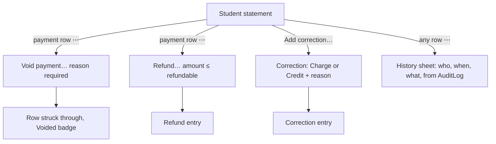
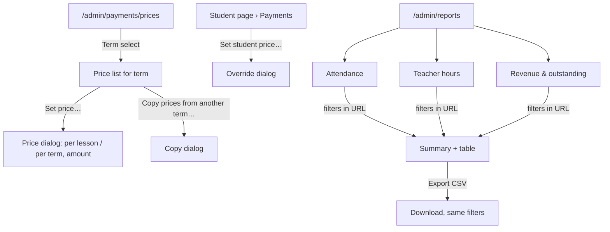
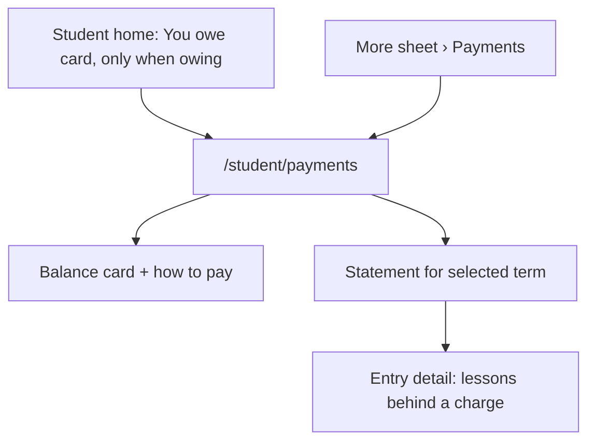

# Payments and reports (Phase 6)

Spec for the Phase 6 screens: price setup, student balances and statements,
recording payments (partial payments, refunds, corrections), the student's
own payments page, and the admin reports (attendance, teacher hours,
revenue/outstanding) with CSV export. Builds on `docs/design/tokens.md`,
`docs/design/app-layout.md`, `docs/design/admin-data.md`,
`docs/design/absences.md` and `docs/design/notifications-substitutes.md`.
Clickable wireframe: `docs/design/wireframes/payments-reports.html`.

The rules behind these screens (which lessons are billable, the pricing
model, when charges are created or recalculated, balance maths, report
definitions, CSV columns and limits) are owned by the Scheduling
Engineer's rules doc (CARM-71, `docs/architecture/phase6-rules.md`, "rules
doc" below). This spec states the **UI assumptions** it needs from that doc
in §12. If they disagree, the rules doc wins on behaviour and this spec is
updated to match.

## Owner decisions this spec follows (2026-10-16, CARM-69)

1. **In scope:** payments and reports.
2. **No parent accounts, no parent logins.** The P6 nav item _Parents_
   (`app-layout.md` §4.3) is dropped.
3. **No multi-school UI.** A user belongs to exactly one school, so there is
   no school switcher. Every screen and every export is scoped to the
   signed-in admin's school.
4. **No payment provider.** Admins record payments by hand. The design
   leaves room for a provider later (an _Online_ method, a provider name and
   an external reference), but no screen starts or receives an online
   payment.

Earlier decisions still apply: one role per user, later-phase nav items are
hidden until they ship, **no attendance tracking** (`lessons.md` decision 1
— see §8.2 for what the attendance report means), TeacherNotes never reach
students, every query is scoped by `schoolId`, all UI strings go through
next-intl.

## 1. Goal

- An admin sets prices once per term and never does billing maths by hand:
  the app shows what each student owes, and why.
- At the front desk, recording a payment takes under 20 seconds: find the
  student, the amount is prefilled, confirm.
- Mistakes are fixed openly, never erased: a wrong payment is voided with a
  reason, money given back is a refund, and every change is in the audit
  log.
- An admin sees at a glance who owes money and how much the school has
  collected.
- A student sees on their phone how much they owe, what for, and what they
  have paid.
- Admins get three reports they can trust and export to a spreadsheet:
  attendance, teacher hours (for payroll) and revenue/outstanding.

## 2. Roles and access

| Area                             | Admin                                                                                | Teacher                                     | Student                                              |
| -------------------------------- | ------------------------------------------------------------------------------------ | ------------------------------------------- | ---------------------------------------------------- |
| Prices                           | Set and change (`/admin/payments/prices`), per-student overrides on the student page | **Nothing**                                 | Nothing (sees the resulting charges only)            |
| Balances and statements          | All students of the school (`/admin/payments`, student page tab _Payments_)          | **Nothing** — no page, no column, no amount | Own balance and statement only (`/student/payments`) |
| Record / refund / correct / void | Yes, all audited                                                                     | No                                          | No                                                   |
| Reports and CSV                  | All three reports (`/admin/reports/*`)                                               | **Nothing** (not even their own hours)      | Nothing                                              |
| Settings › Payments              | Currency, payment instructions for students                                          | No                                          | Reads the payment instructions on their page         |

**Server-side rules** the UI only mirrors (QA covers them in CARM-74):

- Every payments and reports read lives in admin-only server modules,
  scoped by `schoolId`. Teacher loaders never import them (same pattern as
  ratings, `notifications-substitutes.md` §2).
- Student loaders return **the signed-in student's** balance and statement
  through a student DTO: no internal notes, no "recorded by" names, no other
  student. Any other student's id returns **404**.
- A teacher or student opening an `/admin/payments*` or `/admin/reports*`
  URL, or a CSV export URL, gets **403** (`errors.forbidden.*`); the export
  route returns 403 with no body.
- Every payment action (record, refund, correction, void, price change,
  student price override) is a server action that re-validates amounts and
  state at submit time and writes to `AuditLog` in the same transaction.

**Navigation changes** (`app-layout.md` §4.3):

- Admin, section _Finance_: **Payments** (`wallet`) and **Reports**
  (`chart-column`) ship. _People › Parents_ is removed from the nav config.
- Admin, _Settings_: new sub-page **Payments** (`/admin/settings/payments`).
- Student: **Payments** (`wallet`) goes into the _More_ sheet (not a bottom
  tab); the four bottom tabs stay as they are.
- Teacher: no change.

## 3. Concepts shown in the UI

| Concept            | UI word (key)                                | Meaning for the user                                                                                                                                                         |
| ------------------ | -------------------------------------------- | ---------------------------------------------------------------------------------------------------------------------------------------------------------------------------- |
| Price              | **Price** (`prices.*`)                       | What a course or group costs in a term: **per lesson** or **per term**. A group price overrides its course's price; a student price overrides both (§5).                     |
| Charge             | **Charge** (`payments.entry.charge`)         | An amount the student owes, created by the system from the rules doc's billable lessons, or by an admin as a correction. Never typed in as free text by the student.         |
| Payment            | **Payment** (`payments.entry.payment`)       | Money the school received: amount, date, method, optional reference.                                                                                                         |
| Refund             | **Refund** (`payments.entry.refund`)         | Money the school paid back to the student. Its own entry, never a negative payment.                                                                                          |
| Correction         | **Correction** (`payments.entry.correction`) | An admin-made charge or credit with a reason the student sees (e.g. "Discount: sibling", "Book fee").                                                                        |
| Voided             | **Voided** (`payments.status.voided`)        | A payment recorded by mistake. It stays in the statement, struck through, and no longer counts. Nothing is ever deleted.                                                     |
| Balance            | **Balance** (`payments.balance.*`)           | Charges minus payments plus refunds, plus/minus corrections (rules doc). Shown as words, never as a bare signed number: **Owes €120.00**, **In credit €20.00**, **Settled**. |
| Payment status     | **Status** (`payments.status.*`)             | Per student and term: _Unpaid_, _Partly paid_, _Paid_, _In credit_, _Nothing due_ (§3.1).                                                                                    |
| Expected this term | **Expected by end of term**                  | Charges still to come for lessons that haven't happened yet (per-lesson pricing). Shown muted, next to the balance, so nobody confuses "owes now" with "will owe".           |

### 3.1 Status badges

| Status        | When (server-computed, per term) | Badge (token)               | Icon (lucide)   |
| ------------- | -------------------------------- | --------------------------- | --------------- |
| `UNPAID`      | Charged > 0, nothing paid        | **Unpaid** (`danger`)       | `circle-alert`  |
| `PARTLY_PAID` | Paid > 0 but less than charged   | **Partly paid** (`warning`) | `circle-dashed` |
| `PAID`        | Paid = charged, charged > 0      | **Paid** (`success`)        | `circle-check`  |
| `IN_CREDIT`   | Paid > charged                   | **In credit** (`info`)      | `wallet`        |
| `NOTHING_DUE` | Nothing charged yet (or price 0) | **Nothing due** (muted)     | `minus`         |

Entry badges on statements: **Voided** (muted, line-through amount),
**Online** (`info`, reserved for a provider, §6.7), **Correction** (muted).
Every badge is text; color only reinforces it.

### 3.2 Money in the UI

- **Stored** as integer minor units plus an ISO 4217 currency (rules doc).
  The UI never does arithmetic on floats; amounts arrive from the server
  already summed.
- **One currency per school**, set in Settings › Payments (default `EUR`).
  It becomes read-only once any price or payment exists.
- **Displayed** through one i18n helper, `formatMoney(minor, currency)`
  (`src/i18n/money.ts`, `Intl.NumberFormat` with `style: "currency"` and the
  currency's minor digits, in the request locale). en-GB: `€120.00`.
  Signed amounts like `-€5.00` never appear (see Balance above). Messages take the
  **pre-formatted** string as a param (`{amount}`), so no ICU message
  hard-codes a currency.
- **Typed** in a `MoneyInput`: `Input inputmode="decimal"`, currency symbol
  as a non-editable prefix, accepts `120`, `120.5`, `120.50` (and the
  locale's decimal separator later). Parsed **as a string** to minor units
  (`parseMoney`, no `parseFloat`). More decimals than the currency allows →
  `payments.validation.decimals` "Use at most {digits} decimal places." Zero
  or negative → `payments.validation.positive`. Above the rules doc's max →
  `payments.validation.tooLarge`.
- Amounts are right-aligned with `tabular-nums` in tables.

## 4. Flows

### 4.1 Admin — front desk payment

```mermaid
flowchart TD
  P["/admin/payments — Balances"] -->|Record payment… (page action)| D[Record payment dialog]
  P -->|row: Record payment| D
  S["Student page › Payments tab"] -->|Record payment…| D
  D --> A{Amount vs owed}
  A -- equal --> OK[Saved · AuditLog]
  A -- less --> PP[Info: partial, X still owed] --> OK
  A -- more --> OV[Warning: student will be in credit] --> OK
  D --> DUP{Same student + amount + date recorded < 10 min ago?}
  DUP -- yes --> CF[Confirm: record another?] --> OK
  OK --> T[Toast + statement updated · status badge updated]
```

### 4.2 Admin — fixing mistakes



### 4.3 Admin — prices and reports



### 4.4 Student



## 5. Prices (`/admin/payments/prices`)

Tab **Prices** on the Payments page (`Tabs`: _Balances_ · _Payments_ ·
_Prices_, URL path segments). Desktop-first, `max-w-screen-2xl`.

```
┌ Payments                                                [Record payment…] ┐
│ [Balances | Payments | Prices]                                            │
│ Term [Autumn 2026 ▾]                    [Copy prices from another term…]  │
├───────────────────────────────────────────────────────────────────────────┤
│ Course / group          │ Type     │ Level │ Billing    │ Price    │      │
│ ▾ General English B1    │          │ B1    │ Per term   │ €240.00  │ ⋯    │ course row
│     B1 Evening          │ 👥 Group │ B1    │ (course)   │ €240.00  │ ⋯    │ inherits, muted
│     B1 Morning          │ 👥 Group │ B1    │ Per lesson │  €15.00  │ ⋯    │ own price, "Group price" badge
│ ▾ Business English C1   │          │ C1    │ —          │ No price │ ⋯    │ warning text
│     C1 Business         │ 👥 Group │ C1    │ —          │ No price │ ⋯    │
│ ▾ No course                                                               │
│     Jan Novak 1-on-1    │ 👤 1-on-1│ A2    │ Per lesson │  €30.00  │ ⋯    │
├───────────────────────────────────────────────────────────────────────────┤
│ ⚠ 2 groups with lessons this term have no price. Their students aren't    │
│   charged.                                               [Show them]      │
└───────────────────────────────────────────────────────────────────────────┘
```

- **Term `Select`** (default: current term, else next). Prices are per term
  (rules doc), so a price change for spring never rewrites autumn.
- **Rows**: each course with its groups indented under it; groups without a
  course under **No course** (that's where most 1-on-1s live). Archived
  groups are hidden unless they have lessons in the term.
- **Billing** column: _Per lesson_ · _Per term_ · "(course)" when a group
  inherits, muted. **Price** column: formatted amount, or **No price**
  (`warning` text + icon) when neither the group nor its course has one.
- A group with its own price shows a **Group price** muted badge, so the
  admin sees what overrides the course.
- Row menu: _Set price…_ · _Remove price_ (group: falls back to the
  course; course: groups that inherit become "No price" — `AlertDialog`
  listing them).
- **Missing-price alert** at the bottom (`warning`) when a group that has
  lessons in the term has no price; _Show them_ filters the table.
- **Copy prices from another term…** (`Dialog`): From term `Select`;
  "Copies {count} prices to {term}. Existing prices in {term} are kept."
  Never overwrites.

**Set price dialog** (`Dialog`, ≤ 6 fields):

| Field          | Control                                                                                                     | Rules                                                                                                                                                                                      |
| -------------- | ----------------------------------------------------------------------------------------------------------- | ------------------------------------------------------------------------------------------------------------------------------------------------------------------------------------------ |
| Applies to     | Read-only text: course or group name, term                                                                  | —                                                                                                                                                                                          |
| Billing        | `RadioGroup`: Per lesson · Per term                                                                         | Required. Hint per option: "Students pay for each billable lesson." / "One fixed amount for the whole term."                                                                               |
| Price          | `MoneyInput`                                                                                                | Required, ≥ 0. **0 is allowed** (free trial group): such students show _Nothing due_.                                                                                                      |
| Change applies | `RadioGroup` (only when charges already exist for this term): _To lessons from today_ · _To the whole term_ | Default _To lessons from today_. The second recalculates existing charges (rules doc decides which; the UI shows the server's preview "Changes {count} charges for {students} students."). |

Saving toasts "Price saved." and, when it changed charges, "Charges for
{count} students were updated."

**Student price** (override): on the student page, Payments tab, card
**Price** (§6.3): "Pays the group price" or the override, with _Set student
price…_ → dialog: Group (`Select` of the student's groups in the term),
type `RadioGroup` _Fixed price_ (`MoneyInput`, same billing as the group) ·
_Discount_ (`Input` %, 1–100), Reason (required, shown to admins only, e.g.
"Sibling discount"). One override per student, group and term.

States: loading (table skeleton) · no term exists (`payments.prices.noTerm`

- link to Terms) · no groups (`payments.prices.noGroups` + link to Courses &
  groups) · error (`Alert` + _Try again_) · save error inline in the dialog,
  input kept.

## 6. Payments — admin

### 6.1 Balances (`/admin/payments`, default tab)

The answer to "who owes us money?".

```
┌ Payments                                                       [Record payment…] ┐
│ [Balances | Payments | Prices]                                                   │
│ ┌ Outstanding ───┐ ┌ Collected in Oct ┐ ┌ Students owing ┐ ┌ In credit ─────┐    │
│ │ €3,420.00      │ │ €5,180.00        │ │ 23 of 112      │ │ €140.00 (4)    │    │
│ └────────────────┘ └──────────────────┘ └────────────────┘ └────────────────┘    │
│ Term [Autumn 2026 ▾]  Status [Owing ▾]  Group [Any ▾]  [Search students…]        │
├──────────────────────────────────────────────────────────────────────────────────┤
│ Student ↑      │ Groups      │ Charged │ Paid    │ Balance          │ Status       │ Last payment │      │
│ Jana Kovac     │ B1 Evening  │ €240.00 │   €0.00 │ Owes €240.00     │ ⊘ Unpaid     │ —            │ [Record payment] ⋯ │
│ Petr Hruby     │ A2 Morning  │ €180.00 │ €100.00 │ Owes €80.00      │ ◌ Partly paid│ 3 Oct        │ [Record payment] ⋯ │
│ Marek Bielik   │ Marek 1-on-1│ €120.00 │ €140.00 │ In credit €20.00 │ 💳 In credit  │ 12 Oct       │ ⋯ │
│ Lucia Tomas    │ B2 Evening  │ €240.00 │ €240.00 │ Settled          │ ✓ Paid       │ 1 Sep        │ ⋯ │
└──────────────────────────────────────────────────────────────────────────────────┘
│ Showing 1–50 of 112                                   [‹ Previous] [Next ›]      │
```

- **Stat cards** (4, server values for the selected term): _Outstanding_
  (sum owed), _Collected in {month}_ (payments − refunds this calendar
  month, school timezone), _Students owing_ ("{owing} of {total}"), _In
  credit_ (sum and count). Each card is a link that applies the matching
  filter. On mobile they stack 2 × 2.
- **Filters** (URL params): Term (`Select`, default current), Status
  (`Select`: _Any_, _Owing_ = Unpaid + Partly paid (default), _Unpaid_,
  _Partly paid_, _Paid_, _In credit_, _Nothing due_), Group (`Combobox`),
  search by name or email. _Include archived students_ `Checkbox` (off;
  archived students with a balance still show a muted **Archived** badge
  when it's on).
- **Columns**: Student (link to the student page, Payments tab) · Groups ·
  Charged · Paid (payments − refunds) · Balance (words, §3) · Status badge ·
  Last payment (date) · actions. Sortable: Student, Balance (default: owes
  most first when the status filter is _Owing_), Last payment.
- Row actions: **Record payment** (`outline`, only when owing) · `⋯` _Open
  statement_, _Add correction…_.
- 50 rows per page, numbered pagination (`common.pagination.*`).
- Mobile: rows become cards (name, balance in words, status badge, _Record
  payment_); the page stays usable (front desk on a tablet is common), no
  `desktopRecommended` notice.

States:

| State                      | Shows                                                                                                                             |
| -------------------------- | --------------------------------------------------------------------------------------------------------------------------------- |
| Loading                    | 4 stat skeletons + table skeleton                                                                                                 |
| Nothing set up             | `wallet` icon · "No prices for {term} yet" · "Set prices for your courses and groups, then balances show up here." · _Set prices_ |
| Nobody owes (filter Owing) | `circle-check` icon · "Nobody owes anything for {term}." · _Show all students_                                                    |
| No results                 | `common.noResults` + _Clear filters_                                                                                              |
| Error                      | `Alert` "Couldn't load balances." + _Try again_                                                                                   |

### 6.2 Payments journal (`/admin/payments/journal`, tab _Payments_)

Every money movement in a date range, for checking the till or bank
statement. Filters: date range (default this month), Method (`Select`),
Type (_Payments_ / _Refunds_ / _All_, default _All_), _Show voided_
`Checkbox`. Columns: Date · Student (link) · Type (Payment / Refund badge) ·
Method · Reference · Amount · Recorded by · `⋯` (_Open statement_,
_History_). Footer row: "Total received {amount} · Refunded {amount} · Net
{amount}" for the filtered range. _Export CSV_ links to the revenue report
with the same range (§8.4) — the journal itself doesn't export, so there's
one place for money exports.

Empty: "No payments in this period." States as §6.1.

### 6.3 Student page › Payments tab (`/admin/students/[id]?tab=payments`)

New tab after _Groups_ on the student detail (`admin-data.md` §6.6).

```
┌ Jana Kovac                                   [Profile | Groups | Payments] ┐
│ ┌ Balance ─────────────────────────────┐ ┌ Price ─────────────────────────┐ │
│ │ Owes €80.00            ◌ Partly paid │ │ B1 Evening: group price        │ │
│ │ Expected by end of term: €60.00 more │ │ €15.00 per lesson              │ │
│ │ [Record payment…] [Add correction…]  │ │ [Set student price…]           │ │
│ └──────────────────────────────────────┘ └────────────────────────────────┘ │
│ Statement   Term [Autumn 2026 ▾]                                            │
├─────────────────────────────────────────────────────────────────────────────┤
│ Date    │ Description                          │ Charge  │ Paid    │ Balance │   │
│ 1 Sep   │ Carried over from Spring 2026        │         │         │  €0.00  │   │
│ 30 Sep  │ ▸ B1 Evening · September · 8 lessons │ €120.00 │         │ €120.00 │ ⋯ │
│ 3 Oct   │ Payment · Cash · Rcpt 0142           │         │ €100.00 │  €20.00 │ ⋯ │
│ 5 Oct   │ Payment · Bank transfer  [Voided]    │         │ ~~€50~~ │  €20.00 │ ⋯ │
│ 15 Oct  │ ▸ B1 Evening · October so far · 4    │  €60.00 │         │  €80.00 │ ⋯ │
├─────────────────────────────────────────────────────────────────────────────┤
│ Owes €80.00 at 16 Oct 2026                                                  │
└─────────────────────────────────────────────────────────────────────────────┘
```

- **Balance card**: balance in words (large, `text-2xl`), status badge,
  muted line "Expected by end of term: {amount} more" (only with per-lesson
  pricing and future lessons), then _Record payment…_ (primary) and _Add
  correction…_ (`outline`).
- **Price card**: per group in the term, which price applies ("group
  price", "course price", "student price: 10 % discount (Sibling
  discount)"), with _Set student price…_ (§5).
- **Statement**: one table per term (term `Select`), oldest first so the
  running balance reads top-down. First row: **Carried over from {term}**
  (the balance at the end of the previous term; omitted when 0 and there is
  no previous term).
- **Charge rows** are grouped by group and month: "{group} · {month} ·
  {count} lessons" (per lesson) or "{group} · {term} fee" (per term).
  The `▸` disclosure expands the lessons behind the charge: date, time,
  _Billed_ / _Not billed_ with the **server's reason text** (e.g. "Cancelled
  by the school", "Cancelled before the cutoff", "Replacement — not billed
  twice"). The UI never decides billability.
- **Payment rows**: "Payment · {method}" + reference; refunds "Refund ·
  {method}"; corrections "Correction: {description}". Each row has
  "Recorded by {name}" in its `title` and in the History sheet.
- **Voided rows**: amount struck through + **Voided** badge, balance
  unchanged; the void reason is in the History sheet. Line-through is never
  the only signal (badge + screen-reader text "voided").
- Row menu `⋯`: payment → _Refund…_, _Void payment…_, _History_; refund →
  _Void refund…_, _History_; correction → _Void correction…_, _History_;
  charge → _History_ (shows recalculations).
- Footer: "{balance} at {date}".

### 6.4 Record payment (`Dialog`)

```
┌ Record payment                                        ✕ ┐
│ Student (required)  [Jana Kovac ▾]                      │
│ Owes €80.00 · Expected by end of term €60.00 more       │
│ Amount (required)   [€ 80.00      ]                     │
│ ⓘ Partial payment: €30.00 will still be owed.           │  only when amount < owed
│ Date (required)     [16 Oct 2026 ▾]                     │
│ Method (required)   [Cash ▾]                            │
│ Reference           [Receipt no. or bank reference]     │
│ Note (admins only)  [                              ]    │
│                               [Cancel] [Record €80.00]  │
└─────────────────────────────────────────────────────────┘
```

| Field     | Control                  | Rules                                                                                                                                                        |
| --------- | ------------------------ | ------------------------------------------------------------------------------------------------------------------------------------------------------------ |
| Student   | `Combobox` (name, email) | Required. Prefilled and read-only when opened from a row or student page. After choosing, the balance line appears.                                          |
| Amount    | `MoneyInput`             | Required, > 0. Prefilled with what is **owed now** (not the expected amount); empty when nothing is owed.                                                    |
| Date      | Date picker              | Required, default today (school timezone). Not in the future. Older than the rules doc's limit → error "Payments can't be dated more than {days} days back." |
| Method    | `Select`                 | Required: _Cash_ · _Bank transfer_ · _Card (at the office)_ · _Other_. Default: the method this admin used last. _Online_ is not offered (§6.7).             |
| Reference | `Input` ≤ 100            | Optional. Shown to the student (e.g. receipt number).                                                                                                        |
| Note      | `Textarea` ≤ 500         | Optional. **Admins only**, never in the student DTO.                                                                                                         |

- Live feedback under Amount (`role="status"`, polite):
  - amount < owed → `info` "Partial payment: {rest} will still be owed."
  - amount > owed → `warning` "That's {extra} more than owed. {name} will
    be in credit." (allowed; credit carries over).
  - nothing owed → `info` "{name} owes nothing right now. The payment will
    be kept as credit."
- Primary button says the amount: **Record {amount}**; while saving
  "Recording…".
- **Possible duplicate** (server returns `POSSIBLE_DUPLICATE`: same
  student, amount and date recorded in the last 10 minutes): the dialog
  shows a `warning` `Alert` "A payment of {amount} was recorded for {name}
  {minutes} min ago by {admin}." with a required `Checkbox` "This is a
  different payment" and the button _Record anyway_.
- After saving: dialog closes, toast "Payment of {amount} recorded for
  {name}.", the row/statement and stat cards refresh.
- Errors: validation under fields; `Alert` "Couldn't record the payment.
  Nothing was saved." + _Try again_, input kept.

### 6.5 Refund, correction, void

**Refund…** (`Dialog`, from a payment row or the balance card when in
credit): Amount (`MoneyInput`, prefilled with the refundable amount the
server sends: the payment's amount minus earlier refunds, or the credit
when opened from the balance card; above it → "You can refund at most
{max}."), Date, Method, Reason (required, admins only). Description: "Records money paid back to {name}. It doesn't move any
money by itself." Primary **Refund {amount}**. Toast "Refund of {amount}
recorded."

**Add correction…** (`Dialog`): Type `RadioGroup` _Add a charge_ (student
owes more, e.g. book fee) · _Give a credit_ (student owes less, e.g.
goodwill discount); Amount; Description (required, ≤ 100, **shown to the
student**, placeholder "e.g. Course book"); Note (optional, admins only);
Term (`Select`, default the statement's term). Primary **Add charge** /
**Give credit**. Toast "Correction added."

**Void payment…** (`AlertDialog`, destructive):

- Title "Void the payment of {amount} from {date}?"
- Description "Use this when the payment was recorded by mistake. It stays
  in the statement, crossed out, and no longer counts. This can't be
  undone."
- Reason (`Textarea`, required).
- Buttons _Keep payment_ · **Void payment** (`destructive`).
- Blocked when the payment has refunds that aren't voided: "This payment
  has a refund. Void the refund first." (`HAS_REFUNDS`), only _Close_.
- Toast "Payment voided."

Voiding a refund or correction uses the same dialog with its own title.
There is no edit of a saved entry: fix = void + record again, so the audit
trail is a plain list.

### 6.6 History sheet

Right `Sheet` 420 px (bottom sheet on mobile), from any statement row
`⋯ › History`. A vertical list from `AuditLog`, newest first: "{action} by
{name}" + date-time, and the changed fields as "Amount: €80.00", "Reason:
…". For charges: "Recalculated: €120.00 → €105.00 (price changed)". Read
only. Empty can't happen (creation is always logged).

### 6.7 Room for a payment provider later (not designed now)

Only constraints, so nothing has to be redesigned:

- The method list has a reserved value **Online** that the record dialog
  never offers. A future provider writes those payments itself.
- Statement and journal rows already render, when present: an **Online**
  `info` badge, the provider name ("Online · {provider}") and an **External
  reference** (monospace-free, selectable text) in the History sheet and the
  journal's Reference column.
- A non-final provider state (e.g. pending) would show as a muted badge
  **Processing** and not count in the balance; v1 has no such entries.
- The student page reserves the space under the balance card for a future
  **Pay online** button. v1 renders the payment instructions there (§7).
- No "Pay online", "Connect provider" or webhook settings anywhere in v1.

## 7. Payments — student (`/student/payments`, mobile-first)

In the _More_ sheet as **Payments**, with a `danger` dot + "Owes" text
when the student owes money (never color only). Also a **home card** "You
owe {amount}" when the balance is _Owes_: one line of how to pay and _See
details_. No home card when settled or in credit.

```
┌──────────────────────────────┐
│ Payments                     │ h1
│ ┌──────────────────────────┐ │
│ │ You owe                  │ │
│ │ €80.00                   │ │ text-3xl tnum
│ │ ◌ Partly paid · Autumn 26│ │
│ │ About €60.00 more by the │ │ muted, per-lesson pricing only
│ │ end of term.             │ │
│ ├──────────────────────────┤ │
│ │ How to pay               │ │
│ │ Pay at the office or by  │ │ school's instructions (Settings)
│ │ bank transfer to SK12 …  │ │
│ │ Reference: your name.    │ │
│ └──────────────────────────┘ │
│ History    [Autumn 2026 ▾]   │
│ ┌──────────────────────────┐ │
│ │ 15 Oct · B1 Evening      │ │
│ │ October so far · 4 lessons│ │
│ │                 + €60.00 │ │
│ ├──────────────────────────┤ │
│ │ 3 Oct · Payment, cash    │ │
│ │ Receipt 0142    − €100.00│ │
│ ├──────────────────────────┤ │
│ │ 30 Sep · B1 Evening      │ │
│ │ September · 8 lessons    │ │
│ │                 + €120.00│ │
│ └──────────────────────────┘ │
│ Questions about a payment?   │
│ Contact the school office.   │
└──────────────────────────────┘
```

- **Balance card**: label (_You owe_ / _You're in credit_ / _All paid_),
  amount `text-3xl tabular-nums`, status badge and term. _All paid_ uses
  `circle-check` + success text. "About {amount} more by the end of term."
  only when the server sends an expected amount.
- **How to pay**: the school's payment instructions (Settings › Payments,
  plain text, line breaks kept, links auto-linked). Hidden when empty.
- **History**: newest first on mobile (students care about the latest),
  one card list per term (`Select`, default current). Each item: date,
  title, sub-line, signed amount as text with words for screen readers
  ("charge €60.00", "payment €100.00"); `+`/`−` and color are reinforcement
  only. Charges open a bottom sheet listing the lessons behind them with
  _Billed_ / _Not billed_ + reason (same server text as admins, minus
  anything internal).
- **Voided** payments are **not shown** to students (they were never real
  payments); refunds and corrections are shown with their description.
  _Open question Q3._
- Never shown to students: admin notes, refund/void reasons, "recorded
  by", prices of other students, discount reasons.
- States: loading (card skeletons) · nothing yet (`wallet` icon, "No
  payments or charges yet" / "When your school charges for lessons, you'll
  see it here.") · error (`Alert` "Couldn't load your payments." + _Try
  again_).

## 8. Reports (`/admin/reports`)

### 8.1 Reports index and shared layout

`/admin/reports`: h1 "Reports" and three cards (title, one-line
description, _Open report_): **Attendance**, **Teacher hours**, **Revenue &
outstanding**. Each report is its own page so filters live in its URL and
can be bookmarked.

Shared layout for every report:

```
┌ ‹ Reports                                                                  ┐
│ Teacher hours                                              [Export CSV ▾]  │
│ Lessons taught per teacher. Substitute hours count for the substitute.    │
│ Period [Term: Autumn 2026 ▾]  or [1 Sep – 20 Dec 2026]                     │
│ Teacher [Any ▾]   Group [Any ▾]                          [Reset filters]  │
├────────────────────────────────────────────────────────────────────────────┤
│ ┌ Total hours ┐ ┌ Lessons ┐ ┌ Substitute hours ┐                          │
│ │ 412 h 30 min│ │ 275     │ │ 18 h             │                          │
│ └─────────────┘ └─────────┘ └──────────────────┘                          │
│ table …                                                                    │
│ ⓘ Only lessons that have ended count. Data as of 16 Oct 2026, 14:05.      │
└────────────────────────────────────────────────────────────────────────────┘
```

- **Period**: `Select` with the school's terms **plus** _Custom dates…_,
  which reveals a date-range picker. Default: current term. Max range from
  the rules doc; above it the picker shows "Choose at most {days} days."
  and doesn't apply. Dates are calendar days in the school timezone,
  inclusive.
- **Teacher** and **Group** `Combobox`es where relevant (per report
  below), including archived ones (muted "Archived" tag).
- Filters apply immediately (no _Apply_ button), debounced; all in the URL.
  _Reset filters_ link when anything differs from the defaults.
- **Summary cards** (2–4) above one table. Tables follow `app-layout.md` §5
  (sticky header, `aria-sort`, first cell a real link where there is a
  target). 50 rows per page.
- **Footnote** (muted): what counts, plus "Data as of {dateTime}" — reports
  are computed on request; no caching surprises.
- No charts in v1: the numbers are the product. (A chart can be added later
  without changing filters or exports.)

### 8.2 Attendance (`/admin/reports/attendance`)

There is **no attendance tracking** (teachers don't take a register). The
report is built from what the app does know: who was expected in each
lesson, who **cancelled** (absence reports), and who joined as a
**replacement**. The page says so in plain words, so nobody reads it as a
register. _Open question Q1._

Description: "Expected attendance based on cancellations students reported.
Teachers don't take a register, so no-shows aren't counted."

Filters: Period · Teacher · Group · View `ToggleGroup` **By group**
(default) · **By student**.

By group:

| Column          | Meaning (rules doc defines exactly)                                                    |
| --------------- | -------------------------------------------------------------------------------------- |
| Group           | Link to the group page; type icon + label, level                                       |
| Lessons         | Lessons that took place (ended, not cancelled)                                         |
| Expected        | Student places in those lessons (members on each lesson's date)                        |
| Cancelled       | Cancellations, with "{withCredit} with credit · {late} late" under it                  |
| Replacements in | Students who joined as a replacement                                                   |
| Attendance      | (Expected − Cancelled + Replacements in) ÷ (Expected + Replacements in), one decimal % |

By student: Student (link to student page) · Group · Lessons · Cancelled ·
Late cancellations · Replacements taken · Attendance %. Sort by
Attendance ascending to find students who drop off.

Summary cards: _Lessons held_ · _Expected attendance_ (%) · _Cancellations_
· _Replacements_. Lessons cancelled by the school are excluded and counted
in the footnote: "{count} lessons cancelled by the school aren't counted."

### 8.3 Teacher hours (`/admin/reports/teacher-hours`)

For payroll. Uses Phase 5's `teachingMinutes` (ended, non-cancelled lessons,
counted for the **effective** teacher — `phase5-rules.md` §3.4): a lesson
covered by a substitute counts for the substitute, **not** the regular
teacher.

Filters: Period · Teacher · Group.

| Column            | Content                                                                                |
| ----------------- | -------------------------------------------------------------------------------------- |
| Teacher           | Link to the per-teacher detail below; "Archived" tag if archived                       |
| Lessons           | Count of lessons taught                                                                |
| Own lessons       | Hours as the regular teacher                                                           |
| As substitute     | Hours substituting for others (cyan `user-round-cog` icon + text)                      |
| Total             | Own + as substitute                                                                    |
| Covered by others | Muted: hours of their lessons someone else taught (not paid to them; for context only) |

Hours are shown as **"12 h 30 min"** (`reports.hours.format`, ICU with
hours and minutes; "45 min" below an hour). The CSV carries minutes and
decimal hours (§8.5).

**Per-teacher detail** (`/admin/reports/teacher-hours/[teacherId]?…same
filters`): back link, h1 teacher name, the same summary, then one row per
lesson: Date · Time · Group · Role (_Own_ / _Substitute for {teacher}_) ·
Duration. _Export CSV_ exports these lesson rows.

Teachers with no lessons in the period are listed with zeros only when the
_Show teachers without lessons_ `Checkbox` is on (default off).

### 8.4 Revenue & outstanding (`/admin/reports/revenue`)

Filters: Period · Group · Breakdown `ToggleGroup` **By month** (default) ·
**By group** · **By course**.

Summary cards with one-line definitions under each (the two words people
mix up are spelled out):

- **Charged** — "What students were charged for lessons in this period."
- **Collected** — "Payments received minus refunds, by payment date."
- **Outstanding** — "What students owe at the end of the period."
- **In credit** — "Paid in advance, at the end of the period."

Table (by month): Month · Charged · Collected · Refunded · Corrections
(net) · Outstanding at month end. By group / course: Group (or Course) ·
Students · Charged · Collected · Outstanding. Totals row at the bottom
(`tfoot`, bold).

Below the table, card **Who owes** (top 10 by amount owed at the end of
the period, with _See all in Balances_ → `/admin/payments?status=owing`).

Footnote: "Voided entries aren't counted. Amounts in {currency}."

### 8.5 CSV export

- **Export CSV** (`outline`, `download` icon) in the report header. A
  `DropdownMenu` when the report has two shapes (attendance: _By group_ /
  _By student_ follows the current view, so it's a plain button there;
  teacher hours: _Summary_ / _All lessons_; revenue: _This breakdown_ /
  _All entries_ (every charge, payment, refund, correction in the period)).
- Exports **all rows that match the filters**, not just the current page,
  in the current sort.
- File name (ASCII, from i18n): `{report}_{from}_{to}.csv`, e.g.
  `teacher-hours_2026-09-01_2026-12-20.csv`.
- Format (rules doc owns the exact columns): UTF-8 with BOM (Excel opens
  it correctly), comma separator, header row from i18n
  (`reports.csv.<report>.*`), dates ISO `YYYY-MM-DD`, amounts as plain
  decimals with a dot (`120.00`) plus a `currency` column, durations as
  `minutes` and `hours` (decimal, 2 places). No formatted strings like
  "€120.00" or "12 h 30 min" in the file — spreadsheets must be able to sum
  them. Cells starting with `=`, `+`, `-`, `@` are escaped (CSV injection).
- Generated server-side by a route handler that checks the admin role and
  school; the button is a plain link with `download`, so it works without
  JavaScript.
- **Too many rows** (above the rules doc's limit): the button stays
  enabled; clicking shows a `warning` `Alert` "This export has {count} rows,
  more than the {max} allowed. Choose a shorter period or a filter." The
  server enforces the same limit (413-style error page with the same text).
- While generating: button spinner "Preparing…" (client fetch with
  `Content-Disposition`), toast "Export downloaded." on success; error
  `Alert` "Couldn't create the export. Try again."
- Every export is written to `AuditLog` (report, filters, row count), since
  it contains personal and financial data.

### 8.6 States (all reports)

| State               | Shows                                                                                  |
| ------------------- | -------------------------------------------------------------------------------------- |
| Loading             | Summary card skeletons + table skeleton; filters stay usable                           |
| No data in period   | `chart-column` icon · "No data for this period." · "Try another term or date range."   |
| No term yet         | "Add a term first. Reports are based on terms and lessons." + link to Terms & holidays |
| No prices (revenue) | `Alert` (info) "No prices are set for {term}, so nothing is charged." + _Set prices_   |
| Range too long      | Inline under the date picker; the previous result stays                                |
| Error               | `Alert` "Couldn't load the report." + _Try again_                                      |
| Forbidden           | Teacher/student → full-page 403 (`errors.forbidden.*`); CSV route → 403 empty body     |

## 9. Settings › Payments (`/admin/settings/payments`)

Form (`max-w-2xl`):

- **Currency** (`Combobox` of ISO 4217 codes with names, default `EUR`).
  Read-only once any price or payment exists, with the hint "The currency
  can't change once prices or payments exist."
- **Payment instructions for students** (`Textarea`, ≤ 1,000, optional):
  "Shown on the students' Payments page, e.g. your bank account and what
  to write as the reference." Preview below the field.

_Save changes_ → toast "Payment settings saved." Audited.

## 10. Dashboards

- **Admin dashboard** _Needs attention_ card (`app-layout.md` §7.2): line
  "{count} students owe {amount}" → `/admin/payments?status=owing`; line
  "{count} groups have no price for {term}" → Prices with the missing
  filter. Only when non-zero.
- **Student home**: "You owe {amount}" card (§7).
- **Teacher dashboard**: no change. Teachers see no money anywhere.

## 11. Copy (i18n keys, English source)

Message files: `messages/en-GB/payments.json`, `prices.json`,
`reports.json`; nav keys in `nav.json`; settings in `settings.json`.
`{amount}`, `{rest}`, `{extra}`, `{max}` are **pre-formatted money
strings** from `formatMoney`.

### payments

| Key                                   | Copy                                                                                                                          |
| ------------------------------------- | ----------------------------------------------------------------------------------------------------------------------------- |
| `payments.title`                      | Payments                                                                                                                      |
| `payments.tab.balances`               | Balances                                                                                                                      |
| `payments.tab.journal`                | Payments                                                                                                                      |
| `payments.tab.prices`                 | Prices                                                                                                                        |
| `payments.record`                     | Record payment…                                                                                                               |
| `payments.recordShort`                | Record payment                                                                                                                |
| `payments.stat.outstanding`           | Outstanding                                                                                                                   |
| `payments.stat.collectedIn`           | Collected in {month}                                                                                                          |
| `payments.stat.owing`                 | Students owing                                                                                                                |
| `payments.stat.owingValue`            | {owing} of {total}                                                                                                            |
| `payments.stat.inCredit`              | In credit                                                                                                                     |
| `payments.stat.inCreditValue`         | {amount} ({count})                                                                                                            |
| `payments.filter.term`                | Term                                                                                                                          |
| `payments.filter.status`              | Status                                                                                                                        |
| `payments.filter.status.any`          | Any                                                                                                                           |
| `payments.filter.status.owing`        | Owing                                                                                                                         |
| `payments.filter.group`               | Group                                                                                                                         |
| `payments.filter.search`              | Search students…                                                                                                              |
| `payments.filter.archived`            | Include archived students                                                                                                     |
| `payments.col.student`                | Student                                                                                                                       |
| `payments.col.groups`                 | Groups                                                                                                                        |
| `payments.col.charged`                | Charged                                                                                                                       |
| `payments.col.paid`                   | Paid                                                                                                                          |
| `payments.col.balance`                | Balance                                                                                                                       |
| `payments.col.status`                 | Status                                                                                                                        |
| `payments.col.lastPayment`            | Last payment                                                                                                                  |
| `payments.col.date`                   | Date                                                                                                                          |
| `payments.col.description`            | Description                                                                                                                   |
| `payments.col.charge`                 | Charge                                                                                                                        |
| `payments.col.type`                   | Type                                                                                                                          |
| `payments.col.method`                 | Method                                                                                                                        |
| `payments.col.reference`              | Reference                                                                                                                     |
| `payments.col.amount`                 | Amount                                                                                                                        |
| `payments.col.recordedBy`             | Recorded by                                                                                                                   |
| `payments.balance.owes`               | Owes {amount}                                                                                                                 |
| `payments.balance.inCredit`           | In credit {amount}                                                                                                            |
| `payments.balance.settled`            | Settled                                                                                                                       |
| `payments.balance.at`                 | {balance} at {date}                                                                                                           |
| `payments.balance.expected`           | Expected by end of term: {amount} more                                                                                        |
| `payments.status.UNPAID`              | Unpaid                                                                                                                        |
| `payments.status.PARTLY_PAID`         | Partly paid                                                                                                                   |
| `payments.status.PAID`                | Paid                                                                                                                          |
| `payments.status.IN_CREDIT`           | In credit                                                                                                                     |
| `payments.status.NOTHING_DUE`         | Nothing due                                                                                                                   |
| `payments.status.voided`              | Voided                                                                                                                        |
| `payments.status.online`              | Online                                                                                                                        |
| `payments.status.processing`          | Processing                                                                                                                    |
| `payments.method.CASH`                | Cash                                                                                                                          |
| `payments.method.BANK_TRANSFER`       | Bank transfer                                                                                                                 |
| `payments.method.CARD`                | Card (at the office)                                                                                                          |
| `payments.method.OTHER`               | Other                                                                                                                         |
| `payments.method.ONLINE`              | Online · {provider}                                                                                                           |
| `payments.entry.carriedOver`          | Carried over from {term}                                                                                                      |
| `payments.entry.chargeLessons`        | {group} · {month} · {count, plural, one {# lesson} other {# lessons}}                                                         |
| `payments.entry.chargeMonthSoFar`     | {group} · {month} so far · {count, plural, one {# lesson} other {# lessons}}                                                  |
| `payments.entry.chargeTerm`           | {group} · {term} fee                                                                                                          |
| `payments.entry.payment`              | Payment · {method}                                                                                                            |
| `payments.entry.refund`               | Refund · {method}                                                                                                             |
| `payments.entry.correction`           | Correction: {description}                                                                                                     |
| `payments.entry.recordedBy`           | Recorded by {name}                                                                                                            |
| `payments.entry.voidedSr`             | voided                                                                                                                        |
| `payments.lesson.billed`              | Billed                                                                                                                        |
| `payments.lesson.notBilled`           | Not billed: {reason}                                                                                                          |
| `payments.row.openStatement`          | Open statement                                                                                                                |
| `payments.row.refund`                 | Refund…                                                                                                                       |
| `payments.row.void`                   | Void payment…                                                                                                                 |
| `payments.row.voidRefund`             | Void refund…                                                                                                                  |
| `payments.row.voidCorrection`         | Void correction…                                                                                                              |
| `payments.row.history`                | History                                                                                                                       |
| `payments.row.menu`                   | More actions for this entry                                                                                                   |
| `payments.statement.title`            | Statement                                                                                                                     |
| `payments.card.balance`               | Balance                                                                                                                       |
| `payments.card.price`                 | Price                                                                                                                         |
| `payments.card.priceGroup`            | {group}: group price                                                                                                          |
| `payments.card.priceCourse`           | {group}: course price                                                                                                         |
| `payments.card.priceStudent`          | {group}: student price                                                                                                        |
| `payments.card.priceNone`             | {group}: no price                                                                                                             |
| `payments.journal.total`              | Total received {received} · Refunded {refunded} · Net {net}                                                                   |
| `payments.journal.showVoided`         | Show voided                                                                                                                   |
| `payments.journal.type.all`           | All                                                                                                                           |
| `payments.journal.type.payments`      | Payments                                                                                                                      |
| `payments.journal.type.refunds`       | Refunds                                                                                                                       |
| `payments.journal.empty`              | No payments in this period.                                                                                                   |
| `payments.form.title`                 | Record payment                                                                                                                |
| `payments.form.student`               | Student (required)                                                                                                            |
| `payments.form.amount`                | Amount (required)                                                                                                             |
| `payments.form.date`                  | Date (required)                                                                                                               |
| `payments.form.method`                | Method (required)                                                                                                             |
| `payments.form.reference`             | Reference                                                                                                                     |
| `payments.form.referencePlaceholder`  | Receipt no. or bank reference                                                                                                 |
| `payments.form.note`                  | Note (admins only)                                                                                                            |
| `payments.form.owes`                  | Owes {amount}                                                                                                                 |
| `payments.form.partial`               | Partial payment: {rest} will still be owed.                                                                                   |
| `payments.form.over`                  | That's {extra} more than owed. {name} will be in credit.                                                                      |
| `payments.form.nothingOwed`           | {name} owes nothing right now. The payment will be kept as credit.                                                            |
| `payments.form.submit`                | Record {amount}                                                                                                               |
| `payments.form.submitting`            | Recording…                                                                                                                    |
| `payments.form.duplicate`             | A payment of {amount} was recorded for {name} {minutes, plural, one {# min} other {# min}} ago by {admin}.                    |
| `payments.form.duplicateConfirm`      | This is a different payment                                                                                                   |
| `payments.form.recordAnyway`          | Record anyway                                                                                                                 |
| `payments.form.saved`                 | Payment of {amount} recorded for {name}.                                                                                      |
| `payments.form.error`                 | Couldn't record the payment. Nothing was saved.                                                                               |
| `payments.validation.positive`        | Enter an amount greater than zero.                                                                                            |
| `payments.validation.decimals`        | Use at most {digits} decimal places.                                                                                          |
| `payments.validation.tooLarge`        | Enter an amount up to {max}.                                                                                                  |
| `payments.validation.invalid`         | Enter an amount like 120 or 120.50.                                                                                           |
| `payments.validation.future`          | The date can't be in the future.                                                                                              |
| `payments.validation.tooOld`          | Payments can't be dated more than {days} days back.                                                                           |
| `payments.refund.title`               | Refund to {name}                                                                                                              |
| `payments.refund.description`         | Records money paid back to {name}. It doesn't move any money by itself.                                                       |
| `payments.refund.reason`              | Reason (required, admins only)                                                                                                |
| `payments.refund.max`                 | You can refund at most {max}.                                                                                                 |
| `payments.refund.submit`              | Refund {amount}                                                                                                               |
| `payments.refund.saved`               | Refund of {amount} recorded.                                                                                                  |
| `payments.correction.add`             | Add correction…                                                                                                               |
| `payments.correction.title`           | Add a correction                                                                                                              |
| `payments.correction.type`            | Type                                                                                                                          |
| `payments.correction.charge`          | Add a charge                                                                                                                  |
| `payments.correction.chargeHint`      | The student owes more, e.g. a course book.                                                                                    |
| `payments.correction.credit`          | Give a credit                                                                                                                 |
| `payments.correction.creditHint`      | The student owes less, e.g. a goodwill discount.                                                                              |
| `payments.correction.description`     | Description (required, shown to the student)                                                                                  |
| `payments.correction.placeholder`     | e.g. Course book                                                                                                              |
| `payments.correction.submitCharge`    | Add charge                                                                                                                    |
| `payments.correction.submitCredit`    | Give credit                                                                                                                   |
| `payments.correction.saved`           | Correction added.                                                                                                             |
| `payments.void.title`                 | Void the payment of {amount} from {date}?                                                                                     |
| `payments.void.titleRefund`           | Void the refund of {amount} from {date}?                                                                                      |
| `payments.void.titleCorrection`       | Void the correction "{description}"?                                                                                          |
| `payments.void.description`           | Use this when it was recorded by mistake. It stays in the statement, crossed out, and no longer counts. This can't be undone. |
| `payments.void.reason`                | Reason (required)                                                                                                             |
| `payments.void.keep`                  | Keep it                                                                                                                       |
| `payments.void.confirm`               | Void payment                                                                                                                  |
| `payments.void.confirmRefund`         | Void refund                                                                                                                   |
| `payments.void.confirmCorrection`     | Void correction                                                                                                               |
| `payments.void.hasRefunds`            | This payment has a refund. Void the refund first.                                                                             |
| `payments.void.done`                  | Payment voided.                                                                                                               |
| `payments.history.title`              | History                                                                                                                       |
| `payments.history.entry`              | {action} by {name}                                                                                                            |
| `payments.history.recalculated`       | Recalculated: {from} → {to} ({reason})                                                                                        |
| `payments.empty.noPrices.title`       | No prices for {term} yet                                                                                                      |
| `payments.empty.noPrices.description` | Set prices for your courses and groups, then balances show up here.                                                           |
| `payments.empty.noPrices.action`      | Set prices                                                                                                                    |
| `payments.empty.nobodyOwes`           | Nobody owes anything for {term}.                                                                                              |
| `payments.empty.showAll`              | Show all students                                                                                                             |
| `payments.error.load`                 | Couldn't load balances.                                                                                                       |
| `payments.dashboard.owing`            | {count, plural, one {# student owes {amount}} other {# students owe {amount}}}                                                |
| `payments.dashboard.missingPrices`    | {count, plural, one {# group has no price for {term}} other {# groups have no price for {term}}}                              |

### payments.student

| Key                                  | Copy                                                      |
| ------------------------------------ | --------------------------------------------------------- |
| `payments.student.title`             | Payments                                                  |
| `payments.student.youOwe`            | You owe                                                   |
| `payments.student.inCredit`          | You're in credit                                          |
| `payments.student.allPaid`           | All paid                                                  |
| `payments.student.expected`          | About {amount} more by the end of term.                   |
| `payments.student.howToPay`          | How to pay                                                |
| `payments.student.history`           | History                                                   |
| `payments.student.charge`            | charge {amount}                                           |
| `payments.student.payment`           | payment {amount}                                          |
| `payments.student.refund`            | refund {amount}                                           |
| `payments.student.paymentTitle`      | Payment, {method}                                         |
| `payments.student.questions`         | Questions about a payment? Contact the school office.     |
| `payments.student.navOwes`           | Owes                                                      |
| `payments.student.home.title`        | You owe {amount}                                          |
| `payments.student.home.details`      | See details                                               |
| `payments.student.empty.title`       | No payments or charges yet                                |
| `payments.student.empty.description` | When your school charges for lessons, you'll see it here. |
| `payments.student.error`             | Couldn't load your payments.                              |

### prices

| Key                            | Copy                                                                                                                                                                                   |
| ------------------------------ | -------------------------------------------------------------------------------------------------------------------------------------------------------------------------------------- |
| `prices.col.name`              | Course / group                                                                                                                                                                         |
| `prices.col.type`              | Type                                                                                                                                                                                   |
| `prices.col.level`             | Level                                                                                                                                                                                  |
| `prices.col.billing`           | Billing                                                                                                                                                                                |
| `prices.col.price`             | Price                                                                                                                                                                                  |
| `prices.noCourse`              | No course                                                                                                                                                                              |
| `prices.billing.PER_LESSON`    | Per lesson                                                                                                                                                                             |
| `prices.billing.PER_TERM`      | Per term                                                                                                                                                                               |
| `prices.billing.perLessonHint` | Students pay for each billable lesson.                                                                                                                                                 |
| `prices.billing.perTermHint`   | One fixed amount for the whole term.                                                                                                                                                   |
| `prices.inherited`             | (course)                                                                                                                                                                               |
| `prices.none`                  | No price                                                                                                                                                                               |
| `prices.groupPrice`            | Group price                                                                                                                                                                            |
| `prices.set`                   | Set price…                                                                                                                                                                             |
| `prices.remove`                | Remove price                                                                                                                                                                           |
| `prices.remove.title`          | Remove the price of {name}?                                                                                                                                                            |
| `prices.remove.courseGroups`   | These groups use it and will have no price: {groups}.                                                                                                                                  |
| `prices.dialog.title`          | Price for {name} · {term}                                                                                                                                                              |
| `prices.dialog.billing`        | Billing (required)                                                                                                                                                                     |
| `prices.dialog.price`          | Price (required)                                                                                                                                                                       |
| `prices.dialog.applies`        | Change applies                                                                                                                                                                         |
| `prices.dialog.fromToday`      | To lessons from today                                                                                                                                                                  |
| `prices.dialog.wholeTerm`      | To the whole term                                                                                                                                                                      |
| `prices.dialog.preview`        | {count, plural, one {Changes # charge} other {Changes # charges}} for {students, plural, one {# student} other {# students}}.                                                          |
| `prices.saved`                 | Price saved.                                                                                                                                                                           |
| `prices.chargesUpdated`        | {count, plural, one {Charges for # student were updated.} other {Charges for # students were updated.}}                                                                                |
| `prices.missing`               | {count, plural, one {# group with lessons this term has no price. Its students aren't charged.} other {# groups with lessons this term have no price. Their students aren't charged.}} |
| `prices.missing.show`          | Show them                                                                                                                                                                              |
| `prices.copy`                  | Copy prices from another term…                                                                                                                                                         |
| `prices.copy.from`             | From term                                                                                                                                                                              |
| `prices.copy.description`      | Copies {count, plural, one {# price} other {# prices}} to {term}. Existing prices in {term} are kept.                                                                                  |
| `prices.copy.submit`           | Copy prices                                                                                                                                                                            |
| `prices.student.set`           | Set student price…                                                                                                                                                                     |
| `prices.student.title`         | Price for {name}                                                                                                                                                                       |
| `prices.student.group`         | Group (required)                                                                                                                                                                       |
| `prices.student.fixed`         | Fixed price                                                                                                                                                                            |
| `prices.student.discount`      | Discount                                                                                                                                                                               |
| `prices.student.discountValue` | {percent} % discount                                                                                                                                                                   |
| `prices.student.reason`        | Reason (required, admins only)                                                                                                                                                         |
| `prices.student.remove`        | Use the group price again                                                                                                                                                              |
| `prices.noTerm`                | Add a term first. Prices are set per term.                                                                                                                                             |
| `prices.noGroups`              | Create courses and groups first, then set their prices.                                                                                                                                |

### reports

| Key                                        | Copy                                                                                                                                   |
| ------------------------------------------ | -------------------------------------------------------------------------------------------------------------------------------------- |
| `reports.title`                            | Reports                                                                                                                                |
| `reports.open`                             | Open report                                                                                                                            |
| `reports.back`                             | Reports                                                                                                                                |
| `reports.filter.period`                    | Period                                                                                                                                 |
| `reports.filter.term`                      | Term: {term}                                                                                                                           |
| `reports.filter.custom`                    | Custom dates…                                                                                                                          |
| `reports.filter.teacher`                   | Teacher                                                                                                                                |
| `reports.filter.group`                     | Group                                                                                                                                  |
| `reports.filter.any`                       | Any                                                                                                                                    |
| `reports.filter.reset`                     | Reset filters                                                                                                                          |
| `reports.filter.rangeTooLong`              | Choose at most {days} days.                                                                                                            |
| `reports.asOf`                             | Data as of {dateTime}.                                                                                                                 |
| `reports.archived`                         | Archived                                                                                                                               |
| `reports.export`                           | Export CSV                                                                                                                             |
| `reports.export.preparing`                 | Preparing…                                                                                                                             |
| `reports.export.done`                      | Export downloaded.                                                                                                                     |
| `reports.export.tooMany`                   | This export has {count} rows, more than the {max} allowed. Choose a shorter period or a filter.                                        |
| `reports.export.error`                     | Couldn't create the export. Try again.                                                                                                 |
| `reports.hours.format`                     | {hours, plural, =0 {} other {# h}} {minutes, plural, =0 {} other {# min}}                                                              |
| `reports.empty.title`                      | No data for this period.                                                                                                               |
| `reports.empty.description`                | Try another term or date range.                                                                                                        |
| `reports.empty.noTerm`                     | Add a term first. Reports are based on terms and lessons.                                                                              |
| `reports.error.load`                       | Couldn't load the report.                                                                                                              |
| `reports.attendance.title`                 | Attendance                                                                                                                             |
| `reports.attendance.description`           | Expected attendance based on cancellations students reported. Teachers don't take a register, so no-shows aren't counted.              |
| `reports.attendance.view.group`            | By group                                                                                                                               |
| `reports.attendance.view.student`          | By student                                                                                                                             |
| `reports.attendance.col.lessons`           | Lessons                                                                                                                                |
| `reports.attendance.col.expected`          | Expected                                                                                                                               |
| `reports.attendance.col.cancelled`         | Cancelled                                                                                                                              |
| `reports.attendance.col.cancelledDetail`   | {withCredit} with credit · {late} late                                                                                                 |
| `reports.attendance.col.lateCancelled`     | Late cancellations                                                                                                                     |
| `reports.attendance.col.replacementsIn`    | Replacements in                                                                                                                        |
| `reports.attendance.col.replacementsTaken` | Replacements taken                                                                                                                     |
| `reports.attendance.col.rate`              | Attendance                                                                                                                             |
| `reports.attendance.stat.lessons`          | Lessons held                                                                                                                           |
| `reports.attendance.stat.rate`             | Expected attendance                                                                                                                    |
| `reports.attendance.stat.cancellations`    | Cancellations                                                                                                                          |
| `reports.attendance.stat.replacements`     | Replacements                                                                                                                           |
| `reports.attendance.footnote`              | {count, plural, =0 {} one {# lesson cancelled by the school isn't counted.} other {# lessons cancelled by the school aren't counted.}} |
| `reports.hours.title`                      | Teacher hours                                                                                                                          |
| `reports.hours.description`                | Lessons taught per teacher. Substitute hours count for the substitute.                                                                 |
| `reports.hours.col.teacher`                | Teacher                                                                                                                                |
| `reports.hours.col.lessons`                | Lessons                                                                                                                                |
| `reports.hours.col.own`                    | Own lessons                                                                                                                            |
| `reports.hours.col.substitute`             | As substitute                                                                                                                          |
| `reports.hours.col.total`                  | Total                                                                                                                                  |
| `reports.hours.col.coveredByOthers`        | Covered by others                                                                                                                      |
| `reports.hours.col.role`                   | Role                                                                                                                                   |
| `reports.hours.col.duration`               | Duration                                                                                                                               |
| `reports.hours.role.own`                   | Own                                                                                                                                    |
| `reports.hours.role.substitute`            | Substitute for {teacher}                                                                                                               |
| `reports.hours.stat.total`                 | Total hours                                                                                                                            |
| `reports.hours.stat.lessons`               | Lessons                                                                                                                                |
| `reports.hours.stat.substitute`            | Substitute hours                                                                                                                       |
| `reports.hours.showEmpty`                  | Show teachers without lessons                                                                                                          |
| `reports.hours.footnote`                   | Only lessons that have ended count. Cancelled lessons don't.                                                                           |
| `reports.hours.export.summary`             | Summary                                                                                                                                |
| `reports.hours.export.lessons`             | All lessons                                                                                                                            |
| `reports.revenue.title`                    | Revenue & outstanding                                                                                                                  |
| `reports.revenue.description`              | What was charged, what was collected and what is still owed.                                                                           |
| `reports.revenue.breakdown.month`          | By month                                                                                                                               |
| `reports.revenue.breakdown.group`          | By group                                                                                                                               |
| `reports.revenue.breakdown.course`         | By course                                                                                                                              |
| `reports.revenue.stat.charged`             | Charged                                                                                                                                |
| `reports.revenue.stat.chargedHint`         | What students were charged for lessons in this period.                                                                                 |
| `reports.revenue.stat.collected`           | Collected                                                                                                                              |
| `reports.revenue.stat.collectedHint`       | Payments received minus refunds, by payment date.                                                                                      |
| `reports.revenue.stat.outstanding`         | Outstanding                                                                                                                            |
| `reports.revenue.stat.outstandingHint`     | What students owe at the end of the period.                                                                                            |
| `reports.revenue.stat.inCredit`            | In credit                                                                                                                              |
| `reports.revenue.stat.inCreditHint`        | Paid in advance, at the end of the period.                                                                                             |
| `reports.revenue.col.month`                | Month                                                                                                                                  |
| `reports.revenue.col.students`             | Students                                                                                                                               |
| `reports.revenue.col.refunded`             | Refunded                                                                                                                               |
| `reports.revenue.col.corrections`          | Corrections (net)                                                                                                                      |
| `reports.revenue.col.outstandingEnd`       | Outstanding at month end                                                                                                               |
| `reports.revenue.total`                    | Total                                                                                                                                  |
| `reports.revenue.whoOwes`                  | Who owes                                                                                                                               |
| `reports.revenue.seeAll`                   | See all in Balances                                                                                                                    |
| `reports.revenue.noPrices`                 | No prices are set for {term}, so nothing is charged.                                                                                   |
| `reports.revenue.footnote`                 | Voided entries aren't counted. Amounts in {currency}.                                                                                  |
| `reports.revenue.export.breakdown`         | This breakdown                                                                                                                         |
| `reports.revenue.export.entries`           | All entries                                                                                                                            |

CSV header keys live under `reports.csv.<report>.<column>`; their list is
the rules doc's column list, one key per column.

### settings (payments) and nav

| Key                                  | Copy                                                                                             |
| ------------------------------------ | ------------------------------------------------------------------------------------------------ |
| `settings.payments.title`            | Payments                                                                                         |
| `settings.payments.currency`         | Currency                                                                                         |
| `settings.payments.currencyLocked`   | The currency can't change once prices or payments exist.                                         |
| `settings.payments.instructions`     | Payment instructions for students                                                                |
| `settings.payments.instructionsHint` | Shown on the students' Payments page, e.g. your bank account and what to write as the reference. |
| `settings.payments.saved`            | Payment settings saved.                                                                          |
| `nav.payments`                       | Payments                                                                                         |
| `nav.reports`                        | Reports                                                                                          |
| `nav.settings.payments`              | Payments                                                                                         |

## 12. UI assumptions for the rules doc (CARM-71)

The UI needs these from `phase6-rules.md`. Where the rules doc decides
differently, this spec follows it.

| #   | Topic                | The UI assumes                                                                                                                                                                                                                                                 |
| --- | -------------------- | -------------------------------------------------------------------------------------------------------------------------------------------------------------------------------------------------------------------------------------------------------------- |
| R1  | Billable lessons     | A pure function decides per (student, lesson) _billed_ or _not billed_ with a **reason code**; the UI only renders `payments.billing.reason.<CODE>` text. Replacement lessons are never billed twice.                                                          |
| R2  | Pricing              | Prices per term on a course or group (group wins), billing `PER_LESSON` or `PER_TERM`; one optional student override per (student, group, term): fixed amount or % discount. Amount 0 allowed.                                                                 |
| R3  | When charges exist   | Per-lesson charges are created when a lesson **ends** (so "owes now" is real) and grouped by month for display; per-term fees at term start (or joining date). The server also returns `expected` (future lessons).                                            |
| R4  | Recalculation        | Price change: "from today" or "whole term" with a server preview count. Charges recalculated on lesson cancel/move/student leave; each recalculation is an audited change visible in History.                                                                  |
| R5  | Money                | Integer minor units + currency; one currency per school; a max amount per entry; payments dated at most _N_ days back, never in the future.                                                                                                                    |
| R6  | Balance and status   | Balance = charges − payments + refunds ± corrections, voided entries excluded. Running balance across terms, "carried over" row per term. Status per student and term as §3.1.                                                                                 |
| R7  | Entries              | Types `CHARGE`, `PAYMENT`, `REFUND`, `CORRECTION` (charge or credit); immutable; `voidedAt/By/Reason`; refunds link to a payment and can't exceed it; void blocked while unvoided refunds exist (`HAS_REFUNDS`). Duplicate hint `POSSIBLE_DUPLICATE` (10 min). |
| R8  | Provider abstraction | `method` includes reserved `ONLINE`; `provider` (v1: `manual`) and `externalReference` nullable; an entry state for non-final provider payments, unused in v1.                                                                                                 |
| R9  | Attendance report    | Built from expected places, absence reports (with/without credit) and replacements; school-cancelled lessons excluded (§8.2).                                                                                                                                  |
| R10 | Teacher hours        | `teachingMinutes` for the effective teacher; "covered by others" as context only.                                                                                                                                                                              |
| R11 | Revenue              | Charged by lesson date (accrual), collected by payment date (cash), outstanding/in credit at period end, by month/group/course.                                                                                                                                |
| R12 | Limits and CSV       | Max report range (days), max CSV rows, the column lists, CSV-injection escaping, every export audited.                                                                                                                                                         |
| R13 | Permissions          | Admin-only modules for payments and reports; student DTO for own balance/statement; teachers nothing; 403 on admin routes and CSV for non-admins, 404 for another student's data.                                                                              |

## 13. Accessibility

- Balances are **words + amount** ("Owes €80.00"), never a red number or a
  minus sign alone. Status badges always have text.
- Amount inputs: visible currency prefix is `aria-hidden`; the label says
  "Amount (required)" and the input's `aria-describedby` points to the
  partial/over feedback, which is a polite live region.
- Statement tables: `<caption>` "Statement for {term}" (visually hidden),
  numeric columns right-aligned, voided amounts carry hidden "voided" text.
  The charge disclosure is a `button` with `aria-expanded`.
- Report tables: summary cards are `<dl>`; table totals in `<tfoot>`;
  every number has a column header (no unlabeled "12 h").
- Export: a real link/button with visible text; progress via
  `role="status"`.
- Student page: 16 px text, 44 px targets, amount `text-3xl` reflows at
  320 px / 400 % zoom (no fixed widths on amounts).
- No information on hover only: definitions under the revenue cards are
  visible text.

## 14. Edge cases

- **Student joins mid-term** on a per-term price: the rules doc decides
  (pro rata or full); the statement shows the server's description, e.g.
  "{group} · Autumn 2026 fee (from 12 Oct)".
- **Student leaves a group:** no new charges after `leftAt`; balance stays
  until settled. Archived students with a balance appear under _Include
  archived students_.
- **Student in two groups:** one balance, charges per group in the
  statement; the Price card lists each group.
- **1-on-1 rescheduled** with a credit: billed once (R1); the original
  lesson shows "Not billed: rescheduled".
- **Lesson cancelled after it was charged** (admin corrects a past
  lesson): the charge is recalculated; History shows the change; the
  student sees the new amount.
- **Price 0** (trial group): status _Nothing due_; not counted as "no
  price".
- **Overpayment:** in credit, carried to the next term, usable against
  new charges automatically (rules doc).
- **Refund larger than the payment** is refused (`payments.refund.max`).
- **Two admins record the same payment:** duplicate hint (§6.4); otherwise
  void one.
- **Group moved to another course** mid-term: price resolution uses the
  course at charge time; already-created charges don't change (rules doc).
- **Time zone:** payment dates are calendar days in the school timezone;
  "Collected in {month}" uses that month.
- **Very large school:** balances paginate; reports and CSV enforce the
  rules doc's limits.
- **Teacher opens a link** to a student statement or report someone shared:
  403 page, no data in the response.
- **320 px / 400 % zoom:** tables become cards on the student page and the
  balances page; report tables scroll horizontally inside their card with
  the first column sticky (admins only, desktop-first).

## 15. Open questions (owner)

Each has a recommended default; the spec is drawn with it.

1. **Attendance report without a register.** We don't track attendance
   (2026-10-14). The report uses cancellations and replacements and says
   so. _Default: yes, as in §8.2._ Alternative: add a simple register for
   teachers (a new feature, would need its own issue).
2. **Do students see the lessons behind each charge?** _Default: yes_,
   grouped by month with billed/not-billed reasons — it answers "why do I
   owe this?" before the student calls the office.
3. **Voided payments for students.** _Default: hidden_ (they were never
   real). Alternative: shown struck through.
4. **Payment methods.** _Default: Cash, Bank transfer, Card (at the
   office), Other._ Fixed list in v1, no school-defined methods.
5. **Payment instructions text** in Settings, shown to students.
   _Default: yes._
6. **Teachers see their own hours?** _Default: no_ (the issue says teachers
   see no payments; hours feed payroll). Could be added later as a
   read-only card.

## 16. Notes for the Developer (CARM-72, CARM-73)

- New routes: `/admin/payments`, `/admin/payments/journal`,
  `/admin/payments/prices`, `/admin/students/[id]?tab=payments`,
  `/admin/settings/payments`, `/student/payments`, `/admin/reports`,
  `/admin/reports/attendance`, `/admin/reports/teacher-hours`,
  `/admin/reports/teacher-hours/[teacherId]`, `/admin/reports/revenue`, and
  the CSV route handlers (rules doc names them).
- New shared pieces: `formatMoney` / `parseMoney` (`src/i18n/money.ts`,
  unit-tested, no floats), `MoneyInput`, `BalanceText` (words + amount),
  `PaymentStatusBadge`, `ReportShell` (period/teacher/group filters in the
  URL, summary cards, table, export button).
- Nav: enable `nav.payments` and `nav.reports` for admins and
  `nav.payments` in the student _More_ sheet; delete the `nav.parents`
  entry.
- Message files: `payments.json`, `prices.json`, `reports.json`; additions
  to `settings.json` and `nav.json`.
- Wireframe: `docs/design/wireframes/payments-reports.html`.
