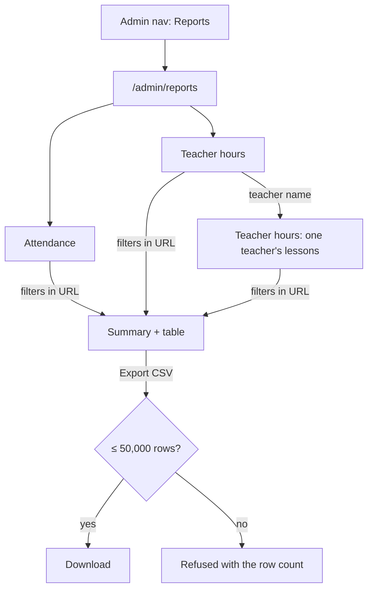

# Reports (Phase 6)

Spec for the Phase 6 admin reports: **attendance** and **teacher hours**,
with filters and CSV export. Builds on `docs/design/tokens.md`,
`docs/design/app-layout.md`, `docs/design/absences.md` and
`docs/design/notifications-substitutes.md`. Clickable wireframe:
`docs/design/wireframes/reports.html`.

The definitions behind these screens (what counts, filters, limits, CSV
format, permissions) are owned by the Scheduling Engineer's rules doc
(CARM-71, `docs/architecture/phase6-rules.md`, "rules doc" below), §5–§6.
If they disagree, the rules doc wins on behaviour and this spec is updated
to match.

## Owner decisions this spec follows

2026-10-16 (CARM-69):

1. **No parent accounts, no parent logins.** The P6 nav item _Parents_
   (`app-layout.md` §4.3) is dropped.
2. **No multi-school UI.** A user belongs to exactly one school; every
   screen and every export is scoped to the signed-in admin's school.

2026-10-17 (CARM-70 review):

3. **Payments are out of scope.** Prices, charges, balances, payments,
   refunds, the student payments page and the money reports (revenue,
   outstanding) are removed from this phase. They come back later as their
   own, properly specified feature. Nothing in this spec stores or shows
   money, and the _Payments_ nav item is removed for every role.

Earlier decisions still apply: one role per user, later-phase nav items are
hidden until they ship, **no attendance tracking** (`lessons.md` decision 1
— see §4.1 for what the attendance report is built from), TeacherNotes
never reach students, every query is scoped by `schoolId`, all UI strings
go through next-intl.

## 1. Goal

- An admin answers two recurring questions without counting by hand:
  _"Which students keep missing lessons?"_ and _"How many hours did each
  teacher teach this month?"_ (for payroll, substitutes included).
- The numbers can be taken to a spreadsheet in one click (CSV).
- Every figure says what it is based on, so nobody mistakes the
  attendance report for a class register.

## 2. Roles and access

| Area            | Admin                             | Teacher                                | Student |
| --------------- | --------------------------------- | -------------------------------------- | ------- |
| Reports and CSV | Both reports (`/admin/reports/*`) | **Nothing** (not even their own hours) | Nothing |

**Server-side rules** the UI only mirrors (rules doc §6; QA covers them in
CARM-74):

- Report loaders live in `src/server/reports/admin.ts`, behind
  `requireRole("ADMIN")` and `getSchoolScopedDb()`. The page and the CSV
  call the same loader.
- A teacher or student opening `/admin/reports*` gets the **403** page
  (`errors.forbidden.*`); the CSV route answers 403 (401 when signed out).
  Another school's ids in the filters give **404**.

**Navigation** (`app-layout.md` §4.3): admin item **Reports**
(`chart-column`) in its own _Reports_ section. No _Payments_ or _Parents_
item for any role. Teachers and students: no change.

## 3. Flow



## 4. Reports (`/admin/reports`)

### 4.0 Index and shared layout

`/admin/reports`: h1 "Reports" and two cards (title, one-line description,
_Open report_): **Attendance** and **Teacher hours**. Each report is its
own page, so its filters live in the URL and can be bookmarked.

```
┌ ‹ Reports                                                                  ┐
│ Teacher hours                                              [Export CSV ▾]  │
│ Hours each teacher taught. Substitute hours count for the substitute.     │
│ Period [Term: Autumn 2026 ▾]  or [1 Sep – 20 Dec 2026]                     │
│ Teacher [Any ▾]   Group [Any ▾]                          [Reset filters]  │
│ ⓘ The period goes past today, so it shows lessons until today.            │
├────────────────────────────────────────────────────────────────────────────┤
│ ┌ Total hours ┐ ┌ Lessons ┐ ┌ Substitute hours ┐                          │
│ │ 412 h 30 min│ │ 275     │ │ 18 h             │                          │
│ └─────────────┘ └─────────┘ └──────────────────┘                          │
│ table …                                                                    │
│ Figures reflect corrections made later, e.g. a recorded substitute.       │
│ Data as of 16 Oct 2026, 14:05.                                             │
└────────────────────────────────────────────────────────────────────────────┘
```

- **Period**: `Select` with the school's terms **plus** _Custom dates…_,
  which reveals a date-range picker. Default: current term. Dates are
  calendar days in the school timezone, inclusive.
  - More than **366 days** (`RANGE_TOO_LONG`): error under the picker
    "Choose a period of at most 366 days." The previous result stays.
  - From after To (`INVALID_RANGE`): "The start date must be on or before
    the end date."
  - A period reaching past today: `info` line "The period goes past today,
    so it shows lessons until today." Both reports count **ended lessons
    only**.
- Other filters per report below. `Combobox`es include archived teachers,
  groups and students, with a muted "Archived" tag.
- Filters apply immediately (debounced) and are kept in the URL. _Reset
  filters_ shows when anything differs from the defaults.
- **Summary cards** (3–4) above one table. Tables follow `app-layout.md`
  §5 (sticky header, `aria-sort`, a real link in the first cell). 50 rows
  per page; **totals cover all rows**, not just the page.
- **Footnotes** (muted, always shown): "Figures reflect corrections made
  later, e.g. a deleted absence or a recorded substitute." and "Data as of
  {dateTime}." Reports read the data as it is now.
- No charts in v1: the numbers are the product.

### 4.1 Attendance (`/admin/reports/attendance`)

**What it's built from.** Teachers don't take a register (owner decision
2026-10-14), so the app doesn't know who actually sat in the room. What it
does know:

- which lessons each student was **expected** at: the lessons of their
  groups, while they were a member, that weren't cancelled by the school;
- which of those lessons the student **cancelled** themselves (the
  _Can't attend?_ button, or the office did it for them), and whether that
  was in time for a makeup credit;
- which **makeup lessons** they attended with those credits (a replacement
  seat in another group, or a rescheduled 1-on-1).

So "attended" means **expected and not cancelled by the student**. A
student who simply doesn't show up without cancelling still counts as
attended. The page says this in its caption, so nobody reads it as a
register: "Based on reported absences. Attendance is not taken in class."

What an admin uses it for: spotting students who cancel a lot (and who may
be about to drop out), seeing how many cancellations came too late for a
credit, and how many makeups were taken.

Filters: Period · Group · Teacher (the lesson's effective teacher, i.e. the
substitute when there is one) · Student.

One row per student and group, sorted by group, then student:

| Column           | Content (ended lessons in the period)                                          |
| ---------------- | ------------------------------------------------------------------------------ |
| Student          | Link to the student page                                                       |
| Group            | Type icon + name, level                                                        |
| Expected         | Lessons the student was expected at                                            |
| Absent           | Lessons they cancelled, with "{withCredit} with credit · {late} late" under it |
| Attended         | Expected − absent                                                              |
| Attendance       | Attended ÷ expected, one decimal % ("—" when expected = 0)                     |
| Makeups attended | Replacements or rescheduled 1-on-1s attended with this group's credits         |

Summary cards: _Expected_ · _Attended_ (with the overall %) · _Absent_
("{withCredit} with credit · {late} late") · _Makeups attended_. Sorting
by Attendance ascending lists the students who miss most at the top.

### 4.2 Teacher hours (`/admin/reports/teacher-hours`)

For payroll. Uses Phase 5's `teachingMinutes` (ended, non-cancelled
lessons, counted for the **effective** teacher): a lesson covered by a
substitute counts for the substitute, **not** the regular teacher.

Filters: Period · Teacher · Group.

| Column            | Content                                                                  |
| ----------------- | ------------------------------------------------------------------------ |
| Teacher           | Link to the per-teacher page; "Archived" tag if archived (still listed)  |
| Lessons           | Lessons taught                                                           |
| Regular           | Hours of their own lessons                                               |
| As substitute     | Hours covering for others (cyan `user-round-cog` + text)                 |
| Total             | Regular + as substitute                                                  |
| Covered by others | Muted: hours of their lessons someone else taught — **not** in the total |

Only teachers who taught in the period are listed. Hours are shown as
"12 h 30 min" (`reports.duration`); the CSV has minutes and decimal hours.
Summary cards: _Total hours_ · _Lessons_ · _Substitute hours_. Footnote:
"Only lessons that have ended count. Cancelled lessons don't. Covered by
others isn't in the total."

**Per-teacher page** (`/admin/reports/teacher-hours/[teacherId]?…same
filters`): back link, h1 the teacher's name, the same summary, then one row
per lesson: Date · Time · Group · Level · Room · Role (_Regular_ /
_Substitute for {teacher}_) · Duration.

**Export CSV** is a `DropdownMenu`: _Summary_ (`teacher-hours`) · _Lesson
details_ (`teacher-hours-lessons`: one row per lesson with date, start,
end, minutes, teacher, role, regular teacher, group, level, room). On the
per-teacher page the button exports that teacher's lesson details.

### 4.3 CSV export (rules doc §5.6)

- **Export CSV** (`outline`, `download` icon) in the report header: a
  plain link to `GET /api/admin/reports/<report>.csv?<same query as the
page>` (`attendance`, `teacher-hours`, `teacher-hours-lessons`). It works
  without JavaScript; with JavaScript the button shows "Preparing…", then
  the toast "Export downloaded."
- Exports **all rows that match the filters**, in a fixed column order,
  with no totals row. An empty result is a header-only file.
- **Too many rows** (`TOO_MANY_ROWS`, more than 50,000): nothing is
  downloaded and the page shows a `warning` `Alert` "This export would
  have {count} rows. The limit is 50,000. Choose a shorter period or add a
  filter." The file is never cut short.
- File name: `<report>_<from>_<to>.csv`.
- Format (the server owns it): UTF-8 with BOM, comma separator, a header
  row in the user's language (`reports.csv.<report>.<column>`), dates
  `YYYY-MM-DD`, times `HH:mm`, minutes as integers, hours as decimals with
  a dot (`12.50`), percentages `87.5`, codes for enums (`SUBSTITUTE`).
  Never "12 h 30 min" in the file, so spreadsheets can sum it. Text cells
  starting with `= + - @` get a leading `'`.
- Errors: `Alert` "Couldn't create the export. Try again." Every export is
  audited (`report.exported`); viewing a page isn't.

### 4.4 States (both reports)

| State             | Shows                                                                                  |
| ----------------- | -------------------------------------------------------------------------------------- |
| Loading           | Summary card skeletons + table skeleton; filters stay usable                           |
| No data in period | `chart-column` icon · "No data for this period." · "Try another term or dates."        |
| No term yet       | "Add a term first. Reports are based on terms and lessons." + link to Terms & holidays |
| Range too long    | Inline error under the date picker; the previous result stays                          |
| Too many rows     | `warning` `Alert` with the count (§4.3)                                                |
| Error             | `Alert` "Couldn't load the report." + _Try again_                                      |
| Forbidden         | Teacher/student → full-page 403 (`errors.forbidden.*`); CSV route → 403                |

## 5. Copy (i18n keys, English source)

Message file: `messages/en-GB/reports.json` (`reports.*`, including
`reports.csv.<report>.<column>`); `nav.reports` in `nav.json`.

| Key                                   | Copy                                                                                                              |
| ------------------------------------- | ----------------------------------------------------------------------------------------------------------------- |
| `nav.reports`                         | Reports                                                                                                           |
| `reports.title`                       | Reports                                                                                                           |
| `reports.open`                        | Open report                                                                                                       |
| `reports.back`                        | Reports                                                                                                           |
| `reports.filter.period`               | Period                                                                                                            |
| `reports.filter.term`                 | Term: {term}                                                                                                      |
| `reports.filter.custom`               | Custom dates…                                                                                                     |
| `reports.filter.teacher`              | Teacher                                                                                                           |
| `reports.filter.group`                | Group                                                                                                             |
| `reports.filter.student`              | Student                                                                                                           |
| `reports.filter.any`                  | Any                                                                                                               |
| `reports.filter.reset`                | Reset filters                                                                                                     |
| `reports.error.rangeTooLong`          | Choose a period of at most {days} days.                                                                           |
| `reports.error.invalidRange`          | The start date must be on or before the end date.                                                                 |
| `reports.error.load`                  | Couldn't load the report.                                                                                         |
| `reports.untilToday`                  | The period goes past today, so it shows lessons until today.                                                      |
| `reports.laterCorrections`            | Figures reflect corrections made later, e.g. a deleted absence or a recorded substitute.                          |
| `reports.asOf`                        | Data as of {dateTime}.                                                                                            |
| `reports.archived`                    | Archived                                                                                                          |
| `reports.duration`                    | {hours, plural, =0 {} other {# h}} {minutes, plural, =0 {} other {# min}}                                         |
| `reports.export`                      | Export CSV                                                                                                        |
| `reports.export.preparing`            | Preparing…                                                                                                        |
| `reports.export.done`                 | Export downloaded.                                                                                                |
| `reports.export.tooManyRows`          | This export would have {count, number} rows. The limit is {max, number}. Choose a shorter period or add a filter. |
| `reports.export.error`                | Couldn't create the export. Try again.                                                                            |
| `reports.empty.title`                 | No data for this period.                                                                                          |
| `reports.empty.description`           | Try another term or dates.                                                                                        |
| `reports.empty.noTerm`                | Add a term first. Reports are based on terms and lessons.                                                         |
| `reports.attendance.title`            | Attendance                                                                                                        |
| `reports.attendance.description`      | Expected and attended lessons per student and group.                                                              |
| `reports.attendance.caption`          | Based on reported absences. Attendance is not taken in class.                                                     |
| `reports.attendance.col.student`      | Student                                                                                                           |
| `reports.attendance.col.group`        | Group                                                                                                             |
| `reports.attendance.col.expected`     | Expected                                                                                                          |
| `reports.attendance.col.absent`       | Absent                                                                                                            |
| `reports.attendance.col.absentDetail` | {withCredit} with credit · {late} late                                                                            |
| `reports.attendance.col.attended`     | Attended                                                                                                          |
| `reports.attendance.col.rate`         | Attendance                                                                                                        |
| `reports.attendance.col.makeups`      | Makeups attended                                                                                                  |
| `reports.attendance.rate`             | {rate} %                                                                                                          |
| `reports.hours.title`                 | Teacher hours                                                                                                     |
| `reports.hours.description`           | Hours each teacher taught. Substitute hours count for the substitute.                                             |
| `reports.hours.col.teacher`           | Teacher                                                                                                           |
| `reports.hours.col.lessons`           | Lessons                                                                                                           |
| `reports.hours.col.regular`           | Regular                                                                                                           |
| `reports.hours.col.substitute`        | As substitute                                                                                                     |
| `reports.hours.col.total`             | Total                                                                                                             |
| `reports.hours.col.coveredByOthers`   | Covered by others                                                                                                 |
| `reports.hours.col.date`              | Date                                                                                                              |
| `reports.hours.col.time`              | Time                                                                                                              |
| `reports.hours.col.level`             | Level                                                                                                             |
| `reports.hours.col.room`              | Room                                                                                                              |
| `reports.hours.col.role`              | Role                                                                                                              |
| `reports.hours.col.duration`          | Duration                                                                                                          |
| `reports.hours.role.REGULAR`          | Regular                                                                                                           |
| `reports.hours.role.SUBSTITUTE`       | Substitute for {teacher}                                                                                          |
| `reports.hours.stat.total`            | Total hours                                                                                                       |
| `reports.hours.stat.lessons`          | Lessons                                                                                                           |
| `reports.hours.stat.substitute`       | Substitute hours                                                                                                  |
| `reports.hours.footnote`              | Only lessons that have ended count. Cancelled lessons don't. Covered by others isn't in the total.                |
| `reports.hours.export.summary`        | Summary                                                                                                           |
| `reports.hours.export.lessons`        | Lesson details                                                                                                    |

CSV header keys live under `reports.csv.<report>.<column>`, one key per
column in the rules doc's order (e.g. `reports.csv.teacher-hours.hours`
"Hours").

## 6. Accessibility

- Summary cards are `<dl>`; table totals are in `<tfoot>`; every number has
  a column header.
- The attendance caption and every footnote are visible text, not
  tooltips.
- The range error is linked to the date picker with `aria-describedby`;
  the too-many-rows alert and export progress use `role="status"`.
- Export is a real link with visible text.
- The cyan substitute marker always has the text "As substitute" /
  "Substitute for {teacher}" next to it.
- At 320 px / 400 % zoom, report tables scroll horizontally inside their
  card with the first column sticky (admin screens are desktop-first).

## 7. Edge cases

- **Lesson covered by a substitute:** counts for the substitute in
  _As substitute_, and for the regular teacher only in _Covered by
  others_. Each lesson is counted exactly once in the totals.
- **A substitute recorded after the fact** (up to 7 days, Phase 5) or an
  absence deleted by an admin changes past figures; the footnote says so.
- **Student joined or left mid-term:** only lessons while they were a
  member are expected.
- **Lessons cancelled by the school** (holidays, timetable changes) aren't
  expected and aren't counted as hours.
- **Archived teacher or student:** still listed for periods they had
  lessons in, with an "Archived" tag.
- **Time zone:** periods are calendar days in the school timezone.
- **Very large export:** refused above 50,000 rows with the count instead
  of being cut short.
- **Teacher opens a shared report link:** 403 page, no data in the
  response.

## 8. Open questions (owner)

1. **Attendance report.** Keep it as described in §4.1 (based on reported
   absences, since there is no register)? _Default: keep it._ The
   alternative is to drop it from Phase 6 and ship only teacher hours.
2. **Teachers see their own hours?** _Default: no._

## 9. Notes for the Developer (CARM-73)

- Routes: `/admin/reports`, `/admin/reports/attendance`,
  `/admin/reports/teacher-hours`,
  `/admin/reports/teacher-hours/[teacherId]` and the CSV route
  `/api/admin/reports/[report]` (rules doc §5.6).
- Shared `ReportShell`: period / filters in the URL, range errors, summary
  cards, table, export button with the `TOO_MANY_ROWS` alert.
- Nav: enable `nav.reports` for admins; delete the `nav.payments` and
  `nav.parents` entries.
- Wireframe: `docs/design/wireframes/reports.html`.
