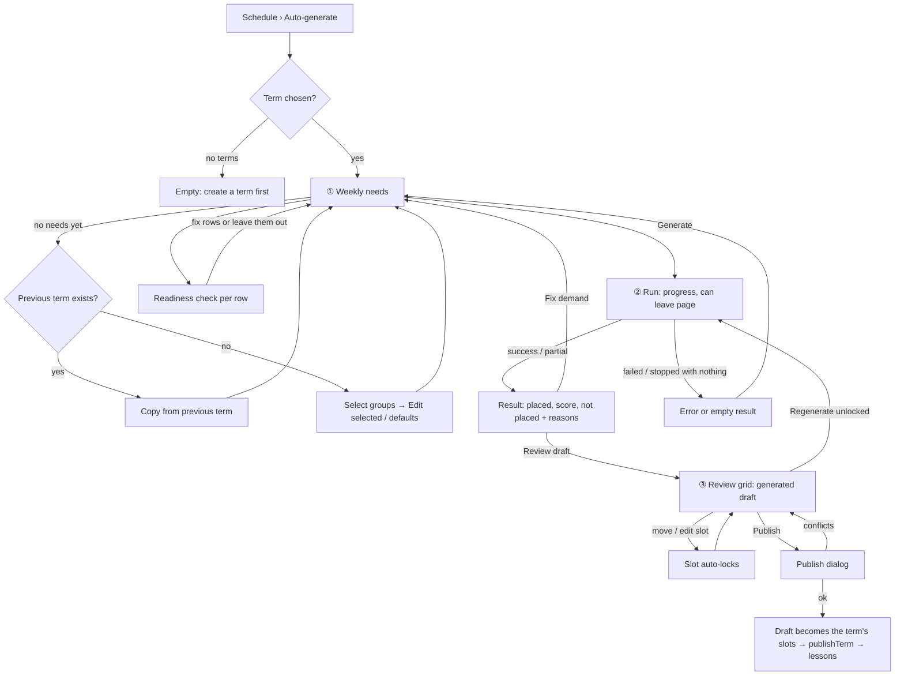

# Timetable generator: admin flow (Phase 4)

Spec for the admin screens that generate a term's weekly timetable
automatically: **enter demand** (what each group needs per week),
**generate** a draft, **review and edit** it, and **publish** it through the
existing Phase 1 publish flow. Builds on `docs/design/tokens.md`,
`docs/design/app-layout.md`, `docs/design/timetable.md` (editor grid, slot
sheet, conflicts, publish dialog) and `docs/design/admin-data.md` (groups,
rooms, teacher availability). Clickable wireframe:
`docs/design/wireframes/timetable-generator.html`.

The generator's rules (demand schema, hard constraints, soft preferences and
weights, algorithm, seed, time budget, unplaced reasons, draft storage,
locking, publishing, terms that already have lessons, concurrency) are owned
by the Scheduling Engineer in `docs/architecture/timetable-generator.md`
(CARM-48, written in parallel with this spec). This spec decides how they
look and behave in the UI. Where it had to assume a rule, the assumption is
listed in §12 so the two docs can be reconciled before stage 2 starts. If
the rules doc decides differently, the rules doc wins and this spec is
updated.

## 1. Goal

- An admin with 60 groups fills in a term's weekly needs in about 15
  minutes, most of it by copying last term and adjusting a few rows, not by
  typing 60 forms.
- Generating is one button. The admin sees that something is happening,
  roughly how long it takes, and can leave the page while it runs.
- The result says plainly what was placed, how good it is, and what could
  not be placed **and why**, with a link to the fix.
- The draft is impossible to mistake for the live timetable. The admin
  adjusts it with the same grid and slot sheet they already know, locks
  what they like and regenerates the rest.
- Publishing is the same deliberate step as in Phase 1, and says exactly
  what happens to lessons that already exist.

## 2. Roles

| Role    | Access                                                                                                  |
| ------- | ------------------------------------------------------------------------------------------------------- |
| Admin   | Everything in this spec: demand, runs, drafts, publish. Desktop-first (≥ 1024 px).                      |
| Teacher | None. No nav item; `/admin/timetable/generate` returns the 403 page. Never sees a draft or demand data. |
| Student | None, same as teacher.                                                                                  |

Enforced server-side: every generator action and query (`requireRole("ADMIN")`
plus the school-scoped client) covers demand reads and writes, starting and
stopping runs, reading run progress and results, editing, locking,
regenerating and publishing drafts. A draft is never returned by the
teacher or student timetable queries. The Phase 4 e2e permission suite
(stage 4) covers every route and action above for teacher and student, and
for an admin of another school.

Below 1024 px the page shows `layout.desktopRecommended` and a read-only
summary (demand counts, last run result, draft status). Editing and
generating are desktop only.

## 3. Concepts shown in the UI

| Concept (rules doc)        | UI word (key)                                 | Meaning                                                                                                                          |
| -------------------------- | --------------------------------------------- | -------------------------------------------------------------------------------------------------------------------------------- |
| Per-group, per-term demand | **Weekly needs** (`generator.demand.title`)   | "B1 Evening: 2 lessons a week, 90 min, Tomas Horvat, a physical room for 10, weekday evenings."                                  |
| Pinned time (demand)       | **Fixed time** (`generator.demand.fixedTime`) | One lesson of the group must be at this weekday and time. A hard input. Icon `pin`.                                              |
| Generator run              | **Run** (`generator.run`)                     | One execution with a seed and a time budget. Has a status, progress and a result.                                                |
| Draft                      | **Generated draft** (`generator.draft`)       | The run's proposed slots for the term. Stored apart from live `TimetableSlot`s; nobody but admins sees it.                       |
| Draft slot                 | **Slot** (as in the editor)                   | A proposed weekly slot in the draft. Same block as in the editor.                                                                |
| Locked draft slot          | **Locked** (`generator.lock.locked`)          | Kept exactly where it is when the admin regenerates. Icon `lock`.                                                                |
| Unplaced demand            | **Not placed** (`generator.unplaced.title`)   | A lesson of a group the generator couldn't fit, with a reason code and suggested fixes.                                          |
| Soft preference            | **Preference** (`generator.preference`)       | Something the generator tries to respect but may break (gaps, spread, daily maximum…). Never blocks saving or publishing.        |
| Score                      | **Score** (`generator.score`)                 | The engine's penalty total for broken preferences. **Lower is better.** Used to compare runs; the breakdown is what admins read. |
| Draft term (Phase 1)       | **Draft** badge                               | A term that is not published yet. Unchanged. Not the same thing as a generated draft — see §3.1.                                 |

### 3.1 "Draft" vs. "Generated draft"

The editor already uses a **Draft** badge for an unpublished term. To keep
the two apart:

- The generator's output is always called **Generated draft**, never just
  "Draft", and always carries the `generated-draft` token (§3.3): a
  `wand-sparkles` icon, an indigo header band and a dashed indigo frame
  around the grid.
- The term badge stays **Draft** / **Published** as in `timetable.md`.
- Copy always says what a generated draft is not: "Not live. Teachers and
  students don't see it."

### 3.2 Three kinds of issue

Generator screens show three kinds of issue. The first two come from the
scheduling module (`timetable.md` §3.1), the third is new.

| Kind       | Badge label (key)                                | Look                             | Blocks publishing?                            |
| ---------- | ------------------------------------------------ | -------------------------------- | --------------------------------------------- |
| Conflict   | **Conflict** (`timetable.severity.blocking`)     | `danger`, icon `octagon-x`       | Yes                                           |
| Warning    | **Warning** (`timetable.severity.warning`)       | `warning`, icon `triangle-alert` | Only until each one is acknowledged, as in P1 |
| Preference | **Preference** (`generator.severity.preference`) | `info`, icon `lightbulb`         | Never                                         |

The generator itself only places slots with no conflicts and no warnings
(§12, A2). Conflicts and warnings appear in a generated draft only when an
admin edits a slot by hand, or when data changed after the run (§8, stale
draft). Preferences are the generator's own "could be better" notes.

### 3.3 New domain tokens (add to `tokens.md` §1.2, phase P4)

| Token             | Surface             | Border / band                                                                                     | Text                 | Icon            | Use                                                                      |
| ----------------- | ------------------- | ------------------------------------------------------------------------------------------------- | -------------------- | --------------- | ------------------------------------------------------------------------ |
| `generated-draft` | `#eef2ff` indigo-50 | header band `#3730a3` indigo-800 (white text 10.2:1); grid frame 2 px dashed `#4f46e5` indigo-600 | `#312e81` indigo-900 | `wand-sparkles` | Banner and frame of anything that shows a generated draft                |
| `diff-new`        | —                   | 2 px solid `#15803d` green-700 outline                                                            | —                    | `plus`          | Compare mode: slot that's new in the draft (with text badge "New")       |
| `diff-moved`      | —                   | 2 px solid `#1d4ed8` blue-700 outline                                                             | —                    | `move`          | Compare mode: slot whose day, time, teacher or room changed ("Changed")  |
| `diff-removed`    | `#f8fafc` slate-50  | 1 px dashed `#94a3b8` slate-400                                                                   | `#475569` slate-600  | `minus`         | Compare mode: live slot the draft no longer has ("Removed"), ghost block |

Text pairs are ≥ 7:1; outlines are ≥ 3:1 against both white and the lesson
surfaces (WCAG 1.4.11). Lesson blocks keep their type tokens
(`lesson-group`, `lesson-individual`); the diff state is an outline plus a
text badge, never color alone.

## 4. Information architecture

- Nav: **Schedule › Auto-generate** (`nav.autoGenerate`, `wand-sparkles`,
  already reserved for P4 in `app-layout.md` §4.3), admin only.
- Route: `/admin/timetable/generate?term={id}&step={demand|run|review}`.
  The term and step are in the URL so the back button and links work.
- Entry points from the editor (`timetable.md` §5): overflow menu item
  _Generate timetable…_ (`generator.entry.fromEditor`), and on the empty
  term overlay a second action _Generate automatically_ next to _New slot_.
- Dashboard setup checklist step 7 stays "a term's timetable is published",
  whether it was built by hand or generated.

### 4.1 Page frame

```
┌ H1 Generate timetable ─────────────────────────────────────────────────────────┐
│ [Term: Spring 2027 ▾] (Draft)                                                    │
│ ① Weekly needs ✓ 58 of 60 ── ② Generate ✓ Run 3 ── ③ Review & publish • draft   │ step nav
├──────────────────────────────────────────────────────────────────────────────────┤
│ step content                                                                     │
└──────────────────────────────────────────────────────────────────────────────────┘
```

- **Term `Select`**: like the editor (newest first, current preselected,
  Draft / Published badge).
- **Step nav**: three links styled as a stepper (`nav` with
  `aria-label="Steps"`, current step `aria-current="step"`). Each step shows
  its status in text, not only an icon. Steps are never locked: the admin
  can open _Review_ before generating (it shows an empty state) and go back
  to _Weekly needs_ at any time.

| Step               | Status text examples (keys `generator.steps.*`)                                        |
| ------------------ | -------------------------------------------------------------------------------------- |
| ① Weekly needs     | "Not started" · "58 of 60 groups ready" · "All 60 groups ready"                        |
| ② Generate         | "Not run yet" · "Running… 40 %" · "Run 3 · 238 of 244 lessons placed" · "Run failed"   |
| ③ Review & publish | "No draft" · "Generated draft · 4 changes by hand" · "Out of date" · "Published 2 Feb" |

## 5. User flows

### 5.1 First generation for a new term



### 5.2 Term that already has a timetable

```mermaid
flowchart TD
  S[Generate for a term with slots] --> K{Term state}
  K -- "draft term with manual slots" --> M[Choose: keep my slots and fill the rest / start from scratch]
  K -- "published, has lessons" --> F[Choose 'Apply from' date ≥ tomorrow<br/>(or refused, per rules doc)]
  M --> G[Run]
  F --> G
  G --> V[Review with Compare to current timetable]
  V --> P[Publish: shows slots replaced, lessons removed / cancelled from the date]
```

## 6. ① Weekly needs (`step=demand`)

### 6.1 Layout

```
┌ Weekly needs for Spring 2027 ───────────────────────────────────────────────────┐
│ [Search groups]  Type [All ▾] Level [All ▾] Teacher [Any ▾] Status [All ▾]       │
│ [Copy from another term…] [Defaults…]                     58 of 60 ready  [Generate ▸] │
├───┬────────────────────┬────────┬────────┬──────────────┬────────────┬──────────────┬───────────┬───┤
│ ☐ │ Group              │ Lessons│ Length │ Teacher      │ Room       │ Days & times │ Status    │ ⋯ │
├───┼────────────────────┼────────┼────────┼──────────────┼────────────┼──────────────┼───────────┼───┤
│ ☐ │ 👥 B1 Evening  B1 8/10 │ 2 ▾ │ 90 ▾  │ Tomas Horvat ▾│ Physical ≥10│ Mon–Fri 16–21│ ✓ Ready   │ ⋯ │
│ ☐ │ 👤 Jan Novak 1-on-1 A2 │ 1 ▾ │ 45 ▾  │ Any A2 teacher│ Online     │ 📌 Tue 18:00 │ ✓ Ready   │ ⋯ │
│ ☐ │ 👥 C1 Business C1 14/14│ 2 ▾ │ 90 ▾  │ Peter Varga ▾ │ Physical ≥14│ Any         │ ⛔ No room │ ⋯ │
│ ☐ │ 👥 A1 Kids  A1 6/12    │ — ▾ │ — ▾   │ — ▾          │ —          │ —            │ Incomplete│ ⋯ │
│ ☐ │ 👥 B2 Old group   B2 0/10│   Left out of generation                          │ Left out  │ ⋯ │
├───┴────────────────────┴────────┴────────┴──────────────┴────────────┴──────────────┴───────────┴───┤
│ 60 groups · 116 lessons a week · 168 teaching hours · 20 teachers                            │ footer
└───────────────────────────────────────────────────────────────────────────────────────────────┘
```

One row per **active group** of the school (archived groups never appear;
1-on-1s included). It's a data table (`app-layout.md` §5) with inline
editing for the three fields admins change most: **Lessons**, **Length** and
**Teacher**. Everything else is edited in the row sheet (§6.3). Sorting:
Group (default), Status, Teacher. No pagination: 60–150 rows fit in one
scrollable table with a sticky header; filters narrow it.

### 6.2 Columns

| Column       | Shows                                                                                                            | Inline control                                                                                         |
| ------------ | ---------------------------------------------------------------------------------------------------------------- | ------------------------------------------------------------------------------------------------------ |
| ☐            | Row selection for bulk edit                                                                                      | `Checkbox`, header checkbox selects the filtered rows                                                  |
| Group        | Type icon + name (link to group detail, new tab), level badge, members "8 / 10"                                  | —                                                                                                      |
| Lessons      | Lessons per week                                                                                                 | `Select` 1–7 (`—` = not set)                                                                           |
| Length       | Minutes per lesson                                                                                               | `Select` 30, 45, 60, 75, 90, 120, 150, 180 (`—` = not set)                                             |
| Teacher      | Fixed teacher name, or "Any {level} teacher" / "One of 3 teachers"                                               | `Combobox`: _Any suitable teacher_ first, then teachers who teach this level, then _Show all teachers_ |
| Room         | "Physical ≥ 10", "Online", "Physical or online ≥ 6", or a specific room name                                     | — (row sheet)                                                                                          |
| Days & times | "Any" (school week and hours), "Mon–Fri 16:00–21:00", fixed times with `pin` icon ("📌 Tue 18:00")               | — (row sheet)                                                                                          |
| Status       | Readiness badge (§6.5)                                                                                           | —                                                                                                      |
| ⋯            | _Edit…_ (row sheet), _Copy to selected rows_, _Leave out of generation_ / _Include in generation_, _Clear needs_ | `DropdownMenu`                                                                                         |

Inline edits save on change (no Save button), with a quiet "Saved" tick in
the cell for 2 s and `aria-live` off (the cell value is the confirmation).
A failed save reverts the cell, outlines it in `destructive` and shows a
toast-free inline message under the table row: `common.error.network`.

The row is the keyboard unit: `Tab` moves through the inline controls in
reading order; `Enter` on the group name opens the row sheet.

### 6.3 Row sheet (edit one group's needs)

Right `Sheet`, 480 px, title "{group} — weekly needs"
(`generator.demand.sheetTitle`). Shows group facts at the top: type, level,
members / capacity, course, and "Last term: 2 × 90 min, Tomas Horvat, Mon &
Wed 17:00" when a previous term exists (read-only, for reference).

| Field                 | Control                                                                                                     | Rules / defaults                                                                                                                                                                                                                                   |
| --------------------- | ----------------------------------------------------------------------------------------------------------- | -------------------------------------------------------------------------------------------------------------------------------------------------------------------------------------------------------------------------------------------------- |
| Include in generation | `Switch`                                                                                                    | Default on. Off = "Left out": the generator ignores this group; if the term already has slots for it, they stay as they are (§9).                                                                                                                  |
| Lessons per week      | `Select` 1–7                                                                                                | required.                                                                                                                                                                                                                                          |
| Length                | `Select` (as in the table) + "Other…" `Input` (15-min steps, 15–240)                                        | required. All lessons of the group are the same length in v1 (Q2).                                                                                                                                                                                 |
| Teacher               | `RadioGroup`: _This teacher_ (`Combobox`) / _Any suitable teacher_ / _One of these teachers_ (multi-select) | required. "Suitable" = teaches the group's level (rules doc, A4). A teacher not marked for this level can still be picked under _This teacher_, with the hint "Not marked as teaching B1." The same teacher teaches every lesson of the week (A5). |
| Room                  | `RadioGroup`: _Physical room_ / _Online room_ / _Either_                                                    | required; default from last term, else _Physical room_ (1-on-1: _Either_).                                                                                                                                                                         |
| Seats needed          | `Input type=number` with hint "8 members now · group capacity 10"                                           | Physical / Either only. Default = **current members** (same basis as the module's `ROOM_CAPACITY_EXCEEDED`). Checkbox _Plan for a full group ({capacity})_ sets it to the group capacity.                                                          |
| Specific room         | `Combobox` "Any room that fits" (default) or a room                                                         | optional, hard: the group may only use this room. Archived rooms hidden.                                                                                                                                                                           |
| Preferred rooms       | multi-select `Combobox`                                                                                     | optional, soft (a preference). Hidden when a specific room is set.                                                                                                                                                                                 |
| Days                  | day `ToggleGroup` (school days; non-school days shown only if already set)                                  | Default: every school day. Hard.                                                                                                                                                                                                                   |
| Times                 | _Between_ start `Select` – end `Select` (15-min steps)                                                      | Default: school hours. Hard. Validation: the window must fit one lesson ("A 90-min lesson doesn't fit between 17:00 and 18:00.").                                                                                                                  |
| Fixed times           | list of rows "Weekday · Start" + _Add fixed time_ (max = lessons per week)                                  | optional, hard. Each fixes one of the week's lessons. Validation: not more than lessons per week; inside days/times; not two on the same day at overlapping times. The end is start + length, shown as text ("Tue 18:00–18:45").                   |

Footer: _Cancel_ · **Save** (primary). A save that would make the row
invalid keeps the sheet open with field errors (form rules in
`app-layout.md` §5). After saving, the readiness check (§6.5) runs for the
row and its badge updates.

### 6.4 Bulk entry

Schools have dozens of groups, so every field can be set for many rows at
once.

- **Select rows** (checkboxes, `Shift`-click for ranges, header checkbox for
  all filtered rows). A selection bar replaces the filter bar's right side:
  "{count} selected" · **Edit selected…** · _Leave out_ · _Include_ ·
  _Clear selection_.
- **Edit selected…** opens the row sheet in bulk mode: title "Edit {count}
  groups", every field starts as _Keep as is_ (a `Select` option or an
  unchecked "Change" checkbox per field), and only fields the admin changes
  are written. Fixed times and specific room are not offered in bulk (they
  are per group). Seats needed offers only _Current members_ / _Full group_
  (no number). Result toast "Updated {count} groups." with **Undo** (restores
  the previous values of those rows).
- **Copy to selected rows** (row menu): copies lessons, length, room and
  days & times from this row to the selected ones (not teacher, not fixed
  times). Same toast with Undo.
- **Defaults…** (toolbar): term defaults applied to new or empty rows —
  lessons per week, length, room kind, days & times. _Apply to {count} rows
  that aren't set yet_ fills only the missing values, never overwrites.
- **Copy from another term…** (toolbar, also the main action of the empty
  state): §6.6.

No spreadsheet paste or CSV import in v1 (Q3).

### 6.5 Readiness check

Every row has a status badge, computed on load and after every change
(server-side `checkDemand`, A7). It answers "will the generator be able to
use this row?" and catches impossible input before a run, so the run result
isn't the first place the admin hears about it.

| Status     | Badge (key)                                          | Look                        | Meaning                                                                                                  |
| ---------- | ---------------------------------------------------- | --------------------------- | -------------------------------------------------------------------------------------------------------- |
| Ready      | "Ready" (`generator.demand.status.ready`)            | `success`, `check`          | Complete and nothing obviously impossible.                                                               |
| Incomplete | "Incomplete" (`.incomplete`)                         | muted, `circle-dashed`      | Lessons or length not set. The generator skips the row.                                                  |
| Problem    | short reason, e.g. "No room big enough" (`.problem`) | `danger`, `octagon-x`       | Complete, but can't be placed as entered. Tooltip and the row sheet show the full message and fix links. |
| Check      | short reason, e.g. "Teacher nearly full" (`.check`)  | `warning`, `triangle-alert` | Placeable on paper, but tight. The run may not place all of it.                                          |
| Left out   | "Left out" (`.excluded`)                             | muted, `circle-slash`       | Include switched off.                                                                                    |

Problems and checks use the same reason codes as unplaced demand (§7.4),
so the admin learns one vocabulary. Examples:

- Problem `NO_ROOM_BIG_ENOUGH`: "No physical room has 14 seats. The biggest
  is Room 3 (12)." Fixes: _Rooms_, _Allow online_, _Seats needed_.
- Problem `FIXED_TIMES_CLASH`: "Tue 18:00 clashes with the fixed time of A2
  Kids (Tomas Horvat)."
- Problem `WINDOW_TOO_NARROW`: "Only 2 school days are allowed for 3 lessons."
- Check `TEACHER_OVERBOOKED`: "Tomas Horvat is asked for 22 h a week but is
  available for 20 h."

Problems don't block generating; the generator reports those rows as not
placed. The **Generate** button's summary says what will happen (§6.7).

**Teacher load panel** (collapsible card above the table, closed by
default, opened from the footer link "Teacher load"): one row per teacher
with fixed assignments: hours asked · hours available in the term's week ·
a bar (`aria-hidden`, numbers are the accessible source) · status. "Any
suitable teacher" rows are counted separately as "flexible hours: 34 h
across 6 teachers". Sorting by load, highest first.

### 6.6 Copy from another term

`Dialog` `generator.copy.title` "Copy weekly needs from another term":

- **From** term `Select` (default: the previous term).
- **Source** (read-only text, decided by what the source term has):
  - it has saved weekly needs → "Copies the weekly needs saved for {term}."
  - otherwise, it has slots → "Works out weekly needs from {term}'s
    timetable: lessons per week, length, teacher, room and the times the
    group had." (`generator.copy.fromSlots`)
- **Rows that already have needs**: `RadioGroup` _Only fill groups that
  aren't set yet_ (default) / _Replace all_.
- **Times**: `Checkbox` _Keep last term's times as fixed times_ (default
  off). Off copies the days only; on turns last term's times into fixed
  times (useful when the school wants a stable timetable).
- Summary before confirming (`generator.copy.summary`): "{count} groups will
  be filled. {skipped} groups weren't in {term}. {archivedTeacher} use an
  archived teacher and get _Any suitable teacher_. {archivedRoom} lose their
  specific room because it's archived."
- Primary **Copy**; result toast "Copied weekly needs for {count} groups."
  with **Undo**.

Groups that are new this term have no source and stay _Incomplete_; the
status filter _Incomplete_ finds them.

### 6.7 Generate button

Primary button in the toolbar, label **Generate** (`generator.generate`),
or **Generate again** when a run already exists. Next to it a one-line
summary (`generator.generate.summary`): "{ready} groups ready ·
{problems} with problems · {incomplete} incomplete · {excluded} left out".
Clicking opens the run options dialog (§7.1). It is never disabled; with
zero ready rows, the dialog says so (§10).

## 7. ② Generate (`step=run`)

### 7.1 Run options dialog

`Dialog` `generator.options.title` "Generate a timetable for {term}":

| Option                         | Control                                                                                                                                                                                                              | Default                                                      |
| ------------------------------ | -------------------------------------------------------------------------------------------------------------------------------------------------------------------------------------------------------------------- | ------------------------------------------------------------ |
| What happens to existing slots | Shown only when the term has slots or a generated draft (§9). `RadioGroup` with consequences in the label hints.                                                                                                     | per §9                                                       |
| Apply from                     | Published term with lessons only: date picker, never before tomorrow (§9).                                                                                                                                           | next Monday                                                  |
| Time limit                     | `RadioGroup` _Quick ({quick})_ / _Standard ({standard})_ / _Thorough ({thorough})_. Values come from the rules doc (A8).                                                                                             | Standard                                                     |
| Preferences                    | Collapsible _Preferences_: one row per soft preference with a `ToggleGroup` _Off / Low / Normal / High_ (A9). "Reset to school defaults". Changes apply to this run only unless _Save as school defaults_ is ticked. | school defaults                                              |
| Variation                      | Collapsible _Advanced_: seed `Input` (number) with hint "Same weekly needs and the same number give the same timetable." _New random number_ link.                                                                   | a new random number each run, shown so a run can be repeated |

Summary at the bottom: "{ready} groups, {lessons} lessons a week.
{problems} groups have problems and will probably not be placed."
Primary **Start**; secondary _Cancel_.

### 7.2 Running

The run happens on the server. The page shows a progress card; the admin
may leave and come back (the step nav shows "Running… 40 %", and the nav
item gets a small spinner with hidden text "Generating").

```
┌ Generating a timetable for Spring 2027 ─────────────────────────────┐
│ Run 3 · started by Anna Novak at 10:42 · seed 48213                 │
│ ▓▓▓▓▓▓▓▓▓▓▓▓░░░░░░░░░░░░  Improving the timetable                    │
│ 236 of 244 lessons placed · score 1,480 (lower is better)           │
│ 1 min 12 s of up to 2 min                                           │
│ [Stop and keep the best so far]  [Cancel run]                       │
└─────────────────────────────────────────────────────────────────────┘
```

- **Phases** (text, from the engine's progress events, A10):
  _Preparing_ → _Placing lessons_ (progress = lessons placed / total) →
  _Improving the timetable_ (progress = time used / time limit; score
  updates). The bar is a `Progress` with `role="progressbar"`,
  `aria-valuenow`, and `aria-valuetext` "Placing lessons, 180 of 244".
- **Live region**: only phase changes and the end are announced, not every
  tick.
- **Stop and keep the best so far** (enabled once all placeable lessons were
  placed, i.e. in _Improving_): ends the run now and produces the result as
  if the time limit had been reached.
- **Cancel run**: `AlertDialog` "Cancel this run? Nothing is saved, and the
  current generated draft stays as it was." No result is kept.
- **One run per term at a time.** Another admin opening the page sees the
  same progress card with "started by {name}". _Generate_ is replaced by
  "A run is in progress" while it runs.
- Progress is polled every 2 s while the page is visible (no websockets in
  v1), and on focus.
- **Taking long**: if no progress event arrives for 30 s, or the run is
  still going 30 s after its time limit, the card shows warning `Alert`
  `generator.run.slow` "This is taking longer than expected. You can keep
  waiting, or cancel and try the Quick time limit." The run is never
  silently abandoned; the server ends it at its hard limit (A10) and the
  result says "Stopped at the time limit".

### 7.3 Result

When a run ends, the step shows the result. The newest run's result is
also the default view when the admin opens the step later.

```
┌ Run 3 finished · 10:44 · 1 min 58 s · seed 48213 ──────── [Review draft ▸] ┐
│ ┌ Placed ──────────┐ ┌ Not placed ─────┐ ┌ Score ─────────────────────┐   │
│ │ 238 of 244       │ │ 6 lessons       │ │ 1,240  (lower is better)   │   │
│ │ lessons (97 %)   │ │ 4 groups        │ │ 12 % better than run 2     │   │
│ └──────────────────┘ └─────────────────┘ └────────────────────────────┘   │
│ Preferences                                                               │
│  Teacher gaps            9 h in total · 6 teachers       [Show]           │
│  Student gaps            3 groups' students wait > 1 h    [Show]          │
│  Lessons spread over week  2 groups on consecutive days  [Show]           │
│  Teacher daily maximum   met                                              │
│  Preferred rooms         5 groups not in a preferred room [Show]          │
│  Stable times            met                                              │
│ Not placed (6 lessons)                                                    │
│  C1 Business · 2 of 2 · No physical room has 14 seats  [Rooms] [Edit needs]│
│  A2 Kids · 1 of 3 · Ana Kral has no free time left that fits  [Availability] [Edit needs] [Place by hand] │
│  …                                                                        │
└───────────────────────────────────────────────────────────────────────────┘
```

- **Header**: run number, finish time, duration, seed, and the end reason
  in text when it isn't a normal finish: "Stopped by {name}", "Stopped at
  the time limit". Primary **Review draft** (→ step ③). Secondary
  _Generate again_ (options dialog with a new seed) and _Run history_
  (§7.5).
- **Three stat cards**: _Placed_ "{placed} of {total} lessons ({percent})";
  _Not placed_ "{lessons} lessons · {groups} groups" (`success` tone and
  "Everything was placed" when 0); _Score_ "{score}" with the help text
  "lower is better" and, when an earlier run of the same term exists, the
  comparison "{percent} better / worse than run {n}". The score's tooltip
  explains: "Points for every preference the timetable breaks, weighted by
  how important it is."
- **Preferences breakdown**: one row per soft preference from the rules doc
  (A9), with what's broken in plain numbers (`generator.preferences.<KEY>.result`)
  or "met". _Show_ opens step ③ with the Preferences filter set to that
  preference.
- **Not placed**: §7.4. Collapsed to the first 10 rows with _Show all_.

### 7.4 Not placed: reasons and fixes

One row per group with unplaced lessons: group (type icon, name, level),
"{unplaced} of {lessons} lessons", the **reason** message
(`generator.unplaced.<REASON>`, ICU params from the engine) and fix
actions. A reason may come with a _Details_ disclosure (e.g. the blocking
times per weekday). Reason codes are owned by the rules doc (A11); this
table is the UI's proposal of the minimum set and the fix each one offers.

| Reason code (proposed)   | Message (key `generator.unplaced.<CODE>`)                                                                        | Fix actions                                                                       |
| ------------------------ | ---------------------------------------------------------------------------------------------------------------- | --------------------------------------------------------------------------------- |
| `NO_SUITABLE_TEACHER`    | No teacher is set up to teach {level}.                                                                           | _Edit needs_ (choose a teacher), _Teachers_                                       |
| `TEACHER_NO_TIME`        | {teacher} has no free time left that fits a {minutes}-min lesson on the allowed days.                            | _Availability_, _Edit needs_ (other teacher, wider days & times), _Place by hand_ |
| `NO_ROOM_BIG_ENOUGH`     | No {kind} room has {seats} seats. The biggest is {room} ({capacity}).                                            | _Rooms_, _Edit needs_ (allow online, seats needed)                                |
| `NO_ROOM_FREE`           | Rooms that fit are all taken at the times {teacher} is free.                                                     | _Edit needs_ (either kind, wider times), _Place by hand_                          |
| `STUDENTS_BUSY`          | {count, plural, one {# student is} other {# students are}} in other groups at every time that's left ({groups}). | _Members_, _Edit needs_, _Place by hand_                                          |
| `FIXED_TIME_UNAVAILABLE` | The fixed time {weekday} {time} isn't possible: {cause}.                                                         | _Edit needs_ (fixed times)                                                        |
| `FIXED_TIMES_CLASH`      | The fixed time {weekday} {time} clashes with {otherGroup}.                                                       | _Edit needs_, _Show {otherGroup}_                                                 |
| `WINDOW_TOO_NARROW`      | {lessons} lessons of {minutes} min don't fit in the allowed days & times.                                        | _Edit needs_                                                                      |
| `NO_SCHOOL_DAYS`         | The term has no teaching days left (holidays and school week).                                                   | _Terms & holidays_, _School settings_                                             |
| `TIME_LIMIT`             | Not placed before the time limit. It may fit with a longer run.                                                  | _Generate again_ (preselects _Thorough_)                                          |
| unknown code             | `generator.unplaced.generic` "Couldn't be placed."                                                               | _Edit needs_                                                                      |

- **Edit needs** opens the row sheet (§6.3) over the result without leaving
  the step. Saving marks the result as based on older needs (§8, stale).
- **Place by hand** opens step ③ with the slot sheet pre-filled with the
  group, teacher and length, so the admin places the lesson manually in the
  draft (the slot sheet's live check applies; warnings can be acknowledged,
  conflicts can't).
- Admin links (_Availability_, _Rooms_, _Members_, …) open in a new tab, so
  the result stays in place.

### 7.5 Run history

`Sheet` listing the term's runs, newest first: run number, started by,
when, duration, time limit, seed, placed / total, score, end reason, and
which run the current generated draft comes from ("Current draft" badge).
Kept: the last 10 runs per term (A12). Older drafts can't be restored in
v1; a run's _Repeat with same settings_ starts a new run with the same
seed and options (deterministic: same needs → same timetable).

## 8. ③ Review & publish (`step=review`)

### 8.1 Layout

```
┌──────────────────────────────────────────────────────────────────────────────────┐
│ ✨ Generated draft · not live. Teachers and students don't see it.   from run 3    │ indigo band
├──────────────────────────────────────────────────────────────────────────────────┤
│ View (By room | Week)  Day [Mon][Tue]…   Teacher ▾ Room ▾ Group ▾                 │
│ [☐ Compare with current timetable]  Issues ⚠ 0 · 💡 14   🔒 12 locked             │
│                          [Regenerate unlocked…] [⋯]           [Publish draft]     │
├┄┄┄┄┄┄┄┄┄┄┄┄┄┄┄┄┄┄┄┄┄┄┄┄┄┄┄┄┄┄┄┄┄┄┄┄┄┄┄┄┄┄┄┄┄┄┄┄┄┄┄┄┄┄┄┄┄┄┄┄┄┄┄┄┄┄┄┄┄┄┄┄┄┄┄┄┄┄┄┄┄┤
┊ grid (same as the editor), dashed indigo frame                                   ┊
└┄┄┄┄┄┄┄┄┄┄┄┄┄┄┄┄┄┄┄┄┄┄┄┄┄┄┄┄┄┄┄┄┄┄┄┄┄┄┄┄┄┄┄┄┄┄┄┄┄┄┄┄┄┄┄┄┄┄┄┄┄┄┄┄┄┄┄┄┄┄┄┄┄┄┄┄┄┄┄┄┄┘
```

- **Draft band** (`generated-draft` token, `role="note"`, not dismissible):
  `generator.draft.band` "Generated draft — not live. Teachers and students
  don't see it." plus "From run {n}, {date}" and, when edited, "{count}
  changes by hand".
- **Grid**: the editor's grid and both views (`timetable.md` §5.2–5.3),
  reused as a component with a `source="draft"` mode. Geometry, filters,
  overlap handling, keyboard and drag & drop are the same. Blocks keep the
  lesson-type tokens. The grid sits inside the dashed indigo frame; the
  `aria-label` of the grid region starts with "Generated draft".
- **Unplaced tray**: when lessons are not placed, a collapsible strip under
  the toolbar: "6 lessons not placed" with chips per group (`pin`-less
  ghost blocks with the group name and length). Dragging a chip into the
  grid, or pressing it (keyboard) → the slot sheet pre-filled (§7.4 _Place
  by hand_).

### 8.2 Block additions in draft mode

| Marker           | Look                                                                  | Accessible name part                |
| ---------------- | --------------------------------------------------------------------- | ----------------------------------- |
| Locked           | `lock` icon, top-left                                                 | "locked"                            |
| From fixed time  | `pin` icon (always locked; can't be unlocked, edit the needs instead) | "fixed time"                        |
| Edited by hand   | `pencil` icon, muted                                                  | "edited by hand"                    |
| Preference note  | `lightbulb` in `info` color, top-right, after conflict/warning badges | "{count} preference notes"          |
| Conflict/warning | as in the editor (`octagon-x` / `triangle-alert`)                     | as in the editor                    |
| Compare state    | outline + badge _New_ / _Changed_ (§8.4)                              | "new" / "changed from Monday 17:00" |

### 8.3 Editing and locking

- **Open a slot** (click / Enter) → the editor's slot sheet in draft mode:
  same fields and live check (`validateSlot` against the draft plus the
  rest of the school's bookings, A13), no _Effective from_ (that's chosen at
  publish, §9). Extra rows:
  - _Locked_ `Switch` with hint "Kept where it is when you regenerate."
  - _Preferences_ list: the preference notes for this slot ("Tomas Horvat
    has a 2 h gap before this lesson.") — information only, nothing to
    acknowledge.
  - _Weekly needs_ link: "B1 Evening needs 2 × 90 min · Edit needs".
- **Any manual change locks the slot** (move, resize, edit in the sheet).
  The toast says it: "Moved B1 Evening to Tue 17:00 and locked it." with
  **Undo** (reverts the move and the lock). Reason: the admin's choice should
  survive the next regenerate. (A14)
- **Lock / unlock** without opening: block context menu _Lock_ / _Unlock_,
  keyboard shortcut `L` on a focused block (also listed in the sheet).
- **Bulk lock** via the toolbar menu `⋯`: _Lock all shown_ (respects
  filters, e.g. "everything of Tomas Horvat" or "all of Monday"), _Unlock
  all shown_, _Unlock everything_ (with `AlertDialog`).
- **Delete a slot** from the draft (sheet menu _Remove from draft_): the
  group's lesson becomes unplaced and appears in the tray. No confirmation;
  toast with Undo.
- **Add a slot** (_New slot_ or click on empty time): as in the editor; it's
  locked. If it adds more lessons than the group needs, the sheet shows info
  "B1 Evening now has 3 lessons; its weekly needs say 2." (allowed).
- **Draft version check**: every draft write sends the draft version; if
  another admin changed the draft meanwhile, `common.error.staleData` +
  _Reload_ in the sheet (no merge).

### 8.4 Compare with current timetable

A `Switch` _Compare with current timetable_ (`generator.compare.toggle`),
shown when the term has live slots. Off by default for a term without live
slots (it's hidden then), on by default when the run was made for a term
that has a timetable.

- Each draft block gets a state: **Unchanged** (no extra mark), **New**
  (`diff-new` outline + badge "New"), **Changed** (`diff-moved` outline +
  badge "Changed"; tooltip and accessible name "was Mon 17:00, Room 1").
- Live slots that have no counterpart in the draft show as **Removed**
  ghost blocks (`diff-removed`, badge "Removed"), not focusable as edit
  targets but listed in the changes list.
- Matching rule (A15): a draft slot "is" a live slot when the group is the
  same and it's the n-th lesson of that group in the week in time order.
  Changed = any of weekday, time, teacher, room differs.
- A summary line replaces the issues count while compare is on:
  "{unchanged} unchanged · {changed} changed · {new} new · {removed}
  removed" with _Show list_ → **Changes** `Sheet`: a table (group, was, now,
  what changed) sortable by group, teacher, day. This table is the
  accessible equivalent of the outlines and the thing to print or send to
  teachers.
- Filter chips in the sheet: _Changed only_, _By teacher_ (lets the admin
  tell each teacher what moves).

### 8.5 Issues panel (draft)

The editor's issues panel (`timetable.md` §5.6) with a third section
**Preferences** after Conflicts and Warnings. Preference rows: icon, slot
summary, message (`generator.preferences.<KEY>.slot`), _Show_. A filter
`Select` by preference (set by _Show_ from the result page). Conflicts and
warnings come from checking the draft (A13); they appear after hand edits
or when the draft is out of date.

### 8.6 Regenerate the unlocked rest

Toolbar button _Regenerate unlocked…_ → `Dialog`
`generator.regenerate.title` "Regenerate the unlocked slots?":

- Body: "{locked} locked slots stay where they are. The other {unlocked}
  slots and the {unplaced} lessons not placed are placed again." If
  there are no locked slots: "Nothing is locked, so the whole timetable is
  generated again. Lock slots you want to keep first."
- The run options (§7.1) are available collapsed under _Options_ (time
  limit, preferences, seed).
- Primary **Regenerate**. It starts a new run (§7.2); the step nav switches
  to ② while it runs and returns to ③ when it finishes, with the result
  summary as a dismissible `Alert` at the top of ③ ("Run 4: 244 of 244
  placed, score 1,120 (9 % better).").
- The previous generated draft is kept until the new run succeeds. A failed
  or cancelled run leaves the draft untouched. After a successful run,
  toast "Draft replaced by run 4." with **Undo** (restores the previous
  draft, A12) for 30 s.

### 8.7 Out-of-date draft

A generated draft is a snapshot. It's **out of date** when anything it was
built from changed after the run (A16): weekly needs, group membership,
group archived, teacher availability, rooms (capacity, archived), holidays
and term dates, school week and hours, or the term's live timetable.

- Band turns into a warning variant: `generator.draft.stale` "Some data
  changed after this draft was generated. Check it again before you
  publish." with up to 5 change lines ("Weekly needs of 3 groups changed",
  "Ana Kral's availability changed", "Room 3 capacity changed") and actions
  **Check draft** and _Regenerate unlocked…_.
- **Check draft** re-runs the draft check (A13). New conflicts and warnings
  show on the blocks and in the issues panel, marked "New". The band
  returns to normal once a check has run after the last change.
- Step nav ③ shows "Out of date".
- Publishing an out-of-date draft runs the check first (the publish dialog
  always does, §9), so stale data can never be published unseen.

## 9. Publishing, and terms that already have a timetable

The rules doc decides what publishing writes (A17, A18). This section
designs for the expected rule: the generated draft **replaces** the term's
slots; for a draft term that's a plain replace before `publishTerm`; for a
published term it's an edit of every changed slot from an _Apply from_ date,
with the same split / reconcile semantics as manual edits
(`scheduling.md` "Slot lifecycle").

### 9.1 Existing slots when starting a run (§7.1 option)

| Term state                        | Options (`RadioGroup`, key `generator.existing.*`)                                                                                                                                                                                                      |
| --------------------------------- | ------------------------------------------------------------------------------------------------------------------------------------------------------------------------------------------------------------------------------------------------------- |
| No slots, no draft                | No option shown.                                                                                                                                                                                                                                        |
| Draft term with manual slots      | _Keep my slots and fill the rest_ (default) — existing slots go into the draft as locked; groups they already cover need fewer lessons. · _Start from scratch_ — the generator ignores existing slots; publishing replaces them.                        |
| Any term with a generated draft   | Only via _Regenerate unlocked_ (§8.6) or _Generate again_; the latter asks "Replace the current generated draft? Its {edits} changes by hand are lost." (`AlertDialog`), unless there are none.                                                         |
| Published term with lessons       | _Apply from_ date (default next Monday; past and today disabled, A18). Live slots before that date are untouched; the generator treats slots of groups left out as fixed bookings. Help text: "Lessons before {date} stay exactly as they are."         |
| Published term, rules doc refuses | If the rules doc decides generating is refused for published terms, the Generate button opens an info dialog instead: "{term} is published. Generate a timetable for the next term, or change this one slot by slot in the editor." with _Open editor_. |

### 9.2 Publish dialog

Button **Publish draft** (primary in step ③) → `Dialog`
`generator.publish.title` "Publish the generated draft for {term}?". It
opens with a check (spinner "Checking the draft…", `aria-busy`), because
data may have changed (§8.7). Then:

- **Summary**
  - "{count} slots" (· "{changed} changed, {new} new, {removed} removed
    compared to the current timetable" when the term has slots)
  - Draft term: "Lessons will be created from {start} to {end}" (same as
    `timetable.publish.range`).
  - Published term: "Changes apply from {date}. Lessons before {date} stay
    as they are." plus the lesson impact (A19): "{created} lessons created ·
    {removed} future lessons removed · {cancelled} cancelled because they
    have history (logs, absences, replacements, a substitute)". If the
    engine has no dry-run counts, the rule text from `timetable.end.description`
    is shown instead of numbers.
  - "{count} warnings acknowledged" (_Review_) when hand edits had
    warnings.
- **Not placed** (when > 0): warning `Alert` "{lessons} lessons of
  {groups} groups aren't placed. These groups will have fewer lessons than
  their weekly needs." with a required `Checkbox` "Publish without them"
  (`generator.publish.unplacedAck`). Unticked + Publish → focus to the
  checkbox with `generator.publish.unplacedRequired`.
- **Blocked**: conflicts in the draft → destructive `Alert` as in
  `timetable.publish.blocked`, list of slots, and the primary button is
  replaced by _Show issues_. Unacknowledged warnings → "Acknowledge {count}
  warnings first" with _Show issues_ (they're acknowledged in the slot sheet,
  as in P1).
- Explanation: draft term → `timetable.publish.description`; published term
  → `generator.publish.descriptionPublished` "Teachers and students see the
  new timetable from {date} right away. People with cancelled lessons are
  not notified automatically yet."
- Primary **Publish timetable**; running state "Publishing… creating
  lessons" (not closable). One transaction under the school's timetable
  lock (A20). If a conflict appeared meanwhile, the dialog switches to the
  blocked state with the fresh list. Other failures:
  `timetable.publish.failed` "Couldn't publish. Nothing was changed. Try
  again."
- **Success**: toast `generator.publish.done` "{term} published from the
  generated draft. {result}" (result counts from `timetable.md` §5.10) with
  _Open timetable_. The generated draft is now consumed: step ③ shows
  "Published {date} from run {n}" with _Open editor_ and _View published
  timetable_; further changes are made in the editor, or by generating
  again (which, for a published term, uses _Apply from_).

## 10. Empty, loading and error states

| Where          | State                           | UI and copy (key)                                                                                                                                                                                                                                                                   |
| -------------- | ------------------------------- | ----------------------------------------------------------------------------------------------------------------------------------------------------------------------------------------------------------------------------------------------------------------------------------- |
| Page           | No terms                        | Empty card as the editor: `timetable.editor.empty.noTerm.*`.                                                                                                                                                                                                                        |
| Page           | No groups / teachers / rooms    | Info `Alert` `generator.missing` "To generate a timetable you need groups with members, teachers and rooms." with links; Weekly needs still shown.                                                                                                                                  |
| Page           | Loading                         | Header and step nav rendered; table skeleton (8 rows) or grid skeleton.                                                                                                                                                                                                             |
| Page           | Load error                      | Destructive `Alert` + _Try again_ in place of the step content.                                                                                                                                                                                                                     |
| ① Weekly needs | No needs entered yet            | Empty card over the table: `generator.demand.empty.title` "No weekly needs yet" / "Say how many lessons each group needs a week. Copy last term to start quickly." Actions: **Copy from {previous term}** (if any), _Fill in by hand_.                                              |
| ① Weekly needs | Filters with no result          | `common.noResultsFor` + _Clear filters_.                                                                                                                                                                                                                                            |
| ① Weekly needs | Generate with 0 ready rows      | Options dialog body replaced by `generator.options.nothingReady` "No group is ready yet. Fill in lessons and length for at least one group." and only _Close_.                                                                                                                      |
| ② Generate     | No run yet                      | `generator.run.empty` "No timetable generated for {term} yet." + **Generate** (if ready rows exist) or _Go to weekly needs_.                                                                                                                                                        |
| ② Generate     | Running / taking long           | §7.2.                                                                                                                                                                                                                                                                               |
| ② Generate     | Run failed                      | Destructive `Alert` `generator.run.failed` "The generator stopped because of an error. Nothing was changed, and your current draft is as it was." + _Try again_ (same options and seed) + error id in muted text for support.                                                       |
| ② Generate     | Cancelled                       | Muted `Alert` "Run {n} was cancelled by {name}. Nothing was saved." + _Generate_.                                                                                                                                                                                                   |
| ② Generate     | Nothing placed                  | Result with Placed "0 of {total}", no draft created, and `generator.result.nothingPlaced` "Nothing could be placed." above the not-placed list, which groups its rows by reason (e.g. all "No teacher is set up to teach A1"). Primary _Go to weekly needs_; _Review draft_ hidden. |
| ② Generate     | Everything placed               | Not placed card in `success` tone: "Everything was placed."                                                                                                                                                                                                                         |
| ② Generate     | Result based on older needs     | Info `Alert` "Weekly needs changed after this run. Generate again to use them." + _Generate again_.                                                                                                                                                                                 |
| ③ Review       | No draft                        | `generator.draft.empty` "There's no generated draft for {term}." + _Go to Generate_.                                                                                                                                                                                                |
| ③ Review       | Draft out of date               | §8.7.                                                                                                                                                                                                                                                                               |
| ③ Review       | Published from this draft       | §9.2 success state.                                                                                                                                                                                                                                                                 |
| ③ Review       | Save / lock failed (network)    | `Alert` in the sheet / toast-free inline error on the block's menu; value reverted.                                                                                                                                                                                                 |
| ③ Review       | Draft changed by another admin  | `common.error.staleData` + _Reload_.                                                                                                                                                                                                                                                |
| Any            | < 1024 px                       | `layout.desktopRecommended` + read-only summary card.                                                                                                                                                                                                                               |
| Any            | Teacher / student opens the URL | 403 page (`errors.forbidden.*`).                                                                                                                                                                                                                                                    |

## 11. Copy (i18n keys, English source)

Namespace `generator`. Conflict messages, severities, publish texts and
result counts are reused from `scheduling.*` and `timetable.*`; they're not
repeated here. Preference keys `generator.preferences.<KEY>.*` follow the
preference list of the rules doc; the keys below use the issue's examples.

### Page, steps

| Key                              | Copy                                                                                        |
| -------------------------------- | ------------------------------------------------------------------------------------------- |
| `nav.autoGenerate`               | Auto-generate                                                                               |
| `generator.title`                | Generate timetable                                                                          |
| `generator.entry.fromEditor`     | Generate timetable…                                                                         |
| `generator.entry.emptyTerm`      | Generate automatically                                                                      |
| `generator.steps.label`          | Steps                                                                                       |
| `generator.steps.demand`         | Weekly needs                                                                                |
| `generator.steps.run`            | Generate                                                                                    |
| `generator.steps.review`         | Review & publish                                                                            |
| `generator.steps.notStarted`     | Not started                                                                                 |
| `generator.steps.demandProgress` | {ready} of {total} groups ready                                                             |
| `generator.steps.demandDone`     | All {total} groups ready                                                                    |
| `generator.steps.noRun`          | Not run yet                                                                                 |
| `generator.steps.running`        | Running… {percent}                                                                          |
| `generator.steps.runResult`      | Run {n} · {placed} of {total} lessons placed                                                |
| `generator.steps.runFailed`      | Run failed                                                                                  |
| `generator.steps.noDraft`        | No draft                                                                                    |
| `generator.steps.draft`          | Generated draft {edits, plural, =0 {} one {· # change by hand} other {· # changes by hand}} |
| `generator.steps.stale`          | Out of date                                                                                 |
| `generator.steps.published`      | Published {date}                                                                            |
| `generator.navRunning`           | Generating                                                                                  |
| `generator.missing`              | To generate a timetable you need groups with members, teachers and rooms.                   |
| `generator.severity.preference`  | Preference                                                                                  |

### ① Weekly needs

| Key                                     | Copy                                                                                                                                                                                                                                                                                                             |
| --------------------------------------- | ---------------------------------------------------------------------------------------------------------------------------------------------------------------------------------------------------------------------------------------------------------------------------------------------------------------- |
| `generator.demand.title`                | Weekly needs for {term}                                                                                                                                                                                                                                                                                          |
| `generator.demand.col.group`            | Group                                                                                                                                                                                                                                                                                                            |
| `generator.demand.col.lessons`          | Lessons                                                                                                                                                                                                                                                                                                          |
| `generator.demand.col.length`           | Length                                                                                                                                                                                                                                                                                                           |
| `generator.demand.col.teacher`          | Teacher                                                                                                                                                                                                                                                                                                          |
| `generator.demand.col.room`             | Room                                                                                                                                                                                                                                                                                                             |
| `generator.demand.col.times`            | Days & times                                                                                                                                                                                                                                                                                                     |
| `generator.demand.col.status`           | Status                                                                                                                                                                                                                                                                                                           |
| `generator.demand.minutes`              | {minutes} min                                                                                                                                                                                                                                                                                                    |
| `generator.demand.anyTeacher`           | Any suitable teacher                                                                                                                                                                                                                                                                                             |
| `generator.demand.anyLevelTeacher`      | Any {level} teacher                                                                                                                                                                                                                                                                                              |
| `generator.demand.oneOfTeachers`        | One of {count} teachers                                                                                                                                                                                                                                                                                          |
| `generator.demand.showAllTeachers`      | Show all teachers                                                                                                                                                                                                                                                                                                |
| `generator.demand.notLevelTeacher`      | Not marked as teaching {level}.                                                                                                                                                                                                                                                                                  |
| `generator.demand.room.physical`        | Physical ≥ {seats}                                                                                                                                                                                                                                                                                               |
| `generator.demand.room.online`          | Online                                                                                                                                                                                                                                                                                                           |
| `generator.demand.room.either`          | Physical or online ≥ {seats}                                                                                                                                                                                                                                                                                     |
| `generator.demand.times.any`            | Any                                                                                                                                                                                                                                                                                                              |
| `generator.demand.fixedTime`            | Fixed time                                                                                                                                                                                                                                                                                                       |
| `generator.demand.fixedTimeValue`       | {weekday} {start}–{end}                                                                                                                                                                                                                                                                                          |
| `generator.demand.addFixedTime`         | Add fixed time                                                                                                                                                                                                                                                                                                   |
| `generator.demand.sheetTitle`           | {group} — weekly needs                                                                                                                                                                                                                                                                                           |
| `generator.demand.bulkTitle`            | Edit {count, plural, one {# group} other {# groups}}                                                                                                                                                                                                                                                             |
| `generator.demand.keep`                 | Keep as is                                                                                                                                                                                                                                                                                                       |
| `generator.demand.lastTerm`             | Last term: {summary}                                                                                                                                                                                                                                                                                             |
| `generator.demand.include`              | Include in generation                                                                                                                                                                                                                                                                                            |
| `generator.demand.lessonsPerWeek`       | Lessons per week                                                                                                                                                                                                                                                                                                 |
| `generator.demand.length`               | Length                                                                                                                                                                                                                                                                                                           |
| `generator.demand.teacherMode.fixed`    | This teacher                                                                                                                                                                                                                                                                                                     |
| `generator.demand.teacherMode.any`      | Any suitable teacher                                                                                                                                                                                                                                                                                             |
| `generator.demand.teacherMode.oneOf`    | One of these teachers                                                                                                                                                                                                                                                                                            |
| `generator.demand.roomKind`             | Room                                                                                                                                                                                                                                                                                                             |
| `generator.demand.roomKind.physical`    | Physical room                                                                                                                                                                                                                                                                                                    |
| `generator.demand.roomKind.online`      | Online room                                                                                                                                                                                                                                                                                                      |
| `generator.demand.roomKind.either`      | Either                                                                                                                                                                                                                                                                                                           |
| `generator.demand.seats`                | Seats needed                                                                                                                                                                                                                                                                                                     |
| `generator.demand.seatsHint`            | {members} members now · group capacity {capacity}                                                                                                                                                                                                                                                                |
| `generator.demand.fullGroup`            | Plan for a full group ({capacity})                                                                                                                                                                                                                                                                               |
| `generator.demand.specificRoom`         | Specific room                                                                                                                                                                                                                                                                                                    |
| `generator.demand.anyRoom`              | Any room that fits                                                                                                                                                                                                                                                                                               |
| `generator.demand.preferredRooms`       | Preferred rooms                                                                                                                                                                                                                                                                                                  |
| `generator.demand.days`                 | Days                                                                                                                                                                                                                                                                                                             |
| `generator.demand.timesBetween`         | Between                                                                                                                                                                                                                                                                                                          |
| `generator.demand.error.windowTooSmall` | A {minutes}-min lesson doesn't fit between {start} and {end}.                                                                                                                                                                                                                                                    |
| `generator.demand.error.tooManyFixed`   | There are more fixed times than lessons per week.                                                                                                                                                                                                                                                                |
| `generator.demand.error.fixedOutside`   | This fixed time is outside the allowed days and times.                                                                                                                                                                                                                                                           |
| `generator.demand.error.fixedOverlap`   | Two fixed times overlap.                                                                                                                                                                                                                                                                                         |
| `generator.demand.status.ready`         | Ready                                                                                                                                                                                                                                                                                                            |
| `generator.demand.status.incomplete`    | Incomplete                                                                                                                                                                                                                                                                                                       |
| `generator.demand.status.excluded`      | Left out                                                                                                                                                                                                                                                                                                         |
| `generator.demand.leaveOut`             | Leave out of generation                                                                                                                                                                                                                                                                                          |
| `generator.demand.includeAction`        | Include in generation                                                                                                                                                                                                                                                                                            |
| `generator.demand.clear`                | Clear needs                                                                                                                                                                                                                                                                                                      |
| `generator.demand.copyToSelected`       | Copy to selected rows                                                                                                                                                                                                                                                                                            |
| `generator.demand.selected`             | {count} selected                                                                                                                                                                                                                                                                                                 |
| `generator.demand.editSelected`         | Edit selected…                                                                                                                                                                                                                                                                                                   |
| `generator.demand.updated`              | Updated {count, plural, one {# group} other {# groups}}.                                                                                                                                                                                                                                                         |
| `generator.demand.defaults`             | Defaults…                                                                                                                                                                                                                                                                                                        |
| `generator.demand.defaultsApply`        | Apply to {count, plural, one {# row that isn't set yet} other {# rows that aren't set yet}}                                                                                                                                                                                                                      |
| `generator.demand.footer`               | {groups} groups · {lessons} lessons a week · {hours} teaching hours · {teachers} teachers                                                                                                                                                                                                                        |
| `generator.demand.teacherLoad`          | Teacher load                                                                                                                                                                                                                                                                                                     |
| `generator.demand.load.asked`           | {hours} h asked                                                                                                                                                                                                                                                                                                  |
| `generator.demand.load.available`       | {hours} h available                                                                                                                                                                                                                                                                                              |
| `generator.demand.load.flexible`        | Flexible hours: {hours} h across {teachers} teachers                                                                                                                                                                                                                                                             |
| `generator.demand.saved`                | Saved                                                                                                                                                                                                                                                                                                            |
| `generator.demand.empty.title`          | No weekly needs yet                                                                                                                                                                                                                                                                                              |
| `generator.demand.empty.description`    | Say how many lessons each group needs a week. Copy last term to start quickly.                                                                                                                                                                                                                                   |
| `generator.demand.empty.copy`           | Copy from {term}                                                                                                                                                                                                                                                                                                 |
| `generator.demand.empty.manual`         | Fill in by hand                                                                                                                                                                                                                                                                                                  |
| `generator.copy.action`                 | Copy from another term…                                                                                                                                                                                                                                                                                          |
| `generator.copy.title`                  | Copy weekly needs from another term                                                                                                                                                                                                                                                                              |
| `generator.copy.from`                   | From                                                                                                                                                                                                                                                                                                             |
| `generator.copy.fromNeeds`              | Copies the weekly needs saved for {term}.                                                                                                                                                                                                                                                                        |
| `generator.copy.fromSlots`              | Works out weekly needs from {term}'s timetable: lessons per week, length, teacher, room and the times the group had.                                                                                                                                                                                             |
| `generator.copy.onlyEmpty`              | Only fill groups that aren't set yet                                                                                                                                                                                                                                                                             |
| `generator.copy.replaceAll`             | Replace all                                                                                                                                                                                                                                                                                                      |
| `generator.copy.keepTimes`              | Keep last term's times as fixed times                                                                                                                                                                                                                                                                            |
| `generator.copy.summary`                | {count, plural, one {# group} other {# groups}} will be filled. {skipped, plural, =0 {} other {# weren't in {term}.}} {archivedTeacher, plural, =0 {} other {# use an archived teacher and get "Any suitable teacher".}} {archivedRoom, plural, =0 {} other {# lose their specific room because it's archived.}} |
| `generator.copy.confirm`                | Copy                                                                                                                                                                                                                                                                                                             |
| `generator.copy.done`                   | Copied weekly needs for {count, plural, one {# group} other {# groups}}.                                                                                                                                                                                                                                         |
| `generator.generate`                    | Generate                                                                                                                                                                                                                                                                                                         |
| `generator.generateAgain`               | Generate again                                                                                                                                                                                                                                                                                                   |
| `generator.generate.summary`            | {ready} ready · {problems} with problems · {incomplete} incomplete · {excluded} left out                                                                                                                                                                                                                         |

### ② Generate

| Key                                              | Copy                                                                                                                                                                                             |
| ------------------------------------------------ | ------------------------------------------------------------------------------------------------------------------------------------------------------------------------------------------------ |
| `generator.options.title`                        | Generate a timetable for {term}                                                                                                                                                                  |
| `generator.options.timeLimit`                    | Time limit                                                                                                                                                                                       |
| `generator.options.quick`                        | Quick ({duration})                                                                                                                                                                               |
| `generator.options.standard`                     | Standard ({duration})                                                                                                                                                                            |
| `generator.options.thorough`                     | Thorough ({duration})                                                                                                                                                                            |
| `generator.options.preferences`                  | Preferences                                                                                                                                                                                      |
| `generator.options.weight.off`                   | Off                                                                                                                                                                                              |
| `generator.options.weight.low`                   | Low                                                                                                                                                                                              |
| `generator.options.weight.normal`                | Normal                                                                                                                                                                                           |
| `generator.options.weight.high`                  | High                                                                                                                                                                                             |
| `generator.options.resetWeights`                 | Reset to school defaults                                                                                                                                                                         |
| `generator.options.saveWeights`                  | Save as school defaults                                                                                                                                                                          |
| `generator.options.advanced`                     | Advanced                                                                                                                                                                                         |
| `generator.options.seed`                         | Variation number                                                                                                                                                                                 |
| `generator.options.seedHint`                     | Same weekly needs and the same number give the same timetable.                                                                                                                                   |
| `generator.options.newSeed`                      | New random number                                                                                                                                                                                |
| `generator.options.summary`                      | {groups} groups, {lessons} lessons a week. {problems, plural, =0 {} one {# group has problems and will probably not be placed.} other {# groups have problems and will probably not be placed.}} |
| `generator.options.nothingReady`                 | No group is ready yet. Fill in lessons and length for at least one group.                                                                                                                        |
| `generator.options.start`                        | Start                                                                                                                                                                                            |
| `generator.existing.keep`                        | Keep my slots and fill the rest                                                                                                                                                                  |
| `generator.existing.keepHint`                    | Your {count} slots go into the draft as locked.                                                                                                                                                  |
| `generator.existing.scratch`                     | Start from scratch                                                                                                                                                                               |
| `generator.existing.scratchHint`                 | Your slots are replaced when you publish the draft.                                                                                                                                              |
| `generator.existing.applyFrom`                   | Apply from                                                                                                                                                                                       |
| `generator.existing.applyFromHint`               | Lessons before {date} stay exactly as they are.                                                                                                                                                  |
| `generator.existing.replaceDraft`                | Replace the current generated draft? {edits, plural, one {Its # change by hand is lost.} other {Its # changes by hand are lost.}}                                                                |
| `generator.existing.refused`                     | {term} is published. Generate a timetable for the next term, or change this one slot by slot in the editor.                                                                                      |
| `generator.run`                                  | Run {n}                                                                                                                                                                                          |
| `generator.run.title`                            | Generating a timetable for {term}                                                                                                                                                                |
| `generator.run.meta`                             | Run {n} · started by {name} at {time} · variation {seed}                                                                                                                                         |
| `generator.run.phase.preparing`                  | Preparing                                                                                                                                                                                        |
| `generator.run.phase.placing`                    | Placing lessons                                                                                                                                                                                  |
| `generator.run.phase.improving`                  | Improving the timetable                                                                                                                                                                          |
| `generator.run.placed`                           | {placed} of {total} lessons placed                                                                                                                                                               |
| `generator.run.elapsed`                          | {elapsed} of up to {limit}                                                                                                                                                                       |
| `generator.run.stopKeep`                         | Stop and keep the best so far                                                                                                                                                                    |
| `generator.run.cancel`                           | Cancel run                                                                                                                                                                                       |
| `generator.run.cancelConfirm`                    | Cancel this run? Nothing is saved, and the current generated draft stays as it was.                                                                                                              |
| `generator.run.inProgress`                       | A run is in progress                                                                                                                                                                             |
| `generator.run.slow`                             | This is taking longer than expected. You can keep waiting, or cancel and try the Quick time limit.                                                                                               |
| `generator.run.empty`                            | No timetable generated for {term} yet.                                                                                                                                                           |
| `generator.run.failed`                           | The generator stopped because of an error. Nothing was changed, and your current draft is as it was.                                                                                             |
| `generator.run.errorId`                          | Error ID: {id}                                                                                                                                                                                   |
| `generator.run.cancelled`                        | Run {n} was cancelled by {name}. Nothing was saved.                                                                                                                                              |
| `generator.run.history`                          | Run history                                                                                                                                                                                      |
| `generator.run.currentDraft`                     | Current draft                                                                                                                                                                                    |
| `generator.run.repeat`                           | Repeat with same settings                                                                                                                                                                        |
| `generator.result.finished`                      | Run {n} finished · {time} · {duration} · variation {seed}                                                                                                                                        |
| `generator.result.stoppedBy`                     | Stopped by {name}                                                                                                                                                                                |
| `generator.result.timeLimit`                     | Stopped at the time limit                                                                                                                                                                        |
| `generator.result.placed`                        | Placed                                                                                                                                                                                           |
| `generator.result.placedValue`                   | {placed} of {total} lessons ({percent})                                                                                                                                                          |
| `generator.result.notPlaced`                     | Not placed                                                                                                                                                                                       |
| `generator.result.notPlacedValue`                | {lessons, plural, one {# lesson} other {# lessons}} · {groups, plural, one {# group} other {# groups}}                                                                                           |
| `generator.result.allPlaced`                     | Everything was placed.                                                                                                                                                                           |
| `generator.result.nothingPlaced`                 | Nothing could be placed.                                                                                                                                                                         |
| `generator.score`                                | Score                                                                                                                                                                                            |
| `generator.score.lowerIsBetter`                  | lower is better                                                                                                                                                                                  |
| `generator.score.help`                           | Points for every preference the timetable breaks, weighted by how important it is.                                                                                                               |
| `generator.score.better`                         | {percent} better than run {n}                                                                                                                                                                    |
| `generator.score.worse`                          | {percent} worse than run {n}                                                                                                                                                                     |
| `generator.result.review`                        | Review draft                                                                                                                                                                                     |
| `generator.result.olderNeeds`                    | Weekly needs changed after this run. Generate again to use them.                                                                                                                                 |
| `generator.preferences.title`                    | Preferences                                                                                                                                                                                      |
| `generator.preferences.met`                      | met                                                                                                                                                                                              |
| `generator.preferences.show`                     | Show                                                                                                                                                                                             |
| `generator.preferences.TEACHER_GAPS.label`       | Teacher gaps                                                                                                                                                                                     |
| `generator.preferences.TEACHER_GAPS.result`      | {hours} h in total · {teachers, plural, one {# teacher} other {# teachers}}                                                                                                                      |
| `generator.preferences.TEACHER_GAPS.slot`        | {teacher} has a {duration} gap before this lesson.                                                                                                                                               |
| `generator.preferences.STUDENT_GAPS.label`       | Student gaps                                                                                                                                                                                     |
| `generator.preferences.STUDENT_GAPS.result`      | {groups, plural, one {# group's students wait} other {# groups' students wait}} more than an hour between lessons                                                                                |
| `generator.preferences.STUDENT_GAPS.slot`        | {count, plural, one {# student waits} other {# students wait}} {duration} after their previous lesson.                                                                                           |
| `generator.preferences.SPREAD.label`             | Lessons spread over the week                                                                                                                                                                     |
| `generator.preferences.SPREAD.result`            | {groups, plural, one {# group has} other {# groups have}} lessons on consecutive days                                                                                                            |
| `generator.preferences.SPREAD.slot`              | {group} also has a lesson the day before.                                                                                                                                                        |
| `generator.preferences.TEACHER_DAILY_MAX.label`  | Teacher daily maximum                                                                                                                                                                            |
| `generator.preferences.TEACHER_DAILY_MAX.result` | {count, plural, one {# day} other {# days}} over the maximum                                                                                                                                     |
| `generator.preferences.TEACHER_DAILY_MAX.slot`   | {teacher} teaches {hours} h on {weekday} (maximum {max} h).                                                                                                                                      |
| `generator.preferences.PREFERRED_ROOM.label`     | Preferred rooms                                                                                                                                                                                  |
| `generator.preferences.PREFERRED_ROOM.result`    | {groups, plural, one {# group isn't} other {# groups aren't}} in a preferred room                                                                                                                |
| `generator.preferences.PREFERRED_ROOM.slot`      | Not in a preferred room ({rooms}).                                                                                                                                                               |
| `generator.preferences.SCHOOL_HOURS.label`       | School hours                                                                                                                                                                                     |
| `generator.preferences.SCHOOL_HOURS.result`      | {count, plural, one {# lesson} other {# lessons}} outside school hours                                                                                                                           |
| `generator.preferences.SCHOOL_HOURS.slot`        | Outside school hours ({schoolHours}).                                                                                                                                                            |
| `generator.preferences.STABLE_TIME.label`        | Stable times                                                                                                                                                                                     |
| `generator.preferences.STABLE_TIME.result`       | {groups, plural, one {# group has} other {# groups have}} lessons at different times of day                                                                                                      |
| `generator.preferences.STABLE_TIME.slot`         | {group}'s other lessons start at {time}.                                                                                                                                                         |
| `generator.unplaced.title`                       | Not placed                                                                                                                                                                                       |
| `generator.unplaced.count`                       | {unplaced} of {lessons} lessons                                                                                                                                                                  |
| `generator.unplaced.NO_SUITABLE_TEACHER`         | No teacher is set up to teach {level}.                                                                                                                                                           |
| `generator.unplaced.TEACHER_NO_TIME`             | {teacher} has no free time left that fits a {minutes}-min lesson on the allowed days.                                                                                                            |
| `generator.unplaced.NO_ROOM_BIG_ENOUGH`          | No {kind} room has {seats} seats. The biggest is {room} ({capacity}).                                                                                                                            |
| `generator.unplaced.NO_ROOM_FREE`                | Rooms that fit are all taken at the times {teacher} is free.                                                                                                                                     |
| `generator.unplaced.STUDENTS_BUSY`               | {count, plural, one {# student is} other {# students are}} in other groups at every time that's left ({groups}).                                                                                 |
| `generator.unplaced.FIXED_TIME_UNAVAILABLE`      | The fixed time {weekday} {time} isn't possible: {cause}.                                                                                                                                         |
| `generator.unplaced.FIXED_TIMES_CLASH`           | The fixed time {weekday} {time} clashes with {otherGroup}.                                                                                                                                       |
| `generator.unplaced.WINDOW_TOO_NARROW`           | {lessons} lessons of {minutes} min don't fit in the allowed days and times.                                                                                                                      |
| `generator.unplaced.NO_SCHOOL_DAYS`              | The term has no teaching days left (holidays and school week).                                                                                                                                   |
| `generator.unplaced.TIME_LIMIT`                  | Not placed before the time limit. It may fit with a longer run.                                                                                                                                  |
| `generator.unplaced.generic`                     | Couldn't be placed.                                                                                                                                                                              |
| `generator.unplaced.details`                     | Details                                                                                                                                                                                          |
| `generator.fix.editNeeds`                        | Edit needs                                                                                                                                                                                       |
| `generator.fix.placeByHand`                      | Place by hand                                                                                                                                                                                    |
| `generator.fix.availability`                     | Availability                                                                                                                                                                                     |
| `generator.fix.rooms`                            | Rooms                                                                                                                                                                                            |
| `generator.fix.members`                          | Members                                                                                                                                                                                          |
| `generator.fix.teachers`                         | Teachers                                                                                                                                                                                         |
| `generator.fix.termsHolidays`                    | Terms & holidays                                                                                                                                                                                 |
| `generator.fix.schoolSettings`                   | School settings                                                                                                                                                                                  |
| `generator.fix.showGroup`                        | Show {group}                                                                                                                                                                                     |

### ③ Review & publish

| Key                                      | Copy                                                                                                                                                                                                                                                                  |
| ---------------------------------------- | --------------------------------------------------------------------------------------------------------------------------------------------------------------------------------------------------------------------------------------------------------------------- |
| `generator.draft`                        | Generated draft                                                                                                                                                                                                                                                       |
| `generator.draft.band`                   | Generated draft — not live. Teachers and students don't see it.                                                                                                                                                                                                       |
| `generator.draft.fromRun`                | From run {n}, {date}                                                                                                                                                                                                                                                  |
| `generator.draft.edits`                  | {count, plural, one {# change by hand} other {# changes by hand}}                                                                                                                                                                                                     |
| `generator.draft.gridLabel`              | Generated draft, {day or week}                                                                                                                                                                                                                                        |
| `generator.draft.empty`                  | There's no generated draft for {term}.                                                                                                                                                                                                                                |
| `generator.draft.goGenerate`             | Go to Generate                                                                                                                                                                                                                                                        |
| `generator.draft.stale`                  | Some data changed after this draft was generated. Check it again before you publish.                                                                                                                                                                                  |
| `generator.draft.check`                  | Check draft                                                                                                                                                                                                                                                           |
| `generator.draft.checking`               | Checking the draft…                                                                                                                                                                                                                                                   |
| `generator.draft.change.needs`           | Weekly needs of {count, plural, one {# group} other {# groups}} changed                                                                                                                                                                                               |
| `generator.draft.change.availability`    | {teacher}'s availability changed                                                                                                                                                                                                                                      |
| `generator.draft.change.room`            | {room} changed                                                                                                                                                                                                                                                        |
| `generator.draft.change.members`         | Members of {count, plural, one {# group} other {# groups}} changed                                                                                                                                                                                                    |
| `generator.draft.change.holidays`        | Holidays or term dates changed                                                                                                                                                                                                                                        |
| `generator.draft.change.timetable`       | The current timetable was edited                                                                                                                                                                                                                                      |
| `generator.draft.change.school`          | School week or hours changed                                                                                                                                                                                                                                          |
| `generator.draft.unplacedTray`           | {count, plural, one {# lesson not placed} other {# lessons not placed}}                                                                                                                                                                                               |
| `generator.draft.needsInfo`              | {group} needs {lessons} × {minutes} min                                                                                                                                                                                                                               |
| `generator.draft.moreThanNeeds`          | {group} now has {count} lessons; its weekly needs say {needed}.                                                                                                                                                                                                       |
| `generator.draft.removeSlot`             | Remove from draft                                                                                                                                                                                                                                                     |
| `generator.draft.removed`                | Removed from the draft. The lesson is now not placed.                                                                                                                                                                                                                 |
| `generator.lock.locked`                  | Locked                                                                                                                                                                                                                                                                |
| `generator.lock.switch`                  | Locked                                                                                                                                                                                                                                                                |
| `generator.lock.hint`                    | Kept where it is when you regenerate.                                                                                                                                                                                                                                 |
| `generator.lock.lock`                    | Lock                                                                                                                                                                                                                                                                  |
| `generator.lock.unlock`                  | Unlock                                                                                                                                                                                                                                                                |
| `generator.lock.count`                   | {count} locked                                                                                                                                                                                                                                                        |
| `generator.lock.lockShown`               | Lock all shown                                                                                                                                                                                                                                                        |
| `generator.lock.unlockShown`             | Unlock all shown                                                                                                                                                                                                                                                      |
| `generator.lock.unlockAll`               | Unlock everything                                                                                                                                                                                                                                                     |
| `generator.lock.unlockAllConfirm`        | Unlock all {count} slots? Regenerating will then move any of them.                                                                                                                                                                                                    |
| `generator.lock.fixedTime`               | Comes from a fixed time. Edit the weekly needs to change it.                                                                                                                                                                                                          |
| `generator.lock.movedAndLocked`          | Moved {group} to {weekday} {time} and locked it.                                                                                                                                                                                                                      |
| `generator.lock.editedAndLocked`         | Saved and locked.                                                                                                                                                                                                                                                     |
| `generator.compare.toggle`               | Compare with current timetable                                                                                                                                                                                                                                        |
| `generator.compare.new`                  | New                                                                                                                                                                                                                                                                   |
| `generator.compare.changed`              | Changed                                                                                                                                                                                                                                                               |
| `generator.compare.removed`              | Removed                                                                                                                                                                                                                                                               |
| `generator.compare.was`                  | was {weekday} {time}, {room}                                                                                                                                                                                                                                          |
| `generator.compare.summary`              | {unchanged} unchanged · {changed} changed · {new} new · {removed} removed                                                                                                                                                                                             |
| `generator.compare.showList`             | Show list                                                                                                                                                                                                                                                             |
| `generator.compare.listTitle`            | Changes compared to the current timetable                                                                                                                                                                                                                             |
| `generator.compare.col.was`              | Was                                                                                                                                                                                                                                                                   |
| `generator.compare.col.now`              | Now                                                                                                                                                                                                                                                                   |
| `generator.compare.col.what`             | What changed                                                                                                                                                                                                                                                          |
| `generator.compare.changedOnly`          | Changed only                                                                                                                                                                                                                                                          |
| `generator.issues.preferences`           | Preferences                                                                                                                                                                                                                                                           |
| `generator.regenerate.action`            | Regenerate unlocked…                                                                                                                                                                                                                                                  |
| `generator.regenerate.title`             | Regenerate the unlocked slots?                                                                                                                                                                                                                                        |
| `generator.regenerate.body`              | {locked, plural, one {# locked slot stays} other {# locked slots stay}} where they are. The other {unlocked} slots and the {unplaced} lessons not placed are placed again.                                                                                            |
| `generator.regenerate.nothingLocked`     | Nothing is locked, so the whole timetable is generated again. Lock slots you want to keep first.                                                                                                                                                                      |
| `generator.regenerate.options`           | Options                                                                                                                                                                                                                                                               |
| `generator.regenerate.confirm`           | Regenerate                                                                                                                                                                                                                                                            |
| `generator.regenerate.done`              | Run {n}: {placed} of {total} placed, score {score}.                                                                                                                                                                                                                   |
| `generator.regenerate.replaced`          | Draft replaced by run {n}.                                                                                                                                                                                                                                            |
| `generator.publish.action`               | Publish draft                                                                                                                                                                                                                                                         |
| `generator.publish.title`                | Publish the generated draft for {term}?                                                                                                                                                                                                                               |
| `generator.publish.compare`              | {changed} changed, {new} new, {removed} removed compared to the current timetable                                                                                                                                                                                     |
| `generator.publish.applyFrom`            | Changes apply from {date}. Lessons before {date} stay as they are.                                                                                                                                                                                                    |
| `generator.publish.impact`               | {created, plural, one {# lesson created} other {# lessons created}} · {removed, plural, one {# future lesson removed} other {# future lessons removed}} · {cancelled, plural, one {# cancelled because it has history} other {# cancelled because they have history}} |
| `generator.publish.unplaced`             | {lessons, plural, one {# lesson} other {# lessons}} of {groups, plural, one {# group} other {# groups}} aren't placed. These groups will have fewer lessons than their weekly needs.                                                                                  |
| `generator.publish.unplacedAck`          | Publish without them                                                                                                                                                                                                                                                  |
| `generator.publish.unplacedRequired`     | Tick this to publish with lessons missing.                                                                                                                                                                                                                            |
| `generator.publish.ackWarnings`          | Acknowledge {count, plural, one {# warning} other {# warnings}} first.                                                                                                                                                                                                |
| `generator.publish.descriptionPublished` | Teachers and students see the new timetable from {date} right away. People with cancelled lessons are not notified automatically yet.                                                                                                                                 |
| `generator.publish.done`                 | {term} published from the generated draft. {result}                                                                                                                                                                                                                   |
| `generator.publish.publishedFrom`        | Published {date} from run {n}                                                                                                                                                                                                                                         |
| `generator.publish.openTimetable`        | Open timetable                                                                                                                                                                                                                                                        |

## 12. Assumptions to align with the rules doc (CARM-48)

Everything below is a UI need, not a rule decision. Each needs a "yes" or a
correction from `docs/architecture/timetable-generator.md` before stage 2.

| #   | UI assumes                                                                                                                                                                                                                                           | Used in    |
| --- | ---------------------------------------------------------------------------------------------------------------------------------------------------------------------------------------------------------------------------------------------------- | ---------- |
| A1  | Demand is one record per (term, group): include flag, lessons per week, one length, teacher mode (fixed / any suitable / one of a list), room kind, seats needed, specific room, preferred rooms, allowed days, a time window, and 0..n fixed times. | §6         |
| A2  | The generator places only slots with **no** blocking conflicts and **no** overridable warnings (teacher unavailability, student double booking, room capacity, school days/hours treated as hard).                                                   | §3.2, §8.5 |
| A3  | School hours is a soft preference _or_ hard; the UI lists it as a preference (`SCHOOL_HOURS`) if soft and as a demand default if hard.                                                                                                               | §7.3       |
| A4  | "Suitable teacher" needs teacher ↔ level data (new: "levels this teacher teaches" on teacher detail). If the rules doc drops it, _Any suitable teacher_ becomes _Any teacher_.                                                                       | §6.3       |
| A5  | All lessons of one group in a week have the same teacher.                                                                                                                                                                                            | §6.3       |
| A6  | Seats needed defaults to current members, matching `ROOM_CAPACITY_EXCEEDED`.                                                                                                                                                                         | §6.3       |
| A7  | A cheap `checkDemand` gives per-row readiness using the same reason codes as unplaced demand.                                                                                                                                                        | §6.5       |
| A8  | Three time limits (quick / standard / thorough) with values from the rules doc.                                                                                                                                                                      | §7.1       |
| A9  | Soft preferences are a fixed list with per-school weights; the UI maps weights to Off / Low / Normal / High.                                                                                                                                         | §7.1, §7.3 |
| A10 | Runs are asynchronous, one per term at a time, with progress events (phase, placed/total, best score, elapsed), stop-and-keep-best and cancel, and a hard server-side limit.                                                                         | §7.2       |
| A11 | Unplaced demand carries a reason code + ICU params per group; codes as in §7.4 or the rules doc's own list.                                                                                                                                          | §7.4       |
| A12 | The last 10 runs per term are kept (metadata); only the current draft and the one before it (for one-step undo) keep their slots.                                                                                                                    | §7.5, §8.6 |
| A13 | A draft can be checked with the existing `buildCalendar` / `checkSlot` against the rest of the school's bookings (other terms' slots and lessons), giving the usual conflict list per draft slot.                                                    | §8.3, §8.5 |
| A14 | Draft slots have a `locked` flag; fixed-time slots are always locked; any manual change sets it.                                                                                                                                                     | §8.3       |
| A15 | Compare matches draft and live slots per group by order in the week.                                                                                                                                                                                 | §8.4       |
| A16 | The draft records what it was built from (a snapshot hash or `updatedAt`s) so the server can say it's out of date and why.                                                                                                                           | §8.7       |
| A17 | Publishing a draft for a draft term replaces the term's slots and calls `publishTerm`.                                                                                                                                                               | §9.2       |
| A18 | For a published term: generate from an _Apply from_ date ≥ tomorrow, then publish = end changed live slots on date − 1 and create new ones from the date (manual edit semantics). Or refused (§9.1).                                                 | §9         |
| A19 | Publishing offers dry-run counts (created / removed / cancelled); otherwise the dialog states the rule.                                                                                                                                              | §9.2       |
| A20 | Publishing takes the school's timetable advisory lock; runs don't (they write only to draft storage).                                                                                                                                                | §9.2       |

## 13. Accessibility

- Weekly needs table: real `<table>` with `<th scope>`; inline controls have
  accessible names including the group ("Lessons per week for B1 Evening").
  Status badges are text. The teacher load bars are `aria-hidden`; numbers
  are in the row.
- Bulk selection: header checkbox is tri-state (`aria-checked="mixed"`); the
  selection bar is a `role="region"` with `aria-label` "Bulk actions",
  announced count via `aria-live="polite"`.
- Step nav: `<nav aria-label="Steps">`, `aria-current="step"`; status is in
  the link text.
- Progress: `role="progressbar"` with `aria-valuetext`; phase changes and
  the end announced once (`aria-live="polite"`); focus moves to the result
  heading when the run ends **only if** focus was on the progress card.
- Draft marking is text first (band, grid `aria-label`, block accessible
  names) and color/frame second.
- Compare states are text badges + outlines; the changes table is the
  accessible equivalent of the grid outlines.
- Lock state is in the block's accessible name; `L` toggles it and the
  result is announced ("Locked").
- Drag from the unplaced tray has a button alternative (WCAG 2.5.7), like
  every drag in the editor.
- Targets ≥ 24 px; inline table controls 32 px high.

## 14. Edge cases

- **Group gains or loses members after demand was entered**: seats needed
  set to "current members" follows the change (it's stored as the mode, not
  the number, A1); a number typed by hand stays.
- **Group archived** after demand was entered: row disappears from the
  table; its draft slots are flagged `GROUP_ARCHIVED` (draft out of date).
- **1-on-1 without a student**: row is _Problem_ "This 1-on-1 has no
  student yet." (`ONE_ON_ONE_STUDENT_COUNT` is overridable in the editor,
  but the generator can't check student clashes without a student).
- **Student in two groups whose fixed times clash**: readiness _Problem_
  `FIXED_TIMES_CLASH` names both groups.
- **Teacher archived** after being chosen: row becomes _Problem_ "Tomas
  Horvat is archived." with _Edit needs_.
- **Term dates or holidays change** after a run: draft out of date; slots
  stay weekly, so mostly the lesson count changes.
- **Two admins**: one run per term; both see the same progress. Demand edits
  are last-write-wins per field (inline) with the usual stale check in the
  sheet; draft edits use the draft version check.
- **Admin leaves during a run**: the run continues; the nav spinner and the
  step status show it on return. No email/notification in v1 (P5).
- **Very large school** (150 groups): the table stays one page; filters and
  the status filter are the way in. The grid uses the editor's horizontal
  scroll for many rooms.
- **Run finishes while the admin edits demand**: the result shows "Weekly
  needs changed after this run" (§10).
- **Published term, Apply from inside a holiday week**: allowed; lessons
  start on the first non-holiday date. The date picker marks holidays.
- **Generated draft for a term whose timetable was published by hand
  meanwhile**: draft out of date ("The current timetable was edited"); the
  publish dialog then needs _Apply from_ (published-term rules).
- **Unknown preference or reason code** from a newer engine: generic label
  `generator.unplaced.generic` / the code's raw key is never shown.

## 15. Open questions for the owner

1. **Teacher ↔ level.** Should admins mark which levels each teacher can
   teach (new tab on teacher detail), so the generator can choose a teacher
   ("Any suitable teacher")? Or must every group name its teacher? The spec
   supports both; choosing a teacher automatically needs the extra data.
2. **Different lesson lengths in one week** (e.g. 1 × 90 + 1 × 60 for the
   same group). v1 assumes one length per group. Needed?
3. **Spreadsheet paste / CSV import** of weekly needs. Not in v1; copy from
   last term plus bulk edit should cover most of the work. Agree?
4. **Preference weights.** Should admins see and tune them (Off / Low /
   Normal / High per preference), or should the school just get sensible
   defaults with no settings?
5. **Generating for a published term.** Allow it with an _Apply from_ date
   (lessons with history become cancelled, as with manual edits), or only
   for unpublished terms? (Also decided on CARM-48.)
6. **Unplaced lessons at publish.** Is "publish without them" with a
   checkbox enough, or should publishing be refused until every lesson is
   placed or the needs are lowered?
7. **Manual change locks the slot automatically.** The spec says yes (the
   admin's choice survives regenerate). Agree?
8. **Telling people about changes** after publishing a generated timetable
   for a published term: notifications are P5. Is the _Changes_ list (by
   teacher) enough until then?
