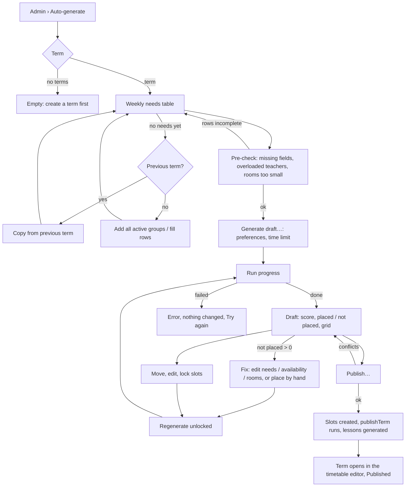
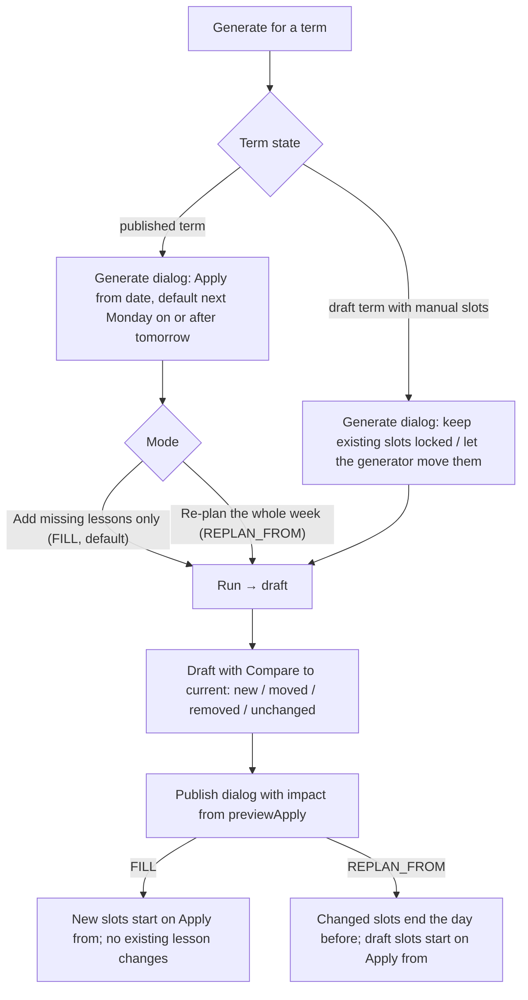

# Timetable generator: admin flow (Phase 4)

Spec for the admin screens that **generate** a term's weekly timetable:
entering what each group needs per week (demand), running the generator,
reviewing and editing the resulting **draft**, and publishing it through the
existing Phase 1 flow. Builds on `docs/design/tokens.md`,
`docs/design/app-layout.md`, `docs/design/timetable.md` (editor grid, slot
sheet, conflicts, publish dialog, result toasts) and
`docs/design/admin-data.md`. Clickable wireframe:
`docs/design/wireframes/timetable-generator.html`.

The generator's rules — demand model, hard and soft constraints, scoring,
algorithm, draft storage, publishing and terms that already have lessons —
are owned by the Scheduling Engineer in `docs/architecture/generator.md`
(CARM-53). This spec decides how they look and behave in the UI. §9 maps
each screen to the rules doc's section; where the two differ, the rules
doc wins.

## 1. Goal

- An admin fills in what every group needs per week once per term, mostly by
  copying last term and adjusting a few rows, not by typing 60 rows.
- One click produces a complete draft. The admin sees right away how good it
  is, and exactly which lessons couldn't be placed, **why**, and what to
  change.
- The draft is edited with the same grid and slot sheet as the manual
  editor. Locking what's right and regenerating the rest is one step.
- Nothing teachers or students see changes until the admin publishes, and
  the publish dialog says exactly what will happen to existing lessons.

## 2. Roles

| Role    | Access                                                                                                       |
| ------- | ------------------------------------------------------------------------------------------------------------ |
| Admin   | Everything on `/admin/timetable/generate` for their own school                                               |
| Teacher | None. No nav item; the route returns the 403 page (`errors.forbidden.*`). Drafts never appear in their views |
| Student | None. Same as teacher                                                                                        |

Enforced server-side: every page loader and server action goes through the
admin action wrapper (`requireRole("ADMIN")`) and `getSchoolScopedDb()`.
Demand, runs and drafts of another school are "not found", never "forbidden"
(no existence leak). Read-only weekly views and lesson queries only read
**live** `TimetableSlot`s / `Lesson`s of published terms, so a draft can't
leak by construction (covered by the Phase 4 e2e permission suite, CARM-57).

## 3. Concepts shown in the UI

| Concept (rules doc)          | UI word (key)                                       | Meaning for the admin                                                                             |
| ---------------------------- | --------------------------------------------------- | ------------------------------------------------------------------------------------------------- |
| Demand (per group and term)  | **Weekly needs** (`generator.demand.title`)         | "B1 Evening needs 2 × 90 min a week with Tomas, in a room for 8."                                 |
| Generation run               | **Run** (`generator.run.*`)                         | One attempt of the generator, with progress, a seed and a result.                                 |
| Draft (per term)             | **Draft timetable** (`generator.draft.*`)           | The generator's output plus the admin's edits. Not visible to anyone else until published.        |
| Draft slot                   | **Slot** (same word as the editor)                  | A weekly slot in the draft. Can be locked.                                                        |
| Locked draft slot            | **Locked** (`generator.slot.locked`)                | The generator keeps it exactly where it is when it runs again.                                    |
| Unplaced demand              | **Not placed** (`generator.unplaced.*`)             | Lessons a group needs that the generator couldn't fit, each with a reason.                        |
| Soft-preference penalty      | **Preference** (`generator.preference.*`)           | Something legal but not ideal (a teacher's gap, a group twice on one day). Never blocks anything. |
| Score                        | **Quality score** (`generator.score.*`)             | One number for the whole draft, plus a breakdown per preference.                                  |
| Hard / overridable conflicts | **Conflict** / **Warning** (`timetable.severity.*`) | Exactly as in the editor (`timetable.md` §3.1). The generator only places slots with neither.     |

Three tiers, three looks, so they are never confused:

| Tier       | Badge (key)                                   | Tone + icon                 | Blocks publish?                          |
| ---------- | --------------------------------------------- | --------------------------- | ---------------------------------------- |
| Conflict   | **Conflict** (`timetable.severity.blocking`)  | `danger`, `octagon-x`       | Yes                                      |
| Warning    | **Warning** (`timetable.severity.warning`)    | `warning`, `triangle-alert` | No, once acknowledged (as in the editor) |
| Preference | **Preference** (`generator.preference.badge`) | `info`, `sparkles`          | Never; only lowers the score             |

## 4. User flows

### 4.1 First timetable for a term



### 4.2 Term that already has a timetable



FILL and REPLAN_FROM are the rules doc's modes (`generator.md` §5.2).
Whether REPLAN_FROM ships in v1 is the owner's call (rules doc Q1); if it
doesn't, the mode choice is hidden and FILL is the only behaviour.

## 5. Screen: `/admin/timetable/generate?term=…&tab=…`

Desktop-first (≥ 1024 px). Below 1024 px the route shows the read-only
summary card (term, status of needs, last run, draft score) and `Alert`
`layout.desktopRecommended`; no editing.

### 5.1 Page layout

```
┌ H1 Auto-generate timetable ──────────────────────────────────────────────────────┐
│ [Term: Spring 2027 ▾] (Draft)                       [⋯]  [Generate draft…]        │ page header
├──────────────────────────────────────────────────────────────────────────────────┤
│ ① Weekly needs  62 groups · 3 incomplete │ ② Draft  Score 86 · 4 not placed │       │ tabs (Tabs, URL)
├──────────────────────────────────────────────────────────────────────────────────┤
│ tab content                                                                      │
└──────────────────────────────────────────────────────────────────────────────────┘
```

- **Term `Select`**: same as the editor (newest first, current term
  preselected, Draft / Published badge). Term in the URL.
- **Tabs** (`Tabs`, `tab` in the URL): **Weekly needs** and **Draft**. Each
  tab label carries a one-line status so the admin knows where they stand
  without switching:
  - Needs: "{groups} groups · {incomplete} incomplete" / "Not started".
  - Draft: "Score {score} · {unplaced} not placed" / "No draft yet" /
    "Generating… {percent} %" / "Out of date".
- **Generate draft…** (primary) opens the generate dialog (§5.3). When a
  draft exists the label is **Regenerate…** and the dialog shows the
  regenerate options. While a run is in progress the button is replaced by
  the run status (§5.4).
- **Overflow `⋯`**: _Copy needs from another term…_, _Open timetable editor_,
  _Discard draft…_ (when a draft exists; `AlertDialog`, destructive), _Run
  history_ (sheet with the last 10 runs: when, who, seed, score, placed,
  duration — for support and "do it again with the same seed").

### 5.2 Tab ① Weekly needs (demand)

One row per active group of the school (archived groups excluded). Rows of
groups that shouldn't be scheduled this term are switched off, not deleted,
so the count stays explainable.

```
┌ Toolbar ───────────────────────────────────────────────────────────────────────────────┐
│ [Search groups]  Level [Any▾]  Teacher [Any▾]  Show [All | Incomplete | Off]   [+ Add groups] │
├────────────────────────────────────────────────────────────────────────────────────────┤
│ ☐ │ Group              │ Type   │ Lvl │ Students │ Lessons/wk │ Length │ Teacher          │ Room         │ Fixed times │ ⋯ │
│ ☐ │ B1 Evening         │ Group  │ B1  │ 7        │ [2]        │ [90▾]  │ [Tomas Horvat▾]  │ Physical ≥ 7 │ —           │ ⋯ │
│ ☐ │ A2 Kids            │ Group  │ A2  │ 9        │ [2]        │ [60▾]  │ Any of 3 ▾       │ Room 3       │ Sat 09:00   │ ⋯ │
│ ☐ │ Jan Novak 1-on-1   │ 1-on-1 │ B2  │ 1        │ [1]        │ [45▾]  │ [Eva Simon▾]     │ Online       │ —           │ ⋯ │
│ ☐ │ ⚠ C1 Business      │ Group  │ C1  │ 6        │ [ ]        │ [  ▾]  │ [Choose▾]        │ Any          │ —           │ ⋯ │
│   │ ○ B2 Exam prep     │ Off this term                                                        │ Turn on │
├────────────────────────────────────────────────────────────────────────────────────────┤
│ Summary: 61 groups on · 148 lessons a week · 196 teaching hours · 3 incomplete          │ sticky footer
└────────────────────────────────────────────────────────────────────────────────────────┘
```

**Columns** (`Table`, dense, sticky header, sortable by group, level,
teacher):

| Column      | Control                                                          | Rules                                                                                                                                                                                                                                                                                                                                                                                                                                   |
| ----------- | ---------------------------------------------------------------- | --------------------------------------------------------------------------------------------------------------------------------------------------------------------------------------------------------------------------------------------------------------------------------------------------------------------------------------------------------------------------------------------------------------------------------------- |
| Select      | `Checkbox`                                                       | For bulk edit. Header checkbox selects the visible (filtered) rows.                                                                                                                                                                                                                                                                                                                                                                     |
| Group       | link → group detail                                              | Name, then muted members count and type icon (`users` / `user`).                                                                                                                                                                                                                                                                                                                                                                        |
| Lessons/wk  | number input, inline                                             | Required; 1–14. 1-on-1 groups usually 1–2.                                                                                                                                                                                                                                                                                                                                                                                              |
| Length      | `Select`: 45, 60, 90, 120 min + _Other…_ (5-min steps, 15–600)   | Required. All lessons of a row have the same length (one row per group in v1; the schema allows more later).                                                                                                                                                                                                                                                                                                                            |
| Teacher     | `Combobox`: a teacher, or **Any of…** (multi-select of teachers) | Required. **Fixed** teacher = one name. **Any of** = the generator picks one teacher for all of the group's lessons from the list (shown as "Any of 3", hover/expand lists them). Defaults to the teacher of the group's slots in the previous term. Switching to _Any of…_ prefills the teachers who taught this level in the previous term; the admin edits the list. Any teacher may be added: there is no qualification list in v1. |
| Room        | summary text; edited in the row sheet                            | "Any" (default: physical or online, capacity ≥ enrolled), "Physical ≥ 7", "Online", or specific rooms ("Room 3", "Room 3 or 4").                                                                                                                                                                                                                                                                                                        |
| Fixed times | summary text; edited in the row sheet                            | Pinned weekday + start times ("Sat 09:00"). Pinned lessons are placed exactly there or reported as not placed — never moved.                                                                                                                                                                                                                                                                                                            |
| Row menu    | `DropdownMenu`                                                   | _Edit details…_ (row sheet), _Turn off for this term_ / _Turn on_, _Reset to previous term_.                                                                                                                                                                                                                                                                                                                                            |

**Editing and saving.** Inline cells save on blur / Enter (debounced
500 ms), one row at a time, like a spreadsheet. The row shows a small
status at its right edge: spinner while saving, nothing when saved, `Alert`
icon + tooltip `common.error.network` with _Retry_ when it failed (values
kept). Invalid values are shown on the cell (`aria-invalid`, message under
the cell, `validation.*`), not saved, and the row counts as incomplete. No
page-level Save button: losing 60 rows of typing to a missed click is the
worse failure.

**Incomplete rows** (missing lessons/week, length or teacher, or invalid):
`triangle-alert` before the name, row background `warning` surface, filter
_Incomplete_. They are **skipped** by the generator; the generate dialog
says so (§5.3). Rows that are off are muted, collapsed to one line with
_Turn on_.

**Row sheet** (_Edit details…_, right `Sheet` 480 px, modal):

| Section        | Fields                                                                                                                                                                                                                                                                                                         |
| -------------- | -------------------------------------------------------------------------------------------------------------------------------------------------------------------------------------------------------------------------------------------------------------------------------------------------------------- |
| Lessons        | Lessons a week · Length (same as the row)                                                                                                                                                                                                                                                                      |
| Teacher        | Radio **Fixed teacher** (`Combobox`) / **Any of these teachers** (multi-select `Combobox` with chips). Under it, muted: "{teacher} is free for {hours} h a week in school hours and has {demand} h of needs this term." (helps spot overload before generating)                                                |
| Room           | Radio **Any suitable room** / **Physical room** / **Online** / **Specific rooms** (multi-select). _Minimum seats_ number, optional (rooms always need at least the enrolled count; muted hint "7 students enrolled"). _Preferred room_ `Select`, optional (soft). Archived rooms not offered.                  |
| Fixed times    | List of pinned lessons: Day `Select` + Start time `Select` (15-min steps) per row; _Add fixed time_. At most "lessons a week" rows. Each pinned time is checked live with `validateSlot`-style hard rules (spinner + result line), so an impossible pin is caught here, not after a 2-minute run.              |
| Preferred time | Optional, soft. _Preferred days_: `ToggleGroup` of the school's teaching weekdays (none = no preference). _Preferred hours_: two time `Select`s **From** / **To** (15-min steps, both or neither; e.g. 16:00–20:00 for adults after work). Muted hint "The generator tries to stay inside these, but may not." |

Footer: _Cancel_ · **Save** (explicit in the sheet, since it holds several
related fields). Same validation and error rules as `timetable.md` §5.4.

**Bulk edit.** With rows selected, a sticky action bar replaces the toolbar:
"{count} selected" · _Set lessons a week_ · _Set length_ · _Set teacher_ ·
_Set room_ · _Turn off_ · _Clear selection_. Each opens a small `Popover`
with one field and **Apply to {count} groups**. Fixed times are not
bulk-editable (they're specific to one group). Bulk updates are all or
nothing (`bulkUpdateDemand`): success toast "{count} groups updated"; if
any row can't take the value, nothing changes and the `Popover` shows an
`Alert` listing those rows ("{count} groups can't take this value") so the
admin can deselect them and apply again.

**Copy from another term** (overflow menu, and the empty state's primary
action): `Dialog` with source term `Select` (default: the previous term).
Source:

- needs of that term if it has any; otherwise
- **derived from its slots** (`demandFromSlots`): lessons a week = slot
  count per group, length = the slot length, fixed teacher = the slot
  teacher, preferred room = the most used room, no fixed times. A group
  whose slots have several teachers or lengths would need several rows; v1
  keeps the most common (teacher, length) and lists the group in the
  summary as "check by hand".

Summary before applying: "Copy needs for {count} groups. {new} groups have
no needs in {source} and stay empty. {skipped} archived groups are skipped."
Copying only fills groups that have no needs in this term yet
(`copyDemand`); rows already filled in are never overwritten. To start a row
again from the previous term, use the row menu's _Reset to previous term_.
Teachers that are no longer active are cleared, so those rows show as
incomplete.

**Add groups.** Groups created after the needs table was started appear at
the top with a "New" badge and empty cells (they're always listed; there's
nothing to add by hand). _+ Add groups_ is therefore only a link to
_Courses & groups_ → new group.

**Pre-check** (collapsible card above the table, re-computed after every
save; cheap, client-or-server summary, no generator run):

| Check                                         | Tone    | Copy (key)                                                                                    | Action                      |
| --------------------------------------------- | ------- | --------------------------------------------------------------------------------------------- | --------------------------- |
| Rows incomplete                               | warning | `generator.precheck.incomplete` "{count} groups are incomplete and will be skipped."          | _Show_ (filter Incomplete)  |
| Teacher needs more hours than they're free    | warning | `generator.precheck.teacherOverloaded` "{teacher} needs {demand} h but is free for {free} h." | _Availability_, _Show rows_ |
| No room big enough / of the needed kind       | warning | `generator.precheck.noRoom` "{group} needs {seats} seats; the largest room has {max}."        | _Edit details_              |
| Fixed time impossible (hard conflict)         | danger  | `generator.precheck.pinConflict` "{group}: the fixed time {time} has a conflict."             | _Edit details_              |
| Student in two groups whose fixed times clash | warning | `generator.precheck.studentPins` "{count} students are in groups with clashing fixed times."  | _Show rows_                 |
| All good                                      | success | `generator.precheck.ok` "Ready to generate."                                                  | —                           |

The pre-check never blocks generating; it explains in advance what will
probably end up as "not placed".

### 5.3 Generate dialog

`Dialog` `generator.generate.title` "Generate a draft for {term}" (on
rerun: "Regenerate the draft for {term}").

| Section         | Content                                                                                                                                                                                                                                                                                                  |
| --------------- | -------------------------------------------------------------------------------------------------------------------------------------------------------------------------------------------------------------------------------------------------------------------------------------------------------- |
| What's included | "{groups} groups, {lessons} lessons a week." If incomplete rows: warning line "{count} incomplete groups are skipped." + _Review_.                                                                                                                                                                       |
| Existing slots  | Only when the term is not published and already has slots: radio **Keep them as they are** (imported into the draft as locked, default) / **Let the generator rearrange them** (imported unlocked).                                                                                                      |
| Published term  | Only for a published term. **Apply from** date picker: default = next Monday on or after tomorrow, never today or earlier, inside the term. Hint "Lessons before this date are not touched." Then radio **Mode** (below).                                                                                |
| Draft edits     | Only on regenerate: "Keeps {locked} locked slots. {unlocked} unlocked slots may move." + checkbox _Also unlock slots I moved by hand_ (unchecked; moving a slot locks it, §5.6).                                                                                                                         |
| Preferences     | Collapsible, closed by default. All 12 preferences of the rules doc in three groups (table below). Each a `Select` **Off · Low · Normal · High** (default Normal). _Reset all to Normal_.                                                                                                                |
| Advanced        | Collapsible. **Time limit** `Select` _Quick (up to 10 s) · Standard (up to 30 s, default) · Thorough (up to 2 min)_. **Seed**: first run "New random seed"; on regenerate "Same as the draft ({seed})" with _Try another variant_ (new seed). _Use seed…_ input in both, so support can reproduce a run. |

**Mode for a published term** (`RadioGroup`, `generator.mode.*`):

| Option                                 | Rules mode    | Help text under the option                                                                                                                     |
| -------------------------------------- | ------------- | ---------------------------------------------------------------------------------------------------------------------------------------------- |
| **Add missing lessons only** (default) | `FILL`        | "Current slots stay exactly as they are. Only lessons that aren't in the timetable yet are placed, from {date}. No existing lesson changes."   |
| **Re-plan the whole week**             | `REPLAN_FROM` | "The generator may move current slots from {date}, keeping as many where they are as it can. You see every change before anything is applied." |

If the owner keeps REPLAN_FROM out of v1 (rules doc Q1), the radio is
hidden and the dialog shows the FILL help text as a plain line.

Footer: _Cancel_ · **Generate** (primary). Server refuses (§7) are shown as
an `Alert` inside the dialog; the dialog stays open.

**Preferences.** Levels are labels, not numbers: the rules doc maps
Off/Low/Normal/High to 0, ⌈w/2⌉, w and 2w of each base weight. An admin can
reason about "teacher gaps matter more than room changes", not about
"weight 40 vs 15". In REPLAN_FROM the dialog opens with _Keep lessons at
their current times_ on **High** (the rules doc's default for that mode).
Levels apply to this run and are stored with the draft, so _Regenerate…_
reopens with them. Whether a change also becomes the school's default is
open (§12, Q2); until then, every new draft starts from Normal.

| Group             | Label (`generator.pref.<CODE>.label`) | Help (`generator.pref.<CODE>.help`)                                         | Rules code                 |
| ----------------- | ------------------------------------- | --------------------------------------------------------------------------- | -------------------------- |
| Teachers          | Teacher's daily maximum               | Stay within each teacher's maximum teaching time per day.                   | `TEACHER_DAILY_MAX`        |
| Teachers          | Same teacher as last term             | When the generator picks the teacher, prefer the group's teacher last term. | `TEACHER_CHANGED`          |
| Teachers          | Times teachers would rather avoid     | Avoid the times teachers marked as "rather not".                            | `TEACHER_PREFERS_NOT`      |
| Teachers          | Teachers' days off                    | Avoid dates when the teacher is away.                                       | `TEACHER_DATE_UNAVAILABLE` |
| Teachers          | No gaps for teachers                  | Avoid idle time between a teacher's lessons on the same day.                | `TEACHER_GAP`              |
| Groups & students | One lesson a day per group            | Avoid putting a group twice on the same day.                                | `SAME_DAY_REPEAT`          |
| Groups & students | Preferred days and hours              | Stay within the group's preferred days and hours from weekly needs.         | `OUTSIDE_PREFERRED_TIME`   |
| Groups & students | Spread over the week                  | Avoid lessons of a group on back-to-back days (groups with up to 3 a week). | `CONSECUTIVE_DAYS`         |
| Groups & students | Same start time each lesson           | Start a group's lessons at the same time on every day it meets.             | `UNSTABLE_TIME`            |
| Groups & students | Keep lessons at their current times   | Prefer the times the group had last term (or now, when re-planning).        | `TIME_CHANGED`             |
| Groups & students | No gaps for students                  | Avoid idle time between a student's lessons in different groups.            | `STUDENT_GAP`              |
| Rooms             | Preferred room                        | Use the group's preferred room from weekly needs.                           | `NOT_PREFERRED_ROOM`       |

The list is in the rules doc's order of base weight within each group, so
the ones that matter most by default come first. Each row's `Select` has
an accessible name with the label ("No gaps for teachers, level").

### 5.4 Run progress

The run happens on the server; the page shows it and survives a reload
(the `GeneratorRun` row is polled with `getRun` every 2 s while running).

```
┌ Generating a draft for Spring 2027 ──────────────────────────────────┐
│ ● Placing lessons          132 of 148                                │
│ ○ Improving the timetable  score 74 → 81                             │
│ [██████████████░░░░░░░] 0:04 · up to 0:30                             │
│ You can leave this page; the run continues.        [Stop and keep best] │
└──────────────────────────────────────────────────────────────────────┘
```

- Shown in the Draft tab (replacing its content) and as a compact status
  in the header (`Badge` with spinner "Generating… 60 %") on both tabs.
- Two phases (`generator.run.phase.*`): **Placing lessons** "{placed} of
  {total}" then **Improving the timetable** "score {from} → {to}". The bar
  is time-based against the preset's cap ("{elapsed} · up to {limit}").
  The budget is really a number of iterations, so most runs finish well
  before the cap (Standard on a 60-group school in about 3 s): the bar then
  jumps to 100 % and the result appears. It never claims "about".
- `aria-live="polite"` announces only phase changes and completion, not
  every number.
- **Stop and keep best** (outline): ends the improvement phase early and
  keeps the best draft found so far. Not offered during the placing phase,
  where the label is **Cancel run** and nothing is kept (confirm
  `AlertDialog`).
- **Cap reached**: the server stops the run at the cap and keeps the best
  draft; the result says "Stopped at the time limit; this is the best draft
  found." Lessons the generator hadn't reached yet are reported as not
  placed with `TIME_LIMIT`.
- **Interrupted**: if the server restarts mid-run, the run's heartbeat goes
  stale and the next poll reports it `FAILED` with `RUN_INTERRUPTED`:
  `generator.run.interrupted` "The run stopped unexpectedly (the server
  restarted). Your weekly needs and the previous draft are unchanged." +
  _Try again_.
- While running, needs and the previous draft are **read-only** (the
  inputs of the run must not change under it); inputs show a muted
  "Locked while generating" hint. Another admin opening the page sees the
  same progress and "Started by {name} at {time}".
- On completion: toast `generator.run.done` "Draft ready: {placed} of
  {total} lessons placed, score {score}." and the Draft tab shows the
  result. If the admin is elsewhere in the app, the toast still appears
  on the next page load (optional; nice-to-have).

### 5.5 Tab ② Draft — result summary

Above the grid, a summary strip (always visible on the Draft tab):

```
┌ Draft · not visible to teachers or students ─────────────── Generated 14 Oct 10:42 by Anna · seed 51823 ┐
│ ┌ Placed ───────┐ ┌ Quality score ──────┐ ┌ Not placed ──────┐ ┌ Issues ───────┐   [Compare to current] │
│ │ 144 / 148     │ │ 86 / 100  ▲ +5      │ │ 4 lessons        │ │ 0 · 2 warnings │   [Publish…]           │
│ │ lessons       │ │ Details             │ │ 3 groups · Show  │ │ Show           │                        │
│ └───────────────┘ └─────────────────────┘ └──────────────────┘ └────────────────┘                        │
└──────────────────────────────────────────────────────────────────────────────────────────────────────────┘
```

- **Draft band**: full-width `info` surface band with `file-pen-line` icon
  and `generator.draft.band` "Draft · not visible to teachers or students"
  across the top of the tab — the one thing that must be impossible to miss.
  Grid blocks in the draft also carry a dashed outline (§5.6).
- **Placed**: "{placed} / {total} lessons". Success tone when all placed.
- **Quality score**: "{score} / 100" plus the change from the previous run
  ("▲ +5" / "▼ −3", with text, not color only). _Details_ opens a popover
  with the breakdown: one row per preference — name, level (Normal/High…),
  **count** ("12 teacher gaps", "3 groups twice on one day") and its share
  of the lost points as a small bar. Each row has _Show_, which highlights
  the affected slots in the grid. Rows with count 0 are collapsed under
  "{count} preferences fully met". The score is the rules doc's quality
  (`generator.md` §3.3): 100 means every preference met; it compares runs
  of the same term, not terms, so the UI never shows it outside its term.
  Help icon `generator.score.help` "100 means every preference is met. Use
  it to compare drafts of this term."
- **Not placed**: "{count} lessons · {groups} groups", danger tone when > 0;
  _Show_ opens the not-placed panel (§5.7).
- **Issues**: conflicts (should be 0 straight after a run) and
  unacknowledged warnings in the draft, from the same check as the editor's
  issues panel (`timetable.md` §5.6, run on the draft). _Show_ opens it.
- Actions: _Compare to current_ (only when the term has live slots, §5.8),
  **Publish…** (primary, §6).

### 5.6 Draft grid

Reuses the editor grid exactly (`timetable.md` §5.2–5.3): **By room** (one
day, rooms as columns) and **Week** (one teacher, room or group), filters,
geometry, keyboard model, drag & drop with the non-drag alternative, issue
badges. Differences:

| Element             | In the draft                                                                                                                                                                                                            |
| ------------------- | ----------------------------------------------------------------------------------------------------------------------------------------------------------------------------------------------------------------------- |
| Block outline       | 1 px dashed `slate-400` around every draft block (plus the lesson-type token as usual), so a screenshot of a draft can't be mistaken for the live timetable.                                                            |
| Locked block        | `lock` icon top-left + accessible name suffix ", locked". Locked blocks are not dimmed; locking is about the generator, not about importance.                                                                           |
| Preference badge    | `sparkles` in `info` tone top-right when the slot contributes to a preference penalty; tooltip lists them ("Tomas has a 90-min gap before this", "B1 Evening is also on Tuesday"). Lowest priority of the three badges. |
| Pinned (fixed time) | `pin` icon; cannot be dragged to another time (the sheet explains: "This is a fixed time from weekly needs. Change it there."); teacher and room can still change.                                                      |
| Imported from term  | (only when existing slots were imported) muted caption "Existing".                                                                                                                                                      |
| Changed vs current  | in Compare mode only, §5.8.                                                                                                                                                                                             |
| Week view, teacher  | hatched unavailability as in the editor, plus a caption per day "4 lessons · 1 gap".                                                                                                                                    |

**Editing a draft slot**: the editor's slot sheet (`timetable.md` §5.4)
with the same live check and per-warning acknowledgement, minus _Effective
from_ (drafts have no history; the apply-from date is set for the whole
draft), plus:

- `Switch` **Locked** (`generator.slot.lock`) with help "The generator
  won't move this slot when you regenerate."
- Saving a moved or edited slot **locks it automatically** (the admin
  placed it on purpose), with toast "Moved B1 Evening to Tue 17:00 and
  locked it." + _Undo_ (rules doc §5.3).
- _Teacher_ in the sheet offers any teacher, not only the row's "any of"
  list: the admin decides, as in the editor.
- _Delete slot_ removes it from the draft; its lesson becomes "not placed"
  with reason _Removed by you_ until the next run.
- _New slot_ works as in the editor; new slots are locked.

**Locking in bulk**: block context menu and toolbar _Lock…_ menu: _Lock
this slot_, _Lock all slots of {group}_, _Lock all slots of {teacher}_,
_Lock everything shown_ (current filter), _Unlock all_. Keyboard: `L` on a
focused block toggles its lock (announced "Locked" / "Unlocked").

**Regenerate the rest**: header button **Regenerate…** opens the generate
dialog in regenerate mode (§5.3), which states how many slots stay and how
many may move. After the run, a toast "Draft updated: {moved} slots moved,
{placed} newly placed, score {score} (▲ +{delta})" with _Show changes_
(highlights moved/new blocks until the next action).

Edits save to the draft one at a time (each is a server action under the
timetable lock, like `saveSlot`). If the draft changed meanwhile (another
admin edited it or a run finished), the sheet shows `common.error.staleData`

- _Reload_, as in the editor.

### 5.7 Not-placed panel

Right `Sheet` 480 px, `generator.unplaced.title` "Not placed ({count})".
One card per group with missing lessons:

```
┌ C1 Business · 1 of 2 lessons not placed ───────────────────────────┐
│ ⛔ No time when Peter Varga, a room for 6 and all 6 students are     │
│    free at once.                                                     │
│    Closest: Thu 18:00 — 2 students have B2 Conversation then.        │
│ [Edit weekly needs] [Teacher availability] [Place by hand]           │
└──────────────────────────────────────────────────────────────────────┘
```

- Title: group + "{missing} of {total} lessons not placed".
- **Reason**: message for the rules doc's reason code
  (`scheduling.generator.reasons.<CODE>`, ICU params; `generator.md` §4.5),
  same pattern as `scheduling.conflicts.<TYPE>`. Unknown codes fall back to
  `scheduling.generator.reasons.generic` "The generator couldn't find a
  time that meets every rule."
- **Why, in numbers** (search reasons only): the blocker breakdown as one
  muted line, `generator.unplaced.blockers` "Teacher busy at {teacherBusy}
  times, unavailable at {teacherUnavailable}, students busy at
  {studentsBusy} ({students}), no free room at {noRoom}." Zero parts are
  left out.
- **Closest option**: the near-miss time with the fewest conflicts and
  those conflicts, rendered as in the editor. _Show_ jumps to that time in
  the grid.
- **Suggestions** (up to 3, from the rules doc): one line each with a link
  to the data to change, e.g. "Tue 17:00 would work if B2 Evening's lesson
  moved" → _Show_ (selects that draft slot), "… if Peter Varga were
  available" → _Teacher availability_, "… with a room for 12" → _Rooms_.
  They never change anything themselves.
- **Suggested fixes** (buttons, by reason):

| Reason code              | Copy (English, `scheduling.generator.reasons.*`)                                                                        | Suggested fixes                                                 |
| ------------------------ | ----------------------------------------------------------------------------------------------------------------------- | --------------------------------------------------------------- |
| `GROUP_ARCHIVED`         | {group} is archived, so it isn't scheduled.                                                                             | _Edit weekly needs_ (turn the row off)                          |
| `NO_ELIGIBLE_TEACHER`    | No teacher can be used for {group}: the chosen teachers are archived, or none is chosen.                                | _Edit weekly needs_ (choose teachers)                           |
| `DURATION_TOO_LONG`      | A {duration}-min lesson doesn't fit in the school day ({schoolHours}).                                                  | _Edit weekly needs_ (length), _School hours_                    |
| `PINNED_TIME_CONFLICT`   | The fixed time {time} has a conflict.                                                                                   | _Edit weekly needs_ (fixed times)                               |
| `NO_ROOM`                | No {roomKind} room with {seats} seats is free at a time that works.                                                     | _Rooms_, _Edit weekly needs_ (room)                             |
| `NO_TEACHER_TIME`        | {teacher} has no free time left that fits a {minutes}-min lesson.                                                       | _Teacher availability_, _Edit weekly needs_ (another teacher)   |
| `STUDENT_CLASH`          | {count, plural, one {# student is} other {# students are}} in other groups at every time that works.                    | _Show students_ (list + their groups), _Place by hand_          |
| `NO_COMMON_TIME`         | No time when {teacher}, a room for {seats} and all {students} students are free at once.                                | _Edit weekly needs_, _Teacher availability_, _Place by hand_    |
| `TAKEN_BY_OTHER_LESSONS` | There are free times, but other lessons in this draft take them all.                                                    | _Show_ (per suggestion), _Place by hand_, _Try another variant_ |
| `TIME_LIMIT`             | The time limit ran out before this lesson was placed.                                                                   | _Regenerate_ with a longer time limit                           |
| `REMOVED_BY_ADMIN`       | You removed this slot from the draft.                                                                                   | _Place by hand_                                                 |
| `INTERNAL_CHECK_FAILED`  | Something went wrong while checking this lesson, so it was left out. This is a bug; please report it with the error ID. | _Copy error ID_, _Place by hand_                                |

`GROUP_ARCHIVED`, `NO_ELIGIBLE_TEACHER`, `DURATION_TOO_LONG` and
`PINNED_TIME_CONFLICT` are found before the run starts; the needs tab's
pre-check shows the same problems in advance (§5.2), so they should rarely
reach this panel. `INTERNAL_CHECK_FAILED` is never expected: its card uses
the `danger` tone and lists the conflicts in a collapsed _Details_ section
for support.

- **Place by hand** opens the slot sheet prefilled with group, teacher,
  length and (if any) the closest time; the live check shows exactly which
  rules break, and overridable ones can be acknowledged like in the editor.
  Placed by hand = locked.
- Panel footer: "Fix the data, then regenerate to try again." + _Regenerate…_
- **Empty**: `generator.unplaced.empty` "Every lesson was placed." (success).

### 5.8 Compare to current

Only when the term already has live slots (draft term with manual slots, or
published term). `ToggleGroup` _Draft · Compare_ in the grid toolbar. In
FILL mode the current slots don't change, so Compare shows them as
unchanged (dimmed, caption "Current") and only **New** blocks stand out;
the summary reads "{new} new slots".

- In **Compare**, each draft block gets a change caption and the removed
  live slots are drawn as ghost blocks (dashed `slate-400`, `lesson-cancelled`
  look, 60 % opacity, not interactive except _Show details_):

| Change    | Caption (key)                                        | Marker                              |
| --------- | ---------------------------------------------------- | ----------------------------------- |
| New       | `generator.compare.new` "New"                        | `plus` icon, `success` tone badge   |
| Moved     | `generator.compare.moved` "Was {weekday} {time}"     | `move` icon, `warning` tone badge   |
| Changed   | `generator.compare.changed` "Was {teacher} · {room}" | `pencil` icon, `warning` tone badge |
| Removed   | `generator.compare.removed` "Removed"                | ghost block, `ban` icon             |
| Unchanged | none                                                 | dimmed to 60 % so changes stand out |

- A **Changes** summary above the grid: "{unchanged} unchanged · {moved}
  moved · {changed} other changes · {new} new · {removed} removed" plus
  "{teachers} teachers and {students} students have a different week" —
  that's what the admin will have to communicate. _List changes_ opens a
  sheet listing every change grouped by group (printable, so it can be
  sent to teachers before publishing).

### 5.9 Draft out of date

The draft stores a fingerprint of what it was generated from (needs,
preference levels, enrolments, availability, rooms, holidays, live slots).
When any of that changes afterwards, the Draft tab label shows **Out of
date** and a `warning` `Alert` sits under the draft band:

`generator.draft.stale` "Data changed since this draft was generated
(weekly needs, enrolments, availability, rooms, holidays or the live
timetable). Regenerate the unlocked rest?" with actions **Check draft**
(re-runs the conflict check on the draft; new conflicts and warnings appear
as badges and in the issues panel) and _Regenerate…_. The fingerprint says
_that_ something changed, not _what_, so the copy lists the kinds of data
rather than the exact change. Publishing still re-checks everything on the
server (§6), so stale is a nudge, not a lock.

## 6. Publish

**Publish…** in the Draft tab opens `Dialog` `generator.publish.title`
"Publish the draft for {term}?". It builds on the editor's publish dialog
(`timetable.md` §5.7) and, like it, runs one server action under the
timetable lock (`applyDraft`): write the draft's slots as live
`TimetableSlot`s, then the `publishTerm` logic — so every existing publish
check applies. The impact numbers in the dialog come from `previewApply`
(a dry run), loaded when the dialog opens (skeleton lines while loading);
apply recomputes them, so they are information, not a promise.

### 6.1 Draft term (not published yet)

- Summary:
  - "{count} slots ({locked} locked, {generated} generated)"
  - if the term has manual slots: "Replaces the {existing} slots in the
    timetable editor." (they're in the draft as imported ones, so nothing
    is lost unless the admin removed them — then "{removed} of them are
    removed.")
  - "Lessons will be created from {start} to {end}" (as the editor)
  - "{count} warnings acknowledged" + _Review_
  - "{unplaced} lessons are not placed" (warning tone) + _Show_ — publishing
    with unplaced demand is allowed; those groups get fewer lessons until
    someone adds slots by hand.
- Choice: **Publish now** (primary, `generator.publish.confirm` "Publish
  timetable") — teachers and students see it right away — or **Save to the
  timetable editor only** (outline, `generator.publish.toEditor`): creates
  the live slots in the still-unpublished term and opens the editor, so the
  admin can publish later with the normal Publish button. (Useful when
  another admin owns the final check.)

### 6.2 Published term (term already has lessons)

The dialog follows the draft's mode (§5.3). Both start with
`generator.publish.applyFrom` "Changes apply from {date}. Lessons before
then are not touched." If that date is no longer in the future, the server
refuses with `EFFECTIVE_DATE_PASSED` (§6.3).

**Add missing lessons only (FILL)**

- "{created} new slots start on {date}. No existing slot or lesson
  changes." (`generator.publish.fillSlots`)
- "{lessons} lessons are added for {groups} groups." + _List changes_
- No checkbox: nothing existing changes. Primary **Add to timetable**
  (`generator.publish.applyFill`).

**Re-plan the whole week (REPLAN_FROM)**

- Summary, in this order — impact first:
  - "{ended} current slots end on {dayBefore}; {created} new slots start on
    {date}." (unchanged slots are kept as they are, not split)
  - "Future lessons: {removed} removed, {cancelled} kept as cancelled
    because they have attendance, absences, homework or a substitute."
  - "{teachers} teachers and {students} students get a different week." +
    _List changes_ (§5.8)
  - When > 0: "{count} replacement bookings are on lessons that will be
    cancelled. They're released, and the students get their makeup credit
    back with at least 7 days to use it." + _Show_. This is the existing
    rule for lessons the school cancels (`replacements.md` §4), not a new
    one.
- Checkbox (required) `generator.publish.understand` "I understand this
  changes the timetable for teachers and students from {date}."
- Primary **Apply draft** (blue, not `destructive`: red is reserved for
  deleting; the required checkbox is the friction). Clicking it unticked
  focuses the checkbox with `validation.required`.

**Preview failed**: the summary lines show `generator.publish.previewFailed`
"Couldn't work out the impact. Try again." + _Try again_; the primary
button stays disabled until a preview succeeds (the admin must see the
impact before a re-plan; FILL doesn't need it and stays enabled).

### 6.3 Running, blocked, failed, done

- While publishing: "Publishing… creating slots and lessons" (button
  spinner, dialog not closable), as in the editor.
- **Blocked** (conflicts in the draft, found up front or by the server
  re-check): destructive `Alert` `timetable.publish.blocked` "Fix {count}
  conflicts before publishing." listing the slots; the publish button is
  replaced by _Show issues_. Warnings never block.
- **Live timetable changed** since the draft was generated (someone edited
  the term in the editor meanwhile): the server re-checks against the
  current live slots; if that yields conflicts → blocked as above, with the
  `Alert` `generator.publish.liveChanged` "The timetable was changed in the
  editor after this draft was made. Review the new issues."; if not, it
  publishes and the success toast mentions it.
- **Unacknowledged warnings** (`UNACKNOWLEDGED_CONFLICTS`): a new
  overridable conflict appeared since the admin acknowledged warnings
  (e.g. someone changed availability). `warning` `Alert`
  `generator.publish.newWarnings` "{count} new warnings need your OK before
  publishing." with each warning and its acknowledge checkbox, as in the
  editor's slot sheet; the primary button retries with them. A clash
  someone created meanwhile is never overridden without the admin seeing
  it.
- **Draft changed** (`DRAFT_CHANGED`, another admin edited the draft while
  the dialog was open): `common.error.staleData` + _Reload_; the dialog
  reloads the preview.
- **Date passed** (`EFFECTIVE_DATE_PASSED`, the dialog was left open past
  midnight): `generator.publish.datePassed` "{date} is no longer in the
  future. Pick a new date and regenerate." + _Regenerate…_ (opens the
  generate dialog with the next default date).
- **Other failure**: `timetable.publish.failed` "Couldn't publish. Nothing
  was changed. Try again."
- **Done**: toast `generator.publish.done` "{term} published from the
  draft. {count} lessons created." (FILL: `generator.publish.doneFill`
  "{lessons} lessons added to {term} from {date}."; REPLAN_FROM: plus the
  removed/cancelled parts from the shared result formatter, `timetable.md`
  §5.10). The draft is deleted once applied (its runs stay in _Run
  history_); the page switches to the editor (`/admin/timetable/edit?term=…`)
  with the usual published banner.

## 7. States

| Where    | State                                                       | UI (key)                                                                                                                                                                                                                 |
| -------- | ----------------------------------------------------------- | ------------------------------------------------------------------------------------------------------------------------------------------------------------------------------------------------------------------------ |
| Page     | No terms                                                    | Empty card as the editor: `timetable.editor.empty.noTerm.*` + _Go to Terms & holidays_.                                                                                                                                  |
| Page     | No active groups                                            | Empty card `generator.empty.noGroups` "No groups to schedule" / "Create groups and enrol students first." / _Go to Courses & groups_.                                                                                    |
| Page     | No teachers                                                 | Info `Alert` `generator.missing.teachers` "Add at least one teacher to fill in weekly needs." + link.                                                                                                                    |
| Page     | Term in the past                                            | Read-only, `Alert` `generator.termEnded` "This term has ended. Choose a current or future term."                                                                                                                         |
| Page     | Term published by someone else while a REPLACE draft exists | Publish refuses `TERM_PUBLISHED`: `Alert` `generator.termPublished` "This term was published meanwhile. Regenerate to add missing lessons or re-plan from a date." + _Regenerate…_.                                      |
| Page     | Loading                                                     | Header + tabs rendered; table skeleton (8 rows) or grid skeleton.                                                                                                                                                        |
| Page     | Load error                                                  | Destructive `Alert` + _Try again_ (`common.error.*`).                                                                                                                                                                    |
| Page     | < 1024 px                                                   | Summary card + `layout.desktopRecommended`.                                                                                                                                                                              |
| Page     | Not an admin                                                | 403 page (`errors.forbidden.*`); nav item not shown.                                                                                                                                                                     |
| Needs    | No needs yet, previous term exists                          | Empty card `generator.demand.empty.title` "No weekly needs for {term} yet" / "Copy them from {previous} and adjust what changed." / **Copy from {previous}** · _Start from scratch_ (shows all groups with empty cells). |
| Needs    | No needs yet, no previous term                              | Table with all active groups and empty cells, info line "Fill in each group's lessons a week, length and teacher."                                                                                                       |
| Needs    | Filter with no result                                       | `common.noResults` + _Clear filters_.                                                                                                                                                                                    |
| Needs    | Row save failed                                             | Row status icon + _Retry_; value kept.                                                                                                                                                                                   |
| Needs    | Read-only during a run                                      | Inputs disabled, hint "Locked while generating".                                                                                                                                                                         |
| Generate | Nothing to generate                                         | Dialog body: `generator.generate.nothing` "No complete weekly needs yet. Fill in at least one group." — **Generate** hidden, _Go to weekly needs_. Also the server's `NO_DEMAND` refusal.                                |
| Generate | Another run in progress                                     | Server refuses `RUN_IN_PROGRESS`: "{name} is already generating this term (started {time})." Dialog shows the live progress instead.                                                                                     |
| Generate | Timetable lock busy                                         | `LOCK_BUSY`: "Someone is saving the timetable right now. Try again in a moment." (rare; the lock is per transaction)                                                                                                     |
| Run      | Running / long run / stopped                                | §5.4.                                                                                                                                                                                                                    |
| Run      | Failed                                                      | Destructive `Alert` `generator.run.failed` "The run failed. Your weekly needs and the previous draft are unchanged." + _Try again_ + _Copy error ID_ (for support).                                                      |
| Run      | Interrupted (server restarted, `RUN_INTERRUPTED`)           | Destructive `Alert` `generator.run.interrupted` + _Try again_ (§5.4).                                                                                                                                                    |
| Run      | Cancelled                                                   | Info toast "Run cancelled. The previous draft is unchanged."                                                                                                                                                             |
| Draft    | No draft yet                                                | Empty card `generator.draft.empty.title` "No draft yet" / "Fill in weekly needs, then generate a draft." / **Generate draft…** (or _Go to weekly needs_ when nothing is complete).                                       |
| Draft    | Nothing placed                                              | Summary shows 0 / {total}; danger `Alert` `generator.draft.nothingPlaced` "No lessons could be placed. The most common reason: {reason}." + _Show not placed_. Grid shows only locked/imported slots.                    |
| Draft    | Some not placed                                             | §5.5, §5.7.                                                                                                                                                                                                              |
| Draft    | Out of date                                                 | §5.9.                                                                                                                                                                                                                    |
| Draft    | Edited by another admin                                     | `common.error.staleData` + _Reload_ on save (§5.6).                                                                                                                                                                      |

## 8. Copy (i18n keys, English source)

New namespace `generator` (`messages/en-GB/generator.json`). Reused, not
duplicated: `timetable.*` (grid, slot sheet, severities, publish, result
formatter), `scheduling.conflicts.*`, `scheduling.errors.*`, `common.*`,
`validation.*`, `errors.forbidden.*`, `layout.desktopRecommended`,
`nav.autoGenerate`. Reason messages follow the rules doc's codes and live
in the shared `scheduling` namespace next to `scheduling.conflicts.*`
(`scheduling.generator.reasons.*`, listed at the end of the last table).

### Page and needs

| Key                                    | Copy                                                                                                                                                                           |
| -------------------------------------- | ------------------------------------------------------------------------------------------------------------------------------------------------------------------------------ |
| `generator.title`                      | Auto-generate timetable                                                                                                                                                        |
| `generator.tabs.demand`                | Weekly needs                                                                                                                                                                   |
| `generator.tabs.demandStatus`          | {groups, plural, one {# group} other {# groups}} · {incomplete, plural, =0 {complete} other {# incomplete}}                                                                    |
| `generator.tabs.demandNotStarted`      | Not started                                                                                                                                                                    |
| `generator.tabs.draft`                 | Draft                                                                                                                                                                          |
| `generator.tabs.draftStatus`           | Score {score} · {unplaced, plural, =0 {all placed} other {# not placed}}                                                                                                       |
| `generator.tabs.draftNone`             | No draft yet                                                                                                                                                                   |
| `generator.tabs.draftRunning`          | Generating… {percent} %                                                                                                                                                        |
| `generator.tabs.draftStale`            | Out of date                                                                                                                                                                    |
| `generator.actions.generate`           | Generate draft…                                                                                                                                                                |
| `generator.actions.regenerate`         | Regenerate…                                                                                                                                                                    |
| `generator.actions.copyDemand`         | Copy needs from another term…                                                                                                                                                  |
| `generator.actions.openEditor`         | Open timetable editor                                                                                                                                                          |
| `generator.actions.discardDraft`       | Discard draft…                                                                                                                                                                 |
| `generator.actions.runHistory`         | Run history                                                                                                                                                                    |
| `generator.discard.title`              | Discard the draft for {term}?                                                                                                                                                  |
| `generator.discard.description`        | The draft and your edits to it are deleted. Weekly needs and the live timetable stay as they are.                                                                              |
| `generator.discard.confirm`            | Discard draft                                                                                                                                                                  |
| `generator.demand.title`               | Weekly needs                                                                                                                                                                   |
| `generator.demand.col.group`           | Group                                                                                                                                                                          |
| `generator.demand.col.type`            | Type                                                                                                                                                                           |
| `generator.demand.col.level`           | Level                                                                                                                                                                          |
| `generator.demand.col.students`        | Students                                                                                                                                                                       |
| `generator.demand.col.lessonsPerWeek`  | Lessons a week                                                                                                                                                                 |
| `generator.demand.col.length`          | Length                                                                                                                                                                         |
| `generator.demand.col.teacher`         | Teacher                                                                                                                                                                        |
| `generator.demand.col.room`            | Room                                                                                                                                                                           |
| `generator.demand.col.fixedTimes`      | Fixed times                                                                                                                                                                    |
| `generator.demand.minutes`             | {minutes} min                                                                                                                                                                  |
| `generator.demand.otherLength`         | Other…                                                                                                                                                                         |
| `generator.demand.teacherAnyOf`        | Any of {count}                                                                                                                                                                 |
| `generator.demand.teacherChoose`       | Choose                                                                                                                                                                         |
| `generator.demand.room.any`            | Any                                                                                                                                                                            |
| `generator.demand.room.physical`       | Physical ≥ {seats}                                                                                                                                                             |
| `generator.demand.room.online`         | Online                                                                                                                                                                         |
| `generator.demand.room.specific`       | {rooms}                                                                                                                                                                        |
| `generator.demand.off`                 | Off this term                                                                                                                                                                  |
| `generator.demand.turnOn`              | Turn on                                                                                                                                                                        |
| `generator.demand.turnOff`             | Turn off for this term                                                                                                                                                         |
| `generator.demand.resetToPrevious`     | Reset to previous term                                                                                                                                                         |
| `generator.demand.editDetails`         | Edit details…                                                                                                                                                                  |
| `generator.demand.newGroup`            | New                                                                                                                                                                            |
| `generator.demand.incomplete`          | Incomplete — skipped when generating                                                                                                                                           |
| `generator.demand.show.all`            | All                                                                                                                                                                            |
| `generator.demand.show.incomplete`     | Incomplete                                                                                                                                                                     |
| `generator.demand.show.off`            | Off                                                                                                                                                                            |
| `generator.demand.addGroups`           | Add groups                                                                                                                                                                     |
| `generator.demand.summary`             | {groups} groups on · {lessons} lessons a week · {hours} teaching hours · {incomplete} incomplete                                                                               |
| `generator.demand.lockedWhileRunning`  | Locked while generating                                                                                                                                                        |
| `generator.demand.fillHint`            | Fill in each group's lessons a week, length and teacher.                                                                                                                       |
| `generator.demand.empty.title`         | No weekly needs for {term} yet                                                                                                                                                 |
| `generator.demand.empty.description`   | Copy them from {previous} and adjust what changed.                                                                                                                             |
| `generator.demand.empty.copy`          | Copy from {previous}                                                                                                                                                           |
| `generator.demand.empty.scratch`       | Start from scratch                                                                                                                                                             |
| `generator.demand.sheet.title`         | Weekly needs: {group}                                                                                                                                                          |
| `generator.demand.sheet.lessons`       | Lessons                                                                                                                                                                        |
| `generator.demand.sheet.teacherFixed`  | Fixed teacher                                                                                                                                                                  |
| `generator.demand.sheet.teacherAnyOf`  | Any of these teachers                                                                                                                                                          |
| `generator.demand.sheet.teacherLoad`   | {teacher} is free for {free} h a week in school hours and has {demand} h of needs this term.                                                                                   |
| `generator.demand.sheet.roomAny`       | Any suitable room                                                                                                                                                              |
| `generator.demand.sheet.roomPhysical`  | Physical room                                                                                                                                                                  |
| `generator.demand.sheet.roomOnline`    | Online                                                                                                                                                                         |
| `generator.demand.sheet.roomSpecific`  | Specific rooms                                                                                                                                                                 |
| `generator.demand.sheet.minSeats`      | Minimum seats                                                                                                                                                                  |
| `generator.demand.sheet.enrolledHint`  | {count, plural, one {# student enrolled} other {# students enrolled}}                                                                                                          |
| `generator.demand.sheet.fixedTimes`    | Fixed times                                                                                                                                                                    |
| `generator.demand.sheet.fixedHint`     | Lessons with a fixed time are placed exactly there, or reported as not placed.                                                                                                 |
| `generator.demand.sheet.addFixed`      | Add fixed time                                                                                                                                                                 |
| `generator.demand.sheet.preferred`     | Preferred time of day                                                                                                                                                          |
| `generator.demand.sheet.morning`       | Morning                                                                                                                                                                        |
| `generator.demand.sheet.afternoon`     | Afternoon                                                                                                                                                                      |
| `generator.demand.sheet.evening`       | Evening                                                                                                                                                                        |
| `generator.bulk.selected`              | {count} selected                                                                                                                                                               |
| `generator.bulk.setLessons`            | Set lessons a week                                                                                                                                                             |
| `generator.bulk.setLength`             | Set length                                                                                                                                                                     |
| `generator.bulk.setTeacher`            | Set teacher                                                                                                                                                                    |
| `generator.bulk.setRoom`               | Set room                                                                                                                                                                       |
| `generator.bulk.turnOff`               | Turn off                                                                                                                                                                       |
| `generator.bulk.clear`                 | Clear selection                                                                                                                                                                |
| `generator.bulk.apply`                 | Apply to {count, plural, one {# group} other {# groups}}                                                                                                                       |
| `generator.bulk.done`                  | {count, plural, one {# group updated} other {# groups updated}}                                                                                                                |
| `generator.bulk.skipped`               | {count, plural, one {# group wasn't changed} other {# groups weren't changed}}                                                                                                 |
| `generator.copy.title`                 | Copy weekly needs                                                                                                                                                              |
| `generator.copy.source`                | Copy from                                                                                                                                                                      |
| `generator.copy.fromSlots`             | {term} has no weekly needs; they're worked out from its timetable slots.                                                                                                       |
| `generator.copy.summary`               | Copy needs for {count} groups. {new, plural, =0 {} other {# groups have no needs in {source} and stay empty.}} {skipped, plural, =0 {} other {# archived groups are skipped.}} |
| `generator.copy.onlyEmpty`             | Only fill empty rows                                                                                                                                                           |
| `generator.copy.overwrite`             | Overwrite all rows                                                                                                                                                             |
| `generator.copy.overwriteWarning`      | Overwrites {count, plural, one {# row} other {# rows}} you've already filled in.                                                                                               |
| `generator.copy.confirm`               | Copy                                                                                                                                                                           |
| `generator.copy.done`                  | Copied weekly needs for {count} groups.                                                                                                                                        |
| `generator.precheck.title`             | Before you generate                                                                                                                                                            |
| `generator.precheck.ok`                | Ready to generate.                                                                                                                                                             |
| `generator.precheck.incomplete`        | {count, plural, one {# group is incomplete and will be skipped.} other {# groups are incomplete and will be skipped.}}                                                         |
| `generator.precheck.teacherOverloaded` | {teacher} needs {demand} h but is free for {free} h.                                                                                                                           |
| `generator.precheck.noRoom`            | {group} needs {seats} seats; the largest suitable room has {max}.                                                                                                              |
| `generator.precheck.pinConflict`       | {group}: the fixed time {time} has a conflict.                                                                                                                                 |
| `generator.precheck.studentPins`       | {count, plural, one {# student is} other {# students are}} in groups with clashing fixed times.                                                                                |
| `generator.empty.noGroups.title`       | No groups to schedule                                                                                                                                                          |
| `generator.empty.noGroups.description` | Create groups and enrol students first.                                                                                                                                        |
| `generator.empty.noGroups.action`      | Go to Courses & groups                                                                                                                                                         |
| `generator.missing.teachers`           | Add at least one teacher to fill in weekly needs.                                                                                                                              |
| `generator.termEnded`                  | This term has ended. Choose a current or future term.                                                                                                                          |
| `generator.termPublished`              | This term was published meanwhile. Regenerate to add missing lessons or re-plan from a date.                                                                                   |

### Generate and run

| Key                                   | Copy                                                                                                                                             |
| ------------------------------------- | ------------------------------------------------------------------------------------------------------------------------------------------------ |
| `generator.generate.title`            | Generate a draft for {term}                                                                                                                      |
| `generator.generate.titleRerun`       | Regenerate the draft for {term}                                                                                                                  |
| `generator.generate.included`         | {groups, plural, one {# group} other {# groups}}, {lessons, plural, one {# lesson} other {# lessons}} a week.                                    |
| `generator.generate.skipped`          | {count, plural, one {# incomplete group is skipped.} other {# incomplete groups are skipped.}}                                                   |
| `generator.generate.review`           | Review                                                                                                                                           |
| `generator.generate.existing`         | This term already has {count, plural, one {# slot} other {# slots}}.                                                                             |
| `generator.generate.keepExisting`     | Keep them as they are                                                                                                                            |
| `generator.generate.moveExisting`     | Let the generator rearrange them                                                                                                                 |
| `generator.generate.applyFrom`        | Apply from                                                                                                                                       |
| `generator.generate.applyFromHint`    | Lessons before this date are not touched.                                                                                                        |
| `generator.generate.applyFromInvalid` | Pick a date after today, inside the term.                                                                                                        |
| `generator.generate.sameSeed`         | Same as the draft ({seed})                                                                                                                       |
| `generator.generate.anotherVariant`   | Try another variant                                                                                                                              |
| `generator.mode.label`                | What should the generator do?                                                                                                                    |
| `generator.mode.fill`                 | Add missing lessons only                                                                                                                         |
| `generator.mode.fillHelp`             | Current slots stay exactly as they are. Only lessons that aren't in the timetable yet are placed, from {date}. No existing lesson changes.       |
| `generator.mode.replan`               | Re-plan the whole week                                                                                                                           |
| `generator.mode.replanHelp`           | The generator may move current slots from {date}, keeping as many where they are as it can. You see every change before anything is applied.     |
| `generator.prefGroup.teachers`        | Teachers                                                                                                                                         |
| `generator.prefGroup.groups`          | Groups & students                                                                                                                                |
| `generator.prefGroup.rooms`           | Rooms                                                                                                                                            |
| `generator.generate.keepsLocked`      | Keeps {locked, plural, one {# locked slot} other {# locked slots}}. {unlocked, plural, one {# unlocked slot} other {# unlocked slots}} may move. |
| `generator.generate.unlockManual`     | Also unlock slots I moved by hand                                                                                                                |
| `generator.generate.preferences`      | Preferences                                                                                                                                      |
| `generator.generate.prefLevel.off`    | Off                                                                                                                                              |
| `generator.generate.prefLevel.low`    | Low                                                                                                                                              |
| `generator.generate.prefLevel.normal` | Normal                                                                                                                                           |
| `generator.generate.prefLevel.high`   | High                                                                                                                                             |
| `generator.generate.resetPrefs`       | Reset all to Normal                                                                                                                              |
| `generator.generate.advanced`         | Advanced                                                                                                                                         |
| `generator.generate.timeLimit`        | Time limit                                                                                                                                       |
| `generator.generate.limit.quick`      | Quick (up to 10 s)                                                                                                                               |
| `generator.generate.limit.standard`   | Standard (up to 30 s)                                                                                                                            |
| `generator.generate.limit.thorough`   | Thorough (up to 2 min)                                                                                                                           |
| `generator.generate.seed`             | Seed                                                                                                                                             |
| `generator.generate.seedNew`          | New random seed                                                                                                                                  |
| `generator.generate.useSeed`          | Use seed…                                                                                                                                        |
| `generator.generate.nothing`          | No complete weekly needs yet. Fill in at least one group.                                                                                        |
| `generator.generate.confirm`          | Generate                                                                                                                                         |
| `generator.run.title`                 | Generating a draft for {term}                                                                                                                    |
| `generator.run.phase.placing`         | Placing lessons                                                                                                                                  |
| `generator.run.phase.placingCount`    | {placed} of {total}                                                                                                                              |
| `generator.run.phase.improving`       | Improving the timetable                                                                                                                          |
| `generator.run.phase.improvingScore`  | score {from} → {to}                                                                                                                              |
| `generator.run.elapsed`               | {elapsed} · up to {limit}                                                                                                                        |
| `generator.run.canLeave`              | You can leave this page; the run continues.                                                                                                      |
| `generator.run.startedBy`             | Started by {name} at {time}                                                                                                                      |
| `generator.run.slow`                  | Taking longer than expected…                                                                                                                     |
| `generator.run.stopKeepBest`          | Stop and keep best                                                                                                                               |
| `generator.run.cancel`                | Cancel run                                                                                                                                       |
| `generator.run.cancelConfirm`         | Cancel this run? Nothing is kept; the previous draft stays as it was.                                                                            |
| `generator.run.cancelled`             | Run cancelled. The previous draft is unchanged.                                                                                                  |
| `generator.run.done`                  | Draft ready: {placed} of {total} lessons placed, score {score}.                                                                                  |
| `generator.run.stoppedByLimit`        | Stopped at the time limit; this is the best draft found.                                                                                         |
| `generator.run.failed`                | The run failed. Your weekly needs and the previous draft are unchanged.                                                                          |
| `generator.run.interrupted`           | The run stopped unexpectedly (the server restarted). Your weekly needs and the previous draft are unchanged.                                     |
| `generator.run.copyErrorId`           | Copy error ID                                                                                                                                    |
| `generator.run.inProgress`            | {name} is already generating this term (started {time}).                                                                                         |
| `generator.run.lockBusy`              | Someone is saving the timetable right now. Try again in a moment.                                                                                |
| `generator.history.title`             | Run history                                                                                                                                      |
| `generator.history.row`               | {date} · {name} · seed {seed} · score {score} · {placed}/{total} placed · {duration}                                                             |

### Draft, not placed, compare, publish

| Key                                                   | Copy                                                                                                                                                                   |
| ----------------------------------------------------- | ---------------------------------------------------------------------------------------------------------------------------------------------------------------------- |
| `generator.draft.band`                                | Draft · not visible to teachers or students                                                                                                                            |
| `generator.draft.generatedBy`                         | Generated {date} by {name} · seed {seed}                                                                                                                               |
| `generator.draft.placed`                              | Placed                                                                                                                                                                 |
| `generator.draft.placedValue`                         | {placed} / {total} lessons                                                                                                                                             |
| `generator.draft.unplaced`                            | Not placed                                                                                                                                                             |
| `generator.draft.unplacedValue`                       | {count, plural, =0 {None} one {# lesson} other {# lessons}}                                                                                                            |
| `generator.draft.unplacedGroups`                      | {count, plural, one {# group} other {# groups}}                                                                                                                        |
| `generator.draft.issues`                              | Issues                                                                                                                                                                 |
| `generator.draft.empty.title`                         | No draft yet                                                                                                                                                           |
| `generator.draft.empty.description`                   | Fill in weekly needs, then generate a draft.                                                                                                                           |
| `generator.draft.nothingPlaced`                       | No lessons could be placed. The most common reason: {reason}.                                                                                                          |
| `generator.draft.stale`                               | Data changed since this draft was generated (weekly needs, enrolments, availability, rooms, holidays or the live timetable). Regenerate the unlocked rest?             |
| `generator.draft.check`                               | Check draft                                                                                                                                                            |
| `generator.draft.updated`                             | Draft updated: {moved} slots moved, {placed} newly placed, score {score} ({delta}).                                                                                    |
| `generator.draft.showChanges`                         | Show changes                                                                                                                                                           |
| `generator.score.title`                               | Quality score                                                                                                                                                          |
| `generator.score.value`                               | {score} / 100                                                                                                                                                          |
| `generator.score.up`                                  | up {delta} from the previous run                                                                                                                                       |
| `generator.score.down`                                | down {delta} from the previous run                                                                                                                                     |
| `generator.score.help`                                | 100 means every preference is met. Use it to compare drafts of this term.                                                                                              |
| `generator.score.details`                             | Details                                                                                                                                                                |
| `generator.score.row`                                 | {preference}: {count}                                                                                                                                                  |
| `generator.preference.badge`                          | Preference                                                                                                                                                             |
| `generator.preference.TEACHER_DAILY_MAX`              | {count, plural, one {# day over a teacher's maximum} other {# days over a teacher's maximum}}                                                                          |
| `generator.preference.TEACHER_CHANGED`                | {count, plural, one {# group with a new teacher} other {# groups with a new teacher}}                                                                                  |
| `generator.preference.TEACHER_PREFERS_NOT`            | {count, plural, one {# lesson at a time a teacher would rather avoid} other {# lessons at times teachers would rather avoid}}                                          |
| `generator.preference.TEACHER_DATE_UNAVAILABLE`       | {count, plural, one {# date a teacher is away} other {# dates a teacher is away}}                                                                                      |
| `generator.preference.TEACHER_GAP`                    | {count, plural, one {# teacher gap} other {# teacher gaps}}                                                                                                            |
| `generator.preference.SAME_DAY_REPEAT`                | {count, plural, one {# group twice on one day} other {# groups twice on one day}}                                                                                      |
| `generator.preference.OUTSIDE_PREFERRED_TIME`         | {count, plural, one {# lesson outside preferred days or hours} other {# lessons outside preferred days or hours}}                                                      |
| `generator.preference.CONSECUTIVE_DAYS`               | {count, plural, one {# pair of lessons on back-to-back days} other {# pairs of lessons on back-to-back days}}                                                          |
| `generator.preference.UNSTABLE_TIME`                  | {count, plural, one {# extra start time} other {# extra start times}}                                                                                                  |
| `generator.preference.TIME_CHANGED`                   | {count, plural, one {# lesson at a new time} other {# lessons at a new time}}                                                                                          |
| `generator.preference.STUDENT_GAP`                    | {count, plural, one {# student gap} other {# student gaps}}                                                                                                            |
| `generator.preference.NOT_PREFERRED_ROOM`             | {count, plural, one {# lesson not in the preferred room} other {# lessons not in the preferred room}}                                                                  |
| `generator.preference.fullyMet`                       | {count, plural, one {# preference fully met} other {# preferences fully met}}                                                                                          |
| `generator.pref.<CODE>.label` / `.help`               | The 12 labels and help texts in the §5.3 preferences table                                                                                                             |
| `generator.slot.lock`                                 | Locked                                                                                                                                                                 |
| `generator.slot.lockHelp`                             | The generator won't move this slot when you regenerate.                                                                                                                |
| `generator.slot.locked`                               | locked                                                                                                                                                                 |
| `generator.slot.pinned`                               | This is a fixed time from weekly needs. Change it there.                                                                                                               |
| `generator.slot.existing`                             | Existing                                                                                                                                                               |
| `generator.slot.movedAndLocked`                       | Moved {group} to {weekday} {time} and locked it.                                                                                                                       |
| `generator.lock.menu`                                 | Lock…                                                                                                                                                                  |
| `generator.lock.slot`                                 | Lock this slot                                                                                                                                                         |
| `generator.lock.group`                                | Lock all slots of {group}                                                                                                                                              |
| `generator.lock.teacher`                              | Lock all slots of {teacher}                                                                                                                                            |
| `generator.lock.shown`                                | Lock everything shown                                                                                                                                                  |
| `generator.lock.unlockAll`                            | Unlock all                                                                                                                                                             |
| `generator.lock.announceLocked`                       | Locked                                                                                                                                                                 |
| `generator.lock.announceUnlocked`                     | Unlocked                                                                                                                                                               |
| `generator.unplaced.title`                            | Not placed ({count})                                                                                                                                                   |
| `generator.unplaced.groupTitle`                       | {group} · {missing} of {total} lessons not placed                                                                                                                      |
| `generator.unplaced.closest`                          | Closest: {weekday} {time} — {problem}                                                                                                                                  |
| `generator.unplaced.footer`                           | Fix the data, then regenerate to try again.                                                                                                                            |
| `generator.unplaced.empty`                            | Every lesson was placed.                                                                                                                                               |
| `generator.unplaced.fix.editDemand`                   | Edit weekly needs                                                                                                                                                      |
| `generator.unplaced.fix.availability`                 | Teacher availability                                                                                                                                                   |
| `generator.unplaced.fix.rooms`                        | Rooms                                                                                                                                                                  |
| `generator.unplaced.fix.showStudents`                 | Show students                                                                                                                                                          |
| `generator.unplaced.fix.placeByHand`                  | Place by hand                                                                                                                                                          |
| `generator.unplaced.fix.regenerate`                   | Regenerate with more time                                                                                                                                              |
| `scheduling.generator.reasons.generic`                | The generator couldn't find a time that meets every rule.                                                                                                              |
| `scheduling.generator.reasons.GROUP_ARCHIVED`         | {group} is archived, so it isn't scheduled.                                                                                                                            |
| `scheduling.generator.reasons.NO_ELIGIBLE_TEACHER`    | No teacher can be used for {group}: the chosen teachers are archived, or none is chosen.                                                                               |
| `scheduling.generator.reasons.DURATION_TOO_LONG`      | A {duration}-min lesson doesn't fit in the school day ({schoolHours}).                                                                                                 |
| `scheduling.generator.reasons.PINNED_TIME_CONFLICT`   | The fixed time {time} has a conflict.                                                                                                                                  |
| `scheduling.generator.reasons.NO_ROOM`                | No {roomKind} room with {seats} seats is free at a time that works.                                                                                                    |
| `scheduling.generator.reasons.NO_TEACHER_TIME`        | {teacher} has no free time left that fits a {minutes}-min lesson.                                                                                                      |
| `scheduling.generator.reasons.STUDENT_CLASH`          | {count, plural, one {# student is} other {# students are}} in other groups at every time that works.                                                                   |
| `scheduling.generator.reasons.NO_COMMON_TIME`         | No time when {teacher}, a room for {seats} and all {students} students are free at once.                                                                               |
| `scheduling.generator.reasons.TAKEN_BY_OTHER_LESSONS` | There are free times, but other lessons in this draft take them all.                                                                                                   |
| `scheduling.generator.reasons.TIME_LIMIT`             | The time limit ran out before this lesson was placed.                                                                                                                  |
| `scheduling.generator.reasons.REMOVED_BY_ADMIN`       | You removed this slot from the draft.                                                                                                                                  |
| `scheduling.generator.reasons.INTERNAL_CHECK_FAILED`  | Something went wrong while checking this lesson, so it was left out. This is a bug; please report it with the error ID.                                                |
| `generator.unplaced.blockers`                         | Teacher busy at {teacherBusy} times, unavailable at {teacherUnavailable}, students busy at {studentsBusy} ({students}), no free room at {noRoom}.                      |
| `generator.unplaced.suggestion`                       | {time} would work {fix}.                                                                                                                                               |
| `generator.unplaced.fix.durationSchoolHours`          | School hours                                                                                                                                                           |
| `generator.unplaced.fix.tryVariant`                   | Try another variant                                                                                                                                                    |
| `generator.compare.toggleDraft`                       | Draft                                                                                                                                                                  |
| `generator.compare.toggleCompare`                     | Compare                                                                                                                                                                |
| `generator.compare.action`                            | Compare to current                                                                                                                                                     |
| `generator.compare.new`                               | New                                                                                                                                                                    |
| `generator.compare.moved`                             | Was {weekday} {time}                                                                                                                                                   |
| `generator.compare.changed`                           | Was {teacher} · {room}                                                                                                                                                 |
| `generator.compare.removed`                           | Removed                                                                                                                                                                |
| `generator.compare.summary`                           | {unchanged} unchanged · {moved} moved · {changed} other changes · {new} new · {removed} removed                                                                        |
| `generator.compare.people`                            | {teachers, plural, one {# teacher} other {# teachers}} and {students, plural, one {# student} other {# students}} get a different week.                                |
| `generator.compare.list`                              | List changes                                                                                                                                                           |
| `generator.publish.action`                            | Publish…                                                                                                                                                               |
| `generator.publish.title`                             | Publish the draft for {term}?                                                                                                                                          |
| `generator.publish.slots`                             | {count, plural, one {# slot} other {# slots}} ({locked} locked, {generated} generated)                                                                                 |
| `generator.publish.replaces`                          | Replaces the {count, plural, one {# slot} other {# slots}} in the timetable editor.                                                                                    |
| `generator.publish.removedExisting`                   | {count, plural, one {# of them is removed.} other {# of them are removed.}}                                                                                            |
| `generator.publish.unplaced`                          | {count, plural, one {# lesson is not placed.} other {# lessons are not placed.}}                                                                                       |
| `generator.publish.confirm`                           | Publish timetable                                                                                                                                                      |
| `generator.publish.toEditor`                          | Save to the timetable editor only                                                                                                                                      |
| `generator.publish.applyFrom`                         | Changes apply from {date}. Lessons before then are not touched.                                                                                                        |
| `generator.publish.slotChanges`                       | {ended, plural, one {# current slot ends} other {# current slots end}} on {dayBefore}; {created, plural, one {# new slot starts} other {# new slots start}} on {date}. |
| `generator.publish.lessonChanges`                     | Future lessons: {removed} removed, {cancelled} kept as cancelled because they have attendance, absences, homework or a substitute.                                     |
| `generator.publish.bookings`                          | {count, plural, one {# replacement booking is} other {# replacement bookings are}} on lessons that will be cancelled.                                                  |
| `generator.publish.fillSlots`                         | {created, plural, one {# new slot starts} other {# new slots start}} on {date}. No existing slot or lesson changes.                                                    |
| `generator.publish.fillLessons`                       | {lessons, plural, one {# lesson is} other {# lessons are}} added for {groups, plural, one {# group} other {# groups}}.                                                 |
| `generator.publish.applyFill`                         | Add to timetable                                                                                                                                                       |
| `generator.publish.bookingsReleased`                  | They're released, and the students get their makeup credit back with at least 7 days to use it.                                                                        |
| `generator.publish.previewFailed`                     | Couldn't work out the impact. Try again.                                                                                                                               |
| `generator.publish.newWarnings`                       | {count, plural, one {# new warning needs} other {# new warnings need}} your OK before publishing.                                                                      |
| `generator.publish.datePassed`                        | {date} is no longer in the future. Pick a new date and regenerate.                                                                                                     |
| `generator.publish.understand`                        | I understand this changes the timetable for teachers and students from {date}.                                                                                         |
| `generator.publish.apply`                             | Apply draft                                                                                                                                                            |
| `generator.publish.running`                           | Publishing… creating slots and lessons                                                                                                                                 |
| `generator.publish.liveChanged`                       | The timetable was changed in the editor after this draft was made. Review the new issues.                                                                              |
| `generator.publish.doneFill`                          | {lessons, plural, one {# lesson} other {# lessons}} added to {term} from {date}.                                                                                       |
| `generator.publish.done`                              | {term} published from the draft. {count, plural, one {# lesson} other {# lessons}} created.                                                                            |

## 9. Alignment with the rules doc (CARM-53)

`docs/architecture/generator.md` is the source of truth for behaviour; its
§9 compares the two documents topic by topic. This table maps the screens
to its sections, so the build (CARM-55/56) can find both sides.

| Screen / element                  | Rules doc                                                                                                                                                                       |
| --------------------------------- | ------------------------------------------------------------------------------------------------------------------------------------------------------------------------------- |
| Weekly needs row and row sheet    | §2.1 `TimetableDemand` (one row per group in the UI), §2.2 "any of" candidates, pins, preferred days/hours                                                                      |
| Bulk edit, copy, pre-check        | §2.1 `bulkUpdateDemand` (all or nothing), `copyDemand` / `demandFromSlots`, `precheckDemand`                                                                                    |
| Generate dialog: preferences      | §3.3 12 codes, levels Off/Low/Normal/High = 0, ⌈w/2⌉, w, 2w                                                                                                                     |
| Generate dialog: time limit, seed | §4.4 iteration presets with caps 10 s / 30 s / 2 min; seed reused on regenerate                                                                                                 |
| Generate dialog: published term   | §5.2 FILL (default) / REPLAN_FROM, from _D_ ≥ tomorrow, default next Monday on or after tomorrow                                                                                |
| Run progress, stop, cancel        | §4.6 `GeneratorRun`, polled `getRun`, `stopRun` keep / cancel, heartbeat → `RUN_INTERRUPTED`                                                                                    |
| Quality score and breakdown       | §3.3 quality = ⌊100·10U / (10U + penalty)⌋, per-code count, points and slot ids                                                                                                 |
| Not-placed panel                  | §4.5 12 reason codes, blocker breakdown, closest, suggestions                                                                                                                   |
| Draft grid, locks                 | §5.3 `locked`, `origin`, auto-lock on edit, `REMOVED_BY_ADMIN`; §5.4 regenerate the rest                                                                                        |
| Out of date                       | §5.5 fingerprint                                                                                                                                                                |
| Publish dialog                    | §5.6 `applyDraft`, `previewApply`; REPLACE with or without publish, FILL, REPLAN_FROM                                                                                           |
| Error states                      | §9 error codes: `RUN_IN_PROGRESS`, `RUN_INTERRUPTED`, `DRAFT_CHANGED`, `BLOCKING_CONFLICTS`, `UNACKNOWLEDGED_CONFLICTS`, `EFFECTIVE_DATE_PASSED`, `TERM_PUBLISHED`, `NO_DEMAND` |

"Source" in earlier drafts of this spec is the rules doc's `origin`.

## 10. Accessibility

- Needs table: a real `<table>` with `<th scope>`; inline inputs have
  accessible names that include the group ("Lessons a week, B1 Evening").
  Incomplete rows: the icon has `sr-only` text "Incomplete", not color only.
  Row save errors are linked with `aria-describedby`.
- Bulk action bar is a `role="toolbar"` with a label; focus moves to it when
  the first row is selected, and back to the table when cleared.
- Run progress: `role="progressbar"` with `aria-valuetext` "Placing lessons,
  132 of 148"; `aria-live="polite"` only for phase changes and completion.
- Draft vs live is never conveyed by the dashed outline alone: the band, the
  tab name and the page title ("Draft · Spring 2027") say it in text.
- Lock state, preference hits and compare changes are part of each block's
  accessible name ("B1 Evening, Monday 17:00 to 18:30, Tomas Horvat, Room 3,
  locked, moved from Tuesday 17:00, 1 preference not met").
- The not-placed panel and the issues panel are the list equivalents of the
  grid badges; the Changes sheet is the list equivalent of Compare mode.
- Keyboard: everything in the editor (`timetable.md` §9) plus `L` to lock.
  Drag has the sheet alternative (WCAG 2.5.7).

## 11. Edge cases

- **Group with no students** (new group): demand allowed; min seats default
  1; the editor's `ONE_ON_ONE_STUDENT_COUNT` / capacity warnings appear in
  the draft as usual.
- **Student joins a group after the run**: draft out of date (§5.9); a new
  `STUDENT_DOUBLE_BOOKED` warning may appear on Check.
- **Teacher removed or deactivated** after demand was entered: the row
  becomes incomplete ("Teacher no longer active"); draft slots with them
  get a blocking conflict on Check; publish is blocked until fixed.
- **Room archived after the run**: draft slots in it get `ROOM_ARCHIVED`
  (blocking for new slots) on Check — regenerate or move them.
- **Holiday added after the run**: no conflict for slots (they skip
  holidays); lesson counts in the publish summary change.
- **1-on-1 groups**: same rows; type icon `user`; "Any of" teacher is
  common (whoever is free).
- **Two lessons a week, one pinned**: one placed at the pin, the other free;
  not placed is per lesson, so "1 of 2 lessons not placed" is possible.
- **Lessons a week > teaching days**: allowed (up to 14); the group then
  meets twice on some days, and _One lesson a day per group_ isn't counted
  for it (rules doc §3.3).
- **Very long run in the dev environment** (no deployment target, slow
  laptop): the budget is iterations, with a wall-clock cap per preset; at
  the cap the draft is the best found, and the result says it stopped at
  the limit. The same seed and the iterations actually done reproduce it.
- **Two admins**: one run per term; draft edits are per slot with stale
  checks; demand rows are per row with last-write-wins and a "Changed by
  {name} just now" hint on refresh; demand edits are refused while a run is
  running (`RUN_IN_PROGRESS`, "Locked while generating").
- **Term dates changed after generating**: out of date; slots outside the
  new dates get `OUTSIDE_TERM` on Check.
- **Previous term had slots split mid-term** (published edits): "derived
  from slots" uses the slots valid on the previous term's last teaching
  week.

## 12. Open questions for the owner

Resolved with the rules doc (CARM-53): terms with lessons (FILL /
REPLAN_FROM from a date, §5.3, §6.2), one length per group (one demand row
per group in the UI; the schema allows more later), the 0–100 score,
auto-lock on manual move, concurrent demand edits (last write wins, locked
during a run), and replacement bookings on lessons cancelled by a re-plan
(released with the existing 7-day grace, §6.2).

Still open, shared with the rules doc's §10 (one answer covers both):

1. **REPLAN_FROM in v1?** (rules Q1) If not, the Generate dialog hides the
   mode choice and published terms only get "Add missing lessons only".
2. **Preference levels as school defaults?** (rules Q4) Recommended: yes,
   changeable per run; then _Reset all to Normal_ becomes _Reset to school
   defaults_ and a changed level asks "Save as the school's default?".
3. **Preferred time of day** (rules Q6): the row sheet has preferred days
   and From/To hours. Recommended as enough for v1; named periods (morning,
   afternoon, evening) would be quick-fill buttons for From/To, not a new
   rule.

Rules Q2 (teacher levels list), Q3 (daily maximum hard or soft, weekly
maximum) and Q5 (sharing online rooms) need no screen change beyond a
setting on the teacher or room form if the owner says yes.
