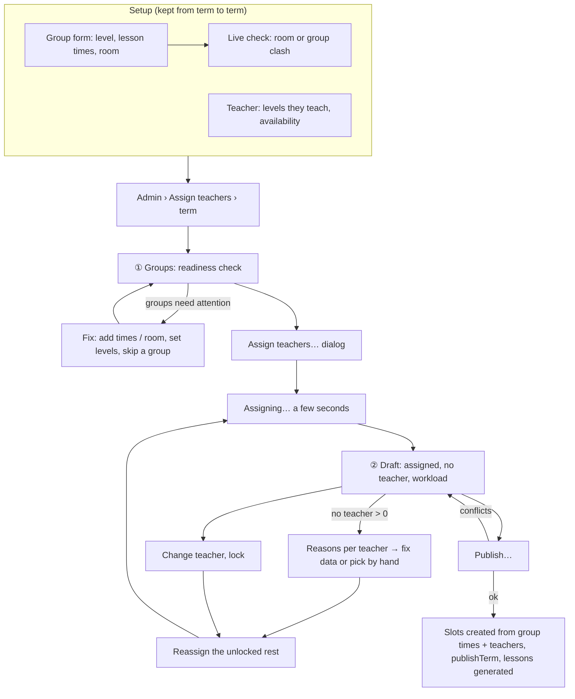
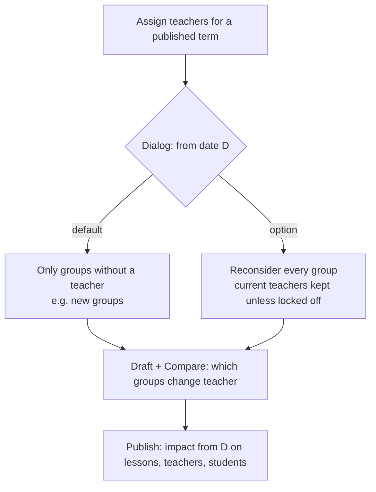

# Timetable generator: assign teachers (Phase 4)

Spec for the admin flow that fills a term's timetable automatically. Every
group's **days, times and room are set by the admin on the group**. The
generator's job is to **assign a teacher to each group** who teaches the
group's level and is free at all of its times, keeping workloads even. The
admin reviews and edits the draft, then publishes it through the existing
Phase 1 flow.

Builds on `docs/design/tokens.md`, `docs/design/app-layout.md`,
`docs/design/timetable.md` (editor grid, conflicts, publish dialog, result
toasts) and `docs/design/admin-data.md` (group and teacher forms). Clickable
wireframe: `docs/design/wireframes/timetable-generator.html`.

> **Model decided by the owner on CARM-54 (2026-10-14).** It replaces the
> first version of this spec, where the generator also chose days and
> times:
>
> 1. Every group has fixed lesson times (e.g. Tue + Thu 17:00–18:30), set
>    when the group is created, and they carry over from term to term.
> 2. The room is fixed per group too, set by the admin.
> 3. The generator assigns **one teacher per group** for the whole term,
>    from the teachers who teach the group's level and are available.
> 4. When several teachers fit, it prefers an **even workload**.
>
> The rules doc `docs/architecture/generator.md` (CARM-53, PR #29, merged)
> describes the earlier model and must be revised to match; §10 lists what
> changes there.

## 1. Goal

- Setting up a term is mostly done already: groups carry their lesson times
  and room from term to term, teachers carry the levels they teach and their
  availability. Assigning teachers for 60 groups is one click.
- The admin sees right away which groups got no teacher and **why, per
  teacher** ("Eva: unavailable on Thursdays after 16:00 · Tomas: teaching C1
  Business then"), and what would fix it.
- Changing an assignment by hand is a dropdown that only offers teachers who
  can take the group, with their workload, and says why the others can't.
- Nothing teachers or students see changes until the admin publishes, and
  the publish dialog says exactly what changes.

## 2. Roles

| Role    | Access                                                                                                 |
| ------- | ------------------------------------------------------------------------------------------------------ |
| Admin   | Everything on `/admin/timetable/generate`, plus the new fields on the group and teacher forms          |
| Teacher | None. No nav item; the route returns the 403 page (`errors.forbidden.*`). Drafts never appear for them |
| Student | None. Same as teacher                                                                                  |

Enforced server-side: every loader and server action goes through the admin
action wrapper (`requireRole("ADMIN")`) and `getSchoolScopedDb()`. Drafts
and runs of another school are "not found" (no existence leak). Teacher and
student views read only live `TimetableSlot`s and `Lesson`s of published
terms, so a draft can't leak by construction (CARM-57 covers it).

## 3. Concepts shown in the UI

| Concept                      | UI word (key)                                       | Meaning for the admin                                                                                                |
| ---------------------------- | --------------------------------------------------- | -------------------------------------------------------------------------------------------------------------------- |
| Group lesson time            | **Lesson times** (`groups.lessonTimes.*`)           | "Tue 17:00–18:30, Room 3". A group has one or more; they repeat every week of every term the group runs in.          |
| Levels a teacher teaches     | **Levels they teach** (`teachers.levels.*`)         | The levels the generator may give this teacher. Admins can still assign anyone by hand.                              |
| Teacher assignment           | **Teacher** of a group in the draft                 | One teacher for all of a group's lessons in the term.                                                                |
| Draft                        | **Draft** (`generator.draft.*`)                     | The proposed assignments for one term. Not visible to anyone else until published.                                   |
| Locked assignment            | **Locked** (`generator.lock.*`)                     | "Keep this teacher." Reassigning never changes it.                                                                   |
| Group without a teacher      | **No teacher** (`generator.unassigned.*`)           | No teacher could take all of the group's times. Always comes with the reason for each teacher who teaches the level. |
| Workload                     | **Workload** (`generator.workload.*`)               | Teaching hours a week per teacher. The generator keeps the spread between the busiest and least busy small.          |
| Hard / overridable conflicts | **Conflict** / **Warning** (`timetable.severity.*`) | As in the editor (`timetable.md` §3.1).                                                                              |

## 4. User flows

### 4.1 Set up once, assign every term



### 4.2 Term that is already published



## 5. Setup screens (additions to `admin-data.md`)

### 5.1 Group form: lesson times (§6.10 create/edit dialog and Details tab)

A new required section **Lesson times** below Capacity:

```
Lesson times                                              (required)
┌ Day ──────┐ ┌ Start ┐ ┌ End ──┐ ┌ Room ─────────────┐
│ Tuesday ▾ │ │ 17:00▾│ │ 18:30▾│ │ Room 3 · 8 seats ▾│  90 min   ✕
│ Thursday ▾│ │ 17:00▾│ │ 18:30▾│ │ Room 3 · 8 seats ▾│  90 min   ✕
└───────────┘ └───────┘ └───────┘ └───────────────────┘
+ Add lesson time
✓ No clashes.   (live check)
Every week, in every term this group runs. 2 lessons · 3 h a week.
```

| Field | Control                               | Rules                                                                                                                                               |
| ----- | ------------------------------------- | --------------------------------------------------------------------------------------------------------------------------------------------------- |
| Day   | `Select` (school days; others marked) | Required. Non-school days allowed with the editor's `OUTSIDE_SCHOOL_DAYS` warning.                                                                  |
| Start | time `Select`, 15-min steps           | Required; inside school hours or `OUTSIDE_SCHOOL_HOURS` warning.                                                                                    |
| End   | time `Select`, 15-min steps           | Required, after start (`validation.timeOrder`). Duration shown as text. Quick chips 45 · 60 · 90 min.                                               |
| Room  | `Combobox` (rooms, online rooms)      | Required (owner decision 2). A new row copies the previous row's room. Capacity shown; fewer seats than members → `ROOM_CAPACITY_EXCEEDED` warning. |

- At least one row; up to 7. Two rows of the same group may not overlap
  (`validation.lessonTimesOverlap`).
- **Live check** (debounced, as the slot sheet): room double-booked by
  another group's lesson time (blocking — fix before saving), a member of
  this group is in another group at the same time (warning, acknowledge to
  save), capacity, school days and hours. The teacher is not checked here:
  that's the generator's job.
- **1-on-1 groups** have lesson times too (the student's regular time);
  usually one row, often an online room.
- **Changing times of a group that is in a published term** (Q2): after
  saving, an info `Alert` "These times are used the next time teachers are
  assigned. The current timetable of {term} still has the old times." with
  _Change the current timetable too…_ → opens the editor's slot sheet for
  that group's slots with _Effective from_ (existing split flow). Saving the
  group never changes live slots silently.
- Group list (§6.10) gets a column **Lesson times** ("Tue, Thu 17:00") and a
  filter _No lesson times_; group detail shows them on the Details tab.

### 5.2 Teacher: levels they teach (new card on the Profile tab, §6.3)

```
Levels they teach
☑ A1 Beginner   ☑ A2 Elementary   ☑ B1 Intermediate
☑ B2 Upper-intermediate   ☐ C1 Advanced   ☐ C2 Proficient
Quick select: [Up to B2 ▾]   [All]   [None]
The generator only gives Tomas groups of these levels. You can still pick him for any group by hand.
```

- A checkbox per active level, ordered by `Level.rank`. **Quick select "Up
  to…"** ticks every level up to the chosen one in one click — most
  teachers are "up to X". A teacher who teaches only some levels (e.g. only
  kids' A1–A2, or only C1–C2 exam prep) just ticks those (owner decision,
  §13).
- Also in the teacher create dialog (optional there; default none).
- A teacher with **no levels** is never assigned by the generator; the
  readiness check lists them (§6.2).
- Teachers list (§6.1) gets a column **Levels** ("A1–B2", or "A1, C1–C2").
- Optional field **Max hours a week** (`Input type=number`, empty = no
  limit) for part-time teachers (Q3). The generator never goes above it.

Availability (§6.4) stays exactly as it is: weekly unavailability ("never
Wednesday afternoons") is a hard limit for the generator; one-off dates are
not (they're covered by a substitute) and only show as warnings.

## 6. Assign teachers: `/admin/timetable/generate?term=…&tab=…`

Nav item `nav.autoGenerate` is relabelled **Assign teachers** (icon
`wand-sparkles` stays). Desktop-first (≥ 1024 px); below that the route
shows a read-only summary card and `layout.desktopRecommended`.

### 6.1 Layout

```
┌ H1 Assign teachers ───────────────────────────────────────────────────────────────┐
│ [Term: Spring 2027 ▾] (Draft term)                       [⋯]  [Assign teachers…]   │
├────────────────────────────────────────────────────────────────────────────────────┤
│ ① Groups  58 ready · 3 need attention   │ ② Draft  52 of 58 assigned              │ tabs
├────────────────────────────────────────────────────────────────────────────────────┤
```

- **Term `Select`** as in the editor; term in the URL.
- **Tabs** (`Tabs`, `tab` in the URL), each with a one-line status:
  - Groups: "{ready} ready · {attention} need attention".
  - Draft: "{assigned} of {total} assigned" / "No draft yet" / "Assigning…" /
    "Out of date".
- **Assign teachers…** (primary) opens the dialog (§6.3). With a draft it
  reads **Reassign…**.
- **Overflow `⋯`**: _Open timetable editor_, _Discard draft…_, _Run history_.

### 6.2 Tab ① Groups (readiness)

Every active group of the school, with what the generator needs from it.

```
┌ Before you assign · 4 things to check ──────────────────────────────────────────────┐
│ ⛔ 2 groups have no lesson times and will be skipped.                    [Show]      │
│ ⚠ Nobody teaches C2. 1 group (C2 Proficiency) can't get a teacher.     [Teachers]   │
│ ⚠ Tue 17:00–18:30: 6 groups at A1–B1, only 4 teachers who teach them are free. [Show]│
│ ⚠ 2 teachers have no levels yet and won't be assigned.                 [Teachers]   │
└──────────────────────────────────────────────────────────────────────────────────────┘
[Search] Level [Any▾] Day [Any▾] Show [All | Needs attention | Skipped]
┌───────────────────────────────────────────────────────────────────────────────────────────┐
│ Group           │ Level │ Lesson times              │ Room    │ Students │ Can teach │ Status        │ ⋯ │
│ A1 Evening      │ A1    │ Tue, Thu 17:00–18:30      │ Room 3  │ 8        │ 5 teachers│ Ready         │ ⋯ │
│ A2 Morning      │ A2    │ Mon 08:00–09:30           │ Room 1  │ 6        │ 4 teachers│ Ready         │ ⋯ │
│ C2 Proficiency  │ C2    │ Wed 18:00–19:30           │ Online 1│ 4        │ 0         │ ⚠ No teacher teaches C2 │ ⋯ │
│ B2 Exam prep    │ B2    │ —                         │ —       │ 5        │ 3 teachers│ ⛔ No lesson times│ ⋯ │
│ ○ B1 Summer club│ B1    │ Sat 10:00–12:00           │ Room 2  │ 0        │ 4 teachers│ Skipped this term │ Include │
└───────────────────────────────────────────────────────────────────────────────────────────┘
58 groups · 104 lessons a week · 151 teaching hours · 20 teachers can give 168 h
```

**Columns:** Group (link → group detail) · Level · Lesson times (compact:
same time on several days is merged, "Tue, Thu 17:00–18:30") · Room ·
Students · **Can teach** ("5 teachers"; popover lists them with a ✓/✗ per
lesson time: "Eva ✗ Thu — unavailable") · Status · row menu (_Edit group_,
_Skip this term_ / _Include_).

**Status** values: _Ready_ (success) · _No lesson times_ (danger: skipped) ·
_No room_ (danger: skipped) · _No teacher teaches {level}_ (warning: will
end up without a teacher) · _Times clash_ (danger: room double-booked by
another group) · _Skipped this term_ (muted).

**Skip this term** keeps a group out of this term's assignment without
archiving it (e.g. a summer club in the spring term). Stored per group and
term.

**Readiness checks** (card above the table, recomputed on load and after
any change; cheap, no generator run):

| Check                                                   | Tone    | Copy (key)                                                                                                                  | Action       |
| ------------------------------------------------------- | ------- | --------------------------------------------------------------------------------------------------------------------------- | ------------ |
| Groups without lesson times or room                     | danger  | `generator.ready.noTimes` "{count} groups have no lesson times and will be skipped."                                        | _Show_       |
| Room double-booked by two groups                        | danger  | `generator.ready.roomClash` "{room} is used by {groupA} and {groupB} on {weekday} at {time}."                               | _Edit group_ |
| A level nobody teaches                                  | warning | `generator.ready.levelUncovered` "Nobody teaches {level}. {count} groups can't get a teacher."                              | _Teachers_   |
| More groups at one time than teachers who can take them | warning | `generator.ready.timeCrunch` "{day} {time}: {groups} groups at {levels}, only {teachers} teachers who teach them are free." | _Show_       |
| Teachers without levels                                 | warning | `generator.ready.teachersNoLevels` "{count} teachers have no levels yet and won't be assigned."                             | _Teachers_   |
| Total hours                                             | warning | `generator.ready.hours` "Groups need {need} h a week; teachers can give {can} h."                                           | —            |
| Student in two groups at the same time                  | warning | `generator.ready.studentClash` "{count} students are in two groups at the same time."                                       | _Show_       |
| All fine                                                | success | `generator.ready.ok` "Ready to assign teachers."                                                                            | —            |

The time-crunch check is the most useful one: it explains in advance why
some groups will end up without a teacher, before anyone runs anything.

Nothing here blocks assigning; groups that aren't ready are simply skipped
and listed.

### 6.3 Assign dialog

`Dialog` `generator.assign.title` "Assign teachers for {term}".

| Section           | Content                                                                                                                                                                                                                                                                                    |
| ----------------- | ------------------------------------------------------------------------------------------------------------------------------------------------------------------------------------------------------------------------------------------------------------------------------------------ |
| Included          | "{groups} groups, {teachers} teachers." If groups are skipped: warning line "{count} groups aren't ready and are skipped." + _Review_.                                                                                                                                                     |
| Existing teachers | Draft term that already has slots: **Keep current teachers** (default: their assignments are copied in as locked) / **Reassign everything**.                                                                                                                                               |
| From date         | Published term only: date picker, default the next Monday after today, inside the term. Hint "Lessons before this date are not touched." Then radio **Only groups without a teacher** (default — e.g. new groups) / **Reconsider every group** (current teachers are kept where possible). |
| On reassign       | Draft exists: "Keeps {locked} locked assignments. {unlocked} groups may get a different teacher."                                                                                                                                                                                          |
| Preference        | Read-only line: "When several teachers fit, workloads are kept as even as possible." (Only preference in v1; owner decision 4. A setting for others, e.g. keep last term's teacher, is a later addition.)                                                                                  |

Footer: _Cancel_ · **Assign teachers** (primary).

### 6.4 Running

Assignment for a school of this size takes seconds (the rules doc sets the
time budget). The dialog stays open with an inline progress line
`generator.run.running` "Assigning teachers… {assigned} of {total}
groups" and a _Cancel_ button; the page doesn't need a "you can leave"
state. If the run takes longer than 10 s, the dialog closes and the Draft
tab shows the progress card with _Cancel_; another admin opening the page
sees "{name} is assigning teachers (started {time})". Needs a
`role="progressbar"`; only completion is announced.

Done: the dialog closes, the Draft tab opens, toast `generator.run.done`
"{assigned} of {total} groups have a teacher." + _Show groups without a
teacher_ when any.

### 6.5 Tab ② Draft: summary

```
┌ Draft · not visible to teachers or students ──────────── Assigned 14 Oct 10:42 by Anna Novak ┐
│ ┌ Assigned ──────┐ ┌ No teacher ────────┐ ┌ Workload ──────────────┐ ┌ Issues ──────┐  [Compare to current] │
│ │ 52 / 58 groups │ │ 6 groups · Show    │ │ 5–9 h a week           │ │ 0 · 2 warnings│  [Publish…]           │
│ │                │ │                    │ │ average 7.5 h · Details │ │ Show         │                       │
│ └────────────────┘ └────────────────────┘ └────────────────────────┘ └──────────────┘                       │
└────────────────────────────────────────────────────────────────────────────────────────────────────────────┘
View: [By group | By teacher | Week]
```

- **Draft band** (`info` surface, `file-pen-line` icon): "Draft · not
  visible to teachers or students". Always on this tab.
- **Assigned**: "{assigned} / {total} groups", success when all.
- **No teacher**: danger when > 0; _Show_ filters the table to them.
- **Workload**: the range from the least to the most busy teacher
  ("5–9 h a week") and the average. This is the score the generator
  optimises (even workload); _Details_ switches to the By teacher view.
  Change since the previous run shown as text ("range was 4–10 h").
- **Issues**: conflicts (should be 0 after a run) and warnings in the draft
  (e.g. a teacher picked by hand who doesn't teach the level, or a one-off
  unavailability on some dates). _Show_ opens the issues panel (editor
  pattern, `timetable.md` §5.6).

### 6.6 By group (default view)

```
┌ Group          │ Level │ Lesson times          │ Room    │ Teacher                    │ 🔒 │ Notes                         ┐
│ ⛔ C2 Proficiency│ C2  │ Wed 18:00–19:30       │ Online 1│ [No teacher — choose ▾]    │    │ Nobody teaches C2 · Why?      │
│ ⛔ B1 Evening   │ B1    │ Tue, Thu 17:00–18:30 │ Room 3  │ [No teacher — choose ▾]    │    │ All 4 B1 teachers busy or unavailable · Why? │
│ A1 Evening     │ A1    │ Tue, Thu 17:00–18:30  │ Room 1  │ [Ana Kral ▾]               │ 🔒 │                               │
│ A2 Morning     │ A2    │ Mon 08:00–09:30       │ Room 1  │ [Eva Simon ▾]              │    │ ⚠ Eva is away on 12 Nov       │
│ C1 Business    │ C1    │ Wed 18:00–19:30       │ Room 2  │ [Tomas Horvat ▾]           │    │                               │
└──────────────────────────────────────────────────────────────────────────────────────────────────────────────────────┘
[Lock… ▾]  Filters: Level · Teacher · Day · [Only without teacher]
```

- Groups without a teacher are sorted to the top (danger tone, `octagon-x`
  - text "No teacher"). Everything else by group name; sortable.
- **Teacher** cell is a `Combobox` (the teacher picker below). Choosing a
  teacher saves to the draft and **locks** the row (owner-approved
  default: a hand-made choice is kept on reassign). Toast "Ana Kral now
  teaches B1 Evening (locked)." + _Undo_.
- **Lock** column: a toggle button per row (`aria-pressed`, label "Lock
  teacher for {group}"). _Lock…_ menu: _Lock all assigned_, _Lock all of
  {teacher}_, _Unlock all_.
- **Notes**: warnings for the row (one-off unavailability dates, level not
  taught, room capacity) and, for rows without a teacher, the short reason +
  _Why?_ (opens §6.7).
- **Reassign…** (header) reruns for all unlocked rows; toast "{changed}
  groups changed teacher, {assigned} newly assigned." + _Show changes_.

**Teacher picker** (`Combobox`, 360 px, searchable). Sections, in this order:

| Section (key)                                             | Who                                                                | Row shows                                | Selectable?                                                                     |
| --------------------------------------------------------- | ------------------------------------------------------------------ | ---------------------------------------- | ------------------------------------------------------------------------------- |
| **Available** (`generator.picker.available`)              | Teach the level, free at all of the group's times, under max hours | name · "6 h → 7.5 h a week"              | Yes                                                                             |
| **Unavailable** (`generator.picker.unavailable`)          | Weekly unavailability overlaps one of the times                    | name · "Unavailable Thu 16:00–20:00"     | Yes, with the editor's overridable warning (acknowledge before publishing)      |
| **Doesn't teach {level}** (`generator.picker.otherLevel`) | Free, but the level isn't in their list                            | name · "Teaches A1–A2"                   | Yes, with a warning (the admin decides)                                         |
| **Over max hours** (`generator.picker.overMax`)           | Would exceed their max hours a week                                | name · "8 h → 9.5 h (max 8 h)"           | Yes, with a warning                                                             |
| **Busy** (`generator.picker.busy`)                        | Teaching another group at one of the times                         | name · "Teaching C1 Business, Wed 18:00" | No (blocking double booking). Disabled with the reason as text, not only greyed |

Plus a first item **No teacher** to unassign (the row becomes "No teacher",
reason _Removed by you_).

### 6.7 Why no teacher? (panel)

Right `Sheet` 480 px, `generator.unassigned.title` "Groups without a
teacher ({count})", one card per group, or opened on a single group from
_Why?_:

```
┌ B1 Evening · Tue, Thu 17:00–18:30 · B1 ───────────────────────────────┐
│ None of the 4 teachers who teach B1 can take both times:              │
│  Tomas Horvat   ✗ Tue — teaching A2 Evening                           │
│  Eva Simon      ✗ Thu — unavailable (weekly, 16:00–20:00)             │
│  Ana Kral       ✗ Tue, Thu — teaching A1 Evening                      │
│  Peter Varga    ✗ would be 10.5 h, max 9 h a week                     │
│ Suggestions:                                                          │
│  • Ana Kral could take it if A1 Evening goes to Lucia Benova. [Apply] │
│ [Pick a teacher anyway ▾] [Edit group times] [Teacher levels]         │
└───────────────────────────────────────────────────────────────────────┘
```

- One line per teacher who teaches the level, with **why they can't**:
  _teaching {group}_ (with the day), _unavailable (weekly)_, _would exceed
  max hours_, _archived_. If nobody teaches the level: "Nobody teaches {level}."
  - _Teacher levels_.
- **Suggestion** (if the rules doc provides it, Q4): a one-swap fix — a
  teacher who could take this group if one of their groups moves to
  someone who is free. _Apply_ makes both changes in the draft (locked).
- Actions: _Pick a teacher anyway_ (the picker, §6.6), _Edit group times_
  (group form in a new tab; the draft becomes out of date), _Teacher
  levels_ / _Availability_.
- Footer: "Fix the data, then reassign to try again." + _Reassign…_.
- Empty: "Every group has a teacher." (success).

### 6.8 By teacher view (workload)

Table, one row per teacher (archived excluded):

| Column  | Content                                                                                                  |
| ------- | -------------------------------------------------------------------------------------------------------- |
| Teacher | name, color dot                                                                                          |
| Levels  | "A1–B2"                                                                                                  |
| Groups  | count; expand row to list them (group, times, room) with the same picker to move a group to someone else |
| Hours   | "7.5 h" + a horizontal bar against the average line (text value always shown; the bar is decoration)     |
| Days    | "Mon, Tue, Thu" (teaching days)                                                                          |
| Max     | "max 8 h" when set                                                                                       |

Sorted by hours, busiest first. Teachers with 0 h are listed (they may be
the fix for a group without a teacher). Selecting a teacher opens the
**Week** view filtered to them (editor grid, read-only blocks, draft
dashed outline, their weekly unavailability hatched).

### 6.9 Week view

The editor grid (`timetable.md` §5.2–5.3) in _Week_ mode for one teacher,
room or group, showing the draft's lessons (group times + assigned
teacher). Blocks have the dashed draft outline and a lock icon when locked.
Times can't be dragged here (times belong to the group); clicking a block
opens a small sheet with the group, its times and the teacher picker.

### 6.10 Compare to current

Only when the term already has teachers on its slots. `ToggleGroup`
_Draft · Compare_ in the toolbar. In By group view, a column **Was**
shows the current teacher when it differs (badge "Changed", warning tone);
unchanged rows are dimmed. Summary line: "{changed} groups change teacher ·
{teachers} teachers and {students} students affected" + _List changes_
(printable list per teacher, so they can be told before publishing).

### 6.11 Out of date

When group times, rooms, members, teacher levels, availability or max
hours change after the run, the Draft tab shows **Out of date** and a
warning `Alert` "Things changed since teachers were assigned: {changes}."
with _Check draft_ (re-runs the check: new conflicts and warnings appear on
the rows) and _Reassign…_. Publishing re-checks on the server anyway.

## 7. Publish

**Publish…** opens `Dialog` "Publish teacher assignments for {term}?".
Publishing creates one live `TimetableSlot` per group lesson time (day,
start, end, room from the group; teacher from the draft) and then runs the
existing `publishTerm` checks, in one server action under the timetable
lock (rules doc `applyDraft`).

### 7.1 Draft term (not published yet)

- "{count} groups, {slots} weekly lessons."
- If the term has slots from the editor: "Replaces the {count} slots in
  the timetable editor."
- "Lessons will be created from {start} to {end}" (as the editor).
- "{count} warnings acknowledged" + _Review_ (overridable warnings must be
  ticked, as in the editor).
- "{count} groups have no teacher and won't get lessons." (warning) +
  _Show_. Allowed: those groups can be added in the editor later.
- Buttons: **Publish timetable** (primary) or **Save to the timetable
  editor only** (outline: creates the slots, term stays a draft).

### 7.2 Published term (from a date)

- "Changes apply from {date}. Lessons before then are not touched."
- "{changed} groups get a different teacher; {new} groups start."
- Lesson impact from the rules doc's preview: "{moved} future lessons get
  the new teacher; {cancelled} kept as cancelled because they have
  attendance, absences, homework or a substitute." (Q5)
- "{teachers} teachers and {students} students are affected." + _List
  changes_.
- Required checkbox "I understand this changes the timetable for teachers
  and students from {date}." Primary **Apply changes** (blue; red is only
  for deleting).

### 7.3 Running, blocked, failed, done

As the editor's publish dialog (`timetable.md` §5.7): non-closable while
running ("Publishing… creating lessons"); **blocked** by conflicts with
the slots listed and _Show issues_; `generator.publish.liveChanged` when
the editor changed the term meanwhile and that created conflicts; failure
"Couldn't publish. Nothing was changed. Try again."; success toast
"{term} published. {count} lessons created." and the page switches to the
editor with the published banner.

## 8. States

| Where  | State                          | UI (key)                                                                                                                            |
| ------ | ------------------------------ | ----------------------------------------------------------------------------------------------------------------------------------- |
| Page   | No terms                       | Editor's empty card `timetable.editor.empty.noTerm.*`.                                                                              |
| Page   | No groups                      | Empty card `generator.empty.noGroups` "No groups yet" / "Create groups with their lesson times first." / _Go to Courses & groups_.  |
| Page   | No teachers / none with levels | Info `Alert` `generator.empty.noTeachers` "Add teachers and set the levels they teach." + _Go to Teachers_.                         |
| Page   | Term has ended                 | Read-only, `generator.termEnded` "This term has ended. Choose a current or future term."                                            |
| Page   | Loading / load error           | Skeleton table / destructive `Alert` + _Try again_.                                                                                 |
| Page   | < 1024 px                      | Summary card + `layout.desktopRecommended`.                                                                                         |
| Page   | Not an admin                   | 403 page; nav item hidden.                                                                                                          |
| Groups | Nothing ready                  | Assign dialog body `generator.assign.nothing` "No group is ready yet. Add lesson times and a room to your groups." + _Show groups_. |
| Groups | Filter with no result          | `common.noResults` + _Clear filters_.                                                                                               |
| Run    | Another run in progress        | `generator.run.inProgress` "{name} is assigning teachers for this term (started {time})." with its progress.                        |
| Run    | Failed                         | `generator.run.failed` "Assigning failed. The previous draft is unchanged." + _Try again_ + _Copy error ID_.                        |
| Draft  | No draft yet                   | Empty card "No draft yet" / "Check the groups, then assign teachers." / **Assign teachers…**.                                       |
| Draft  | Nobody assigned                | Danger `Alert` "No group could get a teacher. Most common reason: {reason}." + _Show_.                                              |
| Draft  | Out of date                    | §6.11.                                                                                                                              |
| Draft  | Edited by someone else         | `common.error.staleData` + _Reload_ on save.                                                                                        |

## 9. Copy (i18n keys, English source)

Namespace `generator` (`messages/en-GB/generator.json`), plus additions to
`groups`, `teachers` and `nav`. Reused, not duplicated: `timetable.*`,
`scheduling.conflicts.*`, `scheduling.errors.*`, `common.*`,
`validation.*`, `errors.forbidden.*`, `layout.desktopRecommended`.

### Setup

| Key                                | Copy                                                                                                               |
| ---------------------------------- | ------------------------------------------------------------------------------------------------------------------ |
| `nav.autoGenerate`                 | Assign teachers (was "Auto-generate")                                                                              |
| `groups.lessonTimes.title`         | Lesson times                                                                                                       |
| `groups.lessonTimes.day`           | Day                                                                                                                |
| `groups.lessonTimes.start`         | Start                                                                                                              |
| `groups.lessonTimes.end`           | End                                                                                                                |
| `groups.lessonTimes.room`          | Room                                                                                                               |
| `groups.lessonTimes.add`           | Add lesson time                                                                                                    |
| `groups.lessonTimes.remove`        | Remove lesson time                                                                                                 |
| `groups.lessonTimes.summary`       | Every week, in every term this group runs. {count, plural, one {# lesson} other {# lessons}} · {hours} h a week.   |
| `groups.lessonTimes.ok`            | No clashes.                                                                                                        |
| `groups.lessonTimes.column`        | Lesson times                                                                                                       |
| `groups.lessonTimes.none`          | No lesson times                                                                                                    |
| `groups.lessonTimes.changedNote`   | These times are used the next time teachers are assigned. The current timetable of {term} still has the old times. |
| `groups.lessonTimes.changeCurrent` | Change the current timetable too…                                                                                  |
| `validation.lessonTimesOverlap`    | Two lesson times of this group overlap.                                                                            |
| `validation.lessonTimesRequired`   | Add at least one lesson time.                                                                                      |
| `teachers.levels.title`            | Levels they teach                                                                                                  |
| `teachers.levels.upTo`             | Up to…                                                                                                             |
| `teachers.levels.all`              | All                                                                                                                |
| `teachers.levels.none`             | None                                                                                                               |
| `teachers.levels.help`             | The generator only gives {name} groups of these levels. You can still pick {name} for any group by hand.           |
| `teachers.levels.column`           | Levels                                                                                                             |
| `teachers.levels.empty`            | No levels set                                                                                                      |
| `teachers.maxHours.label`          | Max hours a week                                                                                                   |
| `teachers.maxHours.help`           | Leave empty for no limit. The generator never assigns more.                                                        |

### Assign teachers

| Key                                         | Copy                                                                                                                                                            |
| ------------------------------------------- | --------------------------------------------------------------------------------------------------------------------------------------------------------------- |
| `generator.title`                           | Assign teachers                                                                                                                                                 |
| `generator.tabs.groups`                     | Groups                                                                                                                                                          |
| `generator.tabs.groupsStatus`               | {ready} ready · {attention, plural, =0 {all set} other {# need attention}}                                                                                      |
| `generator.tabs.draft`                      | Draft                                                                                                                                                           |
| `generator.tabs.draftStatus`                | {assigned} of {total} assigned                                                                                                                                  |
| `generator.tabs.draftNone`                  | No draft yet                                                                                                                                                    |
| `generator.tabs.draftRunning`               | Assigning…                                                                                                                                                      |
| `generator.tabs.draftStale`                 | Out of date                                                                                                                                                     |
| `generator.actions.assign`                  | Assign teachers…                                                                                                                                                |
| `generator.actions.reassign`                | Reassign…                                                                                                                                                       |
| `generator.actions.openEditor`              | Open timetable editor                                                                                                                                           |
| `generator.actions.discardDraft`            | Discard draft…                                                                                                                                                  |
| `generator.actions.runHistory`              | Run history                                                                                                                                                     |
| `generator.groups.col.group`                | Group                                                                                                                                                           |
| `generator.groups.col.level`                | Level                                                                                                                                                           |
| `generator.groups.col.times`                | Lesson times                                                                                                                                                    |
| `generator.groups.col.room`                 | Room                                                                                                                                                            |
| `generator.groups.col.students`             | Students                                                                                                                                                        |
| `generator.groups.col.canTeach`             | Can teach                                                                                                                                                       |
| `generator.groups.col.status`               | Status                                                                                                                                                          |
| `generator.groups.canTeachCount`            | {count, plural, =0 {Nobody} one {# teacher} other {# teachers}}                                                                                                 |
| `generator.groups.status.ready`             | Ready                                                                                                                                                           |
| `generator.groups.status.noTimes`           | No lesson times                                                                                                                                                 |
| `generator.groups.status.noRoom`            | No room                                                                                                                                                         |
| `generator.groups.status.noTeacherForLevel` | Nobody teaches {level}                                                                                                                                          |
| `generator.groups.status.timesClash`        | Times clash                                                                                                                                                     |
| `generator.groups.status.skipped`           | Skipped this term                                                                                                                                               |
| `generator.groups.skip`                     | Skip this term                                                                                                                                                  |
| `generator.groups.include`                  | Include                                                                                                                                                         |
| `generator.groups.editGroup`                | Edit group                                                                                                                                                      |
| `generator.groups.summary`                  | {groups} groups · {lessons} lessons a week · {need} teaching hours · {teachers} teachers can give {can} h                                                       |
| `generator.ready.title`                     | Before you assign                                                                                                                                               |
| `generator.ready.ok`                        | Ready to assign teachers.                                                                                                                                       |
| `generator.ready.noTimes`                   | {count, plural, one {# group has} other {# groups have}} no lesson times or room and will be skipped.                                                           |
| `generator.ready.roomClash`                 | {room} is used by {groupA} and {groupB} on {weekday} at {time}.                                                                                                 |
| `generator.ready.levelUncovered`            | Nobody teaches {level}. {count, plural, one {# group} other {# groups}} can't get a teacher.                                                                    |
| `generator.ready.timeCrunch`                | {day} {time}: {groups} groups at {levels}, only {teachers} teachers who teach them are free.                                                                    |
| `generator.ready.teachersNoLevels`          | {count, plural, one {# teacher has} other {# teachers have}} no levels yet and won't be assigned.                                                               |
| `generator.ready.hours`                     | Groups need {need} h a week; teachers can give {can} h.                                                                                                         |
| `generator.ready.studentClash`              | {count, plural, one {# student is} other {# students are}} in two groups at the same time.                                                                      |
| `generator.assign.title`                    | Assign teachers for {term}                                                                                                                                      |
| `generator.assign.included`                 | {groups, plural, one {# group} other {# groups}}, {teachers, plural, one {# teacher} other {# teachers}}.                                                       |
| `generator.assign.skipped`                  | {count, plural, one {# group isn't ready and is skipped.} other {# groups aren't ready and are skipped.}}                                                       |
| `generator.assign.keepCurrent`              | Keep current teachers                                                                                                                                           |
| `generator.assign.reassignAll`              | Reassign everything                                                                                                                                             |
| `generator.assign.fromDate`                 | From                                                                                                                                                            |
| `generator.assign.fromDateHint`             | Lessons before this date are not touched.                                                                                                                       |
| `generator.assign.onlyUnassigned`           | Only groups without a teacher                                                                                                                                   |
| `generator.assign.reconsiderAll`            | Reconsider every group                                                                                                                                          |
| `generator.assign.keepsLocked`              | Keeps {locked, plural, one {# locked assignment} other {# locked assignments}}. {unlocked, plural, one {# group} other {# groups}} may get a different teacher. |
| `generator.assign.preference`               | When several teachers fit, workloads are kept as even as possible.                                                                                              |
| `generator.assign.nothing`                  | No group is ready yet. Add lesson times and a room to your groups.                                                                                              |
| `generator.assign.confirm`                  | Assign teachers                                                                                                                                                 |
| `generator.run.running`                     | Assigning teachers… {assigned} of {total} groups                                                                                                                |
| `generator.run.inProgress`                  | {name} is assigning teachers for this term (started {time}).                                                                                                    |
| `generator.run.done`                        | {assigned} of {total} groups have a teacher.                                                                                                                    |
| `generator.run.showUnassigned`              | Show groups without a teacher                                                                                                                                   |
| `generator.run.failed`                      | Assigning failed. The previous draft is unchanged.                                                                                                              |
| `generator.run.copyErrorId`                 | Copy error ID                                                                                                                                                   |
| `generator.draft.band`                      | Draft · not visible to teachers or students                                                                                                                     |
| `generator.draft.assignedBy`                | Assigned {date} by {name}                                                                                                                                       |
| `generator.draft.assigned`                  | Assigned                                                                                                                                                        |
| `generator.draft.assignedValue`             | {assigned} / {total} groups                                                                                                                                     |
| `generator.draft.noTeacher`                 | No teacher                                                                                                                                                      |
| `generator.draft.noTeacherValue`            | {count, plural, =0 {None} one {# group} other {# groups}}                                                                                                       |
| `generator.draft.issues`                    | Issues                                                                                                                                                          |
| `generator.draft.view.byGroup`              | By group                                                                                                                                                        |
| `generator.draft.view.byTeacher`            | By teacher                                                                                                                                                      |
| `generator.draft.view.week`                 | Week                                                                                                                                                            |
| `generator.draft.onlyUnassigned`            | Only without teacher                                                                                                                                            |
| `generator.draft.empty.title`               | No draft yet                                                                                                                                                    |
| `generator.draft.empty.description`         | Check the groups, then assign teachers.                                                                                                                         |
| `generator.draft.nobodyAssigned`            | No group could get a teacher. Most common reason: {reason}.                                                                                                     |
| `generator.draft.stale`                     | Things changed since teachers were assigned: {changes}.                                                                                                         |
| `generator.draft.check`                     | Check draft                                                                                                                                                     |
| `generator.draft.reassigned`                | {changed, plural, one {# group changed teacher} other {# groups changed teacher}}, {assigned} newly assigned.                                                   |
| `generator.draft.showChanges`               | Show changes                                                                                                                                                    |
| `generator.draft.teacherSet`                | {teacher} now teaches {group} (locked).                                                                                                                         |
| `generator.workload.title`                  | Workload                                                                                                                                                        |
| `generator.workload.range`                  | {min}–{max} h a week                                                                                                                                            |
| `generator.workload.average`                | average {average} h                                                                                                                                             |
| `generator.workload.previous`               | range was {min}–{max} h                                                                                                                                         |
| `generator.workload.details`                | Details                                                                                                                                                         |
| `generator.workload.hours`                  | {hours} h                                                                                                                                                       |
| `generator.workload.max`                    | max {hours} h                                                                                                                                                   |
| `generator.lock.menu`                       | Lock…                                                                                                                                                           |
| `generator.lock.toggle`                     | Lock teacher for {group}                                                                                                                                        |
| `generator.lock.allAssigned`                | Lock all assigned                                                                                                                                               |
| `generator.lock.teacher`                    | Lock all of {teacher}                                                                                                                                           |
| `generator.lock.unlockAll`                  | Unlock all                                                                                                                                                      |
| `generator.picker.noTeacher`                | No teacher                                                                                                                                                      |
| `generator.picker.available`                | Available                                                                                                                                                       |
| `generator.picker.unavailable`              | Unavailable                                                                                                                                                     |
| `generator.picker.otherLevel`               | Doesn't teach {level}                                                                                                                                           |
| `generator.picker.overMax`                  | Over max hours                                                                                                                                                  |
| `generator.picker.busy`                     | Busy                                                                                                                                                            |
| `generator.picker.load`                     | {from} h → {to} h a week                                                                                                                                        |
| `generator.picker.unavailableAt`            | Unavailable {weekday} {time}                                                                                                                                    |
| `generator.picker.teaches`                  | Teaches {levels}                                                                                                                                                |
| `generator.picker.overMaxLoad`              | {from} h → {to} h (max {max} h)                                                                                                                                 |
| `generator.picker.teachingOther`            | Teaching {group}, {weekday} {time}                                                                                                                              |
| `generator.unassigned.title`                | Groups without a teacher ({count})                                                                                                                              |
| `generator.unassigned.why`                  | Why?                                                                                                                                                            |
| `generator.unassigned.intro`                | None of the {count} teachers who teach {level} can take all of these times:                                                                                     |
| `generator.unassigned.nobodyTeaches`        | Nobody teaches {level}.                                                                                                                                         |
| `generator.unassigned.reason.busy`          | {weekday} — teaching {group}                                                                                                                                    |
| `generator.unassigned.reason.unavailable`   | {weekday} — unavailable (weekly, {time})                                                                                                                        |
| `generator.unassigned.reason.maxHours`      | would be {hours} h, max {max} h a week                                                                                                                          |
| `generator.unassigned.reason.removed`       | You removed the teacher.                                                                                                                                        |
| `generator.unassigned.suggestion`           | {teacher} could take it if {otherGroup} goes to {otherTeacher}.                                                                                                 |
| `generator.unassigned.apply`                | Apply                                                                                                                                                           |
| `generator.unassigned.pickAnyway`           | Pick a teacher anyway                                                                                                                                           |
| `generator.unassigned.editTimes`            | Edit group times                                                                                                                                                |
| `generator.unassigned.teacherLevels`        | Teacher levels                                                                                                                                                  |
| `generator.unassigned.footer`               | Fix the data, then reassign to try again.                                                                                                                       |
| `generator.unassigned.empty`                | Every group has a teacher.                                                                                                                                      |
| `generator.compare.toggleDraft`             | Draft                                                                                                                                                           |
| `generator.compare.toggleCompare`           | Compare                                                                                                                                                         |
| `generator.compare.was`                     | Was                                                                                                                                                             |
| `generator.compare.changed`                 | Changed                                                                                                                                                         |
| `generator.compare.summary`                 | {changed, plural, one {# group changes} other {# groups change}} teacher · {teachers} teachers and {students} students affected                                 |
| `generator.compare.list`                    | List changes                                                                                                                                                    |
| `generator.publish.action`                  | Publish…                                                                                                                                                        |
| `generator.publish.title`                   | Publish teacher assignments for {term}?                                                                                                                         |
| `generator.publish.groups`                  | {groups, plural, one {# group} other {# groups}}, {slots, plural, one {# weekly lesson} other {# weekly lessons}}.                                              |
| `generator.publish.replaces`                | Replaces the {count, plural, one {# slot} other {# slots}} in the timetable editor.                                                                             |
| `generator.publish.unassigned`              | {count, plural, one {# group has no teacher and won't get lessons.} other {# groups have no teacher and won't get lessons.}}                                    |
| `generator.publish.confirm`                 | Publish timetable                                                                                                                                               |
| `generator.publish.toEditor`                | Save to the timetable editor only                                                                                                                               |
| `generator.publish.fromDate`                | Changes apply from {date}. Lessons before then are not touched.                                                                                                 |
| `generator.publish.changes`                 | {changed, plural, one {# group gets} other {# groups get}} a different teacher; {new, plural, =0 {no new groups} one {# group starts} other {# groups start}}.  |
| `generator.publish.lessons`                 | {moved} future lessons get the new teacher; {cancelled} kept as cancelled because they have attendance, absences, homework or a substitute.                     |
| `generator.publish.people`                  | {teachers} teachers and {students} students are affected.                                                                                                       |
| `generator.publish.understand`              | I understand this changes the timetable for teachers and students from {date}.                                                                                  |
| `generator.publish.apply`                   | Apply changes                                                                                                                                                   |
| `generator.publish.running`                 | Publishing… creating lessons                                                                                                                                    |
| `generator.publish.liveChanged`             | The timetable was changed in the editor after this draft was made. Review the new issues.                                                                       |
| `generator.publish.done`                    | {term} published. {count, plural, one {# lesson} other {# lessons}} created.                                                                                    |
| `generator.empty.noGroups.title`            | No groups yet                                                                                                                                                   |
| `generator.empty.noGroups.description`      | Create groups with their lesson times first.                                                                                                                    |
| `generator.empty.noGroups.action`           | Go to Courses & groups                                                                                                                                          |
| `generator.empty.noTeachers`                | Add teachers and set the levels they teach.                                                                                                                     |
| `generator.termEnded`                       | This term has ended. Choose a current or future term.                                                                                                           |

## 10. What changes in the rules doc (`generator.md`, CARM-53)

For the Scheduling Engineer's revision; the UI above assumes these.

| Area              | Was (merged)                                                                                                                                                      | Now                                                                                                                                                                                                                                                |
| ----------------- | ----------------------------------------------------------------------------------------------------------------------------------------------------------------- | -------------------------------------------------------------------------------------------------------------------------------------------------------------------------------------------------------------------------------------------------- |
| Input             | `TimetableDemand` per group and term (lessons a week, duration, teacher, pins)                                                                                    | **Group lesson times** on the group (weekday, start, end, room), kept across terms; a per-term "skip" flag. No demand table.                                                                                                                       |
| Teachers          | Fixed teacher or "any of" list per demand row; no levels table                                                                                                    | **`TeacherLevel`** (teacher × level) decides eligibility; optional `TeacherProfile.maxMinutesPerWeek`.                                                                                                                                             |
| Decision variable | Weekday, start, room and teacher per lesson                                                                                                                       | **Teacher per group** (one for all its lesson times in the term).                                                                                                                                                                                  |
| Hard rules        | Everything `checkLesson` blocks, weekly unavailability, student clashes                                                                                           | Teacher teaches the level; free at **all** the group's times (no teacher double booking, weekly unavailability hard); max hours. Room/group/student clashes are properties of the group times, reported by readiness, not solved by the generator. |
| Soft              | Gaps, spread, stable time, daily max, preferred rooms, one-off unavailability                                                                                     | **Even workload** (v1). One-off unavailability: warning only. Later, as a school setting: keep last term's teacher, or rotate.                                                                                                                     |
| Not placed        | Reason codes per demand unit                                                                                                                                      | Per group without a teacher: the reason **per eligible teacher** (busy with {group}, unavailable, max hours) or "nobody teaches {level}"; optional one-swap suggestion.                                                                            |
| Draft             | `TimetableDraftSlot` with time, room, teacher                                                                                                                     | Assignment per group (teacher, locked, origin). Lessons in the draft are group times × assignment.                                                                                                                                                 |
| Unchanged         | Draft lifecycle, lock/regenerate, staleness, `applyDraft` / `previewApply`, publish via `publishTerm`, FILL / REPLAN_FROM for published terms, concurrency, audit | Same, with "assignment" instead of "slot". FILL = only groups without a teacher; REPLAN_FROM = reconsider every group from _D_.                                                                                                                    |

Also proposed for the scheduling module: a new overridable conflict
`TEACHER_LEVEL_NOT_TAUGHT` so the editor warns too when a slot's teacher
doesn't teach the group's level.

## 11. Accessibility

- Readiness and draft tables are real `<table>`s; the teacher picker cell's
  accessible name includes the group ("Teacher for B1 Evening").
- Picker sections are `group`s with labels; disabled "Busy" options keep
  their reason in the accessible name ("Tomas Horvat, busy: teaching C1
  Business, Wednesday 18:00").
- "No teacher" rows: icon + text, not color alone. Lock toggles use
  `aria-pressed`.
- Workload bars are decorative; the hours are text.
- The draft is identified by the band, the tab label and the page title,
  not only by the dashed outline in the Week view.
- Group form lesson-time rows: each control is labelled with its row
  ("Day, lesson time 2"); _Remove_ buttons say which row; the live check
  is `aria-live="polite"` announcing only the summary.

## 12. Edge cases

- **Group with lesson times on different rooms** per day: allowed (room per
  row).
- **Teacher's levels change after the run**: draft out of date; assignments
  to a level they no longer teach show the level warning on Check.
- **Teacher archived**: their assignments become "No teacher" on Check;
  publishing is blocked until the rows are fixed (the slot would have an
  archived teacher).
- **New group added after the run**: appears in the Groups tab; the draft
  is out of date; _Reassign…_ (or pick by hand) assigns it.
- **Group times changed after the run**: out of date; the assigned teacher
  may now be busy or unavailable at the new time — Check shows it.
- **1-on-1 groups**: same rules; level from the group (the student's
  level).
- **Two published terms overlap**: teachers busy in the other term at the
  same time count as busy (live data of every overlapping term is the
  fixed context, as today).
- **A teacher with lots of levels and no limit**: even workload keeps them
  from getting everything; with max hours empty, the spread is the only
  limit.
- **Editor edits after publishing**: the editor still works slot by slot
  (time, room, teacher from a date). If a slot's time no longer matches
  its group's lesson times, the slot sheet shows "Different from the
  group's lesson times (Tue 17:00)" with a link to the group (Q2).

## 13. Decisions and open questions

Owner decisions (2026-10-14, CARM-54): fixed times per group, kept across
terms; room fixed per group; one teacher per group per term; even workload
as the only preference in v1, with a school setting for other preferences
(e.g. rotate vs keep teachers) as a later addition. Levels a teacher
teaches are a **tick box per level** with an "Up to…" shortcut (§5.2), not
a single "up to level X" (stored as `TeacherLevel` rows, one per level).

Open:

1. (Resolved: levels per teacher, see above.)
2. **Q2 — Changing a group's times mid-term.** Recommended: saving the
   group never changes the live timetable; an alert offers to change the
   current term's slots from a date (existing editor flow).
3. **Q3 — Part-time teachers.** "Even workload" between a full-time and a
   part-time teacher isn't fair without a limit. Recommended: an optional
   **max hours a week** per teacher (§5.2).
4. **Q4 — Swap suggestions** ("Ana could take it if A1 Evening goes to
   Lucia"). Nice to have; depends on the rules doc.
5. **Q5 — Teacher change in a published term**: future lessons with
   attendance, absences or homework — keep them with the new teacher, or
   cancel and re-create (the merged rules doc cancels changed slots'
   lessons with history)? Recommended: a teacher-only change updates the
   teacher on future lessons in place and cancels nothing; needs a rules
   doc decision.
