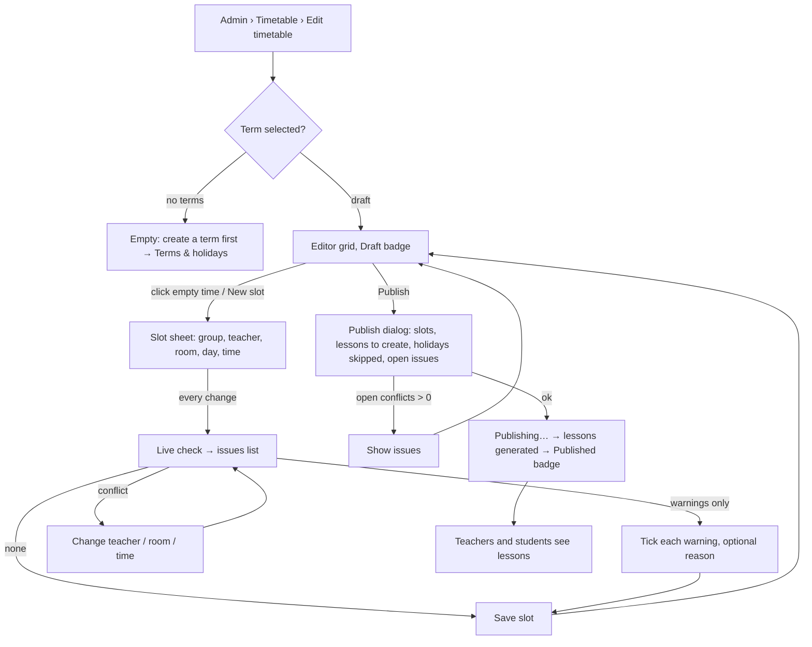
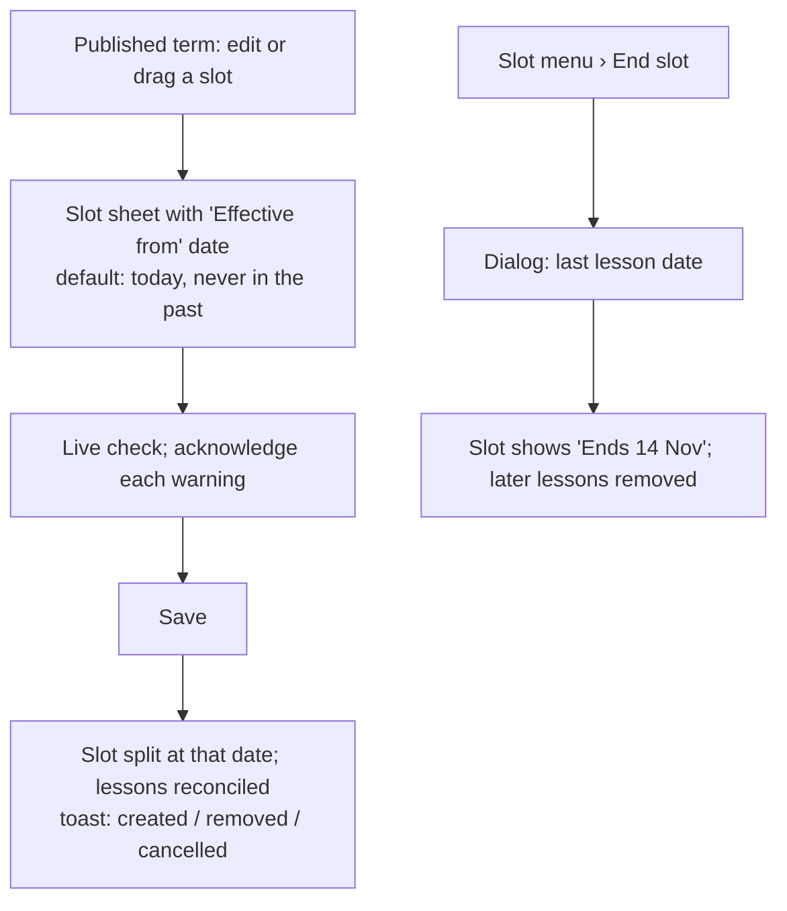
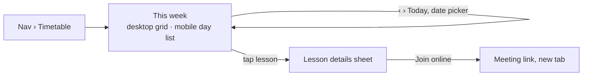

# Timetable: editor & weekly views (Phase 1)

Spec for the admin **timetable editor** (recurring `TimetableSlot`s per term,
conflict checking, override, ending slots, publishing and generating lessons)
and the read-only **weekly timetable** for admin, teacher and student (dated
`Lesson`s). Builds on `docs/design/tokens.md` and `docs/design/app-layout.md`
§7.5 (first look at the grid), and on the scheduling module from CARM-23
(`src/server/scheduling/`, `docs/architecture/scheduling.md`). Admin data
screens are in `docs/design/admin-data.md`. Clickable wireframe:
`docs/design/wireframes/timetable.html`.

## 1. Goal

- An admin builds a term's weekly timetable by hand on desktop, sees every
  conflict **while** placing a slot, with a readable reason, and can
  consciously override the ones that are allowed.
- Publishing is one deliberate step that makes lessons appear for teachers
  and students. After that, changes are safe: they only touch the future and
  say exactly what will change.
- Teachers and students see "what do I have this week" in two seconds — the
  student on a phone.

## 2. Roles

| Role    | Screens                                                                                        | Data                                                                          |
| ------- | ---------------------------------------------------------------------------------------------- | ----------------------------------------------------------------------------- |
| Admin   | Editor `/admin/timetable/edit` (desktop ≥ 1024) · weekly view `/admin/timetable` (all lessons) | All slots and lessons of the school, draft and published terms                |
| Teacher | Weekly view `/teacher/timetable`                                                               | Own lessons (as regular teacher or substitute) of **published** terms         |
| Student | Weekly view `/student/timetable` (mobile-first)                                                | Lessons of groups they are a member of on that date, **published** terms only |

Enforced server-side: the lesson queries for teacher/student filter by the
signed-in profile and `Term.timetablePublishedAt IS NOT NULL`; editor actions
require ADMIN. The details sheet never includes teacher notes (P2) for
students.

## 3. Concepts shown in the UI

| Concept         | UI word (key)                             | Meaning                                                                                 |
| --------------- | ----------------------------------------- | --------------------------------------------------------------------------------------- |
| `TimetableSlot` | **Slot** (`timetable.editor.slot`)        | "B1 Evening, every Monday 17:00–18:30, Tomas, Room 3" within a term, from/until a date. |
| `Lesson`        | **Lesson** (`timetable.lesson`)           | One dated occurrence, e.g. Mon 20 Oct 17:00. What teachers/students see.                |
| Draft term      | **Draft** badge                           | `timetablePublishedAt` null. Only admins see it (not teachers); no lessons exist yet.   |
| Published term  | **Published** badge                       | Lessons generated; teachers and students see them; edits apply from a date onwards.     |
| Conflict        | **Issue** (`scheduling.conflicts.<TYPE>`) | Returned by the scheduling module (CARM-23). Two severities, below.                     |

The scheduling module is the source of truth for types, severities and
lifecycle: `docs/architecture/scheduling.md` and
`messages/en-GB/scheduling.json` (CARM-23, PR #8). This spec only decides
how they look and behave in the UI.

### 3.1 Conflict severities

| Severity (module) | Badge label (key)                            | Help text (key, module copy)                          | Look                                    | Can save?                                                                                            |
| ----------------- | -------------------------------------------- | ----------------------------------------------------- | --------------------------------------- | ---------------------------------------------------------------------------------------------------- |
| `blocking`        | **Conflict** (`timetable.severity.blocking`) | `scheduling.severity.blocking` "Cannot be saved"      | `danger` tokens, icon `octagon-x`       | No — not even by an admin. No override control is shown. Change the slot.                            |
| `overridable`     | **Warning** (`timetable.severity.warning`)   | `scheduling.severity.overridable` "Can be overridden" | `warning` tokens, icon `triangle-alert` | Yes, after the admin acknowledges **each** warning (one checkbox per warning). Recorded in AuditLog. |

The short badge labels are UI keys; the module's severity strings are shown
as the section's help text under the "Conflicts" / "Warnings" headings. Icon

- label are always shown; color only reinforces (tokens §1).

### 3.2 Conflict types

All copy comes from `scheduling.conflicts.<TYPE>` (ICU, module-owned). The
UI formats the raw params before passing them in: `firstDate`
(`YYYY-MM-DD`) → `dateTime` medium date ("Mon 20 Oct 2026"), `otherTime`
and `time` stay `HH:MM–HH:MM`.

| Type                          | Severity    | Typical fix offered next to the message                      |
| ----------------------------- | ----------- | ------------------------------------------------------------ |
| `INVALID_TIME`                | blocking    | — (also caught by field validation, shown on the time field) |
| `OUTSIDE_TERM`                | blocking    | — (shown on the date fields)                                 |
| `GROUP_ARCHIVED`              | blocking    | _Choose another group_ (focus Group field)                   |
| `ROOM_ARCHIVED`               | blocking    | _Choose another room_ (focus Room field)                     |
| `TEACHER_DOUBLE_BOOKED`       | blocking    | _Show slot_ (highlight `refs.counterpart`)                   |
| `ROOM_DOUBLE_BOOKED`          | blocking    | _Show slot_                                                  |
| `GROUP_DOUBLE_BOOKED`         | blocking    | _Show slot_                                                  |
| `STUDENT_DOUBLE_BOOKED`       | overridable | _Show slot_, _Members_                                       |
| `ONLINE_ROOM_SHARED`          | overridable | _Show slot_                                                  |
| `ROOM_CAPACITY_EXCEEDED`      | overridable | _Room_ (room settings)                                       |
| `GROUP_OVER_CAPACITY`         | overridable | _Members_                                                    |
| `ONE_ON_ONE_STUDENT_COUNT`    | overridable | _Members_                                                    |
| `TEACHER_UNAVAILABLE_WEEKLY`  | overridable | _Availability_ (teacher detail › Availability)               |
| `TEACHER_UNAVAILABLE_ON_DATE` | overridable | _Availability_                                               |
| `LESSON_ON_HOLIDAY`           | overridable | — (single lessons only, P2+; slots skip holidays)            |
| `OUTSIDE_SCHOOL_DAYS`         | overridable | _School settings_                                            |
| `OUTSIDE_SCHOOL_HOURS`        | overridable | _School settings_                                            |
| `NO_OCCURRENCES`              | overridable | — (check the dates)                                          |

- **Many dates, one row.** A clash on 12 Mondays is one conflict
  (`dateCount` 12, `firstDate`); the message already says so. A
  _Show dates_ disclosure under the message lists all `dates` (max 20, then
  "+N more").
- **Counterpart.** For double bookings, _Show slot_ selects and outlines the
  slot or lesson in `refs.counterpart` (switching day/view if needed) and
  gives it the same badge, so both sides of the clash are visible.
- **Unknown types** (module added one, UI not updated yet) fall back to
  `timetable.conflict.generic` "This slot has a scheduling issue." with the
  module severity, so a module update never breaks the UI.
- **`ROOM_ARCHIVED`** (CARM-27, owner decision 5) blocks a **new** slot in an
  archived room, and blocks **moving** a slot into one. A slot that already
  uses a room that's archived later keeps running and isn't flagged when
  other fields change. The copy key `scheduling.conflicts.ROOM_ARCHIVED`
  comes from the module. Rooms are hidden from the pickers once archived, so
  the admin normally only sees this after a race or a copy (§5.9).
- Holidays are not a conflict for slots: the slot sheet shows the number of
  lessons the slot will produce ("15 lessons, 2 dates skipped for
  holidays").

## 4. User flows

### 4.1 Build and publish a term



### 4.2 Change a published timetable



### 4.3 Teacher / student



## 5. Admin timetable editor (`/admin/timetable/edit?term=…`)

Desktop-first (≥ 1024 px). Below 1024 px the route shows the read-only
weekly view plus `Alert` `layout.desktopRecommended` (already in
`app-layout.md` §4.2) — no broken editor.

### 5.1 Layout

```
┌ H1 Timetable editor ───────────────────────────────────────────────────────────┐
│ [Term: Autumn 2026 ▾] (Draft)   As of [20 Oct 2026 ▾]        [⋯] [Publish]     │ page header
├────────────────────────────────────────────────────────────────────────────────┤
│ View (By room | Week)  Day: [Mon][Tue][Wed][Thu][Fri][Sat]                      │ toolbar
│ Teacher [Any ▾]  Room [Any ▾]  Group [Any ▾]  Clear     [⚠ Issues 3] [+ New slot]│
├────────────────────────────────────────────────────────────────────────────────┤
│        │ Room 1      │ Room 2      │ Room 3 (8) │ Online 1    │ No room          │ grid
│ 07:00  │             │             │            │             │                  │
│ …      │ ┌B1 Evening┐│             │┌⚠ A2 Kids┐ │             │                  │
│ 17:00  │ │17:00–18:30││             ││ …       │ │             │                  │
└────────┴─────────────┴─────────────┴────────────┴─────────────┴──────────────────┘
```

- **Term `Select`**: all terms, newest first, current term preselected;
  badge _Draft_ / _Published_ next to it. Term in URL.
- **As of** (published terms, or any term with date-scoped slots): a date
  picker that decides which slots are shown (slots valid on that date).
  Default = today if inside the term, else the term's first day. Slots that
  start later or end earlier than the term show a small caption on the
  block: "From 3 Nov" / "Until 14 Nov".
- **Overflow menu `⋯`**: _Copy slots from another term…_ (draft only, §5.9),
  _Check & regenerate lessons_ (published only, §5.8), _View published
  timetable_ (→ `/admin/timetable`).
- **Publish** (primary; draft only). Published terms show instead a success
  badge "Published {date}" and no primary button.

### 5.2 Views

Two views (`ToggleGroup`, `timetable.editor.view.*`), choice kept in the URL:

1. **By room** (default): one weekday at a time (day tabs Mon–Sat; school
   week from settings), columns = rooms (physical first, then online, then a
   "No room" column only if any slot has no room). Best overview of a busy
   school day and of room conflicts. Column header: room name + capacity in
   muted text ("8 seats") or "Online".
2. **Week**: columns = school days, for **one** teacher, room or group.
   Without a filter, the view shows a prompt `timetable.editor.weekNeedsFilter`
   "Choose a teacher, room or group to see their week." with the three
   comboboxes. Best for checking a teacher's or group's week. When filtered
   by teacher, the teacher's weekly unavailability is drawn as hatched
   background (`aria-hidden`; the slot check is the accessible source).

Filters (`Combobox`, archived excluded, except archived ones that still
have slots in this term, which are listed last with an `Archived` badge):
**Teacher**, **Room**, **Group**. In _By room_ view, an archived room gets a
column only if it has slots on that day, with "Archived" in muted text
under the name. In
_By room_ view, filters dim non-matching slots (opacity 40 %, still visible
for context) rather than hiding them, so space conflicts stay obvious; a
_Hide others_ checkbox removes them. _Clear_ resets.

### 5.3 Grid

- Same geometry as the weekly view (`app-layout.md` §7.5): time axis 56 px,
  64 px per hour, 15-min snap, hairline per 30 min, rows = school hours
  (extends when a slot lies outside).
- **Slot block** (`button`): time range · group name (bold) · teacher ·
  (Week view:) room. Lesson-type token (`lesson-group` / `lesson-individual`)
  with type icon + hidden text. Badges at the top-right:
  - Blocking conflict → `octagon-x` in `danger` (can happen after save when
    the world changes, e.g. a membership or a room capacity changes).
  - Warning not acknowledged yet (arose after save) → `triangle-alert` in
    `warning`.
  - Warnings acknowledged → small `shield-check` muted, tooltip "Warning
    acknowledged by {name} on {date}".
  - Changed in a published term → caption "Changed on {date}" (§5.5).
  - Date-scoped → caption "From …" / "Until …".
    The block's accessible name includes them: "B1 Evening, Monday 17:00 to
    18:30, Tomas Horvat, Room 3, 1 warning".
- Overlapping blocks in the same column split the width (max 3, then "+N
  more" popover) — in _By room_ view an overlap **is** a room conflict, so it
  is also flagged.
- Selected block: 2 px `ring` outline + `shadow-sm`.
- **Empty time**: clicking/tapping an empty spot opens the slot sheet
  pre-filled with weekday, start (snapped), end = start + default duration
  (last used, else 60 min), and the room (By room view) or the filtered
  teacher/room/group (Week view). A faint "+" hover indicator shows the
  15-min target. Keyboard users use **New slot** (grid cells are not tab
  stops — too many).
- **Drag & drop** (enhancement, mouse/touch): drag a block to another
  time/room/day; ghost shows the new time; on drop the change is **checked
  first**:
  - no issues → saved; toast "Moved B1 Evening to Tue 17:00" with **Undo**.
  - any issue → nothing saved yet; the slot sheet opens with the new values
    and the issue list, so the admin decides there.
  - Published term → always opens the sheet (needs the "Effective from" date).
    Resize by dragging the bottom edge works the same. Non-drag alternative
    (WCAG 2.5.7): the slot sheet's day/time/room fields; context menu _Move…_.
- Keyboard on blocks: roving tabindex; arrows move between blocks (↑/↓
  within a column by time, ←/→ to the nearest block in the next column);
  Enter/Space opens the slot sheet; `Delete` opens the delete/end
  confirmation; `Esc` clears selection.

### 5.4 Slot sheet (create / edit)

Right `Sheet`, 420 px, modal (focus trapped); the issue list sits right
under the fields. Title "New slot" / "Edit slot".

| Field          | Control                                 | Rules / defaults                                                                                                                                                             |
| -------------- | --------------------------------------- | ---------------------------------------------------------------------------------------------------------------------------------------------------------------------------- |
| Group          | `Combobox` (name, type, level, members) | required. Archived excluded (the module still reports `GROUP_ARCHIVED` if it happens).                                                                                       |
| Teacher        | `Combobox`                              | required. After choosing a group, defaults to the teacher of that group's other slots in this term.                                                                          |
| Room           | `Combobox` (+ "No room")                | optional. Shows capacity / "Online". Archived rooms excluded; an existing slot's archived room stays as the current value with an `Archived` badge (`admin-data.md` §5.3).   |
| Day            | `Select` (school days; others marked)   | required.                                                                                                                                                                    |
| Start · End    | time `Select`s, 15-min steps            | required; end > start (`validation.timeOrder`). Duration shown as text ("90 min"). Quick chips 45 · 60 · 90 min set the end.                                                 |
| Effective from | date picker (**published term only**)   | required; default **today**; past dates disabled (`scheduling.errors.EFFECTIVE_DATE_IN_PAST` if the server disagrees, e.g. after midnight). Dates outside the term disabled. |
| Runs           | text                                    | "Every Monday, 1 Sep – 20 Dec 2026 · 15 lessons · 2 dates skipped for holidays". _More options_ (draft term): first / last date of the slot (`validFrom` / `validUntil`).    |

Below the fields, the **Check** section (live, `aria-live="polite"`):

- While checking (debounced 400 ms after the last change; spinner +
  `timetable.check.checking` "Checking…"). Calls `validateSlot`.
- No issues: success line `timetable.check.ok` "No conflicts."
- Otherwise a grouped list: **Conflicts** (help text "Cannot be saved")
  first, then **Warnings** (help text "Can be overridden"); each row: icon +
  badge + message + fix link (§3.2) + _Show dates_. Header summary
  `timetable.check.summary` "{conflicts} conflicts · {warnings} warnings"
  (only this summary is announced).
- **Acknowledging warnings** (only when there are no conflicts — while a
  conflict exists the checkboxes are hidden, because saving is impossible
  anyway): every warning row has its own checkbox
  `timetable.override.acknowledge` "I've checked this" (accessible name
  includes the message). A _Tick all_ link is **not** offered — each warning
  is acknowledged on purpose. Optional `Textarea`
  `timetable.override.reason` "Reason (optional)" below the list, stored in
  the audit entry. The UI sends the acknowledged conflict **keys**; when
  editing a slot, warnings whose keys were acknowledged before come back
  pre-ticked, new keys start unticked.
- Published term, **edit of a slot that already has lessons**: info line
  `timetable.slot.splitNote` "From {date} this continues as a changed slot.
  Lessons before {date} stay as they were." (module splits the slot).

Footer: _Cancel_ · **Save slot** (primary; label `timetable.slot.saveAnyway`
"Save anyway" once there are warnings and all are ticked). On click:

- Conflicts present → not saved; focus moves to the Check heading, which
  reads `timetable.check.fixFirst` "Fix the conflicts before saving." (button
  stays enabled, per the form rule "never disable submit to signal invalid").
- A warning unticked → focus to the first unticked checkbox, error
  `timetable.override.required` "Tick each warning to save anyway."
- `saveSlot` re-checks inside its transaction. If it returns
  `BLOCKING_CONFLICTS` or `UNACKNOWLEDGED_CONFLICTS`, nothing was saved: the
  sheet shows the **fresh** list (new rows marked "New" badge, unticked), an
  `Alert` `timetable.check.changed` "Something changed since the last check.
  Review the issues again.", and focus moves to it. Never retried
  automatically.
- Success → sheet closes, block highlighted, toast:
  - draft term: `timetable.toast.slotSaved` "Slot saved"
  - published term: `timetable.toast.slotSavedResult` built from the result
    counts (§5.10), e.g. "Slot saved. 9 lessons created, 8 removed, 1
    cancelled because it has history."

Edit sheet header shows a slot menu: _Duplicate_ (opens a new-slot sheet
with the same values on the next day), _End slot…_ (published), _Delete slot_.

### 5.5 Ending and deleting a slot

| Term      | Action offered                                                                     | Effect                                                                                                                     |
| --------- | ---------------------------------------------------------------------------------- | -------------------------------------------------------------------------------------------------------------------------- |
| Draft     | **Delete slot**                                                                    | Removed. Confirm `AlertDialog`; toast with Undo (re-creates it).                                                           |
| Published | **End slot…** (always offered)                                                     | Dialog: _Last lesson_ date (date picker; default = last occurrence on or before today + 7 days; never before today).       |
| Published | **Delete slot** (offered only when the slot never took place, i.e. no past lesson) | Confirm `AlertDialog`. If the server refuses with `SLOT_HAS_LESSONS`, show that message with an _End slot instead_ button. |

End dialog title `timetable.end.title` "End {group} on {weekday}s?";
primary `destructive` "End slot". Body `timetable.end.description`
"Lessons after {date} are removed. Lessons with attendance, absences,
homework or a substitute are kept as cancelled ('Timetable changed'), so no
one loses information." After saving, the result toast (§5.10).

The ended slot stays visible in the grid until its last date ("Until 14
Nov") and disappears for _As of_ dates after it.

Ending a slot to **replace** it (e.g. change teacher from November) is
exactly what _Edit_ with _Effective from_ does; the end dialog hints this:
`timetable.end.hint` "Want to change the teacher, room or time instead? Edit
the slot and choose from which date."

**Slot history.** A slot edited in a published term continues as a new slot
(module split). In the grid, the block shows "Changed on {date}"
(`timetable.editor.changedOn`) for 14 days after the effective date; the
slot sheet has a collapsible _History_ listing earlier versions ("Until 25
Oct: Tomas Horvat, Room 1") from the audit log, so "this slot changed on 26
Oct" is visible.

### 5.6 Issues panel

Toolbar button **Issues** with count badge (conflicts + warnings; hidden
when 0, replaced by muted "No issues"). Data: `checkTerm(termId)`. Opens a
right `Sheet` listing every slot of the term with conflicts or not-yet-
acknowledged warnings, grouped by severity; each row: icon, slot summary
("B1 Evening · Mon 17:00"), message, _Show_ (selects the slot, switching
day/view as needed) and _Edit_. Filter toggle _Include acknowledged
warnings_. Empty: `timetable.issues.empty` "No issues in this term."

Issues on already saved slots appear when something else changes
(membership, room capacity, availability, holidays). The editor re-runs
`checkTerm` on load and after every save; it does not poll.

### 5.7 Publish

Button **Publish** (draft term) → `Dialog` `timetable.publish.title`
"Publish {term}?":

- Summary list:
  - `timetable.publish.slots` "{count} slots"
  - `timetable.publish.range` "Lessons will be created from {start} to {end}"
    (start = later of term start and today, as the module does)
  - `timetable.publish.warnings` "{count} warnings acknowledged" (link
    _Review_ → issues panel with _Include acknowledged warnings_)
- If any slot has a **conflict**: destructive `Alert` `timetable.publish.blocked`
  "Fix {count, plural, one {# conflict} other {# conflicts}} before
  publishing." listing the slots (from `checkTerm`); the **Publish** button
  is replaced by _Show issues_. Warnings never block publishing.
- Explanation `timetable.publish.description` "Teachers and students will
  see their lessons right away. You can still change slots later; changes
  apply from a date you choose."
- Primary **Publish timetable**; while running "Publishing… creating lessons"
  (button spinner, dialog not closable). One transaction: if `publishTerm`
  refuses because a conflict appeared meanwhile, the dialog switches to the
  blocked state with the slots it returns; any other failure shows
  `timetable.publish.failed` "Couldn't publish. Nothing was changed. Try
  again."
- Success: toast `timetable.publish.done` "{term} published. {count}
  lessons created."; header badge → Published; banner (info `Alert`,
  dismissible per term) `timetable.editor.publishedBanner` "This timetable is
  published. Changes apply to future lessons from the date you choose and are
  visible to teachers and students right away."

Unpublishing is not offered in v1 (owner decision 2). After publishing, the
timetable is changed slot by slot, from an effective date.

### 5.8 Check & regenerate lessons (published)

Overflow-menu item for recovery (e.g. after changing a published term's
dates, as the module recommends). Dialog `timetable.regenerate.description`
"Makes sure every slot has its lessons from today on, without duplicates.
Earlier lessons are not touched." → **Run** → result toast (§5.10).
Idempotent (module guarantee), so no further confirmation.

### 5.9 Empty & other states

| State                  | UI                                                                                                                                                                                                                                                                                                                                                                                                                       |
| ---------------------- | ------------------------------------------------------------------------------------------------------------------------------------------------------------------------------------------------------------------------------------------------------------------------------------------------------------------------------------------------------------------------------------------------------------------------ |
| No terms               | Empty card `timetable.editor.empty.noTerm` "Create a term first" / "The timetable belongs to a term with start and end dates." / _Go to Terms & holidays_.                                                                                                                                                                                                                                                               |
| Missing basics         | Info `Alert` listing what's missing (no groups / teachers / rooms) with links; the grid is still shown. `timetable.editor.missing` "To add slots you need at least one group and one teacher."                                                                                                                                                                                                                           |
| Term without slots     | Grid with an overlay card: `timetable.editor.empty.title` "No slots yet" / "Click a free time in the grid or use New slot." Actions: _New slot_, _Copy from {previous term}_ (if one exists).                                                                                                                                                                                                                            |
| Copy from another term | **P1 nice-to-have** (owner decision 3): build it last in the editor issue; it can move to a follow-up without blocking stage 3. Dialog: source term `Select`; "Copy {n} slots", skipping slots whose group or teacher is archived and copying slots whose room is archived **without a room** (counts shown). Copied slots land as-is and are checked like new ones; the result opens the issues panel if there are any. |
| Loading                | Toolbar rendered, grid skeleton (time axis + 4 grey blocks).                                                                                                                                                                                                                                                                                                                                                             |
| Load error             | Destructive `Alert` + _Try again_ instead of the grid.                                                                                                                                                                                                                                                                                                                                                                   |
| Save failed (network)  | `Alert` inside the sheet `common.error.network`; values kept.                                                                                                                                                                                                                                                                                                                                                            |
| Concurrent edit        | On save, if the slot changed since opening: `common.error.staleData` + _Reload_ in the sheet.                                                                                                                                                                                                                                                                                                                            |
| < 1024 px              | Read-only weekly view + `layout.desktopRecommended`.                                                                                                                                                                                                                                                                                                                                                                     |

### 5.10 Result messages after a change (published term)

Every write in a published term (`saveSlot`, `endSlot`, `deleteSlot`,
`regenerateLessons`, holiday save/delete in admin-data §6.8) returns
`created` / `removed` / `cancelled`. One shared formatter builds the toast
from the non-zero parts, joined with ", ":

| Part      | Key                          | Copy                                                                                                    |
| --------- | ---------------------------- | ------------------------------------------------------------------------------------------------------- |
| created   | `timetable.result.created`   | {count, plural, one {# lesson created} other {# lessons created}}                                       |
| removed   | `timetable.result.removed`   | {count, plural, one {# future lesson removed} other {# future lessons removed}}                         |
| cancelled | `timetable.result.cancelled` | {count, plural, one {# cancelled because it has history} other {# cancelled because they have history}} |
| none      | `timetable.result.none`      | No lessons changed.                                                                                     |

Example: "Slot saved. 9 lessons created, 8 future lessons removed, 1
cancelled because it has history." When `cancelled` > 0 the toast has a
_View_ action → weekly view filtered to the slot's group at the first
cancelled date, so the admin can tell the people concerned.

**Before saving**, the UI does not promise exact counts (the module computes
them in the save transaction). The slot sheet and the end/holiday dialogs
state the rule instead (`timetable.end.description`,
`timetable.slot.splitNote`). If CARM-23 adds a dry-run count to
`validateSlot`, show it as an extra line (Q3).

## 6. Weekly timetable (read-only) — all roles

Extends `app-layout.md` §7.5. Shows **lessons** (dated), not slots.

### 6.1 Toolbar & navigation

- `‹` (`timetable.prevWeek` "Previous week") · **Today** · `›`
  (`timetable.nextWeek`) · week label button "13 – 19 Oct 2026"
  (`timetable.weekRange`) that opens a date picker to jump to any week. URL
  `?week=2026-10-13` (Monday) so weeks are linkable and the back button works.
- View `ToggleGroup` _Week_ / _Day_ (desktop). Mobile is always Day/agenda.
- Admin only: Teacher / Room / Group filters (hide non-matching) and
  **Edit timetable** button (→ editor for the term of the shown week).
- Week navigation uses the buttons only — no arrow-key shortcuts, because
  arrows move between lesson blocks.

### 6.2 Lesson block & states

| State                                    | Look (token)                                                        | Text on block                                                                 | Who sees it     |
| ---------------------------------------- | ------------------------------------------------------------------- | ----------------------------------------------------------------------------- | --------------- |
| Scheduled — group                        | `lesson-group`, `users` icon                                        | time, group, room · teacher (admin) / room · level (teacher) / room (student) | all             |
| Scheduled — 1-on-1                       | `lesson-individual`, `user` icon                                    | time, student name (admin/teacher) or "1-on-1 with {teacher}" (student)       | all             |
| Cancelled                                | `lesson-cancelled` (dashed border, line-through time), `ban` icon   | + badge "Cancelled"                                                           | all             |
| Substitute (lesson has substitute)       | `lesson-substitute`, `user-round-cog` icon                          | + badge "Substitute"; student/admin: "{substitute} (instead of {teacher})"    | all             |
| Teacher view: you are the substitute     | `lesson-substitute`                                                 | badge "You're substituting" + "for {teacher}"                                 | teacher         |
| Teacher view: someone covers your lesson | `lesson-cancelled` look without line-through, `user-round-cog` icon | "Covered by {substitute}"                                                     | regular teacher |
| Holiday column                           | striped column (`.holiday`), label holiday name                     | —                                                                             | all             |
| Now                                      | current-time line in today's column                                 | —                                                                             | all             |

The substitute token is listed as P5 in `tokens.md`; substitutes can
already exist in the data (seed / manual), so P1 renders them. Add the
`lesson-substitute` CSS variables to the theme in P1.

### 6.3 Lesson details sheet

Desktop right `Sheet`, mobile bottom `Sheet` (`rounded-t-xl`). Title = group
name; content:

| Row         | Content                                                                                                                         | Roles          |
| ----------- | ------------------------------------------------------------------------------------------------------------------------------- | -------------- |
| Status      | Badge Scheduled / Cancelled (+ reason: `scheduling.cancelReasons.<code>`, e.g. "Timetable changed", "Holiday") / Completed (P2) | all            |
| When        | "Monday 20 October 2026, 17:00–18:30 (90 min)"                                                                                  | all            |
| Type, level | "Group lesson · B1" / "1-on-1 · B1"                                                                                             | all            |
| Teacher     | name; with substitute: "{substitute} — substitute for {teacher}"                                                                | all            |
| Room        | name; online: **Join online** link button (new tab, `common.opensInNewTab`) when a meeting link exists                          | all            |
| Students    | list of names (count)                                                                                                           | admin, teacher |
| Actions     | _Open in editor_ (slot)                                                                                                         | admin          |

P2 adds lesson log, attendance and homework here; P3 adds _Can't attend?_
for students. Students never see other students' names.

### 6.4 Desktop (admin, teacher; student ≥ 768)

Week grid per `app-layout.md` §7.5. Admin without filters: overlapping
lessons split width (max 3 + "+N more"); filters recommended — the admin
view remembers the last filter in the URL.

### 6.5 Student mobile (< 768, primary)

```
┌──────────────────────────────┐
│ Timetable                    │ h1
│ ‹  13 – 19 Oct  ›   [Today]  │ week nav (44 px targets)
│ Mo Tu We Th Fr Sa Su         │ day strip: chips with date, dot = lessons
│ 13 14 •15 16 17 18 19        │ selected day = primary, today = ring
├──────────────────────────────┤
│ Wednesday 15 October         │ h2
│ ┌──────────────────────────┐ │
│ │ 17:00–18:30   👥 Group    │ │ lesson card (lesson tokens)
│ │ B1 Evening               │ │
│ │ Room 3 · Tomas Horvat    │ │
│ └──────────────────────────┘ │
│ ┌ 19:00–19:45 ⟳ Substitute ┐ │
│ │ 1-on-1 · Ana (for Tomas) │ │
│ │ [Join online ↗]          │ │
│ └──────────────────────────┘ │
├──────────────────────────────┤
│ Home  Timetable  …           │ bottom tab bar
└──────────────────────────────┘
```

- Opens on **today** (or the first day of the week with lessons when
  navigating to another week).
- Day strip chips 44 × 52 px, `aria-pressed` on the selected day, label
  "Wednesday 15 October, 2 lessons".
- Card = full-width button opening the details sheet; cancelled cards keep
  their place, struck-through time, "Cancelled" badge and reason.
- Day empty: `timetable.empty.day` "No lessons on {weekday}." + _Next
  lesson: {date} {time}_ link if one exists. Holiday: "Holiday — {name}".
- Body text 16 px, controls 44 px (tokens §2, §3).

### 6.6 Read-only states

| State                                | Copy (key)                                                                                |
| ------------------------------------ | ----------------------------------------------------------------------------------------- |
| Loading                              | Grid/list skeleton                                                                        |
| Empty week                           | `timetable.empty.week` "No lessons this week." (+ next lesson link)                       |
| Week outside any term                | `timetable.empty.noTerm` "No term this week." + "Next term starts {date}." when known     |
| Term not published (teacher/student) | `timetable.empty.none` "The timetable for this term hasn't been published yet."           |
| Student in no group                  | `timetable.empty.noGroups` "You're not in any group yet. The school office will add you." |
| Admin filters with no result         | `common.noResultsFor` + _Clear filters_                                                   |
| Error                                | `common.error.*` Alert + _Try again_                                                      |

## 7. Scheduling service the UI calls (CARM-23)

`src/server/timetable/service.ts`, documented in
`docs/architecture/scheduling.md`. Conflicts are returned, refusals throw
`SchedulingError` (`scheduling.errors.<code>`).

| UI moment                           | Call                                         | UI uses                                                                                 |
| ----------------------------------- | -------------------------------------------- | --------------------------------------------------------------------------------------- |
| Live check in the slot sheet / drop | `validateSlot`                               | `type`, `severity`, `key`, `dates`, `params`, `refs.counterpart`                        |
| Save slot                           | `saveSlot` (+ acknowledged keys, reason)     | success → result counts; `BLOCKING_CONFLICTS` / `UNACKNOWLEDGED_CONFLICTS` → fresh list |
| End / delete slot                   | `endSlot`, `deleteSlot`                      | result counts; `SLOT_HAS_LESSONS` → offer _End slot instead_                            |
| Editor load, issues panel, badges   | `checkTerm`                                  | conflicts per slot                                                                      |
| Publish                             | `publishTerm`                                | lessons created; refusal → conflicting slots                                            |
| Check & regenerate                  | `regenerateLessons`                          | result counts                                                                           |
| Holidays / terms (admin-data §6.8)  | `saveHoliday`, `deleteHoliday`, `deleteTerm` | result counts; `TERM_HAS_LESSONS`                                                       |

## 8. Copy (i18n keys, English source)

Namespace `timetable` (extends existing `timetable.*` keys in
`app-layout.md` §7.5). Conflict messages, severity help texts, cancel
reasons and service errors are **reused from `scheduling.*`**
(`messages/en-GB/scheduling.json`, CARM-23) and not duplicated here. Result
counts: §5.10.

### Weekly view

| Key                              | Copy                                                                      |
| -------------------------------- | ------------------------------------------------------------------------- |
| `timetable.title`                | Timetable                                                                 |
| `timetable.myTitle`              | My timetable                                                              |
| `timetable.prevWeek`             | Previous week                                                             |
| `timetable.nextWeek`             | Next week                                                                 |
| `timetable.today`                | Today                                                                     |
| `timetable.weekRange`            | {start} – {end}                                                           |
| `timetable.jumpToWeek`           | Go to week                                                                |
| `timetable.view.week`            | Week                                                                      |
| `timetable.view.day`             | Day                                                                       |
| `timetable.filter.teacher`       | Teacher                                                                   |
| `timetable.filter.room`          | Room                                                                      |
| `timetable.filter.group`         | Group                                                                     |
| `timetable.filter.any`           | Any                                                                       |
| `timetable.editTimetable`        | Edit timetable                                                            |
| `timetable.type.group`           | Group lesson                                                              |
| `timetable.type.oneOnOne`        | 1-on-1 lesson                                                             |
| `timetable.oneOnOneWith`         | 1-on-1 with {teacher}                                                     |
| `timetable.status.scheduled`     | Scheduled                                                                 |
| `timetable.status.cancelled`     | Cancelled                                                                 |
| `timetable.status.completed`     | Completed                                                                 |
| `timetable.substitute.badge`     | Substitute                                                                |
| `timetable.substitute.instead`   | {substitute} (instead of {teacher})                                       |
| `timetable.substitute.youAre`    | You're substituting                                                       |
| `timetable.substitute.for`       | for {teacher}                                                             |
| `timetable.substitute.coveredBy` | Covered by {substitute}                                                   |
| `timetable.holiday`              | Holiday                                                                   |
| `timetable.holidayNamed`         | Holiday — {name}                                                          |
| `timetable.dayChip`              | {date}, {count, plural, =0 {no lessons} one {# lesson} other {# lessons}} |
| `timetable.moreLessons`          | +{count} more                                                             |
| `timetable.blockLabel`           | {group}, {weekday} {from} to {to}, {details}                              |
| `timetable.details.when`         | When                                                                      |
| `timetable.details.duration`     | {minutes} min                                                             |
| `timetable.details.typeLevel`    | Type and level                                                            |
| `timetable.details.teacher`      | Teacher                                                                   |
| `timetable.details.room`         | Room                                                                      |
| `timetable.details.joinOnline`   | Join online                                                               |
| `timetable.details.students`     | Students ({count})                                                        |
| `timetable.details.cancelReason` | Reason: {reason}                                                          |
| `timetable.details.openInEditor` | Open in editor                                                            |
| `timetable.empty.week`           | No lessons this week.                                                     |
| `timetable.empty.day`            | No lessons on {weekday}.                                                  |
| `timetable.empty.nextLesson`     | Next lesson: {date} at {time}                                             |
| `timetable.empty.none`           | The timetable for this term hasn't been published yet.                    |
| `timetable.empty.noTerm`         | No term this week.                                                        |
| `timetable.empty.nextTerm`       | Next term starts {date}.                                                  |
| `timetable.empty.noGroups`       | You're not in any group yet. The school office will add you.              |

### Editor

| Key                                         | Copy                                                                                                                                                                          |
| ------------------------------------------- | ----------------------------------------------------------------------------------------------------------------------------------------------------------------------------- |
| `timetable.editor.title`                    | Timetable editor                                                                                                                                                              |
| `timetable.editor.term`                     | Term                                                                                                                                                                          |
| `timetable.editor.draft`                    | Draft                                                                                                                                                                         |
| `timetable.editor.published`                | Published {date}                                                                                                                                                              |
| `timetable.editor.asOf`                     | As of                                                                                                                                                                         |
| `timetable.editor.view.byRoom`              | By room                                                                                                                                                                       |
| `timetable.editor.view.week`                | Week                                                                                                                                                                          |
| `timetable.editor.noRoom`                   | No room                                                                                                                                                                       |
| `timetable.editor.seats`                    | {count} seats                                                                                                                                                                 |
| `timetable.editor.online`                   | Online                                                                                                                                                                        |
| `timetable.editor.weekNeedsFilter`          | Choose a teacher, room or group to see their week.                                                                                                                            |
| `timetable.editor.hideOthers`               | Hide others                                                                                                                                                                   |
| `timetable.editor.newSlot`                  | New slot                                                                                                                                                                      |
| `timetable.editor.issues`                   | Issues                                                                                                                                                                        |
| `timetable.editor.noIssues`                 | No issues                                                                                                                                                                     |
| `timetable.editor.fromDate`                 | From {date}                                                                                                                                                                   |
| `timetable.editor.untilDate`                | Until {date}                                                                                                                                                                  |
| `timetable.editor.acknowledgedBy`           | Warning acknowledged by {name} on {date}                                                                                                                                      |
| `timetable.editor.publishedBanner`          | This timetable is published. Changes apply to future lessons from the date you choose and are visible to teachers and students right away.                                    |
| `timetable.editor.copyFrom`                 | Copy slots from another term…                                                                                                                                                 |
| `timetable.editor.copyFromTerm`             | Copy from {term}                                                                                                                                                              |
| `timetable.editor.copySummary`              | Copy {count} slots. {skipped, plural, =0 {} other {# with archived groups or teachers are skipped.}} {noRoom, plural, =0 {} other {# lose their room because it's archived.}} |
| `timetable.editor.regenerate`               | Check & regenerate lessons                                                                                                                                                    |
| `timetable.editor.viewPublished`            | View published timetable                                                                                                                                                      |
| `timetable.editor.missing`                  | To add slots you need at least one group and one teacher.                                                                                                                     |
| `timetable.editor.empty.noTerm.title`       | Create a term first                                                                                                                                                           |
| `timetable.editor.empty.noTerm.description` | The timetable belongs to a term with start and end dates.                                                                                                                     |
| `timetable.editor.empty.noTerm.action`      | Go to Terms & holidays                                                                                                                                                        |
| `timetable.editor.empty.title`              | No slots yet                                                                                                                                                                  |
| `timetable.editor.empty.description`        | Click a free time in the grid or use New slot.                                                                                                                                |
| `timetable.slot.newTitle`                   | New slot                                                                                                                                                                      |
| `timetable.slot.editTitle`                  | Edit slot                                                                                                                                                                     |
| `timetable.slot.group`                      | Group                                                                                                                                                                         |
| `timetable.slot.teacher`                    | Teacher                                                                                                                                                                       |
| `timetable.slot.room`                       | Room                                                                                                                                                                          |
| `timetable.slot.day`                        | Day                                                                                                                                                                           |
| `timetable.slot.start`                      | Start                                                                                                                                                                         |
| `timetable.slot.end`                        | End                                                                                                                                                                           |
| `timetable.slot.duration`                   | {minutes} min                                                                                                                                                                 |
| `timetable.slot.effectiveFrom`              | Effective from                                                                                                                                                                |
| `timetable.slot.effectiveFromHint`          | Lessons before this date stay as they are.                                                                                                                                    |
| `timetable.slot.runs`                       | Every {weekday}, {start} – {end} ({count, plural, one {# lesson} other {# lessons}})                                                                                          |
| `timetable.slot.runsSkipped`                | {count, plural, =0 {} one {# date skipped for holidays} other {# dates skipped for holidays}}                                                                                 |
| `timetable.slot.splitNote`                  | From {date} this continues as a changed slot. Lessons before {date} stay as they were.                                                                                        |
| `timetable.slot.saveAnyway`                 | Save anyway                                                                                                                                                                   |
| `timetable.slot.history`                    | History                                                                                                                                                                       |
| `timetable.slot.historyRow`                 | Until {date}: {teacher}, {room}, {weekday} {time}                                                                                                                             |
| `timetable.slot.endInstead`                 | End slot instead                                                                                                                                                              |
| `timetable.slot.moreOptions`                | More options                                                                                                                                                                  |
| `timetable.slot.validFrom`                  | First lesson                                                                                                                                                                  |
| `timetable.slot.validUntil`                 | Last lesson                                                                                                                                                                   |
| `timetable.slot.notSchoolDay`               | {weekday} (no school)                                                                                                                                                         |
| `timetable.slot.save`                       | Save slot                                                                                                                                                                     |
| `timetable.slot.duplicate`                  | Duplicate                                                                                                                                                                     |
| `timetable.slot.move`                       | Move…                                                                                                                                                                         |
| `timetable.slot.end`                        | End slot…                                                                                                                                                                     |
| `timetable.slot.delete`                     | Delete slot                                                                                                                                                                   |
| `timetable.severity.blocking`               | Conflict                                                                                                                                                                      |
| `timetable.severity.warning`                | Warning                                                                                                                                                                       |
| `timetable.severity.newBadge`               | New                                                                                                                                                                           |
| `timetable.check.title`                     | Check                                                                                                                                                                         |
| `timetable.check.checking`                  | Checking…                                                                                                                                                                     |
| `timetable.check.ok`                        | No conflicts.                                                                                                                                                                 |
| `timetable.check.summary`                   | {conflicts, plural, one {# conflict} other {# conflicts}} · {warnings, plural, one {# warning} other {# warnings}}                                                            |
| `timetable.check.fixFirst`                  | Fix the conflicts before saving.                                                                                                                                              |
| `timetable.check.changed`                   | Something changed since the last check. Review the issues again.                                                                                                              |
| `timetable.check.showSlot`                  | Show slot                                                                                                                                                                     |
| `timetable.check.availability`              | Availability                                                                                                                                                                  |
| `timetable.check.members`                   | Members                                                                                                                                                                       |
| `timetable.check.room`                      | Room                                                                                                                                                                          |
| `timetable.check.schoolSettings`            | School settings                                                                                                                                                               |
| `timetable.check.chooseGroup`               | Choose another group                                                                                                                                                          |
| `timetable.check.showDates`                 | Show dates                                                                                                                                                                    |
| `timetable.check.moreDates`                 | +{count} more                                                                                                                                                                 |
| `timetable.override.reason`                 | Reason (optional)                                                                                                                                                             |
| `timetable.override.acknowledge`            | I've checked this                                                                                                                                                             |
| `timetable.override.required`               | Tick each warning to save anyway.                                                                                                                                             |
| `timetable.conflict.generic`                | This slot has a scheduling issue.                                                                                                                                             |
| `timetable.toast.slotSaved`                 | Slot saved                                                                                                                                                                    |
| `timetable.toast.slotMoved`                 | Moved {group} to {weekday} {time}                                                                                                                                             |
| `timetable.toast.slotDeleted`               | Slot deleted                                                                                                                                                                  |
| `timetable.toast.slotEnded`                 | Slot ends on {date}.                                                                                                                                                          |
| `timetable.toast.slotSavedResult`           | Slot saved. {result}                                                                                                                                                          |
| `timetable.editor.changedOn`                | Changed on {date}                                                                                                                                                             |
| `timetable.end.title`                       | End {group} on {weekday}s?                                                                                                                                                    |
| `timetable.end.lastLesson`                  | Last lesson                                                                                                                                                                   |
| `timetable.end.hint`                        | Want to change the teacher, room or time instead? Edit the slot and choose from which date.                                                                                   |
| `timetable.end.description`                 | Lessons after {date} are removed. Lessons with attendance, absences, homework or a substitute are kept as cancelled ("Timetable changed"), so no one loses information.       |
| `timetable.end.confirm`                     | End slot                                                                                                                                                                      |
| `timetable.delete.title`                    | Delete this slot?                                                                                                                                                             |
| `timetable.issues.title`                    | Issues in {term}                                                                                                                                                              |
| `timetable.issues.includeAcknowledged`      | Include acknowledged warnings                                                                                                                                                 |
| `timetable.issues.empty`                    | No issues in this term.                                                                                                                                                       |
| `timetable.publish.action`                  | Publish                                                                                                                                                                       |
| `timetable.publish.title`                   | Publish {term}?                                                                                                                                                               |
| `timetable.publish.description`             | Teachers and students will see their lessons right away. You can still change slots later; changes apply from a date you choose.                                              |
| `timetable.publish.slots`                   | {count, plural, one {# slot} other {# slots}}                                                                                                                                 |
| `timetable.publish.range`                   | Lessons will be created from {start} to {end}                                                                                                                                 |
| `timetable.publish.warnings`                | {count, plural, one {# warning acknowledged} other {# warnings acknowledged}}                                                                                                 |
| `timetable.publish.review`                  | Review                                                                                                                                                                        |
| `timetable.publish.blocked`                 | Fix {count, plural, one {# conflict} other {# conflicts}} before publishing.                                                                                                  |
| `timetable.publish.showIssues`              | Show issues                                                                                                                                                                   |
| `timetable.publish.confirm`                 | Publish timetable                                                                                                                                                             |
| `timetable.publish.running`                 | Publishing… creating lessons                                                                                                                                                  |
| `timetable.publish.failed`                  | Couldn't publish. Nothing was changed. Try again.                                                                                                                             |
| `timetable.publish.done`                    | {term} published. {count, plural, one {# lesson} other {# lessons}} created.                                                                                                  |
| `timetable.regenerate.description`          | Makes sure every slot has its lessons from today on, without duplicates. Earlier lessons are not touched.                                                                     |
| `timetable.regenerate.run`                  | Run                                                                                                                                                                           |

## 9. Accessibility

- Grid is a custom widget: container `role="region"` with
  `aria-label` "Timetable, {day or week}"; blocks are buttons with full
  accessible names (§5.3); column headers are real headings (`h3`) with
  `aria-current="date"` for today.
- The Day view (`<ol>` of lessons) is the semantic equivalent of the week
  grid; the editor's issues panel is the equivalent of the badge icons.
- Live check results: `aria-live="polite"` region announcing the summary
  only ("1 conflict, 2 warnings"), not every message.
- Drag & drop always has the sheet/menu alternative (WCAG 2.5.7); targets ≥
  24 px — blocks shorter than 24 px tall (< 22 min) get min-height 24 px and
  overlap visually rather than shrinking.
- Hatched unavailability and holiday stripes are decorative and paired with
  text (column label / check messages).
- Focus never hides under the sticky toolbar (`scroll-padding-top`).

## 10. Edge cases

- **DST**: slot times are local wall-clock; lessons keep 17:00 across the
  October change. Shown times always in `School.timezone`.
- **Lessons with history** (attendance, absence, homework, substitute, manual
  move): a slot edit or end never deletes them; they become cancelled with
  reason `scheduling.cancelReasons.TIMETABLE_CHANGED` / `HOLIDAY`, shown in
  every weekly view and counted in the result toast.
- **Student joins a group mid-term**: appears in that group's lessons from
  `joinedAt`; student timetable shows only lessons on/after joining and
  before `leftAt`.
- **Group archived with ended slots**: past lessons still render with the
  group name.
- **Room archived with running slots**: slots and lessons keep the room, and
  the room keeps being checked for double bookings and capacity. Read-only
  views show the room name as usual; students don't see that it's archived.
- **Term overlap**: can't happen — a school's terms never share a day
  (`data-model.md` "Terms never overlap"). Back-to-back terms in one week
  both show their lessons in read-only views; the editor works on one term
  at a time, and cross-term double bookings are still reported (the module
  checks every term overlapping the checked dates).
- **Very long names**: blocks truncate with tooltip; details sheet wraps.
- **Many rooms** (> 8): By-room view scrolls horizontally with a sticky time
  axis; column min-width 140 px.
- **Slot ending at 21:00 exactly**: allowed; end = school end is not
  "outside hours".
- **Slot on Sunday**: possible via the day `Select` ("Sunday (no school)") and
  flagged with `OUTSIDE_SCHOOL_DAYS`.
- **Saving shortly after midnight** with yesterday as effective date: server
  refuses with `EFFECTIVE_DATE_IN_PAST`; the field shows that message and
  resets to today.
- **Teacher both regular and substitute in overlapping lessons**: teacher
  double-booking applies to the effective teacher (module); the teacher view
  shows both, side by side.

## 11. Open questions

Resolved with CARM-23 (2026-10-14): two severities, blocking and
overridable, per-conflict acknowledgement, the type list in §3.2, effective
dates defaulting to today, slot split on edit, delete-or-cancel of unwanted
lessons, publish refused only by blocking conflicts.

Owner decisions (2026-10-14, CARM-22):

1. **Severities:** as in §3.1–3.2. The Scheduling Engineer and Designer agreed
   on these, and the owner raised no objection.
2. **Unpublish:** not offered in v1 (§5.7).
3. **Copy slots from a previous term:** stays in P1 as a nice-to-have (§5.9).
4. **Drafts:** teachers don't see a draft timetable, the same as students (§2).
5. **Archive rooms and levels:** yes, with a blocking `ROOM_ARCHIVED` conflict
   (§3.2, `admin-data.md` §5.3). The schema change is CARM-27.
6. **Password reset:** doesn't sign people out of open sessions
   (`admin-data.md` §5.4).

Still open:

- **Q3 — Dry-run counts (CARM-23).** Before saving, the UI can only state
  the rule ("lessons after {date} are removed, ones with history are
  cancelled"). A count from `validateSlot` / an end preview would let the
  dialog say "8 lessons removed, 1 cancelled" up front. Nice-to-have, not
  required for P1. The Scheduling Engineer will add it as a follow-up
  after CARM-23. Until then the UI shows the rule.
